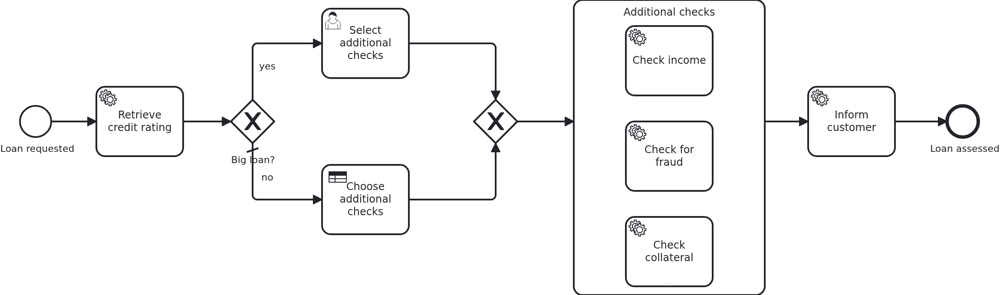

# Ad-hoc subprocesses

[](./LICENSE)

Every other BPMN (Business Process Model and Notation) blueprint shows a model which sets the
order and an application which answers. An ad-hoc subprocess turns that around. It holds
activities without sequence flows between them. Something outside the model decides which of
them run, while the workflow is already in front of them. This blueprint shows both halves. The
activities are ordinary tasks with ordinary methods behind them. And there are two ways the
choice arrives.

## What this blueprint shows



The loan approval of the base blueprint, with more checks after the scoring. Three checks are
drawn side by side inside the ad-hoc subprocess. A request runs the ones somebody picked:

- A big loan goes to a case worker. The user task reports its id, and the application keeps it.
  The answer through the API writes the picked element ids onto the workflow aggregate.
  VanillaBP hands the list to the BPMS (business process management system) while it completes
  the task. So the list is there when the workflow enters the subprocess.
- A decision table decides everything else. The cluster evaluates the DMN (Decision Model and
  Notation) deployed next to the BPMN file and writes its result into the same variable. Not a
  line of Java takes part on that path. That is the point of having both in one blueprint: the
  element does not know who picked.

The model reads one attribute, `activeElementsCollection`. It is a FEEL expression which names
the ids of the elements to activate. It is evaluated once, when the workflow enters the
element. There is no completion condition. So the workflow leaves the subprocess when
everything it activated is done, and the service task behind it runs.

Only what the model reads leaves the application. `Aggregate.java` is annotated
`@NoSyncWithBPMS`. The two attributes an expression looks at carry `@SyncWithBPMS`. One is the
amount, which the gateway compares and the decision table reads as its input. The other is the
list of element ids. What the checks wrote stays here, because no expression asks for it.

Two things are worth knowing before you copy this.

The BPMN element ids are a contract. The list names elements, not tasks. So the ids of the
three activities appear in the code and in the decision table. On the Java side they are
written down in one place, `Check.java`. On the model side the one place is
`loan_approval.dmn`.

The checks run at the same time, so two branches write the same workflow aggregate. That is why
the aggregate carries a version attribute. The collision then becomes an optimistic locking
exception which the BPMS retries, instead of a write which disappears without an error.
[`persistence-parallel-branches`](https://github.com/vanillabp-blueprints/persistence-parallel-branches-springboot)
shows the other ways to deal with two writers, and when each of them fits.

You will see that at work. When both checks reach the aggregate at the same time, one of them
loses. VanillaBP logs an ERROR which names the task and the workflow, and the BPMS retries it a
moment later. Nothing is lost. The version attribute buys you that retry. Without it the second
write would have overwritten the first, and nothing would have been logged at all. The Camunda
8 profile shortens the retry backoff, so that moment stays short. On Camunda 8 the three checks
also write `retries="3"` on their `zeebe:taskDefinition`. Without the attribute the adapter
gives a failed job no second attempt, and the losing check would end in an incident.

A third decision maker exists, and it is not shown here: a model provider can pick the
activities. It needs a connector runtime and an account with that provider. So this blueprint
stays with the two decision makers anybody can run. The adapter's
[wiki](https://github.com/camunda-community-hub/vanillabp-camunda8-adapter/wiki/Configuration#the-bpmn-model-for-camunda-8)
says what it does with such an element.

This blueprint runs on Camunda 8 only, because Camunda 7 does not execute an ad-hoc
subprocess.

## Delta to the base blueprint

Compared to [`module-single`](https://github.com/vanillabp-blueprints/module-single-springboot):

|            File            |                                                            What is different                                                            |
|----------------------------|-----------------------------------------------------------------------------------------------------------------------------------------|
| `loan_approval.bpmn`       | an ad-hoc subprocess holding three service tasks, a user task and a business rule task ahead of it, and a gateway choosing between them |
| `loan_approval.dmn`        | the decision table picking the checks for a request nobody has to look at                                                               |
| `model/Check.java`         | the three checks and the BPMN element id of each of them                                                                                |
| `model/Aggregate.java`     | `checksToRun`, the list the model reads, a version attribute, one flag per check, and the annotations which say what is shared          |
| `WorkflowTaskHandler.java` | one `@WorkflowTask` method per check, and none for the subprocess itself                                                                |
| `Service.java`             | the checks as business methods, and the two halves of the user task picking them                                                        |
| `Workflow.java`            | `completeUserTask` in addition to `startWorkflow`, and nothing about the subprocess                                                     |
| `ApiController.java`       | the URL picking the checks, carrying the task id and the names of the checks                                                            |
| `LoanApprovalIT.java`      | one test per decision maker: the case worker picks two of three, the decision table picks two of three                                  |
| `pom.xml`                  | one BPMS profile instead of two                                                                                                         |

## Running it

Requires a JDK 21 or newer and a Camunda 8 cluster, because Camunda 8 is a remote engine:

```bash
mvn install verify
```

The address of the cluster and everything else specific to that engine are in
`application/src/main/resources/application-camunda8.yaml`. The module's own test has a copy:

```yaml
vanillabp:
  adapters:
    camunda8:
      # Camunda 8 is a remote engine: point this at your cluster.
      rest-address: http://localhost:8080
      # Camunda 8.10 can lose a leased job for a whole job-timeout. Until Camunda fixes that,
      # the adapter advises against a lease. The key has no default:
      # https://github.com/camunda-community-hub/vanillabp-camunda8-adapter/wiki/Configuration#a-job-somebody-else-holds
      job-lease: do-not-use
```

The blueprint does not lease its jobs. On 8.10 the gateway of the cluster can lose a leased
job when a long poll ends, and the job then waits for a whole `job-timeout`. Until Camunda
fixes that, the adapter advises `do-not-use`, and moving to `use` later costs nothing. Why is
[decision 88 of the Camunda 8 adapter](https://github.com/camunda-community-hub/vanillabp-camunda8-adapter/blob/main/DECISIONS.md#88-until-camunda-fixes-its-gateway-the-adapter-advises-against-a-lease-and-its-own-tests-keep-one).

The file is loaded because the Maven profile `camunda8` sets the Spring profile of the same
name. It is the only profile of this blueprint, and it is active by default. So the build, the
tests and `spring-boot:run` all follow it, and nobody has to name an engine.

Start the application:

```bash
mvn -pl application spring-boot:run
```

You see nothing about identifiers at startup. The BPMS profile sets
`name-clash-avoidance: use-prefix`. So VanillaBP puts the workflow module ID in front of every
identifier before it reaches the engine, and takes it off again on the way back.
[The wiki](https://github.com/vanillabp/adapter-platform-integration/wiki/Workflow-modules#how-name-clashes-are-avoided)
explains the modes and what each of them costs. None of it touches the ids of the activities
inside the subprocess. That is why the list on the aggregate and the decision table can name
them.

Start a loan approval nobody has to look at. This is the only URL you need:

```
http://localhost:8080/api/loan-approval/start?amount=5000
```

The decision table picks, the two checks it picked run, and the process ends:

```
Loan approval '0f7c…' started
Credit rating of loan approval '0f7c…' is 50
Income of loan approval '0f7c…' was checked
Loan approval '0f7c…' was checked for fraud
The customer of loan approval '0f7c…' was informed
```

Ask for more than ten thousand and a case worker has to pick instead:

```
http://localhost:8080/api/loan-approval/start?amount=20000
```

The process stops at the user task. It logs one URL per combination somebody can pick, each one
filled in and ready to click:

```
Loan approval '3b1e…' waits for somebody to pick the additional checks. Continue with one of:
  income                    -> http://localhost:8080/api/loan-approval/3b1e…/select-checks/1a2b…?checks=income
  fraud                     -> http://localhost:8080/api/loan-approval/3b1e…/select-checks/1a2b…?checks=fraud
  collateral                -> http://localhost:8080/api/loan-approval/3b1e…/select-checks/1a2b…?checks=collateral
  income,fraud              -> http://localhost:8080/api/loan-approval/3b1e…/select-checks/1a2b…?checks=income,fraud
  income,collateral         -> http://localhost:8080/api/loan-approval/3b1e…/select-checks/1a2b…?checks=income,collateral
  fraud,collateral          -> http://localhost:8080/api/loan-approval/3b1e…/select-checks/1a2b…?checks=fraud,collateral
  income,fraud,collateral   -> http://localhost:8080/api/loan-approval/3b1e…/select-checks/1a2b…?checks=income,fraud,collateral
```

Opening one of them completes the user task, and the picked checks run. The ones nobody picked
stay untouched, although they are drawn in the model. If you open the same URL twice, the
answer is that this selection is not open any more. The application decides that on its own,
without asking the BPMS.

## How it works

|                                          File                                          |                                            Role                                            |
|----------------------------------------------------------------------------------------|--------------------------------------------------------------------------------------------|
| `loan-approval/src/main/resources/loan-approval/processes/camunda8/loan_approval.bpmn` | the ad-hoc subprocess, its `activeElementsCollection`, and the two ways the list is filled |
| `loan-approval/src/main/resources/loan-approval/processes/camunda8/loan_approval.dmn`  | the decision table, whose output column holds BPMN element ids                             |
| `.../loanapproval/model/Check.java`                                                    | the checks and their element ids, the contract between code and model                      |
| `.../loanapproval/model/Aggregate.java`                                                | `checksToRun`, the version attribute, what each check wrote, and which of it is shared     |
| `.../loanapproval/WorkflowTaskHandler.java`                                            | one `@WorkflowTask` method per check, and no method for the element itself                 |
| `.../loanapproval/Service.java`                                                        | the checks as business methods, and keeping the task id while somebody picks               |
| `.../loanapproval/Workflow.java`                                                       | `completeUserTask`, the only place `ProcessService` is used                                |
| `.../loanapproval/ApiController.java`                                                  | the GET endpoint carrying the task id and the names of the checks                          |
| `loan-approval/src/test/.../LoanApprovalIT.java`                                       | one test per decision maker. They wait for the aggregate instead of asking the engine      |

The order of events on the path where a person decides: the service task fills in the credit
rating. The gateway sends a big loan to the user task. VanillaBP calls
`WorkflowTaskHandler#selectChecks` with `TaskEvent.CREATED`. That method does not do the work.
It keeps the task's `@TaskId` on the aggregate. When the answer arrives through the API,
`Service#selectChecks` writes the picked element ids onto the aggregate. It tells `Workflow`
that the checks were selected. `Workflow#checksSelected` completes the user task in a
transaction. So the aggregate is saved along with the answer, and the list reaches the BPMS
with it.

On the other path none of this happens. The gateway sends the request to the business rule
task. The cluster evaluates the decision and writes its result into the process variable the
subprocess reads. The workflow enters the element, and nobody asked the application. So the
aggregate's own `checksToRun` stays empty there. The flags the checks wrote show what ran.

Either way the subprocess activates the elements the list names. Each of them is an ordinary
job, served by an ordinary `@WorkflowTask` method. Two of them run at once, which is why the
aggregate carries a version attribute. When they are done, the workflow leaves the element. The
service task behind it informs the customer, and the process ends.

The tests wait instead of asserting at once. A BPMS runs tasks in transactions of its own, and
a remote engine gets to a task a moment after the workflow was started. Asserting right away
would test the timing, not the application.

## Documentation

- [Workflow aggregates](https://github.com/vanillabp/adapter-platform-integration/wiki/Workflow-aggregates): how an aggregate says what is shared with the BPMS, which is how the list reaches the model
- [Two writers on one aggregate](https://github.com/vanillabp/adapter-platform-integration/wiki/Workflow-aggregates#two-writers-on-one-aggregate): why the aggregate carries a version attribute
- [User tasks](https://github.com/vanillabp/adapter-platform-integration/wiki/Workflow-tasks#user-tasks): the notification handler, the task id and completing the task later
- [Workflow tasks](https://github.com/vanillabp/adapter-platform-integration/wiki/Workflow-tasks): what a `@WorkflowTask` method is, which is all the activities inside the element need
- the wiki of the [BPMS adapter](https://github.com/vanillabp/adapter-platform-integration/wiki/BPMS-adapters) you use: which attribute of the model names the activities to run, and which flavours of the element it serves

This blueprint is developed in the monorepo
[`blueprints`](https://github.com/vanillabp-blueprints/blueprints). This repository is a
read-only mirror, **issues and pull requests belong there.**

## Noteworthy & Contributors

[VanillaBP](https://www.github.com/vanillabp/spi-for-java) was developed by [Phactum](https://www.phactum.at) with the
intention of giving back to the community as it has benefited the community in the past.


## License

Copyright 2026 Phactum Softwareentwicklung GmbH

Licensed under the Apache License, Version 2.0
