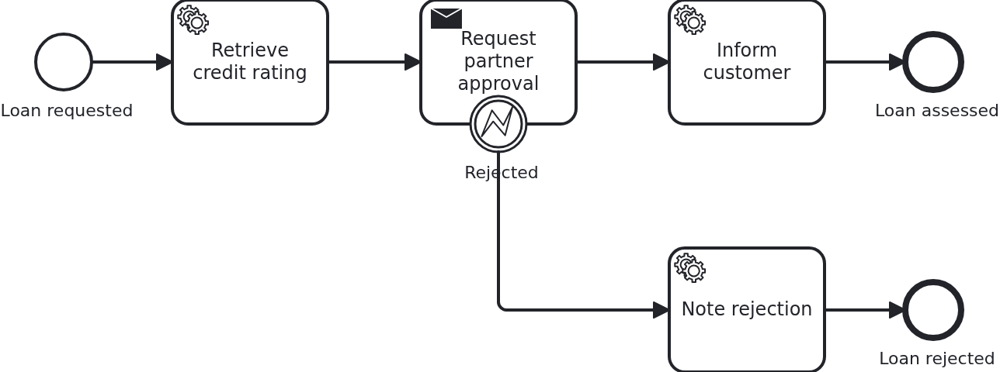

# Asynchronous tasks

[](./LICENSE)

Some work does not finish while the process asks for it. A partner gets a request and answers
minutes or days later, through a callback nobody waits for. This blueprint shows the task which
stays open in between: what the application has to keep, and how it later completes or cancels
the task.

## What this blueprint shows



The loan approval of the base blueprint, with a partner who has to approve the loan before the
customer is informed. Three things happen around that task:

- The task is delivered, and VanillaBP calls `WorkflowTaskHandler#requestPartnerApproval`. The
  method sends the request and stores the task's `@TaskId` on the workflow aggregate. Returning
  from it does **not** complete the task. That single parameter makes the difference. Without
  it, the very same method would complete the task by returning.
- The partner answers through the API, which calls `ProcessService#completeTask` with the
  stored id. The workflow leaves the task, and the service task behind it runs.
- Or the partner refuses. The application calls `cancelTask` with the error code
  `partner-rejected`. So the workflow leaves through the error boundary event instead.

If the workflow takes the task away, the same handler method is called a second time, now with
`@TaskEvent CANCELED`. It drops the stored id. A method without a `@TaskEvent` parameter never
learns about that. It would keep an id which nobody can answer any more.

Two more things are in this blueprint:

- `Service#requestPartnerApproval` returns early if the aggregate already holds a task id. A
  remote BPMS (business process management system) may deliver the same task twice. Asking a
  partner twice may open two cases on their side. The state of the aggregate decides whether
  something already happened, never a counter of calls.
- A task id reaches the application from outside. It may arrive twice, late, or for a task the
  workflow has taken away. `Service#openPartnerRequest` compares it with the one on the
  aggregate and refuses anything else, before the BPMS takes part.

It is worth knowing who guards which direction. Everything the application sends to the BPMS
goes through VanillaBP's transaction outbox. The outbox gives every operation a key, so a
repeated operation is noticed, and it dispatches each one at least once. Completing a task
twice does nothing except write a log line. The same is true when the answer of a partner
arrives twice. The other direction is the application's job. A BPMS may deliver the same task
again, and
[the wiki says so plainly](https://github.com/vanillabp/adapter-platform-integration/wiki/Workflow-tasks#what-happens-when-my-handler-throws).
Let the state of the aggregate decide, which is what the early return above does.

The difference to a user task is who answers, not how it works. The mechanics below are the
same. `bpmn-user-task` shows them for a person instead of a system.

## Delta to the base blueprint

Compared to [`module-single`](https://github.com/vanillabp-blueprints/module-single-springboot):

|               File                |                                        What is different                                         |
|-----------------------------------|--------------------------------------------------------------------------------------------------|
| `loan_approval.bpmn`              | a send task the workflow waits at, an error boundary event on it, and a service task per way out |
| `WorkflowTaskHandler.java`        | the `@WorkflowTask` method of that task, taking `@TaskId` and `@TaskEvent`                       |
| `Workflow.java`                   | `completeTask` and `cancelTask` in addition to `startWorkflow`                                   |
| `Service.java`                    | both halves of the task: sending the request, and answering it when the partner replies          |
| `PartnerApprovalClient.java`      | new: the port to the surrounding system, so a test can replace it                                |
| `LocalPartnerApprovalClient.java` | new: a stand-in partner, so the blueprint runs without one                                       |
| `ApiController.java`              | the callback carrying the partner's answer                                                       |
| `Aggregate.java`                  | `partnerApprovalTaskId` and what the process wrote on the way out                                |
| `LoanApprovalIT.java`             | one test per way the task ends: still open, completed, canceled                                  |

The one line worth looking at is `camunda:delegateExpression` in the Camunda 7 model. A task
which stays open needs it there. Camunda 8 needs nothing like it. The wiki of each adapter says
how that engine wants such a task modelled, for
[Camunda 7](https://github.com/camunda-community-hub/vanillabp-camunda7-adapter/wiki/Configuration#the-bpmn-model-for-camunda-7).

## Running it

Requires a JDK 21 or newer. Camunda 7 is embedded, so nothing else has to run:

```bash
mvn install verify
```

To run it on another BPMS, pick another Maven profile. Not one line of Java changes:

```bash
mvn install verify -Pcamunda8
```

Camunda 8 is a remote engine, so a cluster has to run. Start one. Its address and everything
else specific to that engine are in its profile file
`application/src/main/resources/application-camunda8.yaml`. The module's own test has a copy:

```yaml
vanillabp:
  adapters:
    camunda8:
      # Camunda 8 is a remote engine: point this at your cluster.
      rest-address: http://localhost:8080
      # Camunda 8.10 can lose a leased job for a whole job-timeout. Until Camunda fixes that,
      # the adapter advises against a lease. The key has no default:
      # https://github.com/camunda-community-hub/vanillabp-camunda8-adapter/wiki/Configuration#a-job-somebody-else-holds
      job-lease: do-not-use
```

The blueprint does not lease its jobs. On 8.10 the gateway of the cluster can lose a leased
job when a long poll ends, and the job then waits for a whole `job-timeout`. Until Camunda
fixes that, the adapter advises `do-not-use`, and moving to `use` later costs nothing. Why is
[decision 88 of the Camunda 8 adapter](https://github.com/camunda-community-hub/vanillabp-camunda8-adapter/blob/main/DECISIONS.md#88-until-camunda-fixes-its-gateway-the-adapter-advises-against-a-lease-and-its-own-tests-keep-one).

The file is loaded because the Maven profile `camunda8` sets the Spring profile of the same
name. So you choose the engine once, on the Maven command line. The build, the tests and
`spring-boot:run` all follow it.

[Operaton](https://operaton.org), the open source successor of Camunda 7, is embedded as well
and needs nothing else either. The BPMN files are the ones of Camunda 7, because Operaton reads
their `camunda:` attributes:

```bash
mvn install verify -Poperaton
```

[CIB seven](https://cibseven.org), a fork of Camunda 7 made by CIB software, is embedded as
well and needs nothing else either. The BPMN files are the ones of Camunda 7, because CIB seven
reads their `camunda:` attributes:

```bash
mvn install verify -Pcibseven
```

Start the application:

```bash
mvn -pl application spring-boot:run
```

You see nothing about identifiers at startup. The BPMS profiles of this blueprint set
`name-clash-avoidance: use-prefix`. So VanillaBP puts the workflow module ID in front of every
identifier before it reaches the engine, and takes it off again on the way back. The BPMN
files, the business code and the rest of the configuration keep the plain names. No tenant is
involved, which matters on a BPMS licensed per tenant.
[The wiki](https://github.com/vanillabp/adapter-platform-integration/wiki/Workflow-modules#how-name-clashes-are-avoided)
explains the modes and what each of them costs.

Start a loan approval. This is the only URL you need:

```
http://localhost:8080/api/loan-approval/start?amount=5000
```

The process runs up to the partner and stops there. It logs the two URLs the partner's answer
would arrive at, each one filled in and ready to click:

```
Loan approval '0f7c…' started
Credit rating of loan approval '0f7c…' is 50
Partner was asked to approve loan approval '0f7c…' (5000 at a rating of 50)
Loan approval '0f7c…' waits for the partner. Their answer arrives at one of:
  Approved -> http://localhost:8080/api/loan-approval/0f7c…/partner-decision/1a2b…?approved=true
  Rejected -> http://localhost:8080/api/loan-approval/0f7c…/partner-decision/1a2b…?approved=false
```

Opening the first one completes the task, and the process goes on to its end:

```
The partner approved loan approval '0f7c…'
The customer of loan approval '0f7c…' was informed
```

Opening the second one cancels it instead, and the workflow takes the error path:

```
The partner rejected loan approval '0f7c…'
The partner request of loan approval '0f7c…' was canceled
Loan approval '0f7c…' ended as rejected by the partner
```

The middle line is the cancellation. It arrives at the same handler method that sent the
request. If you open the same URL twice, the answer is that this request is not open any more.
The application decides that on its own, without asking the BPMS.

Camunda 7 serves its own web applications, and the `camunda7` profile of this blueprint
configures a user for them. They show the instance standing at the task which waits for the
partner, a view the logged URLs cannot give. Where they are served and how to log in is in the
[adapter's wiki](https://github.com/camunda-community-hub/vanillabp-camunda7-adapter/wiki/Cockpit-Tasklist-and-Admin).

## How it works

|                                          File                                          |                                                  Role                                                   |
|----------------------------------------------------------------------------------------|---------------------------------------------------------------------------------------------------------|
| `loan-approval/src/main/resources/loan-approval/processes/camunda7/loan_approval.bpmn` | the process: a send task that stays open, an error boundary event on it, and a service task per way out |
| `.../loanapproval/WorkflowTaskHandler.java`                                            | the `@WorkflowTask` method of that task: `@TaskId`, `@TaskEvent`, and no work of its own                |
| `.../loanapproval/Service.java`                                                        | both halves of the task: sending the request once, answering it when the partner replies                |
| `.../loanapproval/Workflow.java`                                                       | `completeTask` and `cancelTask`, the only place `ProcessService` is used                                |
| `.../loanapproval/PartnerApprovalClient.java`                                          | the port to the surrounding system, so a test can put a simulator in its place                          |
| `.../loanapproval/ApiController.java`                                                  | the callback the partner's answer arrives at                                                            |
| `.../loanapproval/model/Aggregate.java`                                                | `partnerApprovalTaskId`, the handle to the open task, plus what the process wrote                       |
| `loan-approval/src/test/.../LoanApprovalIT.java`                                       | one test per way the task ends. They wait for the aggregate instead of asking the engine                |

The order of events: the first service task fills in the credit rating. Then the BPMS delivers
the waiting task and calls `WorkflowTaskHandler#requestPartnerApproval` with
`TaskEvent.CREATED`. The handler hands over to `Service`, which sends the request and stores
the task id on the aggregate. VanillaBP saves the aggregate after the call, as for any other
task. The workflow now waits, and no thread of the application waits with it.

Whenever the answer arrives, `ApiController` calls `Service#partnerDecided`. It writes the
result and tells `Workflow` what happened. `completeTask` and `cancelTask` run in a
transaction. The aggregate is saved along with the answer. On a remote BPMS the completion is
sent only after that transaction committed. So a rollback leaves the task open, instead of
completing a task whose result was undone.

The tests wait instead of asserting at once. A BPMS runs tasks in transactions of its own, and
a remote one delivers a task a moment after the workflow was started. Asserting right away
would pass on an embedded engine and fail on a remote one.

## Documentation

- [Completing and canceling asynchronous tasks](https://github.com/vanillabp/adapter-platform-integration/wiki/Workflow-tasks#completing-and-canceling-asynchronous-tasks): the rules those two calls follow
- [Parameters](https://github.com/vanillabp/adapter-platform-integration/wiki/Workflow-tasks#parameters): `@TaskId`, `@TaskEvent` and everything else a handler may ask for
- [What happens when my handler throws?](https://github.com/vanillabp/adapter-platform-integration/wiki/Workflow-tasks#what-happens-when-my-handler-throws): why sending the request twice has to be prevented by the aggregate
- [User tasks and asynchronous tasks](https://github.com/vanillabp/spi-for-java#user-tasks-and-asynchronous-tasks): the annotations used in `WorkflowTaskHandler.java`
- the wiki of the [BPMS adapter](https://github.com/vanillabp/adapter-platform-integration/wiki/BPMS-adapters) you use: how a task has to be modelled so that it can stay open

This blueprint is developed in the monorepo
[`blueprints`](https://github.com/vanillabp-blueprints/blueprints). This repository is a
read-only mirror, **issues and pull requests belong there.**

## Noteworthy & Contributors

[VanillaBP](https://www.github.com/vanillabp/spi-for-java) was developed by [Phactum](https://www.phactum.at) with the
intention of giving back to the community as it has benefited the community in the past.


## License

Copyright 2026 Phactum Softwareentwicklung GmbH

Licensed under the Apache License, Version 2.0
