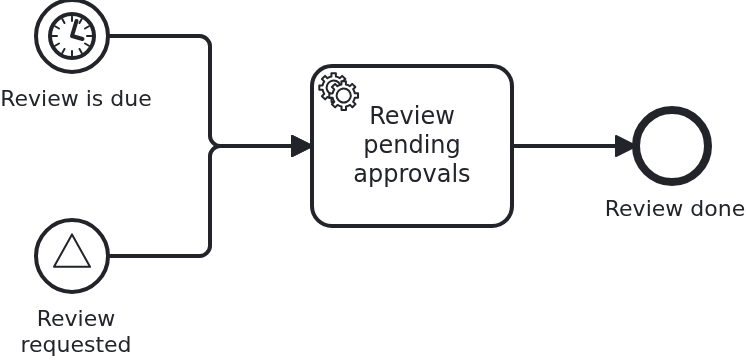

# Workflows the BPMS starts

[](./LICENSE)

Every other workflow begins with a call. The application has a business case, hands VanillaBP
its aggregate, and a workflow starts. Here nobody calls. A timer fires, or a broadcast signal
arrives, and the engine begins a process for which no data exists yet.

## What this blueprint shows



A second process next to the loan approval of the base blueprint: a review which looks at the
loan approvals collected so far. It has two start events, and no call can trigger either of
them.

- **There is no `startWorkflow`.** Look at `nightlyreview/Workflow.java`. The class which owns
  `ProcessService` for this workflow has no method which starts one, because there is nothing
  to start. That missing method is the blueprint.
- **You still build the aggregate.** A workflow needs one: tasks are routed by its ID, and
  expressions read its attributes. The application builds it, exactly as for a workflow it
  starts itself. `@WorkflowStartedByBpms` returns the aggregate. VanillaBP saves it before
  anything else of the process runs. No object of yours comes into existence without your code.
- **You name the workflow.** The ID of a workflow is the ID of its aggregate, and the method
  picks it. The BPMS (business process management system) learns it afterwards and holds it:
  Camunda 7 as the business key, Camunda 8 as a process variable. That is also why a repeated
  notification finds the aggregate instead of building a second one.

The method is **required** for this process. A timer or a signal may fire for it, and an
application without the method does not boot. The message names the process and the method to
write. You learn that while the models are deployed, not when the timer fires at three in the
morning.

The signal start event is the one place where the application has a say. It can broadcast
`ReviewRequested` and so ask for a review. But it still does not start one. A broadcast is a
name, and what listens for it is the engine's business. That is also why this blueprint
combines with
[`bpmn-signals`](https://github.com/vanillabp-blueprints/bpmn-signals-springboot). That one
shows the other half: a signal caught by workflows which already run.

Message start events are **not** part of this. The application triggers those through
`startWorkflowByMessage`, which carries your aggregate.
[`bpmn-message-start`](https://github.com/vanillabp-blueprints/bpmn-message-start-springboot)
shows them.

## Delta to the base blueprint

Compared to [`module-single`](https://github.com/vanillabp-blueprints/module-single-springboot):

|                   File                   |                                 What is different                                 |
|------------------------------------------|-----------------------------------------------------------------------------------|
| `nightly_review.bpmn`                    | a second process with a timer start event and a signal start event                |
| `nightlyreview/WorkflowTaskHandler.java` | `@WorkflowStartedByBpms` next to the ordinary `@WorkflowTask`                     |
| `nightlyreview/Service.java`             | builds the aggregate of a start nobody asked for, and names it                    |
| `nightlyreview/Workflow.java`            | `sendSignal` and, deliberately, no `startWorkflow`                                |
| `nightlyreview/model/Aggregate.java`     | the aggregate of a workflow nobody started, built by the application all the same |
| `NightlyReviewIT.java`                   | a test which cannot start anything and waits for an aggregate to appear           |

## Running it

Requires a JDK 21 or newer. Camunda 7 is embedded, so nothing else has to run:

```bash
mvn install verify
```

To run it on another BPMS, pick another Maven profile. Not one line of Java changes:

```bash
mvn install verify -Pcamunda8
```

Camunda 8 is a remote engine, so a cluster has to run. Start one. Its address and everything
else specific to that engine are in its profile file
`application/src/main/resources/application-camunda8.yaml`. The module's own test has a copy:

```yaml
vanillabp:
  adapters:
    camunda8:
      # Camunda 8 is a remote engine: point this at your cluster.
      rest-address: http://localhost:8080
      # Camunda 8.10 can lose a leased job for a whole job-timeout. Until Camunda fixes that,
      # the adapter advises against a lease. The key has no default:
      # https://github.com/camunda-community-hub/vanillabp-camunda8-adapter/wiki/Configuration#a-job-somebody-else-holds
      job-lease: do-not-use
```

The blueprint does not lease its jobs. On 8.10 the gateway of the cluster can lose a leased
job when a long poll ends, and the job then waits for a whole `job-timeout`. Until Camunda
fixes that, the adapter advises `do-not-use`, and moving to `use` later costs nothing. Why is
[decision 88 of the Camunda 8 adapter](https://github.com/camunda-community-hub/vanillabp-camunda8-adapter/blob/main/DECISIONS.md#88-until-camunda-fixes-its-gateway-the-adapter-advises-against-a-lease-and-its-own-tests-keep-one).

The file is loaded because the Maven profile `camunda8` sets the Spring profile of the same
name. So you choose the engine once, on the Maven command line. The build, the tests and
`spring-boot:run` all follow it.

[Operaton](https://operaton.org), the open source successor of Camunda 7, is embedded as well
and needs nothing else either. The BPMN files are the ones of Camunda 7, because Operaton reads
their `camunda:` attributes:

```bash
mvn install verify -Poperaton
```

The Process-Engine-API adapter cannot run this blueprint, and it says so instead of starting
badly. That API never reports a start the application did not ask for. So deploying such a
process fails with a message which names the element.

Start the application:

```bash
mvn -pl application spring-boot:run
```

You see nothing about identifiers at startup. The BPMS profiles of this blueprint set
`name-clash-avoidance: use-prefix`. So VanillaBP puts the workflow module ID in front of every
identifier before it reaches the engine, and takes it off again on the way back. The BPMN
files, the business code and the rest of the configuration keep the plain names. No tenant is
involved, which matters on a BPMS licensed per tenant.
[The wiki](https://github.com/vanillabp/adapter-platform-integration/wiki/Workflow-modules#how-name-clashes-are-avoided)
explains the modes and what each of them costs.

Then do nothing. Five seconds after the model was deployed the timer fires, and a workflow
exists which nobody asked for:

```
A nightly review 'a41f…' was started by the BPMS: TIMER, from start event 'StartEvent_ScheduledReview'. Nobody called startWorkflow
The nightly review 'a41f…' looked at 0 loan approval(s) at 2026-08-14T09:12:31.884Z
```

The reviews are listed at

```
http://localhost:8080/api/nightly-review
```

To ask for one instead of waiting, broadcast the signal:

```
http://localhost:8080/api/nightly-review/request
```

```
A review was requested. Whether one starts is the engine's decision
A nightly review '7c02…' was started by the BPMS: SIGNAL, from start event 'StartEvent_ReviewRequested'. Nobody called startWorkflow
```

The loan approval of the base blueprint is still there, started the ordinary way. It gives the
review something to count:

```
http://localhost:8080/api/loan-approval/start?amount=5000
```

Camunda 7 serves its own web applications, and the `camunda7` profile of this blueprint
configures a user for them. They show the review instances under the business key the
application chose while it built the aggregate, and that key is the ID of the review. Where
they are served and how to log in is in the
[adapter's wiki](https://github.com/camunda-community-hub/vanillabp-camunda7-adapter/wiki/Cockpit-Tasklist-and-Admin).

## How it works

|                            File                            |                                   Role                                   |
|------------------------------------------------------------|--------------------------------------------------------------------------|
| `.../loan-approval/processes/camunda7/nightly_review.bpmn` | the process: a timer start event, a signal start event, one service task |
| `.../nightlyreview/WorkflowTaskHandler.java`               | `@WorkflowStartedByBpms`, the hook into a start nobody triggered         |
| `.../nightlyreview/Service.java`                           | builds and names the aggregate. It has no way to start a review          |
| `.../nightlyreview/Workflow.java`                          | `sendSignal` for asking, and no `startWorkflow` at all                   |
| `.../nightlyreview/model/Aggregate.java`                   | the aggregate the application builds for a start it did not ask for      |
| `loan-approval/src/test/.../NightlyReviewIT.java`          | waits for a workflow to appear, because it cannot start one              |

The order of events: the model is deployed while the application boots. The engine schedules
the timer, and five seconds later it fires. VanillaBP is notified and opens a transaction. It
calls the `@WorkflowStartedByBpms` method, takes the aggregate it returns and saves it. Only
then does the process go on to its service task, which is an ordinary `@WorkflowTask`. From
there on nothing about this workflow is special.

### The trigger says what fired, not when

`BpmsStartTrigger` carries the kind of the start event, the BPMN ID of the event which fired,
and for a signal its name. It carries no time. No BPMS tells a start listener the moment it
scheduled the start for, so an adapter would have to invent one.

Where the moment matters, the model writes it. The service task of this process fills a
variable of its own by an expression: `${now().toInstant().toString()}` on Camunda 7,
`=string(now())` on Camunda 8. `reviewPendingApprovals` reads it as a `@TaskParam`:

```java
@WorkflowTask
public void reviewPendingApprovals(final Aggregate review, @TaskParam("reviewedAt") final String reviewedAt) {
```

It arrives as a text, and the aggregate keeps it as one. The expression language decides what a
moment looks like. Camunda 7 writes `2026-08-14T09:12:31.884Z`, Camunda 8 writes
`2026-08-14T09:12:31.884@GMT`. Because the two differ, VanillaBP hands out no time of its own.

The two engines arrange that differently, and it is worth knowing which part is theirs. Camunda
7 runs an execution listener on the start event inside its own transaction. So the aggregate
and the process instance commit together, and the aggregate's ID becomes the instance's
business key. On Camunda 8 VanillaBP adds an execution listener. Its job asks your method for
the aggregate and writes its ID into the instance. The listener holds the workflow back, so
nothing runs before the aggregate exists.

The test is the unusual part. It has no call to make. So it waits for an aggregate with the
expected trigger kind to appear. For the signal it broadcasts in a poll loop, not once. A
signal is not buffered, and a subscription which is a moment late gets nothing.

## Documentation

- [Starting workflows](https://github.com/vanillabp/adapter-platform-integration/wiki/Starting-workflows): the whole picture, including which ID the aggregate gets and what each BPMS supports
- [Workflow aggregates](https://github.com/vanillabp/adapter-platform-integration/wiki/Workflow-aggregates): why the aggregate has to exist before the process runs
- [Workflow tasks](https://github.com/vanillabp/adapter-platform-integration/wiki/Workflow-tasks): the ordinary half of the wiring, unchanged here
- the wiki of the [BPMS adapter](https://github.com/vanillabp/adapter-platform-integration/wiki/BPMS-adapters) you use: what its engine does with a start event nobody triggered

This blueprint is developed in the monorepo
[`blueprints`](https://github.com/vanillabp-blueprints/blueprints). This repository is a
read-only mirror, **issues and pull requests belong there.**

## Noteworthy & Contributors

[VanillaBP](https://www.github.com/vanillabp/spi-for-java) was developed by [Phactum](https://www.phactum.at) with the
intention of giving back to the community as it has benefited the community in the past.


## License

Copyright 2026 Phactum Softwareentwicklung GmbH

Licensed under the Apache License, Version 2.0
