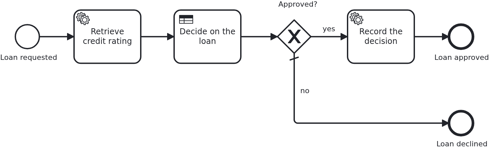

# Business rule task

[](./LICENSE)

A decision does not have to be Java. This blueprint takes the base blueprint and lets a DMN
(Decision Model and Notation) decision table decide whether a loan is approved. The table is
deployed with the process, and the BPMS (business process management system) evaluates it. Its
decision steers the model and reaches the application.

## What this blueprint shows



The loan approval of the base blueprint, with a business rule task after the service task. The
service task rates the request. The decision table turns the amount and that rating into an
approval. Its result is used twice: the gateway routes on it, and the task behind the gateway
hands it to the application.

What is worth looking at:

- The decision table lives next to the BPMN files, in `processes/<adapter-id>/`, and the boot
  deploys it with them. Nothing deploys it separately, and no property switches it on. It is
  specific to the adapter for the same reason a BPMN file is: how a business rule task names
  its decision is the engine's business.
- **No `@WorkflowTask` method serves the business rule task.** The engine evaluates the table.
  VanillaBP knows that and does not ask for a handler. For this one BPMN task type, the check
  of the wiring stays silent on purpose.
- **A decision table reads what the BPMS holds.** The aggregate is annotated `@NoSyncWithBPMS`,
  so nothing is shared by default. The two attributes the inputs of the table name, `amount`
  and `creditRating`, carry `@SyncWithBPMS`. An input whose attribute is not shared reads
  nothing, and its rule never matches. So look at this first when a table gets a new input.
- The result of the decision is a variable of the workflow, so reading it needs nothing new.
  The task's input mapping brings it into the task's scope, and `@TaskParam` names it
  (`WorkflowTaskHandler.recordDecision`). Not one line of Java in this blueprint is specific to
  DMN.
- **A decision can also work without any Java.** The gateway behind the business rule task
  reads the result straight from the workflow. The declined branch ends the process, and the
  application does not hear about it. `LoanApprovalIT` runs both outcomes. The declined one
  asserts that the aggregate stays untouched.
- The rules themselves are in a place where a business person can read them. To change when a
  loan is approved, change `loan_approval.dmn`, not the application.
- The workflow module is a JAR of its own (`loan-approval/`) and cannot be started alone. It
  declares itself by the marker file `META-INF/workflow-module`, which contains its ID.
- Everything it owns is named after that ID. Workflow modules are not isolated by classloaders.
  They share one classpath. So each module needs a namespace of its own in two places: a unique
  Java package (`blueprint.workflowmodule.loanapproval`) and a single resource subdirectory
  (`src/main/resources/loan-approval/`) which holds *all* of its resources. The marker file is
  the one exception. It has to be in `META-INF/`.
- It knows no BPMS. Its only VanillaBP dependency is `vanillabp-spring-boot-support`, which
  exposes no engine API on purpose. The adapter is a dependency of the application
  (`application/`). BPMN files are the only thing that differs between engines. That is why
  they are in `processes/<adapter-id>/`.
- It brings its own configuration. `loan-approval/loan-approval.yaml` inside the module is
  loaded automatically and wins over `application.yaml`. So the configuration a module needs
  stays with the module and is not spread across the project.
- One class per direction of the BPMN wiring. `Service` is the business code and never touches
  VanillaBP. `Workflow` is what the application tells the process and the only place
  `ProcessService` is injected. `WorkflowTaskHandler` is what the process tells the
  application. It carries `@WorkflowService` and every `@WorkflowTask` method, and it calls
  `Service`. Here each of them forwards a single line, and that is exactly why it is worth
  seeing. The shape stays the same once a process needs to correlate messages or complete
  tasks. And it keeps the two beans from depending on each other.
- It is tested on its own. The integration test is in the workflow module and brings a minimal
  application with it. The application only has a smoke test.

There is no `vanillabp.*` property anywhere. With one adapter on the classpath and one workflow
module, VanillaBP finds the adapter, the module and the location of the BPMN files by
convention.

## Delta to the base blueprint

Compared to [`module-single`](https://github.com/vanillabp-blueprints/module-single-springboot):

|            File            |                                           What is different                                           |
|----------------------------|-------------------------------------------------------------------------------------------------------|
| `loan_approval.dmn`        | new: the decision table, one per adapter id, deployed with the process by the boot                    |
| `loan_approval.bpmn`       | a business rule task calling that decision, a gateway routing on its result, and a second end event   |
| `Aggregate.java`           | `approval`, what the decision decided, and the annotations which share what the table reads           |
| `Service.java`             | keeps that result, and rates a request the other way round: the bigger the loan, the lower the rating |
| `WorkflowTaskHandler.java` | a `@WorkflowTask` method reading the result through `@TaskParam`                                      |
| `LoanApprovalIT.java`      | one test per outcome of the table, steered by the amount                                              |

The decision table differs between the two BPMS in the same way the BPMN does, and for the same
reason. How a business rule task names its decision is the engine's business
(`camunda:decisionRef` against `zeebe:calledDecision`). So is the language a rule is written
in. Not one line of Java knows about either. Nothing in the blueprint deploys the table,
because the boot deploys a module's DMN files with its processes.

## Running it

Requires a JDK 21 or newer. Camunda 7 is embedded, so nothing else has to run:

```bash
mvn install verify
```

To run it on another BPMS, pick another Maven profile. Not one line of Java changes:

```bash
mvn install verify -Pcamunda8
```

Camunda 8 is a remote engine, so a cluster has to run. Start one. Its address and everything
else specific to that engine are in its profile file
`application/src/main/resources/application-camunda8.yaml`. The module's own test has a copy:

```yaml
vanillabp:
  adapters:
    camunda8:
      # Camunda 8 is a remote engine: point this at your cluster.
      rest-address: http://localhost:8080
      # Camunda 8.10 can lose a leased job for a whole job-timeout. Until Camunda fixes that,
      # the adapter advises against a lease. The key has no default:
      # https://github.com/camunda-community-hub/vanillabp-camunda8-adapter/wiki/Configuration#a-job-somebody-else-holds
      job-lease: do-not-use
```

The blueprint does not lease its jobs. On 8.10 the gateway of the cluster can lose a leased
job when a long poll ends, and the job then waits for a whole `job-timeout`. Until Camunda
fixes that, the adapter advises `do-not-use`, and moving to `use` later costs nothing. Why is
[decision 88 of the Camunda 8 adapter](https://github.com/camunda-community-hub/vanillabp-camunda8-adapter/blob/main/DECISIONS.md#88-until-camunda-fixes-its-gateway-the-adapter-advises-against-a-lease-and-its-own-tests-keep-one).

The file is loaded because the Maven profile `camunda8` sets the Spring profile of the same
name. So you choose the engine once, on the Maven command line. The build, the tests and
`spring-boot:run` all follow it.

[Operaton](https://operaton.org), the open source successor of Camunda 7, is embedded as well
and needs nothing else either. The BPMN files are the ones of Camunda 7, because Operaton reads
their `camunda:` attributes:

```bash
mvn install verify -Poperaton
```

Without it the application does not boot. This is the normal way to work with VanillaBP: it
checks the configuration while it boots, and the message names the property to set.

Start the application:

```bash
mvn -pl application spring-boot:run
```

You see nothing about identifiers at startup. The BPMS profiles of this blueprint set
`name-clash-avoidance: use-prefix`. So VanillaBP puts the workflow module ID in front of every
identifier before it reaches the engine, and takes it off again on the way back. The BPMN
files, the business code and the rest of the configuration keep the plain names. No tenant is
involved, which matters on a BPMS licensed per tenant.
[The wiki](https://github.com/vanillabp/adapter-platform-integration/wiki/Workflow-modules#how-name-clashes-are-avoided)
explains the modes and what each of them costs.

Start a loan approval. This is the only URL you need:

```
http://localhost:8080/api/loan-approval/start?amount=2000
```

It answers with the ID of the loan request and logs the URL which shows the result:

```
Loan approval '0f7c…' started
Credit rating of loan approval '0f7c…' is 8
Loan approval '0f7c…' was decided: APPROVED
Show the result -> http://localhost:8080/api/loan-approval/0f7c…
```

Opening that URL shows the aggregate, including what the decision table decided.

Ask for more money, and the same table declines it. The log does not report that at all. The
declined branch of the gateway ends the process without calling the application:

```
http://localhost:8080/api/loan-approval/start?amount=9000
```

Camunda 7 serves its own web applications, and the `camunda7` profile of this blueprint
configures a user for them. The
[adapter's wiki](https://github.com/camunda-community-hub/vanillabp-camunda7-adapter/wiki/Cockpit-Tasklist-and-Admin)
says where they are served and how to log in.

## How it works

|                                          File                                          |                                                                  Role                                                                   |
|----------------------------------------------------------------------------------------|-----------------------------------------------------------------------------------------------------------------------------------------|
| `loan-approval/src/main/resources/META-INF/workflow-module`                            | contains `loan-approval`, which makes this JAR a workflow module                                                                        |
| `loan-approval/src/main/resources/loan-approval/processes/camunda7/loan_approval.bpmn` | the process: a service task for the rating, a business rule task, a gateway on its result, and a service task which records an approval |
| `loan-approval/src/main/resources/loan-approval/processes/camunda7/loan_approval.dmn`  | the decision table `loan_decision` which the business rule task evaluates                                                               |
| `.../loanapproval/model/Aggregate.java`                                                | the workflow aggregate, a normal JPA entity keyed by the loan request ID. It shares the two attributes the table reads                  |
| `.../loanapproval/Service.java`                                                        | the business code: builds the aggregate and tells `Workflow` that somebody requested a loan                                             |
| `.../loanapproval/Workflow.java`                                                       | what the application tells the process; the only class using `ProcessService`                                                           |
| `.../loanapproval/WorkflowTaskHandler.java`                                            | what the process tells the application: `@WorkflowService`, `@WorkflowTask`, calls `Service`                                            |
| `.../loanapproval/ApiController.java`                                                  | the GET endpoints operating the process                                                                                                 |
| `.../loanapproval/config/LoanApprovalProperties.java`                                  | the module's own configuration                                                                                                          |
| `application/.../Application.java`                                                     | the Spring Boot application; its package is the parent of the module's, so scanning finds everything                                    |
| `loan-approval/src/test/.../LoanApprovalIT.java`                                       | starts a real workflow and waits for the aggregate to have been filled                                                                  |
| `loan-approval/src/test/.../WorkflowModuleTest.java`                                   | its base class: boots the module and waits for the workflow to make progress. The same in every blueprint                               |
| `application/src/test/.../ApplicationSmokeTest.java`                                   | boots the application, which is where VanillaBP validates that every BPMN task is wired to code                                         |

The order of events: `ApiController` calls `Service#request`. That method builds the aggregate
and tells `Workflow` what happened, namely `loanRequested`, not "start the process".
`Workflow#loanRequested` calls `ProcessService#startWorkflow`. VanillaBP stores the aggregate
and starts the process in the same transaction, so you never get an aggregate without a
workflow, or the other way round. The BPMS then reaches the service task and calls
`WorkflowTaskHandler#retrieveCreditRating`. That method only hands over to
`Service#assessCreditRating`. VanillaBP loads the aggregate before the call and saves it after.
VanillaBP shares what the annotations allow when it saves. That is why the decision table finds
the amount and the rating when the engine evaluates it a moment later. This happens in a
transaction VanillaBP owns, so neither of the two classes declares one of its own. Only the
method the API calls does, because starting a workflow has to run in a transaction. If you put
`@Transactional` on a task handler anyway, the boot fails with a message naming the method. If
you put it on a bean the handler calls, the task fails while it runs. So VanillaBP enforces
this rule, and you do not have to remember it.

The test waits instead of asserting at once, and that is on purpose. A BPMS runs tasks in its
own transactions, and a remote one runs them some time later. A test which assumes otherwise
passes on one engine and fails on the next.

## Documentation

- [Workflow modules](https://github.com/vanillabp/adapter-platform-integration/wiki/Workflow-modules): what a workflow module is, its ID, and where its BPMN files are looked for
- [Defining a workflow module](https://github.com/vanillabp/adapter-platform-integration/wiki/Workflow-modules-in-Spring-Boot#defining-a-workflow-module): the marker file, resource conventions and the module's own configuration files
- [How name clashes are avoided](https://github.com/vanillabp/adapter-platform-integration/wiki/Workflow-modules#how-name-clashes-are-avoided): the modes keeping two workflow modules apart, and what each of them costs
- [Workflow aggregates](https://github.com/vanillabp/adapter-platform-integration/wiki/Workflow-aggregates): why there are no process variables
- [Sharing workflow-aggregate data](https://github.com/vanillabp/adapter-platform-integration/wiki/Workflow-aggregates#fine-grained-control-over-attributes-synchronized-to-the-bpms): `@SyncWithBPMS`, `@NoSyncWithBPMS`, and what a BPMS gets to see
- [Wire up a process / Wire up a task](https://github.com/vanillabp/spi-for-java#usage): the annotations used in `WorkflowTaskHandler.java`
- the wiki of the [BPMS adapter](https://github.com/vanillabp/adapter-platform-integration/wiki/BPMS-adapters) you use: how a BPMN task has to be modelled for that engine

This blueprint is developed in the monorepo
[`blueprints`](https://github.com/vanillabp-blueprints/blueprints). This repository is a
read-only mirror, **issues and pull requests belong there.**

## Noteworthy & Contributors

[VanillaBP](https://www.github.com/vanillabp/spi-for-java) was developed by [Phactum](https://www.phactum.at) with the
intention of giving back to the community as it has benefited the community in the past.


## License

Copyright 2026 Phactum Softwareentwicklung GmbH

Licensed under the Apache License, Version 2.0
