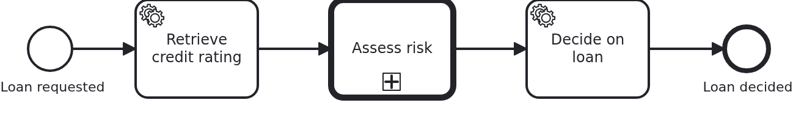
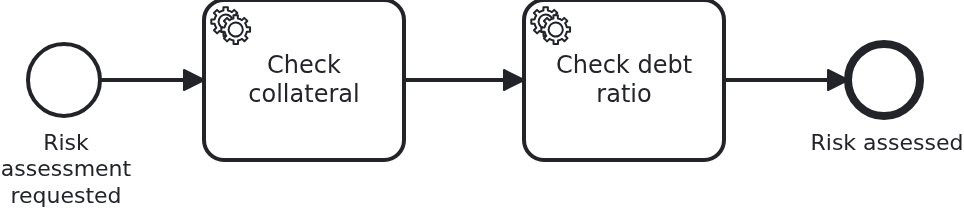

# Call activities to reduce complexity

[](./LICENSE)

A process grows until its diagram no longer fits on a screen. A call activity is the way out. A
section of the model moves into a process of its own, and the calling process points at it.
This blueprint shows what that costs in code, which is nothing. It also shows the one thing the
model has to carry, so that both process instances stay one business case.

## What this blueprint shows





The loan approval of the base blueprint, with the risk assessment moved out. The calling
process rates the request, hands over to `risk_assessment`, and decides once it comes back. The
called process does the two checks the decision needs.

The BPMS (business process management system) runs a call activity, not your code. There is no
`@WorkflowTask` method for it and no `ProcessService` call. The engine starts an instance of
the called process, waits for it to end, and then moves the calling token on. Splitting a model
this way changes only the BPMN.

Both processes work on one workflow aggregate. Whatever a split-off section does could just as
well be drawn into the calling model. So it is the same business case, and there is nothing to
copy or keep in sync. `checkCollateral` and `checkDebtRatio` write onto the loan approval.
`decideOnLoan` reads what they wrote, as if it had all happened in one diagram.

One annotation wires the tasks of both processes:

```java
@WorkflowService(
    workflowAggregateClass = Aggregate.class,
    bpmnProcess = @BpmnProcess(bpmnProcessId = "loan_approval"),
    secondaryBpmnProcesses = @BpmnProcess(bpmnProcessId = "risk_assessment"))
```

`secondaryBpmnProcesses` names every process except the one the application starts. Put called
processes there, not into a handler class of their own. VanillaBP builds one `ProcessService`
per workflow aggregate class. With a second workflow service class on the same aggregate,
`startWorkflow` starts the process of whichever class the classpath scan found first. That can
be the called process, and nothing says so. The workflow runs, the wrong half of the model
runs, and the aggregate ends up half filled.

The call activity carries no input mapping. That is worth a sentence, because it used to need
one. VanillaBP finds the workflow aggregate of a task by the handle the engine keeps on the
process instance. A called instance is a new one, and it does not get that handle by itself.
Which handle it is depends on the engine. So the adapter ties the two instances together, not
the model. On Camunda 7 the business key carries the aggregate's ID, and VanillaBP passes it on
while deploying. On Camunda 8 the ID travels as a process variable, and
`propagateAllParentVariables` is the engine's default.

So the model says nothing about identity on either engine, and that is what a blueprint should
show. The difference between the two engines is what the adapter does, not what you have to
write.

That ID is also the only part of the aggregate the BPMS gets to see. `Aggregate` carries
`@NoSyncWithBPMS`, and not one attribute carries `@SyncWithBPMS`. No expression of either model
reads an attribute. The call activity maps nothing in and nothing back, and none of the
sequence flows has a condition. A split model does not need the data, it needs the handle.

Splitting a large model into parts is one of the two reasons to split a model, and the only one
a call activity is for. A process used by several different parent processes would need a
workflow aggregate of its own. VanillaBP answers that case differently. Model the other process
as a collapsed pool and start it from a service task. Then the two stay separate business cases
with separate data. The
[SPI documentation](https://github.com/vanillabp/spi-for-java#call-activities) puts both
situations side by side.

## Delta to the base blueprint

Compared to [`module-single`](https://github.com/vanillabp-blueprints/module-single-springboot):

|            File            |                                                   What is different                                                    |
|----------------------------|------------------------------------------------------------------------------------------------------------------------|
| `loan_approval.bpmn`       | a call activity pointing at `risk_assessment`, and a task after it using the result                                    |
| `risk_assessment.bpmn`     | new: the called process, two service tasks between a plain start and end event                                         |
| `WorkflowTaskHandler.java` | `secondaryBpmnProcesses` names the called process; its tasks are methods like any other                                |
| `Aggregate.java`           | what the called process writes, the decision made from it, and `@NoSyncWithBPMS` on the class                          |
| `Service.java`             | the two checks of the risk assessment and the decision after it                                                        |
| `loan-approval.yaml`       | the two numbers the checks and the decision use                                                                        |
| `LoanApprovalIT.java`      | asserts across the call activity: the calling process is started, and the result of the called one is on the aggregate |

Both BPMN files are in the same directory of the workflow module and are deployed together. A
called process belongs to the module which owns it. It is not a module of its own.

## Running it

Requires a JDK 21 or newer. Camunda 7 is embedded, so nothing else has to run:

```bash
mvn install verify
```

To run it on another BPMS, pick another Maven profile. Not one line of Java changes:

```bash
mvn install verify -Pcamunda8
```

Camunda 8 is a remote engine, so a cluster has to run. Start one. Its address and everything
else specific to that engine are in its profile file
`application/src/main/resources/application-camunda8.yaml`. The module's own test has a copy:

```yaml
vanillabp:
  adapters:
    camunda8:
      # Camunda 8 is a remote engine: point this at your cluster.
      rest-address: http://localhost:8080
      # This adapter leases the jobs it holds, so the cluster takes the answer of the current
      # activation only. The key has no default, because a lease cannot be taken back. This is
      # the value the adapter recommends:
      # https://github.com/camunda-community-hub/vanillabp-camunda8-adapter/wiki/Configuration#a-job-somebody-else-holds
      job-lease: use
```

The file is loaded because the Maven profile `camunda8` sets the Spring profile of the same
name. So you choose the engine once, on the Maven command line. The build, the tests and
`spring-boot:run` all follow it.

Start the application:

```bash
mvn -pl application spring-boot:run
```

You see nothing about identifiers at startup. The BPMS profiles of this blueprint set
`name-clash-avoidance: use-prefix`. So VanillaBP puts the workflow module ID in front of every
identifier before it reaches the engine, and takes it off again on the way back. The BPMN
files, the business code and the rest of the configuration keep the plain names. No tenant is
involved, which matters on a BPMS licensed per tenant.
[The wiki](https://github.com/vanillabp/adapter-platform-integration/wiki/Workflow-modules#how-name-clashes-are-avoided)
explains the modes and what each of them costs.

This is the URL that starts a loan approval:

```
http://localhost:8080/api/loan-approval/start?amount=5000
```

The log shows the calling and the called process working on one loan approval. Nothing marks
the border between them:

```
Loan approval '4d0e…' started
Credit rating of loan approval '4d0e…' is 50
Collateral of loan approval '4d0e…' is worth 3000
Debt ratio of loan approval '4d0e…' is 10%
Loan approval '4d0e…' was approved (rating 50, debt ratio 10%, collateral 3000)
```

An amount of 30000 gets just as good a rating, but takes the debt ratio past the configured
maximum. The calling process makes that decision from what the called one found:

```
Loan approval '92a5…' was rejected (rating 100, debt ratio 60%, collateral 18000)
```

The result of a run is at

```
http://localhost:8080/api/loan-approval/{loanRequestId}
```

Both numbers the checks use are in the module's own configuration
(`loan-approval/src/main/resources/loan-approval/loan-approval.yaml`).

Camunda 7 serves its own web applications, and the `camunda7` profile of this blueprint
configures a user for them. They are worth a look for a call activity: the calling instance
stands in it while a second instance runs the called process, and the two are linked in both
directions. Where they are served and how to log in is in the
[adapter's wiki](https://github.com/camunda-community-hub/vanillabp-camunda7-adapter/wiki/Cockpit-Tasklist-and-Admin).

## How it works

|                                             File                                             |                                                    Role                                                    |
|----------------------------------------------------------------------------------------------|------------------------------------------------------------------------------------------------------------|
| `loan-approval/src/main/resources/loan-approval/processes/<adapter-id>/loan_approval.bpmn`   | the calling process: the call activity and the task using its result                                       |
| `loan-approval/src/main/resources/loan-approval/processes/<adapter-id>/risk_assessment.bpmn` | the called process, started by nobody but the call activity                                                |
| `.../loanapproval/WorkflowTaskHandler.java`                                                  | the tasks of both processes, wired by one `@WorkflowService`                                               |
| `.../loanapproval/Service.java`                                                              | the business code, which does not know that two processes are involved                                     |
| `.../loanapproval/model/Aggregate.java`                                                      | the one aggregate, `@NoSyncWithBPMS` on it, and a comment per attribute which says which process writes it |
| `loan-approval/src/test/.../LoanApprovalIT.java`                                             | starts the calling process and waits for the decision, across the call activity                            |

The order of events: `retrieveCreditRating` runs in the calling process. The engine starts
`risk_assessment` and passes the aggregate's ID along. The two checks of the called process run
as ordinary workflow tasks. The called process ends, the call activity completes, and
`decideOnLoan` reads the result. Every one of those tasks is a transaction of its own. The
aggregate is loaded and saved around each of them.

Nothing in the business code says which process it serves. That property is worth keeping. A
section moved into a called process today can move back into the calling model tomorrow, and
only the BPMN files change.

## Documentation

- [Call activities](https://github.com/vanillabp/spi-for-java#call-activities): decomposition and reuse, and why they are modelled differently
- [Wire up a process](https://github.com/vanillabp/spi-for-java#wire-up-a-process): `@WorkflowService`, `@BpmnProcess` and what `secondaryBpmnProcesses` is for
- [Workflow aggregates](https://github.com/vanillabp/adapter-platform-integration/wiki/Workflow-aggregates): one aggregate per business case, and why there are no process variables
- [Sharing workflow-aggregate data](https://github.com/vanillabp/adapter-platform-integration/wiki/Workflow-aggregates#fine-grained-control-over-attributes-synchronized-to-the-bpms): `@SyncWithBPMS`, `@NoSyncWithBPMS`, and what a BPMS gets to see
- [Digging into call activities](https://github.com/vanillabp/adapter-platform-integration/wiki/Viewing-workflows#digging-into-call-activities): following a workflow across a call activity
- the wiki of the [BPMS adapter](https://github.com/vanillabp/adapter-platform-integration/wiki/BPMS-adapters) you use: how that engine identifies a called process instance

This blueprint is developed in the monorepo
[`blueprints`](https://github.com/vanillabp-blueprints/blueprints). This repository is a
read-only mirror, **issues and pull requests belong there.**

## Noteworthy & Contributors

[VanillaBP](https://www.github.com/vanillabp/spi-for-java) was developed by [Phactum](https://www.phactum.at) with the
intention of giving back to the community as it has benefited the community in the past.


## License

Copyright 2026 Phactum Softwareentwicklung GmbH

Licensed under the Apache License, Version 2.0
