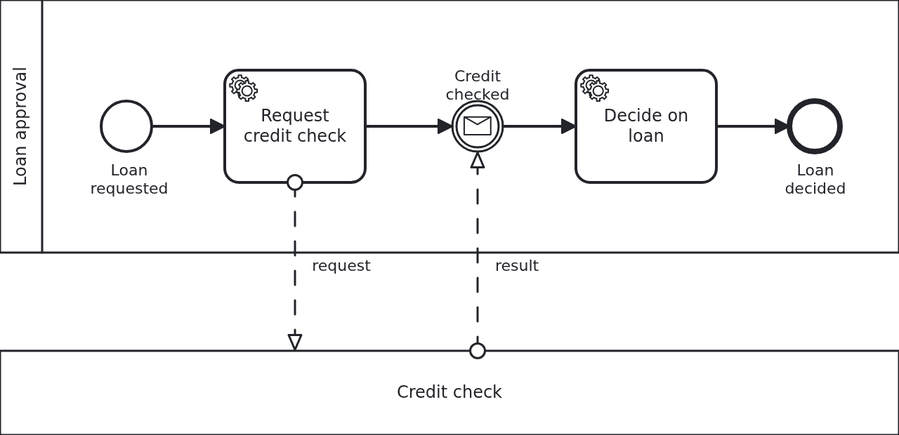
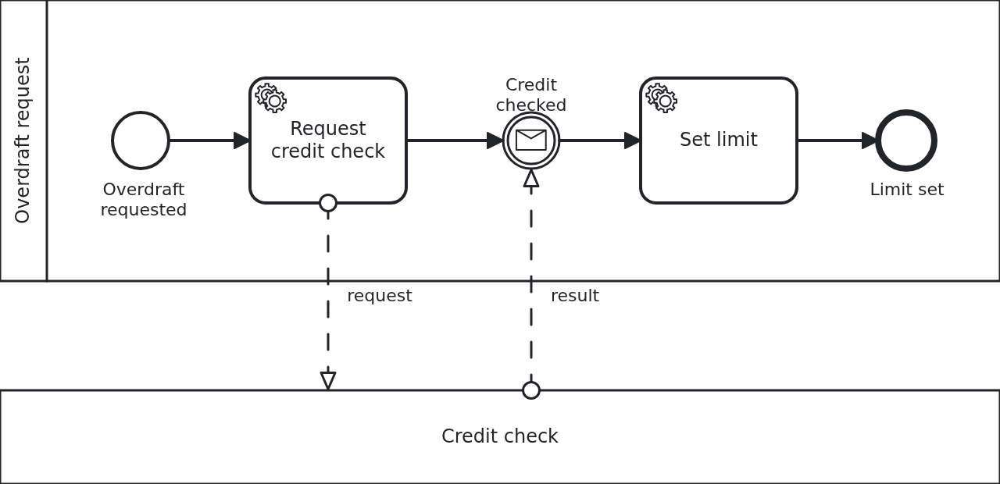
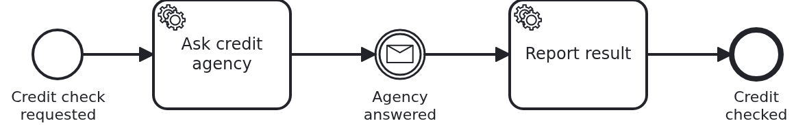

# A called process reused by several processes

[](./LICENSE)

Some sections of a process are needed by other processes as well. A credit check is one. A loan
approval needs it, and so does an overdraft on a current account. A call activity does not fit
here, because a called process shares the workflow aggregate of its caller. A section several
processes use runs in several contexts, so it needs a workflow aggregate of its own. This
blueprint shows how such a process is started, and how its result goes back to the process which
asked.

## What this blueprint shows







Three processes in one workflow module. The loan approval and the overdraft request both need a
credit check. Each of them asks for one and waits for the result, and each uses the score in its
own way. The loan approval is approved or rejected. The overdraft gets the share of the
requested limit which the score says.

- **The credit check is a collapsed pool, not a call activity.** In both calling models it is a
  pool with no content. Two message flows show what goes over and what comes back. The engine
  ignores pools and message flows. They are there for the reader of the model.
- **A service task starts it.** *Request credit check* is an ordinary service task. Its handler
  calls `CreditChecks#request`, which starts the credit check with `startWorkflow`. That
  happens in the transaction of the task. So the caller and the credit check are committed
  together, or not at all.
- **The credit check has a workflow aggregate of its own,** and a workflow service of its own.
  It keeps who asked and for which case, as two strings. It does not know what a loan approval
  or an overdraft is.
- **The result comes back as a message.** The last task of the credit check, *Report result*,
  publishes a `CreditChecked` event. Each caller has a `CreditCheckedListener`. The listener
  writes the score onto its own aggregate and correlates the message `CreditChecked`, which its
  process waits for. A listener ignores the results other processes asked for.

The credit check has its own wait state. It asks a credit agency and waits for the answer. That
is what makes the blueprint usable in a browser: you play the agency. It also means that the
caller always waits at its message event before the result comes. The credit check can never
answer before somebody listens.

The two contracts of the credit check are in its own package, `creditcheck`:

```java
public interface CreditChecks {
  String request(String requestedBy, String caseId, int amount);
}

public record CreditChecked(String requestedBy, String caseId, int score) {}
```

The request is a method call, and the result is an event. If the credit check called its users
back, it would have to know each of them, and every new user would change it. Now a third
process could use it, and the credit check would not change.

Why not a call activity? A called process works on the aggregate of its caller. That is right
for a section of one process, which
[`bpmn-call-activity-decomposition`](https://github.com/vanillabp-blueprints/bpmn-call-activity-decomposition-quarkus)
shows. Here the credit check would have to work on a loan approval in one case and on an
overdraft in the other. The
[SPI documentation](https://github.com/vanillabp/spi-for-java/wiki/Call-activities#reuse-a-call-activity-runs-a-section-other-processes-use-too)
puts both cases side by side.

All three processes are in one workflow module. If the credit check belonged to another team and
module, the same idea crosses the border between modules, which
[`module-interaction`](https://github.com/vanillabp-blueprints/module-interaction-quarkus)
shows.

## Delta to the base blueprint

Compared to [`module-single`](https://github.com/vanillabp-blueprints/module-single-quarkus):

|                        File                         |                                                                                                                      What is different                                                                                                                      |
|-----------------------------------------------------|-------------------------------------------------------------------------------------------------------------------------------------------------------------------------------------------------------------------------------------------------------------|
| `loan_approval.bpmn`                                | a service task which asks for the credit check, the collapsed pool, and a message event for the result                                                                                                                                                      |
| `overdraft_request.bpmn`                            | new: the second process which uses the credit check, modelled the same way                                                                                                                                                                                  |
| `credit_check.bpmn`                                 | new: the reused process. It asks the agency, waits for the answer and reports the result                                                                                                                                                                    |
| `creditcheck/...`                                   | new: the reused process in a package of its own. `CreditChecks` and `CreditChecked` are how other processes use it. `Service` starts it, takes the answer of the agency and publishes the result. `model/Aggregate.java` keeps who asked and for which case |
| `overdraft/...`                                     | new: the second caller, in the same structure as the loan approval                                                                                                                                                                                          |
| `CreditCheckedListener.java`                        | new, once per caller: takes the result, ignores the results of others, and hands it to `Service`                                                                                                                                                            |
| `Service.java`                                      | asks for the credit check, writes the score onto the aggregate, correlates, and decides                                                                                                                                                                     |
| `Workflow.java`                                     | `correlateMessage` for the result, plus the message name as a constant                                                                                                                                                                                      |
| `WorkflowTaskHandler.java`                          | the tasks `requestCreditCheck` and `decideOnLoan`                                                                                                                                                                                                           |
| `model/Aggregate.java`                              | `creditCheckId`, `creditScore` and `approved`, an entity name of its own, and `@NoSyncWithBPMS`                                                                                                                                                             |
| `loan-approval.yaml`, `LoanApprovalProperties.java` | the lowest score for which a loan is approved                                                                                                                                                                                                               |
| `loan-approval/openapi/overdraft.yaml`              | new: the API of the overdraft request                                                                                                                                                                                                                       |
| `loan-approval/openapi/credit-check.yaml`           | new: the URL at which the agency answers                                                                                                                                                                                                                    |
| `loan-approval/pom.xml`                             | generates the interfaces of the two new OpenAPI files as well                                                                                                                                                                                               |
| `LoanApprovalIT.java`, `OverdraftRequestIT.java`    | each caller waits, gets its result and goes on                                                                                                                                                                                                              |
| `CreditCheckIT.java`                                | two callers at the same time get their own results, and an answer which arrives twice changes nothing                                                                                                                                                       |

## Running it

Requires a JDK 21 or newer. Camunda 7 is embedded, so nothing else has to run:

```bash
mvn install verify
```

To run it on another BPMS, pick another Maven profile. Not one line of Java changes:

```bash
mvn install verify -Pcamunda8
```

Camunda 8 is a remote engine, so a cluster has to run, and the adapter has to be able to search
it. That needs secondary storage configured, and credentials which may read it. Correlating
finds the workflow by the process variable which holds the aggregate's ID, and that is a
search. On a cluster which refuses a search, the workflow module does not deploy, and the
message says which of the two is missing.

Start one. Its address and everything else specific to that engine are in its profile file
`application/src/main/resources/application-camunda8.yaml`. The module's own test has a copy:

```yaml
vanillabp:
  adapters:
    camunda8:
      # Camunda 8 is a remote engine: point this at your cluster.
      rest-address: http://localhost:8080
      # With a lease, the cluster takes the answer of the current activation only. The key
      # has no default. The 8.8 and 8.9 lines accept it and do nothing. On an 8.10 cluster
      # older than 8.10.10, a leased job can wait a whole job-timeout for nobody, and the
      # adapter warns at startup. Choose 'do-not-use' there. The cluster never takes a
      # lease off a job again. The wiki says why:
      # https://github.com/vanillabp/camunda8-adapter/wiki/Configuration#a-job-somebody-else-holds
      job-lease: use
```

The blueprint leases its jobs. With a lease, the cluster takes the answer of the current
activation only, so a run whose lock ran out cannot overwrite what a newer run wrote. On an 8.10
cluster older than 8.10.10, a leased job can wait a whole `job-timeout` for nobody. The adapter
then warns at startup, so choose `do-not-use` there. The cluster never takes a lease off a job
again. The
[wiki of the Camunda 8 adapter](https://github.com/vanillabp/camunda8-adapter/wiki/Configuration#a-job-somebody-else-holds) explains why.

The file is loaded because the Maven profile `camunda8` makes the config profile of the same
name the parent of the profile the application runs in. So you choose the engine once, on the
Maven command line. The build, the tests and `quarkus:dev` all follow it.

[Operaton](https://operaton.org), the open source successor of Camunda 7, is embedded as well
and needs nothing else either. The BPMN files are the ones of Camunda 7, because Operaton reads
their `camunda:` attributes:

```bash
mvn install verify -Poperaton
```

[CIB seven](https://cibseven.org), a fork of Camunda 7 made by CIB software, is embedded as
well and needs nothing else either. The BPMN files are the ones of Camunda 7, because CIB seven
reads their `camunda:` attributes:

```bash
mvn install verify -Pcibseven
```

Start the application:

```bash
mvn -pl application quarkus:dev
```

`quarkus:dev` opens a debug port, 5005. If a second application runs in dev mode on the same
machine, both want that port. Start the second one with `-Ddebug=false`, or give it a port of
its own with `-Ddebug=5006`.

You see nothing about identifiers at startup. The BPMS profiles of this blueprint set
`name-clash-avoidance: use-prefix`. So VanillaBP puts the workflow module ID in front of every
identifier before it reaches the engine, and takes it off again on the way back. The BPMN
files, the business code and the rest of the configuration keep the plain names. No tenant is
involved, which matters on a BPMS licensed per tenant.
[The wiki](https://github.com/vanillabp/adapter-platform-integration/wiki/Workflow-modules#how-name-clashes-are-avoided)
explains the modes and what each of them costs.

Start a loan approval:

```
http://localhost:8080/loan-approval/api/start?amount=5000
```

Or start an overdraft request. It uses the same credit check:

```
http://localhost:8080/loan-approval/api/overdrafts/start?limit=1000
```

The process asks for a credit check and waits. The credit check asks the agency and logs the URL
at which the agency answers:

```
Credit check '7a1e…' started for loan-approval '0f7c…'
Loan approval '0f7c…' waits for credit check '7a1e…'
Loan approval '0f7c…' started
Credit check '7a1e…' waits for the agency:
  Answer -> http://localhost:8080/loan-approval/api/credit-checks/7a1e…/agency-answered?score=70
```

Opening it lets the credit check go on. It reports the result, and the loan approval decides:

```
The agency gave credit check '7a1e…' a score of 70
The credit check of loan approval '0f7c…' reported a score of 70
Credit check '7a1e…' reported a score of 70 to loan-approval '0f7c…'
Loan approval '0f7c…' is approved
```

On an embedded engine the lines may come in another order, because the next process runs in
the same thread. If you open the same URL a second time, the answer is that the agency
answered already. The application decides that before it asks the BPMS.

## How it works

|                                          File                                          |                                             Role                                              |
|----------------------------------------------------------------------------------------|-----------------------------------------------------------------------------------------------|
| `loan-approval/src/main/resources/loan-approval/processes/camunda7/loan_approval.bpmn` | the first caller: the service task, the collapsed pool, and the message event `CreditChecked` |
| `.../processes/camunda7/overdraft_request.bpmn`                                        | the second caller, modelled the same way                                                      |
| `.../processes/camunda7/credit_check.bpmn`                                             | the reused process, with a workflow aggregate of its own                                      |
| `.../loanapproval/creditcheck/CreditChecks.java`                                       | how a caller asks. `Service` of the credit check implements it                                |
| `.../loanapproval/creditcheck/Service.java`                                            | starts the credit check, takes the answer of the agency, publishes `CreditChecked`            |
| `.../loanapproval/CreditCheckedListener.java`                                          | the loan approval takes its result. The overdraft request has one of its own                  |
| `.../loanapproval/Service.java`                                                        | asks for the credit check, writes the score onto the aggregate, correlates, decides           |
| `loan-approval/src/test/.../CreditCheckIT.java`                                        | two callers at the same time, each gets its own result                                        |

The order of events, for the loan approval:

1. The loan approval reaches *Request credit check*. `Service#requestCreditCheck` calls
   `CreditChecks#request`. That builds the aggregate of the credit check and starts its
   workflow. The loan approval keeps the id of the credit check and moves on to the message
   event, where it waits.
2. The credit check reaches *Ask credit agency* and waits for the answer. The answer arrives at
   the API, and `Service#agencyAnswered` writes the score onto the aggregate of the credit check
   and correlates `AgencyAnswered`.
3. The credit check reaches *Report result*. `Service#reportResult` publishes `CreditChecked`
   with the id of the loan approval and the score. The event is delivered at once, in the
   transaction of the task.
4. `CreditCheckedListener` of the loan approval takes it. `Service#creditChecked` writes the
   score onto the loan approval and correlates `CreditChecked`. The listener of the overdraft
   request ignores it, because the loan approval asked.
5. The loan approval reaches *Decide on loan*, which reads the score from its own aggregate.

The score travels twice, and both times through an aggregate. The agency's answer goes onto the
credit check before its message is correlated. The result goes onto the loan approval before its
message is correlated. The BPMS only learns the names of the messages. All three aggregates carry
`@NoSyncWithBPMS`.

Both callers wait for a message of the same name, `CreditChecked`. That is fine. VanillaBP
correlates by the aggregate's id, and each process waits in its own workflow. The two processes
also both have a task `requestCreditCheck`. VanillaBP wires a task by its process, so the two
handlers never mix up.

A test which lets the agency answer right after the start retries while the BPMS does not know
the credit check yet. A remote engine finds a workflow from an index it fills in the
background. An embedded engine answers at once, and the loop runs once.

## Documentation

- [Call activities](https://github.com/vanillabp/spi-for-java/wiki/Call-activities#reuse-a-call-activity-runs-a-section-other-processes-use-too): reuse compared to decomposition
- [Message correlation](https://github.com/vanillabp/adapter-platform-integration/wiki/Message-correlation): the API, how the workflow is found, correlation ids and idempotency
- [Workflow aggregates](https://github.com/vanillabp/adapter-platform-integration/wiki/Workflow-aggregates): why the result belongs there and not in the BPMS
- [Starting a workflow](https://github.com/vanillabp/spi-for-java/wiki/Starting-and-ending-workflows): `startWorkflow`, which starts the credit check

This blueprint is developed in the monorepo
[`blueprints`](https://github.com/vanillabp-blueprints/blueprints). This repository is a
read-only mirror, **issues and pull requests belong there.**

## Noteworthy & Contributors

[VanillaBP](https://www.github.com/vanillabp/spi-for-java) was developed by [Phactum](https://www.phactum.at) with the
intention of giving back to the community as it has benefited the community in the past.


## License

Copyright 2026 Phactum Softwareentwicklung GmbH

Licensed under the Apache License, Version 2.0
