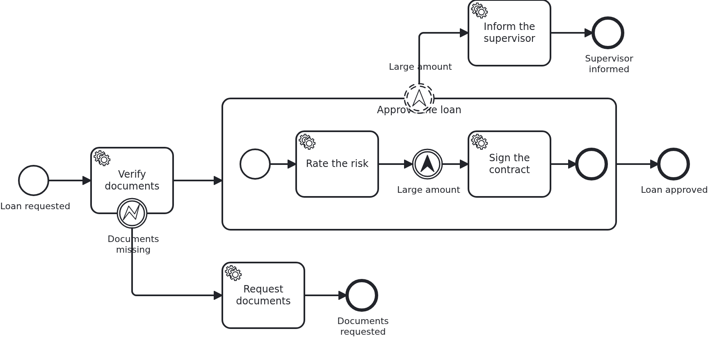

# Errors and escalations

[](./LICENSE)

BPMN (Business Process Model and Notation) has two ways of saying that something went
differently than planned, and you cannot swap one for the other. An error says "this activity
cannot be completed". An escalation says "somebody should know, and work goes on". This
blueprint has one of each in the same process.

## What this blueprint shows



Two ways out of the ordinary path:

- **The error comes from business code.** `Service#verifyDocuments` throws
  `TaskException("documents-missing")` when the documents are incomplete. The task ends, and
  the interrupting error boundary event routes the workflow. Everything the handler wrote
  before throwing is committed. A BPMN error is a business outcome, not a failure. An error
  boundary event is always interrupting, because the activity could not be completed.
- **The escalation comes from the model.** Inside the subprocess an escalation throw event
  reports the large amount. A non-interrupting boundary event catches it. The supervisor is
  informed on a branch of its own, **while the subprocess goes on** and signs the contract. No
  line of Java knows that this happens.

That second point is worth saying clearly: **VanillaBP has no API for raising an escalation.**
`TaskException` maps to a BPMN error, and there is nothing like it for escalations. The model
decides whether something escalates, with a gateway which routes to a throw event where the
process needs it. Business code writes what it knows onto the aggregate. The model decides what
that means for the flow. The gateways blueprint shows the same split of work.

For the application, both branches are ordinary tasks. A task inside a subprocess is wired
exactly like one outside it. The branch behind the escalation is a task like any other. The
nesting and the event are the model's business.

## Delta to the base blueprint

Compared to [`module-single`](https://github.com/vanillabp-blueprints/module-single-quarkus):

|            File            |                                                     What is different                                                      |
|----------------------------|----------------------------------------------------------------------------------------------------------------------------|
| `loan_approval.bpmn`       | an error boundary event on the first task, and a subprocess which throws an escalation, caught by a non-interrupting event |
| `Service.java`             | throws `TaskException` for the error; one method per branch                                                                |
| `WorkflowTaskHandler.java` | a `@WorkflowTask` method per task, inside and outside the subprocess                                                       |
| `Aggregate.java`           | what each branch wrote, so the tests can tell the two ways out apart, plus `@DynamicUpdate`                                |
| `loan-approval.yaml`       | the amount below which the documents count as incomplete                                                                   |
| `LoanApprovalIT.java`      | one test per way out                                                                                                       |

## Running it

Requires a JDK 21 or newer. Camunda 7 is embedded, so nothing else has to run:

```bash
mvn install verify
```

To run it on another BPMS (business process management system), pick another Maven profile. Not
one line of Java changes:

```bash
mvn install verify -Pcamunda8
```

Camunda 8 is a remote engine, so a cluster has to run. Start one. Its address and everything
else specific to that engine are in its profile file
`application/src/main/resources/application-camunda8.yaml`. The module's own test has a copy:

```yaml
vanillabp:
  adapters:
    camunda8:
      # Camunda 8 is a remote engine: point this at your cluster.
      rest-address: http://localhost:8080
      # Camunda 8.10 can lose a leased job for a whole job-timeout. Until Camunda fixes that,
      # the adapter advises against a lease. The key has no default:
      # https://github.com/camunda-community-hub/vanillabp-camunda8-adapter/wiki/Configuration#a-job-somebody-else-holds
      job-lease: do-not-use
```

The blueprint does not lease its jobs. On 8.10 the gateway of the cluster can lose a leased
job when a long poll ends, and the job then waits for a whole `job-timeout`. Until Camunda
fixes that, the adapter advises `do-not-use`, and moving to `use` later costs nothing. Why is
[decision 88 of the Camunda 8 adapter](https://github.com/camunda-community-hub/vanillabp-camunda8-adapter/blob/main/DECISIONS.md#88-until-camunda-fixes-its-gateway-the-adapter-advises-against-a-lease-and-its-own-tests-keep-one).

The file is loaded because the Maven profile `camunda8` makes the config profile of the same
name the parent of the profile the application runs in. So you choose the engine once, on the
Maven command line. The build, the tests and `quarkus:dev` all follow it.

Take the address out and the application does not boot. This is the normal way to work with
VanillaBP: it checks the configuration while it boots, and the message names the property to
set.

[Operaton](https://operaton.org), the open source successor of Camunda 7, is embedded as well
and needs nothing else either. The BPMN files are the ones of Camunda 7, because Operaton reads
their `camunda:` attributes:

```bash
mvn install verify -Poperaton
```

[CIB seven](https://cibseven.org), a fork of Camunda 7 made by CIB software, is embedded as
well and needs nothing else either. The BPMN files are the ones of Camunda 7, because CIB seven
reads their `camunda:` attributes:

```bash
mvn install verify -Pcibseven
```

Start the application:

```bash
mvn -pl application quarkus:dev
```

You see nothing about identifiers at startup. The BPMS profiles of this blueprint set
`name-clash-avoidance: use-prefix`. So VanillaBP puts the workflow module ID in front of every
identifier before it reaches the engine, and takes it off again on the way back. The BPMN
files, the business code and the rest of the configuration keep the plain names. No tenant is
involved, which matters on a BPMS licensed per tenant.
[The wiki](https://github.com/vanillabp/adapter-platform-integration/wiki/Workflow-modules#how-name-clashes-are-avoided)
explains the modes and what each of them costs.

Start a loan approval. This is the only URL you need:

```
http://localhost:8080/api/loan-approval/start?amount=5000
```

The documents are complete, the subprocess runs, and next to it the escalation informs the
supervisor:

```
Loan approval '0f7c…' started
Credit rating of loan approval '0f7c…' is 50
The supervisor was informed about loan approval '0f7c…'
The contract of loan approval '0f7c…' was signed
```

Ask for less than the configured amount, and the documents count as incomplete. So the error
path is taken, and the workflow never enters the subprocess:

```
http://localhost:8080/api/loan-approval/start?amount=500
```

```
Loan approval '4b21…' has incomplete documents
Documents were requested for loan approval '4b21…'
```

## How it works

|                                          File                                          |                                                                 Role                                                                  |
|----------------------------------------------------------------------------------------|---------------------------------------------------------------------------------------------------------------------------------------|
| `loan-approval/src/main/resources/META-INF/workflow-module`                            | contains `loan-approval`, which makes this JAR a workflow module                                                                      |
| `loan-approval/src/main/resources/loan-approval/processes/camunda7/loan_approval.bpmn` | the process: a service task with an error boundary event, and a subprocess whose escalation a non-interrupting boundary event catches |
| `.../loanapproval/model/Aggregate.java`                                                | the workflow aggregate, a normal JPA entity keyed by the loan request ID                                                              |
| `.../loanapproval/Service.java`                                                        | the business code: builds the aggregate and tells `Workflow` that somebody requested a loan                                           |
| `.../loanapproval/Workflow.java`                                                       | what the application tells the process; the only class using `ProcessService`                                                         |
| `.../loanapproval/WorkflowTaskHandler.java`                                            | what the process tells the application: `@WorkflowService`, `@WorkflowTask`, calls `Service`                                          |
| `.../loanapproval/ApiController.java`                                                  | the GET endpoints operating the process                                                                                               |
| `.../loanapproval/config/LoanApprovalProperties.java`                                  | the module's own configuration                                                                                                        |
| `loan-approval/src/test/.../LoanApprovalIT.java`                                       | starts a real workflow and waits for the aggregate to have been filled                                                                |
| `loan-approval/src/test/.../WorkflowModuleTest.java`                                   | its base class: boots the module and waits for the workflow to make progress. The same in every blueprint                             |
| `application/src/test/.../ApplicationSmokeTest.java`                                   | boots the application, which is where VanillaBP validates that every BPMN task is wired to code                                       |

The order of events: `ApiController` calls `Service#request`. That method builds the aggregate
and tells `Workflow` what happened, namely `loanRequested`, not "start the process".
`Workflow#loanRequested` calls `ProcessService#startWorkflow`. VanillaBP stores the aggregate
and starts the process in the same transaction, so you never get an aggregate without a
workflow, or the other way round. The BPMS then reaches the first service task and calls
`WorkflowTaskHandler#verifyDocuments`. That method only hands over to `Service#verifyDocuments`,
and so does every other task method here. VanillaBP loads the aggregate before the call and
saves it after.
This happens in a transaction VanillaBP owns, so neither of the two classes declares one of its
own. Only the method the API calls does, because starting a workflow has to run in a
transaction. If you put `@Transactional` on a task handler anyway, the boot fails with a
message naming the method. If you put it on a bean the handler calls, the task fails while it
runs. So VanillaBP enforces this rule, and you do not have to remember it.

The test waits instead of asserting at once, and that is on purpose. A BPMS runs tasks in its
own transactions, and a remote one runs them some time later. A test which assumes otherwise
passes on one engine and fails on the next.

The escalation adds a token, and that has a consequence for the data, not for the model. The
branch behind the boundary event and the task after the throw event run at the same time, and
both save the aggregate. So `Aggregate` carries `@DynamicUpdate`. Without it every save writes
the whole row. The transaction which commits second puts back the values it read at its start,
and the other branch's write is gone. There is no exception and no log line. The process
behaves exactly as modelled, but the data does not. This cost a red CI job here before anybody
understood it. The framework describes the second writer and the ways to deal with it under
[Two writers on one aggregate](https://github.com/vanillabp/adapter-platform-integration/wiki/Workflow-aggregates#two-writers-on-one-aggregate).

Two branches which write the SAME attribute are a different problem, and no annotation solves
it. That needs a `@Version` column, or a model which keeps a branch's result in an entity of
its own.
[`persistence-parallel-branches`](https://github.com/vanillabp-blueprints/persistence-parallel-branches-quarkus)
shows that.

## Documentation

- [What happens when my handler throws?](https://github.com/vanillabp/adapter-platform-integration/wiki/Workflow-tasks#what-happens-when-my-handler-throws): the three outcomes, and why a `TaskException` commits
- [Defining a workflow module](https://github.com/vanillabp/adapter-platform-integration/wiki/Workflow-modules-in-Quarkus#defining-a-workflow-module): the marker file, resource conventions and the module's own configuration files
- [How name clashes are avoided](https://github.com/vanillabp/adapter-platform-integration/wiki/Workflow-modules#how-name-clashes-are-avoided): the modes keeping two workflow modules apart, and what each of them costs
- [Workflow aggregates](https://github.com/vanillabp/adapter-platform-integration/wiki/Workflow-aggregates): why there are no process variables
- [Wire up a process / Wire up a task](https://github.com/vanillabp/spi-for-java#usage): the annotations used in `WorkflowTaskHandler.java`
- the wiki of the [BPMS adapter](https://github.com/vanillabp/adapter-platform-integration/wiki/BPMS-adapters) you use: how a BPMN task has to be modelled for that engine

This blueprint is developed in the monorepo
[`blueprints`](https://github.com/vanillabp-blueprints/blueprints). This repository is a
read-only mirror, **issues and pull requests belong there.**

## Noteworthy & Contributors

[VanillaBP](https://www.github.com/vanillabp/spi-for-java) was developed by [Phactum](https://www.phactum.at) with the
intention of giving back to the community as it has benefited the community in the past.


## License

Copyright 2026 Phactum Softwareentwicklung GmbH

Licensed under the Apache License, Version 2.0
