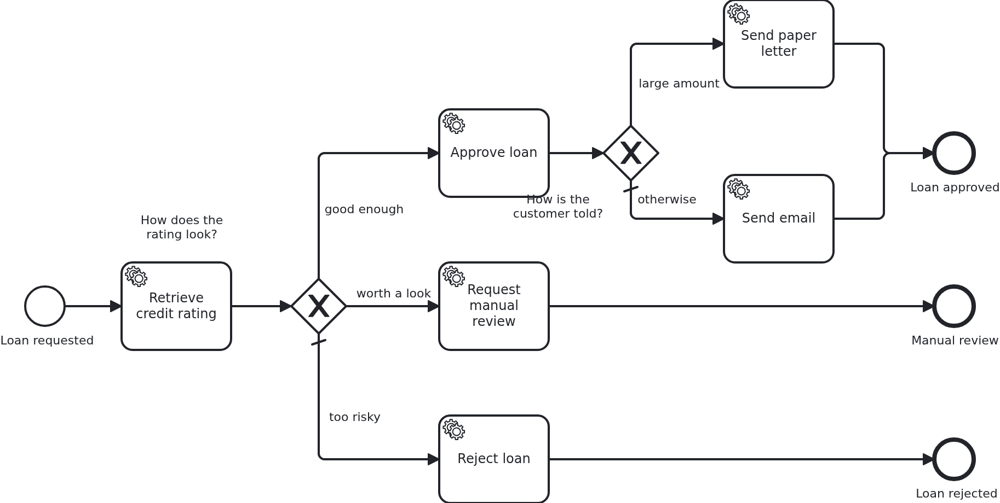

# Gateways

[](./LICENSE)

A process which always runs straight through does not need a diagram. This blueprint is about
the first fork. How does a gateway decide which way to go, when there are no process variables
to decide on?

## What this blueprint shows



The loan approval of the base blueprint, with two decisions in it. They are modelled
differently on purpose: **the first one the way VanillaBP recommends, the second one the way
most people write it first.** The point of this blueprint is to compare them.

**The first gateway asks the aggregate a question.** Its conditions are `${ratedAcceptable}`
and `${ratedForManualReview}`. Those are not attributes. They are getters, and the aggregate
answers them itself:

```java
public boolean isRatedAcceptable() { return "acceptable".equals(ratingBand); }
```

So the model knows the decisions of the process and nothing about the data behind them. The day
`ratingBand` becomes an enum, a number or three columns, this file stays as it is. So do the
workflows which already run, and that is the part which hurts otherwise. The wiki explains why
in detail under
[Decoupling BPMN from the data model](https://github.com/vanillabp/adapter-platform-integration/wiki/Workflow-aggregates#decoupling-bpmn-from-the-data-model).
It strongly recommends this technique.

**The second gateway reads a raw attribute**, `${amount >= 10000}`, and carries the threshold
itself. It works, it is shorter, and most diagrams look like this. You do not see what it costs
until the data model changes. The model now depends on `amount` being a number in that unit.
The day it becomes a `Money` with a currency, every workflow waiting at this gateway needs its
data migrated. The wiki calls that procedure error-prone and worth avoiding. **Do not copy that
one.** It is in here so that you recognize it, and the model says so in a comment.

Two rules hold for both of them:

**Conditions read the workflow aggregate.** VanillaBP has no process variables. So a condition
names something in a Java class you can open, with a type and a comment.

**Conditions must not overlap.** An earlier version of this blueprint routed on two booleans,
`riskAcceptable` and `worthAManualReview`. Both are true for a good rating. Camunda 7 then took
the first branch and Camunda 8 the second, and both were allowed to. Questions like "is this
rated acceptable?" and "is this rated for a manual review?" cannot both be true, because the
aggregate answers them from one value.

The last branch of each gateway is its **default flow**. It is taken when no condition is true.
It keeps a workflow from getting stuck at a gateway where it fits nowhere.

**The conditions decide what the BPMS (business process management system) must know.**
`Aggregate` is annotated `@NoSyncWithBPMS`, so nothing is shared by default. What a condition
reads carries `@SyncWithBPMS`. That is the two getters of the first gateway, and `amount`,
because the second gateway compares it in the model. The credit rating and the band behind the
answers never leave the application. That is the other cost of the second gateway. A raw
attribute read by a condition has to be shared. A question which the aggregate answers keeps
its data at home.

## Delta to the base blueprint

Compared to [`module-single`](https://github.com/vanillabp-blueprints/module-single-quarkus):

|            File            |                                            What is different                                            |
|----------------------------|---------------------------------------------------------------------------------------------------------|
| `loan_approval.bpmn`       | two exclusive gateways, each with a default flow: one asking the aggregate, one reading a raw attribute |
| `Aggregate.java`           | `ratingBand`, the two getters the first gateway asks, and the annotations which name what is shared     |
| `Service.java`             | turns the rating into a band, and one method per branch                                                 |
| `WorkflowTaskHandler.java` | a `@WorkflowTask` method per branch                                                                     |
| `loan-approval.yaml`       | the two thresholds the bands are derived from                                                           |
| `LoanApprovalIT.java`      | one test per branch, steered by the amount                                                              |

The conditions differ between the two BPMS, and this is the one place where they have to.
Camunda 7 evaluates `${ratedAcceptable}`, Camunda 8 the FEEL expression `=ratedAcceptable`.
Both ask the same aggregate the same question, and no line of Java knows about either. On a
remote engine the answer travels as a process variable. That is what `@SyncWithBPMS` on the
getters is for. The pattern costs nothing there either.

## Running it

Requires a JDK 21 or newer. Camunda 7 is embedded, so nothing else has to run:

```bash
mvn install verify
```

To run it on another BPMS, pick another Maven profile. Not one line of Java changes:

```bash
mvn install verify -Pcamunda8
```

Camunda 8 is a remote engine, so a cluster has to run. Start one. Its address and everything
else specific to that engine are in its profile file
`application/src/main/resources/application-camunda8.yaml`. The module's own test has a copy:

```yaml
vanillabp:
  adapters:
    camunda8:
      # Camunda 8 is a remote engine: point this at your cluster.
      rest-address: http://localhost:8080
      # This adapter leases the jobs it holds, so the cluster takes the answer of the current
      # activation only. The key has no default, because a lease cannot be taken back. This is
      # the value the adapter recommends:
      # https://github.com/camunda-community-hub/vanillabp-camunda8-adapter/wiki/Configuration#a-job-somebody-else-holds
      job-lease: use
```

The file is loaded because the Maven profile `camunda8` makes the config profile of the same
name the parent of the profile the application runs in. So you choose the engine once, on the
Maven command line. The build, the tests and `quarkus:dev` all follow it.

Start the application:

```bash
mvn -pl application quarkus:dev
```

You see nothing about identifiers at startup. The BPMS profiles of this blueprint set
`name-clash-avoidance: use-prefix`. So VanillaBP puts the workflow module ID in front of every
identifier before it reaches the engine, and takes it off again on the way back. The BPMN
files, the business code and the rest of the configuration keep the plain names. No tenant is
involved, which matters on a BPMS licensed per tenant.
[The wiki](https://github.com/vanillabp/adapter-platform-integration/wiki/Workflow-modules#how-name-clashes-are-avoided)
explains the modes and what each of them costs.

The amount decides which branch is taken. So this is the URL to play with:

```
http://localhost:8080/api/loan-approval/start?amount=5000
```

An amount of 5000 gives a rating of 50. That is at or above the configured minimum of 30. The
second gateway then decides how the customer hears about it:

```
Loan approval '0f7c…' started
Credit rating of loan approval '0f7c…' is 50, which counts as 'acceptable'
Loan approval '0f7c…' was approved
The customer of loan approval '0f7c…' gets an email
```

50000 is approved as well, but takes the other branch of the second gateway. That is the branch
whose condition compares the amount in the model:

```
Loan approval '3e5a…' was approved
The customer of loan approval '3e5a…' gets a paper letter
```

1500 gives a rating of 15. That is below the minimum, but a person should still look at it:

```
Credit rating of loan approval '4b21…' is 15, which counts as 'review'
Loan approval '4b21…' goes to a manual review
```

300 gives a rating of 3. It fits no condition, so the default flow is taken:

```
Credit rating of loan approval '9d02…' is 3, which counts as 'too-low'
Loan approval '9d02…' was rejected
```

Both thresholds are in the module's own configuration
(`loan-approval/src/main/resources/loan-approval/loan-approval.yaml`). Move them, and the same
amounts end up somewhere else. Nobody touches the model.

## How it works

|                                          File                                          |                                                    Role                                                     |
|----------------------------------------------------------------------------------------|-------------------------------------------------------------------------------------------------------------|
| `loan-approval/src/main/resources/loan-approval/processes/camunda7/loan_approval.bpmn` | the process: two exclusive gateways, one asking the aggregate and one reading a raw attribute               |
| `.../loanapproval/Service.java`                                                        | turns the rating into a band using the configured thresholds, and does the work of each branch              |
| `.../loanapproval/model/Aggregate.java`                                                | `ratingBand`, which the conditions read, `outcome`, which says where the workflow ended, and what is shared |
| `.../loanapproval/WorkflowTaskHandler.java`                                            | one `@WorkflowTask` method per branch, each of them forwarding to `Service`                                 |
| `loan-approval/src/main/resources/loan-approval/loan-approval.yaml`                    | the thresholds, which is where a number like "30" belongs                                                   |
| `loan-approval/src/test/.../LoanApprovalIT.java`                                       | one test per branch, each one steered by the amount alone                                                   |

The order of events: `Service#assessCreditRating` writes the rating and the band. VanillaBP
saves the aggregate when the task handler returns. Then the BPMS evaluates the conditions of
the gateway. On an embedded engine the condition reads the aggregate directly. On a remote one
it reads what VanillaBP shared with the cluster when the task was completed. The model shows
neither. That is why the same BPMN works on both, once the expression syntax matches the
engine.

A gateway needs nothing from the application except the attribute it reads. This blueprint has
no `ProcessService` call except the one which starts the workflow. No handler knows that a
gateway exists.

## Documentation

- [Decoupling BPMN from the data model](https://github.com/vanillabp/adapter-platform-integration/wiki/Workflow-aggregates#decoupling-bpmn-from-the-data-model): the pattern the first gateway follows, and what the second one costs
- [Workflow aggregates](https://github.com/vanillabp/adapter-platform-integration/wiki/Workflow-aggregates): why there are no process variables, and what a condition can read
- [Wire up an expression](https://github.com/vanillabp/spi-for-java#wire-up-an-expression): how an expression in the model reaches your data
- [Sharing workflow-aggregate data](https://github.com/vanillabp/adapter-platform-integration/wiki/Workflow-aggregates#fine-grained-control-over-attributes-synchronized-to-the-bpms): what a remote engine gets to see, and how to keep an attribute out of it
- the wiki of the [BPMS adapter](https://github.com/vanillabp/adapter-platform-integration/wiki/BPMS-adapters) you use: the expression language of that engine

This blueprint is developed in the monorepo
[`blueprints`](https://github.com/vanillabp-blueprints/blueprints). This repository is a
read-only mirror, **issues and pull requests belong there.**

## Noteworthy & Contributors

[VanillaBP](https://www.github.com/vanillabp/spi-for-java) was developed by [Phactum](https://www.phactum.at) with the
intention of giving back to the community as it has benefited the community in the past.


## License

Copyright 2026 Phactum Softwareentwicklung GmbH

Licensed under the Apache License, Version 2.0
