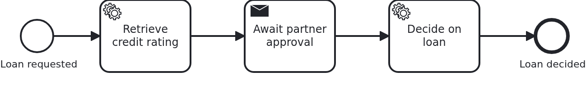

# Showing BPMN and execution history

[](./LICENSE)

Sooner or later somebody asks to see the process: the diagram, and on top of it what this one
case has done so far. This blueprint serves both from the application, through three methods
which only read and change nothing.

## What this blueprint shows



The loan approval of the base blueprint with one wait state added. So there is something to
look at while the workflow still runs. Three endpoints answer what a viewer needs:

```
GET /api/loan-approval/{id}/definitions   which process definitions this workflow uses
GET /api/loan-approval/{id}/diagram       the BPMN XML of one of them
GET /api/loan-approval/{id}/history       what this workflow has done, element by element
```

They map one to one onto `ProcessService#getProcessDefinitions`, `#getBpmnXml` and
`#getWorkflowHistory`. All three live in `Workflow.java` next to `startWorkflow`, because that
is the one class allowed to touch `ProcessService`. They are the only part of the SPI (service
provider interface) which changes nothing: no transaction, no progress, nothing stored.

**The element ids are the point.** A `WorkflowHistory` holds when the workflow started, when it
ended if it did, and its elements in the order they ran, with their start and end times. An
element which has started and not ended is where the workflow stands. A viewer like
[bpmn.io](https://bpmn.io/) colours it. Feed it the XML from `/diagram` and the ids from
`/history`, and the picture draws itself. This blueprint stops at the API, because a blueprint
should not teach a UI (user interface).

**A process definition id is opaque.** It looks like something you could take apart, and you
must not. VanillaBP puts the adapter which can resolve it in front of the BPMS' own id. A
workflow may run in any configured BPMS (business process management system), and `getBpmnXml`
has no aggregate to derive one from. Pass the id back exactly as it came.

**Not every BPMS records the same.** Some report every flow node, some only activities. A
remote engine reports with a delay, because an exporter feeds its history. The test of this
blueprint is written with that in mind. It waits for the history instead of asserting it right
away. It checks that the elements it drove through are in there, not that they are the only
ones.

**Ended workflows can be shown too**, as long as the BPMS still holds them. Once its history
retention cleaned up, `getWorkflowHistory` says so with a `WorkflowNotFoundException` which
tells you what to do, instead of an empty answer.

## Delta to the base blueprint

Compared to [`module-single`](https://github.com/vanillabp-blueprints/module-single-quarkus):

|            File            |                                       What is different                                        |
|----------------------------|------------------------------------------------------------------------------------------------|
| `loan_approval.bpmn`       | a task the workflow waits at, so a running workflow has something to show, and a task after it |
| `Workflow.java`            | the three viewer methods next to `startWorkflow` and `completeTask`                            |
| `Service.java`             | passes them through, and its log says where to look                                            |
| `ApiController.java`       | `/definitions`, `/diagram` and `/history`                                                      |
| `Aggregate.java`           | the id of the task the workflow waits at, so the wait can be answered                          |
| `WorkflowTaskHandler.java` | the `@TaskId` handler of that task                                                             |
| `LoanApprovalIT.java`      | asks what a viewer asks, while the workflow runs and after it ended                            |

The wait state is not the subject here. It exists because the history of a workflow which
finished in twenty milliseconds shows nothing worth looking at.
[`bpmn-async-task`](https://github.com/vanillabp-blueprints/bpmn-async-task-quarkus) shows how
an asynchronous task works.

## Running it

Requires a JDK 21 or newer. Camunda 7 is embedded, so nothing else has to run:

```bash
mvn install verify
```

To run it on another BPMS, pick another Maven profile. Not one line of Java changes:

```bash
mvn install verify -Pcamunda8
```

Camunda 8 is a remote engine, so a cluster has to run, and the adapter has to be able to search
it. That needs secondary storage configured, and credentials which may read it. The three
endpoints answer from the query API. On a cluster which refuses a search, the workflow module
does not deploy, and the message says which of the two is missing.

Start one. Its address and everything else specific to that engine are in its profile file
`application/src/main/resources/application-camunda8.yaml`. The module's own test has a copy:

```yaml
vanillabp:
  adapters:
    camunda8:
      # Camunda 8 is a remote engine: point this at your cluster.
      rest-address: http://localhost:8080
      # Camunda 8.10 can lose a leased job for a whole job-timeout. Until Camunda fixes that,
      # the adapter advises against a lease. The key has no default:
      # https://github.com/camunda-community-hub/vanillabp-camunda8-adapter/wiki/Configuration#a-job-somebody-else-holds
      job-lease: do-not-use
```

The blueprint does not lease its jobs. On 8.10 the gateway of the cluster can lose a leased
job when a long poll ends, and the job then waits for a whole `job-timeout`. Until Camunda
fixes that, the adapter advises `do-not-use`, and moving to `use` later costs nothing. Why is
[decision 88 of the Camunda 8 adapter](https://github.com/camunda-community-hub/vanillabp-camunda8-adapter/blob/main/DECISIONS.md#88-until-camunda-fixes-its-gateway-the-adapter-advises-against-a-lease-and-its-own-tests-keep-one).

The file is loaded because the Maven profile `camunda8` makes the config profile of the same
name the parent of the profile the application runs in. So you choose the engine once, on the
Maven command line. The build, the tests and `quarkus:dev` all follow it.

[Operaton](https://operaton.org), the open source successor of Camunda 7, is embedded as well
and needs nothing else either. The BPMN files are the ones of Camunda 7, because Operaton reads
their `camunda:` attributes:

```bash
mvn install verify -Poperaton
```

[CIB seven](https://cibseven.org), a fork of Camunda 7 made by CIB software, is embedded as
well and needs nothing else either. The BPMN files are the ones of Camunda 7, because CIB seven
reads their `camunda:` attributes:

```bash
mvn install verify -Pcibseven
```

Start the application:

```bash
mvn -pl application quarkus:dev
```

You see nothing about identifiers at startup. The BPMS profiles of this blueprint set
`name-clash-avoidance: use-prefix`. So VanillaBP puts the workflow module ID in front of every
identifier before it reaches the engine, and takes it off again on the way back. The BPMN
files, the business code and the rest of the configuration keep the plain names. No tenant is
involved, which matters on a BPMS licensed per tenant.
[The wiki](https://github.com/vanillabp/adapter-platform-integration/wiki/Workflow-modules#how-name-clashes-are-avoided)
explains the modes and what each of them costs.

This is the URL that starts a loan approval:

```
http://localhost:8080/api/loan-approval/start?amount=5000
```

The workflow then waits, and the log says where to look:

```
Loan approval '4d0e…' waits for the partner. Look at it while it waits:
  http://localhost:8080/api/loan-approval/4d0e…/history
Approve -> http://localhost:8080/api/loan-approval/4d0e…/approve
```

The history of the waiting workflow names the element where it stands, without an end time:

```json
{
  "processDefinitionId": "camunda7:loan_approval:1:8f2c…",
  "startTime": "2026-08-15T15:11:42.531+02:00",
  "endTime": null,
  "elementsHistory": [
    { "elementId": "ServiceTask_RetrieveCreditRating", "startTime": "…", "endTime": "…" },
    { "elementId": "SendTask_AwaitPartnerApproval", "startTime": "…", "endTime": null }
  ]
}
```

The diagram behind it is the BPMN the BPMS holds. That is the model VanillaBP deployed:

```
http://localhost:8080/api/loan-approval/{loanRequestId}/diagram
```

Answer the wait with the `approve` URL and ask again. The last element has an end time, the
task after it appears, and the workflow itself has an end time too.

## How it works

|                                            File                                            |                                    Role                                     |
|--------------------------------------------------------------------------------------------|-----------------------------------------------------------------------------|
| `.../loanapproval/Workflow.java`                                                           | the three viewer methods, where `ProcessService` is injected                |
| `.../loanapproval/ApiController.java`                                                      | the GET endpoints a UI would call                                           |
| `.../loanapproval/Service.java`                                                            | passes the calls through, without a transaction, because nothing is changed |
| `loan-approval/src/main/resources/loan-approval/processes/<adapter-id>/loan_approval.bpmn` | the process, with one wait state so a running workflow shows something      |
| `loan-approval/src/test/.../LoanApprovalIT.java`                                           | asks the BPMS what a viewer asks, while running and after the end           |

The order of events: `getProcessDefinitions` finds the workflow in whichever BPMS holds it, and
reports the definition it runs on. `getBpmnXml` resolves an id to its model.
`getWorkflowHistory` reads the elements. VanillaBP decides which BPMS answers. The opaque
definition id carries that decision from one call to the next.

A process with call activities returns more than one definition, and each names the elements
which call it. The history of a call activity which ran carries a
`secondaryWorkflowHistoryContext`, to dig one level down. This blueprint has no call activity.
So both endpoints take the context as an optional parameter and pass it on. Try that with the
model of
[`bpmn-call-activity-decomposition`](https://github.com/vanillabp-blueprints/bpmn-call-activity-decomposition-quarkus).

## Documentation

- [Viewing workflows](https://github.com/vanillabp/adapter-platform-integration/wiki/Viewing-workflows): the three methods, opaque ids, ended workflows and what differs per BPMS
- [Viewing BPMN and execution history](https://github.com/vanillabp/spi-for-java#viewing-bpmn-and-execution-history-of-workflows): the record types and how a viewer is fed
- [Workflow aggregates](https://github.com/vanillabp/adapter-platform-integration/wiki/Workflow-aggregates): why the aggregate is all VanillaBP needs to find the workflow again
- the wiki of the [BPMS adapter](https://github.com/vanillabp/adapter-platform-integration/wiki/BPMS-adapters) you use: what that engine records, and what it needs to record it

This blueprint is developed in the monorepo
[`blueprints`](https://github.com/vanillabp-blueprints/blueprints). This repository is a
read-only mirror, **issues and pull requests belong there.**

## Noteworthy & Contributors

[VanillaBP](https://www.github.com/vanillabp/spi-for-java) was developed by [Phactum](https://www.phactum.at) with the
intention of giving back to the community as it has benefited the community in the past.


## License

Copyright 2026 Phactum Softwareentwicklung GmbH

Licensed under the Apache License, Version 2.0
