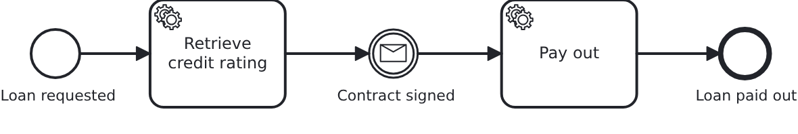

# Message correlation

[](./LICENSE)

A running workflow waits for something which happens elsewhere: a contract comes back signed, a
payment arrives, a partner answers. This blueprint shows how that news reaches the workflow. It
also shows which part of it reaches the BPMS (business process management system), and that is
less than most people expect.

## What this blueprint shows



The loan approval of the base blueprint. It waits for the signed contract before the money is
paid out. Three things are worth looking at:

- **Nothing about the correlation is modelled.** The catch event names a message, and that is
  all. VanillaBP correlates by the workflow aggregate's id. So no correlation key, no business
  key and no expression appears in the BPMN.
- **The aggregate shares nothing.** It carries `@NoSyncWithBPMS` and not a single
  `@SyncWithBPMS`. The correlation reads the aggregate's id, and every BPMS gets that id
  anyway. The BPMS must know a correlation key. So if a model names a key of its own, the
  attribute behind that key has to be shared.
- **The message's content never reaches the BPMS.** `Service#contractSigned` writes who signed
  onto the aggregate FIRST, and correlates afterwards. The engine learns the name of the
  message and nothing else. So everything later in the flow, like a gateway, a later task or a
  report, reads the aggregate, not a payload nobody can query.
- **The application decides what a second message means.** Without a correlation id, VanillaBP
  does not drop a repeated message, on purpose. The same message may arrive several times
  during a workflow's life, and that can be correct. Here the early return in `Service` is that
  decision. It keeps the second delivery away from a BPMS where nothing waits for it any more.

Two things this blueprint leaves out on purpose, and where to find them:

- **Correlation ids.** `correlateMessage(aggregate, messageName, correlationId)` tells several
  waiting occurrences of the same message apart, for example one per ordered item. It also
  drops repeats among the correlations which have not reached the BPMS yet. The same id again,
  after the first one was dispatched, is a new correlation. But if a repeating scope plans two
  of them in one unit of work, it loses the second one, and a warning says so. One catch event
  needs none.
  [The wiki explains the rest](https://github.com/vanillabp/adapter-platform-integration/wiki/Message-correlation#correlation-ids-several-occurrences-of-the-same-message).
- **Starting a workflow by message**, which is `bpmn-message-start`.

## Delta to the base blueprint

Compared to [`module-single`](https://github.com/vanillabp-blueprints/module-single-springboot):

|         File          |                                         What is different                                          |
|-----------------------|----------------------------------------------------------------------------------------------------|
| `loan_approval.bpmn`  | a message catch event the workflow waits at, and a service task behind it                          |
| `Workflow.java`       | `correlateMessage`, plus the message name as a constant                                            |
| `Service.java`        | writes what the message carried onto the aggregate, then correlates. Refuses a repeat              |
| `ApiController.java`  | the callback the message arrives at                                                                |
| `Aggregate.java`      | `contractSignedBy`, which is where the message's content ends up, `paidOut`, and `@NoSyncWithBPMS` |
| `LoanApprovalIT.java` | waiting, continuing, and a message arriving twice                                                  |

## Running it

Requires a JDK 21 or newer. Camunda 7 is embedded, so nothing else has to run:

```bash
mvn install verify
```

To run it on another BPMS, pick another Maven profile. Not one line of Java changes:

```bash
mvn install verify -Pcamunda8
```

Camunda 8 is a remote engine, so a cluster has to run, and the adapter has to be able to search
it. That needs secondary storage configured, and credentials which may read it. Correlating
finds the workflow by the process variable which holds the aggregate's ID, and that is a
search. On a cluster which refuses a search, the workflow module does not deploy, and the
message says which of the two is missing.

Start one. Its address and everything else specific to that engine are in its profile file
`application/src/main/resources/application-camunda8.yaml`. The module's own test has a copy:

```yaml
vanillabp:
  adapters:
    camunda8:
      # Camunda 8 is a remote engine: point this at your cluster.
      rest-address: http://localhost:8080
      # This adapter leases the jobs it holds, so the cluster takes the answer of the current
      # activation only. The key has no default, because a lease cannot be taken back. This is
      # the value the adapter recommends:
      # https://github.com/camunda-community-hub/vanillabp-camunda8-adapter/wiki/Configuration#a-job-somebody-else-holds
      job-lease: use
```

The file is loaded because the Maven profile `camunda8` sets the Spring profile of the same
name. So you choose the engine once, on the Maven command line. The build, the tests and
`spring-boot:run` all follow it.

Start the application:

```bash
mvn -pl application spring-boot:run
```

You see nothing about identifiers at startup. The BPMS profiles of this blueprint set
`name-clash-avoidance: use-prefix`. So VanillaBP puts the workflow module ID in front of every
identifier before it reaches the engine, and takes it off again on the way back. The BPMN
files, the business code and the rest of the configuration keep the plain names. No tenant is
involved, which matters on a BPMS licensed per tenant.
[The wiki](https://github.com/vanillabp/adapter-platform-integration/wiki/Workflow-modules#how-name-clashes-are-avoided)
explains the modes and what each of them costs.

Start a loan approval. This is the only URL you need:

```
http://localhost:8080/api/loan-approval/start?amount=5000
```

The process rates the request and then waits. It logs the URL the message arrives at:

```
Loan approval '0f7c…' started
Credit rating of loan approval '0f7c…' is 50. The workflow now waits for the signed contract:
  Signed -> http://localhost:8080/api/loan-approval/0f7c…/contract-signed?signedBy=Jane%20Doe
```

Opening it correlates the message, and the process runs to its end:

```
The contract of loan approval '0f7c…' was signed by 'Jane Doe'
Loan approval '0f7c…' was paid out to 'Jane Doe'
```

If you open the same URL a second time, the answer is that the contract was signed already. The
application decides that before it asks the BPMS, and the log line says so.

Camunda 7 serves its own web applications, and the `camunda7` profile of this blueprint
configures a user for them. They show the instance standing at the message event, which is the
quickest way to see what waiting means. Where they are served and how to log in is in the
[adapter's wiki](https://github.com/camunda-community-hub/vanillabp-camunda7-adapter/wiki/Cockpit-Tasklist-and-Admin).

## How it works

|                                          File                                          |                                            Role                                             |
|----------------------------------------------------------------------------------------|---------------------------------------------------------------------------------------------|
| `loan-approval/src/main/resources/loan-approval/processes/camunda7/loan_approval.bpmn` | the process: a message catch event naming `ContractSigned`, and a service task behind it    |
| `.../loanapproval/Service.java`                                                        | writes the message's content onto the aggregate, correlates, and refuses a repeated message |
| `.../loanapproval/Workflow.java`                                                       | `correlateMessage`, the only place `ProcessService` is used                                 |
| `.../loanapproval/ApiController.java`                                                  | the endpoint the message arrives at                                                         |
| `.../loanapproval/model/Aggregate.java`                                                | `contractSignedBy`: the one place which says what the message brought                       |
| `loan-approval/src/test/.../LoanApprovalIT.java`                                       | the workflow waits, the message lets it continue, a repeat is refused                       |

The order of events: the service task fills in the rating. The BPMS reaches the catch event,
and the workflow stops there. Whenever the answer arrives, `ApiController` calls
`Service#contractSigned`. It loads the aggregate, writes what the message carried, and tells
`Workflow` what happened. `Workflow#contractSigned` calls `ProcessService#correlateMessage`
with the aggregate and the message name, in a transaction. On a remote BPMS the correlation is
sent only after that transaction committed. So a rollback takes it with it.

VanillaBP finds the workflow itself. It asks the configured adapters in their order of
priority, and caches the answer. That is why the migration feature works for messages too. If
no BPMS knows the workflow, a `WorkflowNotFoundException` names the likely causes and tells you
what to do. The message is not lost without a word.

The test which correlates the message retries while the BPMS does not know the workflow yet. A
remote engine answers "which workflow belongs to this aggregate?" from an index it fills in the
background. So a message which arrives seconds after the start may find nothing, although the
workflow is there. An embedded engine answers at once, and the loop runs once.

## Documentation

- [Message correlation](https://github.com/vanillabp/adapter-platform-integration/wiki/Message-correlation): the API, how the workflow is found, correlation ids and idempotency
- [Correlate an incoming message](https://github.com/vanillabp/spi-for-java#correlate-an-incoming-message): the call itself
- [Workflow aggregates](https://github.com/vanillabp/adapter-platform-integration/wiki/Workflow-aggregates): why the message's content belongs there and not in the BPMS
- [Sharing workflow-aggregate data](https://github.com/vanillabp/adapter-platform-integration/wiki/Workflow-aggregates#fine-grained-control-over-attributes-synchronized-to-the-bpms): `@SyncWithBPMS`, `@NoSyncWithBPMS`, and why this blueprint shares nothing
- the wiki of the [BPMS adapter](https://github.com/vanillabp/adapter-platform-integration/wiki/BPMS-adapters) you use: what it has to arrange in the model so that correlating by the aggregate works

This blueprint is developed in the monorepo
[`blueprints`](https://github.com/vanillabp-blueprints/blueprints). This repository is a
read-only mirror, **issues and pull requests belong there.**

## Noteworthy & Contributors

[VanillaBP](https://www.github.com/vanillabp/spi-for-java) was developed by [Phactum](https://www.phactum.at) with the
intention of giving back to the community as it has benefited the community in the past.


## License

Copyright 2026 Phactum Softwareentwicklung GmbH

Licensed under the Apache License, Version 2.0
