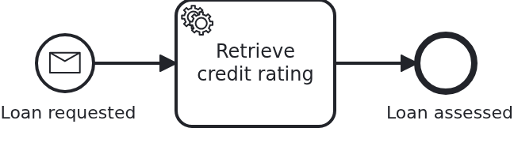

# Starting a workflow by message

[](./LICENSE)

Some processes are modelled to begin with a message, not with somebody pressing a button: an
order arrives, a file is delivered, another system reports something. This blueprint shows what
that changes for the application. It is one method name, and one thing to understand about what
travels.

## What this blueprint shows



The loan approval of the base blueprint, but its start event is a **message start event**.
Instead of `startWorkflow` the application calls

```java
bpms.startWorkflowByMessage(loanApproval, "LoanRequested");
```

and that is the whole difference in code. What is worth understanding:

- **The aggregate comes first.** The application creates it, gives it its natural id and stores
  it. VanillaBP starts the workflow in the same transaction. So here, too, you never get a
  workflow without its aggregate. A message start event does not mean the process invents the
  business case. It means a message addresses the process.
- **Only the id travels.** As with every message in VanillaBP, no payload reaches the BPMS
  (business process management system). The message carries the name it is published under and
  the aggregate's id. From then on, the workflow is addressed by that id. Everything the
  process may need belongs on the aggregate before the call. The aggregate says the same in
  code. It carries `@NoSyncWithBPMS`, and no attribute takes that back, because no expression
  in this model reads one. If a condition or a timer read an attribute, that attribute would
  carry `@SyncWithBPMS`. No other attribute would.
- **The model decides, not the code.** Whether a process starts by message is a decision of the
  model, and the application follows it. VanillaBP would have to reject `startWorkflow` on a
  process modelled this way, and the other way round.

When to model it: a process which is triggered by something arriving, not by your own
application, usually reads better as a message start event. It also combines with
`bpmn-message-correlation`. The same message name may start a workflow, and later be correlated
with a running one.

## Delta to the base blueprint

Compared to [`module-single`](https://github.com/vanillabp-blueprints/module-single-quarkus):

|         File         |                                    What is different                                     |
|----------------------|------------------------------------------------------------------------------------------|
| `loan_approval.bpmn` | the start event carries a `bpmn:messageEventDefinition`, plus the `bpmn:message`         |
| `Workflow.java`      | `startWorkflowByMessage` instead of `startWorkflow`, with the message name as a constant |

Nothing else changes. The aggregate, the service, the task handler and the API are those of the
base blueprint. That is the point to take away: a message start event is a decision of the
model, not an architecture.

## Running it

Requires a JDK 21 or newer. Camunda 7 is embedded, so nothing else has to run:

```bash
mvn install verify
```

To run it on another BPMS, pick another Maven profile. Not one line of Java changes:

```bash
mvn install verify -Pcamunda8
```

Camunda 8 is a remote engine, so a cluster has to run. Start one. Its address and everything
else specific to that engine are in its profile file
`application/src/main/resources/application-camunda8.yaml`. The module's own test has a copy:

```yaml
vanillabp:
  adapters:
    camunda8:
      # Camunda 8 is a remote engine: point this at your cluster.
      rest-address: http://localhost:8080
      # Camunda 8.10 can lose a leased job for a whole job-timeout. Until Camunda fixes that,
      # the adapter advises against a lease. The key has no default:
      # https://github.com/camunda-community-hub/vanillabp-camunda8-adapter/wiki/Configuration#a-job-somebody-else-holds
      job-lease: do-not-use
```

The blueprint does not lease its jobs. On 8.10 the gateway of the cluster can lose a leased
job when a long poll ends, and the job then waits for a whole `job-timeout`. Until Camunda
fixes that, the adapter advises `do-not-use`, and moving to `use` later costs nothing. Why is
[decision 88 of the Camunda 8 adapter](https://github.com/camunda-community-hub/vanillabp-camunda8-adapter/blob/main/DECISIONS.md#88-until-camunda-fixes-its-gateway-the-adapter-advises-against-a-lease-and-its-own-tests-keep-one).

The file is loaded because the Maven profile `camunda8` makes the config profile of the same
name the parent of the profile the application runs in. So you choose the engine once, on the
Maven command line. The build, the tests and `quarkus:dev` all follow it.

Take the address out and the application does not boot. This is the normal way to work with
VanillaBP: it checks the configuration while it boots, and the message names the property to
set.

[Operaton](https://operaton.org), the open source successor of Camunda 7, is embedded as well
and needs nothing else either. The BPMN files are the ones of Camunda 7, because Operaton reads
their `camunda:` attributes:

```bash
mvn install verify -Poperaton
```

[CIB seven](https://cibseven.org), a fork of Camunda 7 made by CIB software, is embedded as
well and needs nothing else either. The BPMN files are the ones of Camunda 7, because CIB seven
reads their `camunda:` attributes:

```bash
mvn install verify -Pcibseven
```

Start the application:

```bash
mvn -pl application quarkus:dev
```

You see nothing about identifiers at startup. The BPMS profiles of this blueprint set
`name-clash-avoidance: use-prefix`. So VanillaBP puts the workflow module ID in front of every
identifier before it reaches the engine, and takes it off again on the way back. The BPMN
files, the business code and the rest of the configuration keep the plain names. No tenant is
involved, which matters on a BPMS licensed per tenant.
[The wiki](https://github.com/vanillabp/adapter-platform-integration/wiki/Workflow-modules#how-name-clashes-are-avoided)
explains the modes and what each of them costs.

Start a loan approval. This is the only URL you need:

```
http://localhost:8080/api/loan-approval/start?amount=5000
```

The log names the message the workflow was started with:

```
Loan approval '0f7c…' started by publishing the message 'LoanRequested'
Credit rating of loan approval '0f7c…' is 50
Show the result -> http://localhost:8080/api/loan-approval/0f7c…
```

Opening that URL shows the aggregate, including the credit rating the service task wrote.

## How it works

|                                          File                                          |                                                   Role                                                    |
|----------------------------------------------------------------------------------------|-----------------------------------------------------------------------------------------------------------|
| `loan-approval/src/main/resources/META-INF/workflow-module`                            | contains `loan-approval`, which makes this JAR a workflow module                                          |
| `loan-approval/src/main/resources/loan-approval/processes/camunda7/loan_approval.bpmn` | the process: start event, service task, end event. The task names the method implementing it              |
| `.../loanapproval/model/Aggregate.java`                                                | the workflow aggregate, a normal JPA entity keyed by the loan request ID                                  |
| `.../loanapproval/Service.java`                                                        | the business code: builds the aggregate and tells `Workflow` that somebody requested a loan               |
| `.../loanapproval/Workflow.java`                                                       | what the application tells the process; the only class using `ProcessService`                             |
| `.../loanapproval/WorkflowTaskHandler.java`                                            | what the process tells the application: `@WorkflowService`, `@WorkflowTask`, calls `Service`              |
| `.../loanapproval/ApiController.java`                                                  | the GET endpoints operating the process                                                                   |
| `.../loanapproval/config/LoanApprovalProperties.java`                                  | the module's own configuration                                                                            |
| `loan-approval/src/test/.../LoanApprovalIT.java`                                       | starts a real workflow and waits for the aggregate to have been filled                                    |
| `loan-approval/src/test/.../WorkflowModuleTest.java`                                   | its base class: boots the module and waits for the workflow to make progress. The same in every blueprint |
| `application/src/test/.../ApplicationSmokeTest.java`                                   | boots the application, which is where VanillaBP validates that every BPMN task is wired to code           |

The order of events: `ApiController` calls `Service#request`, which builds the aggregate and
tells `Workflow` what happened, namely `loanRequested`, not "start the process".
`Workflow#loanRequested` publishes the message, and VanillaBP persists the aggregate and starts
the workflow in the same transaction, so an aggregate without a workflow, or the other way
round, cannot happen. The BPMS then reaches the service task and calls
`WorkflowTaskHandler#retrieveCreditRating`, which does nothing but hand over to
`Service#assessCreditRating`, with the aggregate loaded before and saved after the call. This
happens in a transaction VanillaBP owns, so neither of the two classes declares one of its own.
Only the method the API calls does, because starting a workflow has to run in a transaction. If
you put `@Transactional` on a task handler anyway, the boot fails with a message naming the
method. If you put it on a bean the handler calls, the task fails while it runs. So VanillaBP
enforces this rule, and you do not have to remember it.

The test waits instead of asserting at once, and that is on purpose. A BPMS runs tasks in its
own transactions, and a remote one runs them some time later. A test which assumes otherwise
passes on one engine and fails on the next.

## Documentation

- [Starting a workflow by message](https://github.com/vanillabp/adapter-platform-integration/wiki/Message-correlation#starting-a-workflow-by-message): what the call does and what it sends
- [Message correlation](https://github.com/vanillabp/adapter-platform-integration/wiki/Message-correlation): the same rules for a message reaching a RUNNING workflow
- [Defining a workflow module](https://github.com/vanillabp/adapter-platform-integration/wiki/Workflow-modules-in-Quarkus#defining-a-workflow-module): the marker file, resource conventions and the module's own configuration files
- [How name clashes are avoided](https://github.com/vanillabp/adapter-platform-integration/wiki/Workflow-modules#how-name-clashes-are-avoided): the modes keeping two workflow modules apart, and what each of them costs
- [Workflow aggregates](https://github.com/vanillabp/adapter-platform-integration/wiki/Workflow-aggregates): why there are no process variables
- [Wire up a process / Wire up a task](https://github.com/vanillabp/spi-for-java#usage): the annotations used in `WorkflowTaskHandler.java`
- the wiki of the [BPMS adapter](https://github.com/vanillabp/adapter-platform-integration/wiki/BPMS-adapters) you use: how a BPMN task has to be modelled for that engine

This blueprint is developed in the monorepo
[`blueprints`](https://github.com/vanillabp-blueprints/blueprints). This repository is a
read-only mirror, **issues and pull requests belong there.**

## Noteworthy & Contributors

[VanillaBP](https://www.github.com/vanillabp/spi-for-java) was developed by [Phactum](https://www.phactum.at) with the
intention of giving back to the community as it has benefited the community in the past.


## License

Copyright 2026 Phactum Softwareentwicklung GmbH

Licensed under the Apache License, Version 2.0
