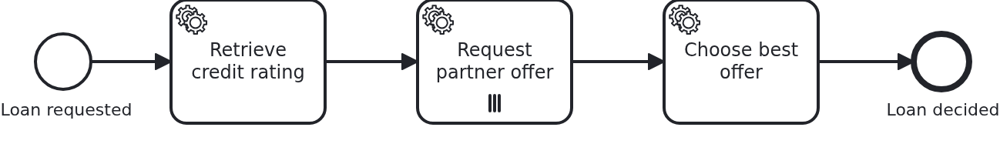

# Multi-instance tasks

[](./LICENSE)

Sometimes a task has to run once per something: per partner asked, per document to check, per
customer to inform. A multi-instance task is how the model says so. This blueprint shows what
the business code sees of it: one element at a time.

## What this blueprint shows



The loan approval of the base blueprint asks several partner banks for an offer, one instance
of the task per partner. Afterwards it takes the cheapest one.

The BPMS (business process management system) hands three things to a `@WorkflowTask` method.
Each of them names the multi-instance element in the model:

```java
@WorkflowTask
public void requestPartnerOffer(
    final Aggregate loanRequest,
    @MultiInstanceElement("ServiceTask_RequestPartnerOffer") final String partnerId,
    @MultiInstanceIndex("ServiceTask_RequestPartnerOffer") final int index,
    @MultiInstanceTotal("ServiceTask_RequestPartnerOffer") final int total) {
```

The name is the ID of the multi-instance element, not the name of the element variable in the
model. You have to give it. A method may sit inside several iterations at once, for example a
multi-instance task within a multi-instance subprocess. Then it matters which of them a
parameter asks about.

What the loop goes over comes from the workflow aggregate. The model reads the attribute
`partnerIds`, and the business code fills it before the workflow reaches the task. The class is
annotated `@NoSyncWithBPMS`, and that one attribute `@SyncWithBPMS`. So the list is the only
part of the aggregate which reaches the BPMS. It has to reach it, because the engine makes one
instance per element and hands that element over. Keep such a collection to identifiers. An
identifier is the smallest thing which names an iteration, and the business code looks up
whatever else it needs. The offers the iterations write stay in the application, because no
expression in the model reads them.

Every instance is a token of its own, and a remote engine really runs them next to each other.
Each of them loads the workflow aggregate, runs the method and saves it again. So an attribute
written by all of them would end up holding what the instance which commits last read at its
start. That is why this blueprint adds a row per offer, `PartnerOffer`. This is a decision of
the model, not a JPA (Jakarta Persistence) trick. An offer of one partner is a thing of its
own, and several of them do not compete. The wiki has the other ways out under
[Workflow aggregates](https://github.com/vanillabp/adapter-platform-integration/wiki/Workflow-aggregates).

Anything computed over all iterations belongs after the multi-instance task. `chooseBestOffer`
is a plain service task which runs once, when the last instance has finished. It reads the rows
the iterations left.

## Delta to the base blueprint

Compared to [`module-single`](https://github.com/vanillabp-blueprints/module-single-springboot):

|            File            |                                                     What is different                                                     |
|----------------------------|---------------------------------------------------------------------------------------------------------------------------|
| `loan_approval.bpmn`       | a multi-instance service task iterating over an attribute of the aggregate, and a task after it                           |
| `Aggregate.java`           | `partnerIds`, which the model loops over and which is therefore shared with the BPMS, and `offers`, one row per iteration |
| `PartnerOffer.java`        | new: what one iteration found                                                                                             |
| `WorkflowTaskHandler.java` | `@MultiInstanceElement`, `@MultiInstanceIndex` and `@MultiInstanceTotal`                                                  |
| `Service.java`             | a method taking ONE partner, and a second one choosing between the results                                                |
| `loan-approval.yaml`       | the partners, which is what decides how many iterations there are                                                         |
| `LoanApprovalIT.java`      | asserts the rows of all iterations, without relying on the order they arrived in                                          |

## Running it

Requires a JDK 21 or newer. Camunda 7 is embedded, so nothing else has to run:

```bash
mvn install verify
```

To run it on another BPMS, pick another Maven profile. Not one line of Java changes:

```bash
mvn install verify -Pcamunda8
```

Camunda 8 is a remote engine, so a cluster has to run. Start one. Its address and everything
else specific to that engine are in its profile file
`application/src/main/resources/application-camunda8.yaml`. The module's own test has a copy:

```yaml
vanillabp:
  adapters:
    camunda8:
      # Camunda 8 is a remote engine: point this at your cluster.
      rest-address: http://localhost:8080
      # This adapter leases the jobs it holds, so the cluster takes the answer of the current
      # activation only. The key has no default, because a lease cannot be taken back. This is
      # the value the adapter recommends:
      # https://github.com/camunda-community-hub/vanillabp-camunda8-adapter/wiki/Configuration#a-job-somebody-else-holds
      job-lease: use
```

The file is loaded because the Maven profile `camunda8` sets the Spring profile of the same
name. So you choose the engine once, on the Maven command line. The build, the tests and
`spring-boot:run` all follow it.

[Operaton](https://operaton.org), the open source successor of Camunda 7, is embedded as well
and needs nothing else either. The BPMN files are the ones of Camunda 7, because Operaton reads
their `camunda:` attributes:

```bash
mvn install verify -Poperaton
```

That engine has no loop cardinality. It reports neither the number of instances nor, to a
nested task, the iteration around it. The adapter fills those gaps while deploying. So the same
Java code and the same annotations work here. The
[adapter's wiki](https://github.com/camunda-community-hub/vanillabp-camunda8-adapter/wiki/Deviations)
says what it does.

Start the application:

```bash
mvn -pl application spring-boot:run
```

You see nothing about identifiers at startup. The BPMS profiles of this blueprint set
`name-clash-avoidance: use-prefix`. So VanillaBP puts the workflow module ID in front of every
identifier before it reaches the engine, and takes it off again on the way back. The BPMN
files, the business code and the rest of the configuration keep the plain names. No tenant is
involved, which matters on a BPMS licensed per tenant.
[The wiki](https://github.com/vanillabp/adapter-platform-integration/wiki/Workflow-modules#how-name-clashes-are-avoided)
explains the modes and what each of them costs.

This is the URL that starts a loan approval:

```
http://localhost:8080/api/loan-approval/start?amount=5000
```

The log shows one line per iteration, and the choice made afterwards:

```
Loan approval '383f…' started
Credit rating of loan approval '383f…' is 50, asking 3 partner(s)
Asking partner 1 of 3 for loan approval '383f…'
Partner 'northern-bank' offers 95 basis points for loan approval '383f…'
Asking partner 2 of 3 for loan approval '383f…'
Partner 'harbour-credit' offers 70 basis points for loan approval '383f…'
Asking partner 3 of 3 for loan approval '383f…'
Partner 'alpine-savings' offers 85 basis points for loan approval '383f…'
Loan approval '383f…' takes the offer of 'harbour-credit' at 70 basis points, out of 3 offer(s)
```

The result of a run is at

```
http://localhost:8080/api/loan-approval/{loanRequestId}
```

Add a partner to `loan-approval/src/main/resources/loan-approval/loan-approval.yaml`, and the
task runs four times instead of three. Nobody touches the model, and there is no deployment.
That is why the list lives in configuration.

Camunda 7 serves its own web applications, and the `camunda7` profile of this blueprint
configures a user for them. They draw the multi-instance task with the number of instances that
ran, which is the quickest way to see an iteration from outside. Where they are served and how
to log in is in the
[adapter's wiki](https://github.com/camunda-community-hub/vanillabp-camunda7-adapter/wiki/Cockpit-Tasklist-and-Admin).

## How it works

|                                            File                                            |                                   Role                                    |
|--------------------------------------------------------------------------------------------|---------------------------------------------------------------------------|
| `loan-approval/src/main/resources/loan-approval/processes/<adapter-id>/loan_approval.bpmn` | the multi-instance task, what it loops over and what each instance gets   |
| `.../loanapproval/WorkflowTaskHandler.java`                                                | turns the element, the index and the total into a call naming one partner |
| `.../loanapproval/Service.java`                                                            | asks one partner, and picks the best offer once all of them answered      |
| `.../loanapproval/model/Aggregate.java`                                                    | the collection the model iterates over, and the offers written into it    |
| `.../loanapproval/model/PartnerOffer.java`                                                 | one row per iteration, which is what makes concurrent instances harmless  |
| `loan-approval/src/main/resources/loan-approval/loan-approval.yaml`                        | the partners. So the number of iterations is configuration, not model     |
| `loan-approval/src/test/.../LoanApprovalIT.java`                                           | asserts the rows of all iterations and the choice made from them          |

The order of events: `retrieveCreditRating` writes the rating and the partners. The engine
evaluates the collection and creates one instance per element. Each instance runs the handler
in a transaction of its own. `chooseBestOffer` runs when the last of them has finished.

The test says `containsExactlyInAnyOrder`, and that is not laziness. The instances have no
order among themselves. A test which expects one passes on an embedded engine and fails on a
remote one.

## Documentation

- [Multi-instance](https://github.com/vanillabp/spi-for-java#multi-instance): the three annotations, and the resolver for nested iterations
- [Workflow aggregates](https://github.com/vanillabp/adapter-platform-integration/wiki/Workflow-aggregates): why the collection is an attribute rather than a variable, and what several writers do to a row
- [Wire up a task](https://github.com/vanillabp/spi-for-java#wire-up-a-task): what a `@WorkflowTask` method may be handed
- the wiki of the [BPMS adapter](https://github.com/vanillabp/adapter-platform-integration/wiki/BPMS-adapters) you use: what that engine reports about an iteration
- [What becomes of a shared value on Camunda 7](https://github.com/camunda-community-hub/vanillabp-camunda7-adapter/wiki/What-becomes-of-a-shared-value): the partner ids travel to that engine as an object variable, and the serialization format an application needs so a list of ids stays readable

This blueprint is developed in the monorepo
[`blueprints`](https://github.com/vanillabp-blueprints/blueprints). This repository is a
read-only mirror, **issues and pull requests belong there.**

## Noteworthy & Contributors

[VanillaBP](https://www.github.com/vanillabp/spi-for-java) was developed by [Phactum](https://www.phactum.at) with the
intention of giving back to the community as it has benefited the community in the past.


## License

Copyright 2026 Phactum Softwareentwicklung GmbH

Licensed under the Apache License, Version 2.0
