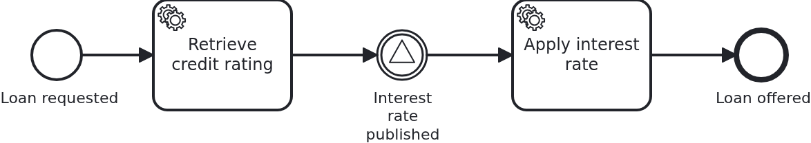
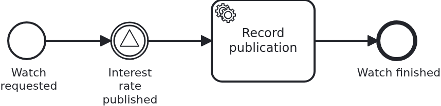

# Signals

[](./LICENSE)

Some news is not addressed to anybody. Today's interest rate is published, and every loan
approval which waits for it goes on. That may be one, a dozen, or none, and the publisher knows
nothing about them. That is a signal. This blueprint shows what it can and cannot do.

## What this blueprint shows



The loan approval of the base blueprint. It waits for the day's interest rate before the offer
is made. Three things are worth looking at:

- **The sender addresses nobody.** `Workflow#interestRatePublished` passes a name and nothing
  else. It passes no aggregate, and there is no parameter for one. A signal reaches every
  element of the workflow module which waits for that name, and a caller cannot narrow that
  down. To reach exactly one workflow, use `bpmn-message-correlation`.
- **A signal carries no data at all.** A message can at least take the detour over the
  aggregate it is correlated for. A broadcast has no aggregate to write to. So `Service` stores
  the rate in its own table first, and the task behind the catch event reads it from there.
- **A signal is not buffered.** It reaches whoever waits at that moment. A loan approval which
  arrives at the catch event a second later gets nothing, and waits for the next publication.
  Where a delivery has to wait for its recipient, correlate a message instead.

### The scope is the workflow module, not the process



A second process in the same workflow module does nothing else: it starts, waits for
`InterestRatePublished`, and records that the signal arrived. It belongs to a use case of its
own, `ratewatch`, with its own aggregate, its own API, and no line of code shared with the loan
approval.

One broadcast reaches both processes. That is what "a signal is broadcast per workflow module"
means, and it is easy to get wrong in either direction. Nobody has to send the signal once per
process. And nobody can keep it inside the process which sent it. The broadcast does not cross
the workflow module. Another module is a scope of its own. An application which wants the
signal there sends it through the `ProcessService` of that module as well.

`RateWatchIT` tests that claim. The rate watch waits, the loan approval use case publishes a
rate, and the watch goes on.

Two things this blueprint leaves out on purpose, and where to find them:

- **A signal which starts a workflow** belongs to `bpmn-bpms-initiated-start`. There nobody
  created an aggregate beforehand. The application learns of the start through a hook, and does
  not trigger it.
- **A signal throw event inside the model.** That is one process telling itself something, and
  it needs no line of Java. So there is nothing for a blueprint to explain.

## Delta to the base blueprint

Compared to [`module-single`](https://github.com/vanillabp-blueprints/module-single-springboot):

|         File          |                                        What is different                                        |
|-----------------------|-------------------------------------------------------------------------------------------------|
| `loan_approval.bpmn`  | a signal catch event the workflow waits at, and a service task behind it                        |
| `Workflow.java`       | `sendSignal`, plus the signal name as a constant                                                |
| `Service.java`        | stores the published rate, then broadcasts. Reads the rate again when a workflow goes on        |
| `ApiController.java`  | the endpoint which publishes the rate. It is the only one without a loan request id in its path |
| `InterestRate.java`   | the published rate, application data belonging to no workflow                                   |
| `Aggregate.java`      | `interestRate`, which is where the rate ends up per loan approval                               |
| `LoanApprovalIT.java` | waiting, one broadcast continuing two workflows, and a signal nobody caught                     |
| `ratewatch/`          | a second use case, whose process waits for the same signal                                      |
| `rate_watch.bpmn`     | that process: start, catch the signal, record it                                                |
| `RateWatchIT.java`    | the broadcast of one use case reaching the process of the other                                 |

## Running it

Requires a JDK 21 or newer. Camunda 7 is embedded, so nothing else has to run:

```bash
mvn install verify
```

To run it on another BPMS (business process management system), pick another Maven profile. Not
one line of Java changes:

```bash
mvn install verify -Pcamunda8
```

Camunda 8 is a remote engine, so a cluster has to run. Start one. Its address and everything
else specific to that engine are in its profile file
`application/src/main/resources/application-camunda8.yaml`. The module's own test has a copy:

```yaml
vanillabp:
  adapters:
    camunda8:
      # Camunda 8 is a remote engine: point this at your cluster.
      rest-address: http://localhost:8080
      # Camunda 8.10 can lose a leased job for a whole job-timeout. Until Camunda fixes that,
      # the adapter advises against a lease. The key has no default:
      # https://github.com/camunda-community-hub/vanillabp-camunda8-adapter/wiki/Configuration#a-job-somebody-else-holds
      job-lease: do-not-use
```

The blueprint does not lease its jobs. On 8.10 the gateway of the cluster can lose a leased
job when a long poll ends, and the job then waits for a whole `job-timeout`. Until Camunda
fixes that, the adapter advises `do-not-use`, and moving to `use` later costs nothing. Why is
[decision 88 of the Camunda 8 adapter](https://github.com/camunda-community-hub/vanillabp-camunda8-adapter/blob/main/DECISIONS.md#88-until-camunda-fixes-its-gateway-the-adapter-advises-against-a-lease-and-its-own-tests-keep-one).

The file is loaded because the Maven profile `camunda8` sets the Spring profile of the same
name. So you choose the engine once, on the Maven command line. The build, the tests and
`spring-boot:run` all follow it.

[Operaton](https://operaton.org), the open source successor of Camunda 7, is embedded as well
and needs nothing else either. The BPMN files are the ones of Camunda 7, because Operaton reads
their `camunda:` attributes:

```bash
mvn install verify -Poperaton
```

Start the application:

```bash
mvn -pl application spring-boot:run
```

You see nothing about identifiers at startup. The BPMS profiles of this blueprint set
`name-clash-avoidance: use-prefix`. So VanillaBP puts the workflow module ID in front of every
identifier before it reaches the engine, and takes it off again on the way back. The BPMN
files, the business code and the rest of the configuration keep the plain names. No tenant is
involved, which matters on a BPMS licensed per tenant.
[The wiki](https://github.com/vanillabp/adapter-platform-integration/wiki/Workflow-modules#how-name-clashes-are-avoided)
explains the modes and what each of them costs.

Start a loan approval. This is the only URL you need:

```
http://localhost:8080/api/loan-approval/start?amount=5000
```

The process rates the request and then waits. It logs the URL which publishes the rate:

```
Loan approval '0f7c…' started
Credit rating of loan approval '0f7c…' is 50. The workflow now waits for today's interest rate, and so does every other loan approval which got this far:
  Publish -> http://localhost:8080/api/loan-approval/publish-interest-rate?rate=3.5
```

Start a second and a third loan approval before you open that URL. One broadcast continues all
of them:

```
An interest rate of 3.5% was published. Every loan approval waiting for it continues
Loan approval '0f7c…' is offered at 3.5%
Loan approval '91ab…' is offered at 3.5%
Loan approval '4d20…' is offered at 3.5%
```

Now start another loan approval, and watch it wait, although the rate has been published. The
signal is gone, and only the next publication reaches it. Remember that before you choose a
signal over a message.

The rate watch starts at a URL of its own and waits for the same signal:

```
http://localhost:8080/api/rate-watch/start
```

Publish a rate while both a loan approval and a rate watch wait, and one call continues both:

```
An interest rate of 3.5% was published. Every loan approval waiting for it continues
Loan approval '0f7c…' is offered at 3.5%
Rate watch '7b31…' noticed the publication, although the broadcast was sent by the loan approval use case
```

Camunda 7 serves its own web applications, and the `camunda7` profile of this blueprint
configures a user for them. They show every instance standing at the signal event, which is the
quickest way to see who a broadcast is about to reach. Where they are served and how to log in
is in the
[adapter's wiki](https://github.com/camunda-community-hub/vanillabp-camunda7-adapter/wiki/Cockpit-Tasklist-and-Admin).

## How it works

|                                          File                                          |                                            Role                                            |
|----------------------------------------------------------------------------------------|--------------------------------------------------------------------------------------------|
| `loan-approval/src/main/resources/loan-approval/processes/camunda7/loan_approval.bpmn` | the process: a signal catch event naming `InterestRatePublished`, a service task behind it |
| `.../loanapproval/Service.java`                                                        | stores the rate, broadcasts, and reads the rate again for each workflow which goes on      |
| `.../loanapproval/Workflow.java`                                                       | `sendSignal`, the only place `ProcessService` is used                                      |
| `.../loanapproval/ApiController.java`                                                  | the endpoint publishing the rate, addressed to no business case                            |
| `.../loanapproval/model/InterestRate.java`                                             | the published rate: application data, not a workflow aggregate                             |
| `.../loanapproval/model/Aggregate.java`                                                | `interestRate`: what the workflow read after the signal reached it                         |
| `loan-approval/src/test/.../LoanApprovalIT.java`                                       | waiting, one broadcast for two workflows, and a signal nobody caught                       |

The order of events: the service task fills in the rating. The BPMS reaches the catch event, and the workflow stops there, together with every
other loan approval which got this far. Whenever the rate is published, `ApiController` calls
`Service#publishInterestRate`. It saves the rate and then tells `Workflow` what happened.
`Workflow#interestRatePublished` calls `ProcessService#sendSignal` with the signal name, in a
transaction. On a remote BPMS the broadcast is sent only after that transaction committed. So a
rollback takes it with it. By then the rate is stored, and the workflows which go on are about
to read it.

The broadcast is limited to the workflow module of that `ProcessService`. It reaches every BPMS
the module is deployed to. That keeps it complete while workflows are migrated from one BPMS to
another. It does not cross into other workflow modules. An application which wants a signal in
several modules sends it through the `ProcessService` of each of them. Which modules are meant
is a business question, and VanillaBP does not answer it for you.

The test broadcasts again and again, not once. The reason is the property this blueprint is
about. A written credit rating proves that the service task ran. It does not prove that the
subscription of the catch event behind it exists yet. On a remote engine those are two
transactions, and a signal which falls into that gap is gone. Repeating does no harm, because a
signal nobody waits for reaches nobody.

## Documentation

- [Workflow modules](https://github.com/vanillabp/adapter-platform-integration/wiki/Workflow-modules): the scope a broadcast covers, and how identifiers are kept apart between modules
- [Message correlation](https://github.com/vanillabp/adapter-platform-integration/wiki/Message-correlation): the addressed counterpart, for news meant for one workflow
- [Workflow aggregates](https://github.com/vanillabp/adapter-platform-integration/wiki/Workflow-aggregates): why data a workflow needs lives in your own tables and not in the BPMS
- the wiki of the [BPMS adapter](https://github.com/vanillabp/adapter-platform-integration/wiki/BPMS-adapters) you use: what its engine does with a broadcast

This blueprint is developed in the monorepo
[`blueprints`](https://github.com/vanillabp-blueprints/blueprints). This repository is a
read-only mirror, **issues and pull requests belong there.**

## Noteworthy & Contributors

[VanillaBP](https://www.github.com/vanillabp/spi-for-java) was developed by [Phactum](https://www.phactum.at) with the
intention of giving back to the community as it has benefited the community in the past.


## License

Copyright 2026 Phactum Softwareentwicklung GmbH

Licensed under the Apache License, Version 2.0
