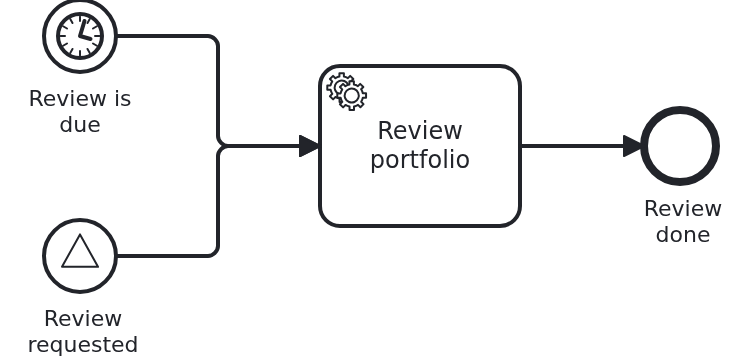

# A timer start event, and a method per start event

[](./LICENSE)

A timer fires, and the engine starts a workflow. Nobody calls `startWorkflow`, so the
application builds the workflow aggregate when the engine asks for it. This process has a
second start event as well, and the aggregate depends on which of the two fired. So each start
event gets a method of its own: `@WorkflowStartedByBpms(id = ...)`.

## What this blueprint shows



A second process next to the loan approval of the base blueprint: a review of the loan
approvals collected so far. It has two start events, and no call can trigger either of them.
The timer start event `StartEvent_ScheduledReview` starts a review on a schedule. The signal
start event `StartEvent_ReviewRequested` starts one when somebody asks for it.

- **One method per start event.** Look at `portfolioreview/WorkflowTaskHandler.java`. It has
  two `@WorkflowStartedByBpms` methods. Each one names the BPMN id of its start event in `id`.
  VanillaBP calls the method of the event which fired, and never the other one.
- **Each method builds its own aggregate.** A scheduled review and a requested review are not
  the same thing, so their aggregates differ. `reviewIsDue` marks the review `SCHEDULED`.
  `reviewWasRequested` marks it `REQUESTED` and keeps the name of the signal. A single method
  without `id` would have to look at the `BpmsStartTrigger` and branch on it.
- **The method for the timer takes no parameter.** It knows which event fired, because `id`
  says so. The trigger would only repeat that. The method for the signal takes the trigger for
  one detail, the name of the signal.
- **The timer is a literal of the model.** No workflow aggregate exists before the timer fires,
  so there is nothing an expression could read. The cycle is written in the model, and a new
  version of the model replaces the schedule of the old one.

Both methods are **required**. A start event the BPMS fires on its own needs a method which
serves it, and an application without one does not boot. The same is true for a method whose
`id` names a start event the process does not have. The message lists the start events the
process has. You learn both while the models are deployed, not when the timer fires.

[`bpmn-bpms-initiated-start`](https://github.com/vanillabp-blueprints/bpmn-bpms-initiated-start-springboot)
shows the other way. Its process has a timer and a signal start event as well, but both lead
to the same aggregate, so one method without `id` serves both. Use that one when the start
events do not matter to your code, and this one when they do.
[`bpmn-timer`](https://github.com/vanillabp-blueprints/bpmn-timer-springboot) shows timers
inside a running workflow, where an expression can read the aggregate.

## Delta to the base blueprint

Compared to [`module-single`](https://github.com/vanillabp-blueprints/module-single-springboot):

|                       File                       |                                             What is different                                             |
|--------------------------------------------------|-----------------------------------------------------------------------------------------------------------|
| `portfolio_review.bpmn`                          | a second process with a timer start event and a signal start event                                        |
| `portfolioreview/WorkflowTaskHandler.java`       | two `@WorkflowStartedByBpms(id = ...)` methods, one per start event, next to the ordinary `@WorkflowTask` |
| `portfolioreview/Service.java`                   | builds a different aggregate for each start event, and names it                                           |
| `portfolioreview/Workflow.java`                  | `sendSignal` and no `startWorkflow`                                                                       |
| `portfolioreview/model/Aggregate.java`           | the aggregate of a review, with the occasion the building method writes                                   |
| `portfolioreview/model/Occasion.java`            | new: `SCHEDULED` or `REQUESTED`, one value per start event                                                |
| `portfolioreview/model/AggregateRepository.java` | new: the repository of the reviews, with a query for the occasion                                         |
| `portfolioreview/ApiController.java`             | new: asks for a review by broadcasting the signal, and lists the reviews                                  |
| `loan-approval/openapi/portfolio-review.yaml`    | new: the OpenAPI file of that controller                                                                  |
| `loan-approval/openapi/loan-approval.yaml`       | the paths name the resource, `/loan-approval/api/loan-requests/...`, because the module has two           |
| `loanapproval/ApiController.java`                | logs the URL with the resource name `loan-requests`                                                       |
| `PortfolioReviewIT.java`                         | waits for a review of each occasion, because nothing can start one                                        |
| `loan-approval/pom.xml`                          | generates the Java interface of `portfolio-review.yaml` as well                                           |

## Running it

Requires a JDK 21 or newer. Camunda 7 is embedded, so nothing else has to run:

```bash
mvn install verify
```

To run it on another BPMS, pick another Maven profile. Not one line of Java changes:

```bash
mvn install verify -Pcamunda8
```

Camunda 8 is a remote engine, so a cluster has to run. Start one. Its address and everything
else specific to that engine are in its profile file
`application/src/main/resources/application-camunda8.yaml`. The module's own test has a copy:

```yaml
vanillabp:
  adapters:
    camunda8:
      # Camunda 8 is a remote engine: point this at your cluster.
      rest-address: http://localhost:8080
      # With a lease, the cluster takes the answer of the current activation only. The key
      # has no default. The 8.8 and 8.9 lines accept it and do nothing. On an 8.10 cluster
      # older than 8.10.10, a leased job can wait a whole job-timeout for nobody, and the
      # adapter warns at startup. Choose 'do-not-use' there. The cluster never takes a
      # lease off a job again. The wiki says why:
      # https://github.com/vanillabp/camunda8-adapter/wiki/Configuration#a-job-somebody-else-holds
      job-lease: use
```

The blueprint leases its jobs. With a lease, the cluster takes the answer of the current
activation only, so a run whose lock ran out cannot overwrite what a newer run wrote. On an 8.10
cluster older than 8.10.10, a leased job can wait a whole `job-timeout` for nobody. The adapter
then warns at startup, so choose `do-not-use` there. The cluster never takes a lease off a job
again. The
[wiki of the Camunda 8 adapter](https://github.com/vanillabp/camunda8-adapter/wiki/Configuration#a-job-somebody-else-holds) explains why.

The file is loaded because the Maven profile `camunda8` sets the Spring profile of the same
name. So you choose the engine once, on the Maven command line. The build, the tests and
`spring-boot:run` all follow it.

[Operaton](https://operaton.org), the open source successor of Camunda 7, is embedded as well
and needs nothing else either. The BPMN files are the ones of Camunda 7, because Operaton reads
their `camunda:` attributes:

```bash
mvn install verify -Poperaton
```

[CIB seven](https://cibseven.org), a fork of Camunda 7 made by CIB software, is embedded as
well and needs nothing else either. The BPMN files are the ones of Camunda 7, because CIB seven
reads their `camunda:` attributes:

```bash
mvn install verify -Pcibseven
```

The Process-Engine-API adapter cannot run this blueprint, and it says so instead of starting
badly. That API never reports a start the application did not ask for. So deploying such a
process fails with a message which names the element.

Start the application:

```bash
mvn -pl application spring-boot:run
```

You see nothing about identifiers at startup. The BPMS profiles of this blueprint set
`name-clash-avoidance: use-prefix`. So VanillaBP puts the workflow module ID in front of every
identifier before it reaches the engine, and takes it off again on the way back. The BPMN
files, the business code and the rest of the configuration keep the plain names. No tenant is
involved, which matters on a BPMS licensed per tenant.
[The wiki](https://github.com/vanillabp/adapter-platform-integration/wiki/Workflow-modules#how-name-clashes-are-avoided)
explains the modes and what each of them costs.

Then do nothing. About five seconds after the model was deployed the timer fires, and a workflow
exists which nobody asked for. The cycle `R/PT5S` starts one every five seconds, as long as the
model is deployed:

```
The timer started the portfolio review 'a41f…'. Nobody called startWorkflow
The SCHEDULED portfolio review 'a41f…' looked at 0 loan approval(s)
```

The reviews are listed at

```
http://localhost:8080/loan-approval/api/portfolio-reviews
```

To ask for one instead of waiting, broadcast the signal:

```
http://localhost:8080/loan-approval/api/portfolio-reviews/request
```

The other method builds this one:

```
A review was requested. Whether one starts is the engine's decision
The signal 'PortfolioReviewRequested' started the portfolio review '7c02…'. Nobody called startWorkflow
The REQUESTED portfolio review '7c02…' looked at 0 loan approval(s)
```

The loan approval of the base blueprint is still there, started the ordinary way. It gives the
review something to count:

```
http://localhost:8080/loan-approval/api/loan-requests/start?amount=5000
```

Camunda 7 serves its own web applications, and the `camunda7` profile of this blueprint
configures a user for them. They show the review instances under the business key the
application chose while it built the aggregate, and that key is the ID of the review. Where
they are served and how to log in is in the
[adapter's wiki](https://github.com/vanillabp/camunda7-adapter/wiki/Cockpit-Tasklist-and-Admin).

## How it works

|                             File                             |                                   Role                                    |
|--------------------------------------------------------------|---------------------------------------------------------------------------|
| `.../loan-approval/processes/camunda7/portfolio_review.bpmn` | the process: a timer start event, a signal start event, one service task  |
| `.../portfolioreview/WorkflowTaskHandler.java`               | one `@WorkflowStartedByBpms(id = ...)` method per start event             |
| `.../portfolioreview/Service.java`                           | builds the aggregate of each start event. It has no way to start a review |
| `.../portfolioreview/model/Aggregate.java`                   | the aggregate, which says which method built it                           |
| `loan-approval/src/test/.../PortfolioReviewIT.java`          | waits for an aggregate of each occasion, because it cannot start one      |

The order of events: the model is deployed while the application boots. VanillaBP reads its
start events and checks that each one the BPMS fires on its own has a method. The engine
schedules the timer, and five seconds later it fires. VanillaBP opens a transaction, picks the
method whose `id` is the start event which fired, and calls it. It saves the aggregate the
method returns. Only then does the process go on to its service task, which is an ordinary
`@WorkflowTask`. From there on nothing about this workflow is special.

The two methods in short:

```java
@WorkflowStartedByBpms(id = SCHEDULED_REVIEW)
public Aggregate reviewIsDue() {
  return portfolioReview.scheduled();
}

@WorkflowStartedByBpms(id = REVIEW_REQUESTED)
public Aggregate reviewWasRequested(final BpmsStartTrigger trigger) {
  return portfolioReview.requested(trigger.signalName());
}
```

The ids are constants of the handler, `StartEvent_ScheduledReview` and
`StartEvent_ReviewRequested`. They are the BPMN ids of the two start events. If somebody
renames a start event in the model, the application does not boot until the constant follows.

Do not mix a method with `id` and a method without one for the same process. The method
without `id` serves every start event, so two methods would serve the one with the `id`, and
VanillaBP calls the first it finds.

### Choosing a timer for a start event

A BPMN timer is one of three things: a date (`timeDate`), a duration (`timeDuration`) or a
cycle (`timeCycle`). On a start event a cycle is the usual choice, because it starts a workflow
again and again. `R3/PT5S` fires three times, `R/P1D` fires every day without an end. This
blueprint runs `R/PT5S`, without an end, for its tests. A model which is deployed again without a
change is no new version, so the engine keeps the schedule it has. A cycle which already ended
in an earlier run would start nothing in the next one. A date starts one workflow at that moment. Not every engine accepts a
duration on a start event. A cycle with one repetition, such as `R1/PT5S`, takes its place, but
it has the same catch as every cycle with an end: on Camunda 8 it fires once per version of the
model, not once per deployment.

The value is written in the model and does not come from configuration, unlike the deadlines
of `bpmn-timer`. A timer inside a workflow reads its value when the workflow reaches it, and
the aggregate is there to read. A timer on a start event is scheduled when the model is
deployed, and no aggregate exists yet. So the short cycle of this blueprint is in the model
itself. A project writes its real schedule there, and its test waits for the first start.

A schedule in business time, such as "the first of every month at 06:00 in Vienna", would be a
cron expression in the cycle. The BPMS reads a cron in the time zone of the machine the engine
runs on. For a remote engine that is the machine of its cluster, which often runs on UTC. The
BPMS never knows the zone of the business. A cycle written as a duration, such as `R/PT5S` here, depends on no zone. Do not set
the time zone of the machine to make a cron fit, because that moves every other time of the
application as well. [`bpmn-timer`](https://github.com/vanillabp-blueprints/bpmn-timer-springboot)
shows how a timer inside a workflow keeps a time of day in the time zone of the business.

The test is the unusual part. It has no call to make. So it waits for an aggregate with the
expected occasion to appear. The occasion is written by the method which built the aggregate,
so the test proves that each start event reached its own method. For the signal it broadcasts
in a poll loop, not once. A signal is not buffered, and a subscription which is a moment late
gets nothing.

## Documentation

- [A workflow nobody started through VanillaBP](https://github.com/vanillabp/spi-for-java/wiki/Starting-and-ending-workflows#a-workflow-nobody-started-through-vanillabp): `@WorkflowStartedByBpms`, its parameters and what `id` does
- [Starting workflows](https://github.com/vanillabp/adapter-platform-integration/wiki/Starting-workflows): the whole picture, including which ID the aggregate gets and what each BPMS supports
- [Timers](https://github.com/vanillabp/adapter-platform-integration/wiki/Timers): the three forms a timer takes, and where a timer sits in a model
- [Workflow aggregates](https://github.com/vanillabp/adapter-platform-integration/wiki/Workflow-aggregates): why the aggregate has to exist before the process runs
- the wiki of the [BPMS adapter](https://github.com/vanillabp/adapter-platform-integration/wiki/BPMS-adapters) you use: what its engine does with a start event nobody triggered

This blueprint is developed in the monorepo
[`blueprints`](https://github.com/vanillabp-blueprints/blueprints). This repository is a
read-only mirror, **issues and pull requests belong there.**

## Noteworthy & Contributors

[VanillaBP](https://www.github.com/vanillabp/spi-for-java) was developed by [Phactum](https://www.phactum.at) with the
intention of giving back to the community as it has benefited the community in the past.


## License

Copyright 2026 Phactum Softwareentwicklung GmbH

Licensed under the Apache License, Version 2.0
