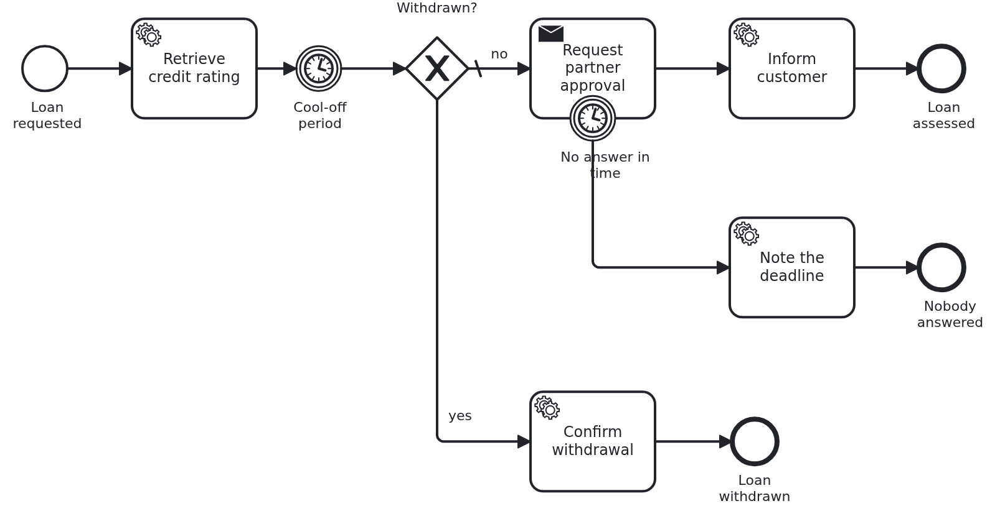

# Timers

[](./LICENSE)

Waiting is part of most business processes: a cool-off period before something is sent, a
deadline after which a request is chased or dropped. A BPMS (business process management
system) does that waiting for you. This blueprint shows two kinds of it: one delays the
process, the other takes work away. And it shows what the application has to do when the
business case changes while the workflow waits.

## What this blueprint shows



The loan approval of the base blueprint, with a partner who has to approve the loan, and two
timers around that:

- **A timer in the sequence flow.** After the rating the workflow just waits. Only then is the
  partner asked. Nothing of the application runs in the meantime: no thread, no scheduler, no
  `sleep`. The BPMS holds the instance and wakes it up.
- **A deadline on the waiting task.** The task which asks the partner carries an interrupting
  timer boundary event. If no answer arrives in time, the workflow leaves the task and takes
  the path behind the timer. There the process decides what a missed deadline means.
- **A change while the workflow waits.** The customer may withdraw during the cool-off
  period. A gateway behind the timer reads `withdrawn` and ends the workflow instead of asking
  the partner.

With the second one the application notices something. An interrupting boundary event cancels
the open task. The handler is called once more with `@TaskEvent CANCELED`, so it can drop the
task id it kept. **Not every BPMS reports that**, so an application must not rely on it.
Answering a task that is gone does nothing either way.
[The adapter's wiki page](https://github.com/vanillabp/adapter-platform-integration/wiki/BPMS-adapters)
says which engines deliver cancellations. The test of this blueprint asserts the cleared id
only where it is delivered.

The two timers get their durations in two different ways, and that is a decision, not a
detail. The cool-off period is a literal in the model, `PT10S`. It belongs to the process, so
changing it means a new process version, with instances still running on the old one. The
deadline belongs to the business. The partner has three days to answer, so it is configuration
of the module, `partner-deadline: P3D` in `loan-approval.yaml`. The aggregate copies it when
the loan is requested, and the timer boundary event reads it with an expression:
`${partnerDeadline}` on Camunda 7, `=partnerDeadline` on Camunda 8. The value a workflow
started with stays its deadline, even if the configuration changes later.

An expression reads the aggregate, so the attribute it names has to travel to the BPMS. The
class carries `@NoSyncWithBPMS`, and `partnerDeadline` alone carries `@SyncWithBPMS`. So the
engine holds the aggregate's ID and that one value. It is a `String`, because a `Duration` of
three days reaches the model as `PT72H`. The wiki page
[Timers](https://github.com/vanillabp/adapter-platform-integration/wiki/Timers#a-deadline-out-of-the-workflow-aggregate)
explains the expression and which Java types fit.

The withdrawal needs one more call. VanillaBP writes the shared values of the aggregate when
it talks to the BPMS anyway: at the start, when a task is done, when a message is correlated.
While the timer waits, none of this happens. So the customer withdraws, the application sets
`withdrawn`, and the BPMS still holds `false`. The gateway would read `false` and ask the
partner. `Workflow` therefore tells the BPMS that the aggregate changed:

```java
public void loanWithdrawn(final Aggregate loanApproval) {
  bpms.aggregateChanged(loanApproval);
}
```

The call does not say WHAT is written. That is still decided by `@SyncWithBPMS`, here on
`withdrawn`. It only says "read the aggregate again". It is sent after the transaction has
committed, like every other operation on the BPMS, and it reads the values when it is sent.
This works the same on every BPMS. A gateway reads process variables on all of them, and the
call writes them. The wiki page
[The workflow aggregate](https://github.com/vanillabp/spi-for-java/wiki/The-workflow-aggregate#tell-the-bpms-that-the-aggregate-changed)
explains the second form, `aggregateChanged(aggregate, taskId)`, which writes into the scope a
task runs in.

## Delta to the base blueprint

Compared to [`module-single`](https://github.com/vanillabp-blueprints/module-single-quarkus):

|                        File                         |                                                             What is different                                                              |
|-----------------------------------------------------|--------------------------------------------------------------------------------------------------------------------------------------------|
| `loan_approval.bpmn`                                | a timer catch event, a gateway behind it which reads `withdrawn`, a task waiting for a partner, and a timer boundary event on it           |
| `WorkflowTaskHandler.java`                          | the `@WorkflowTask` method of the waiting task, taking `@TaskId` and `@TaskEvent`, and `confirmWithdrawal`                                 |
| `Workflow.java`                                     | `completeTask` and `aggregateChanged` in addition to `startWorkflow`                                                                       |
| `Service.java`                                      | copies the deadline, takes a withdrawal, sends the request, keeps the task id, answers it, and notes a missed deadline                     |
| `PartnerApprovalClient.java`                        | new: the port to the partner, so a test can replace it                                                                                     |
| `LocalPartnerApprovalClient.java`                   | new: a stand-in partner, so the blueprint runs without one                                                                                 |
| `ApiController.java`                                | the withdrawal, and the callback carrying the partner's answer and the task id                                                             |
| `loan-approval/openapi/loan-approval.yaml`          | the URLs `withdraw` and `partner-approved/{taskId}`                                                                                        |
| `Aggregate.java`                                    | `partnerApprovalTaskId`, `partnerApproved`, `timedOut`, `withdrawalConfirmed`, and `partnerDeadline` and `withdrawn`, which the BPMS reads |
| `loan-approval.yaml`, `LoanApprovalProperties.java` | `partner-deadline: P3D`, the business value of the deadline                                                                                |
| `application.yaml`                                  | `partner-deadline: PT3S` in the test and in the demo application, so nobody waits three days                                               |
| `LoanApprovalIT.java`                               | one test per outcome: answered in time, not answered at all, and withdrawn during the cool-off period                                      |
| `PartnerApprovalSimulator.java`, `Simulator.java`   | new in the tests: the simulator which stands in for the partner, and its base class from the test harness                                  |
| `pom.xml`, `loan-approval/pom.xml`                  | hands the BPMS of the build to the tests, for the assertion about cancellations                                                            |

## Running it

Requires a JDK 21 or newer. Camunda 7 is embedded, so nothing else has to run:

```bash
mvn install verify
```

To run it on another BPMS, pick another Maven profile. Not one line of Java changes:

```bash
mvn install verify -Pcamunda8
```

Camunda 8 is a remote engine, so a cluster has to run. Start one. Its address and everything
else specific to that engine are in its profile file
`application/src/main/resources/application-camunda8.yaml`. The module's own test has a copy:

```yaml
vanillabp:
  adapters:
    camunda8:
      # Camunda 8 is a remote engine: point this at your cluster.
      rest-address: http://localhost:8080
      # Camunda 8.10 can lose a leased job for a whole job-timeout. Until Camunda fixes that,
      # the adapter advises against a lease. The key has no default:
      # https://github.com/vanillabp/camunda8-adapter/wiki/Configuration#a-job-somebody-else-holds
      job-lease: do-not-use
```

The blueprint does not lease its jobs. On 8.10 the gateway of the cluster can lose a leased
job when a long poll ends, and the job then waits for a whole `job-timeout`. Until Camunda
fixes that, the adapter advises `do-not-use`, and moving to `use` later costs nothing. The
[wiki of the Camunda 8 adapter](https://github.com/vanillabp/camunda8-adapter/wiki/Configuration#a-job-somebody-else-holds) explains why.

The file is loaded because the Maven profile `camunda8` makes the config profile of the same
name the parent of the profile the application runs in. So you choose the engine once, on the
Maven command line. The build, the tests and `quarkus:dev` all follow it.

[Operaton](https://operaton.org), the open source successor of Camunda 7, is embedded as well
and needs nothing else either. The BPMN files are the ones of Camunda 7, because Operaton reads
their `camunda:` attributes:

```bash
mvn install verify -Poperaton
```

[CIB seven](https://cibseven.org), a fork of Camunda 7 made by CIB software, is embedded as
well and needs nothing else either. The BPMN files are the ones of Camunda 7, because CIB seven
reads their `camunda:` attributes:

```bash
mvn install verify -Pcibseven
```

Start the application:

```bash
mvn -pl application quarkus:dev
```

`quarkus:dev` opens a debug port, 5005. If a second application runs in dev mode on the same
machine, both want that port. Start the second one with `-Ddebug=false`, or give it a port of
its own with `-Ddebug=5006`.

You see nothing about identifiers at startup. The BPMS profiles of this blueprint set
`name-clash-avoidance: use-prefix`. So VanillaBP puts the workflow module ID in front of every
identifier before it reaches the engine, and takes it off again on the way back. The BPMN
files, the business code and the rest of the configuration keep the plain names. No tenant is
involved, which matters on a BPMS licensed per tenant.
[The wiki](https://github.com/vanillabp/adapter-platform-integration/wiki/Workflow-modules#how-name-clashes-are-avoided)
explains the modes and what each of them costs.

Start a loan approval. This is the only URL you need:

```
http://localhost:8080/loan-approval/api/start?amount=5000
```

The rating is done at once. The partner is asked ten seconds later, and from then on the
clock runs. The module gives the partner three days, but the demo application shortens that to
three seconds in its `application.yaml`:

```
Loan approval '0f7c…' started. The customer may withdraw during the cool-off period:
  Withdraw -> http://localhost:8080/loan-approval/api/0f7c…/withdraw
Credit rating of loan approval '0f7c…' is 50
Partner was asked to approve loan approval '0f7c…' (5000 at a rating of 50)
Loan approval '0f7c…' waits for the partner, but not forever - the task carries a deadline of PT3S:
  Approved -> http://localhost:8080/loan-approval/api/0f7c…/partner-approved/1a2b…
```

Open that URL quickly, and the answer is accepted:

```
The partner approved loan approval '0f7c…'
The customer of loan approval '0f7c…' was informed
```

Wait instead, and the deadline ends the wait by itself:

```
The partner request of loan approval '4b21…' was canceled
Nobody answered for loan approval '4b21…' in time
```

Or open the withdraw URL within the ten seconds of the cool-off period. Then the partner is
never asked:

```
The customer withdrew loan approval '0f7c…'
The withdrawal of loan approval '0f7c…' was confirmed
```

The first of the two lines about the deadline is the cancellation. It reaches the same handler that sent the
request, on a BPMS that reports cancellations. If you open the URL afterwards, the answer is
that this request is not open any more. The application decides that on its own.

## How it works

|                                          File                                          |                                                         Role                                                         |
|----------------------------------------------------------------------------------------|----------------------------------------------------------------------------------------------------------------------|
| `loan-approval/src/main/resources/loan-approval/processes/camunda7/loan_approval.bpmn` | the process: a timer catch event, a gateway behind it, a waiting task and an interrupting timer boundary event on it |
| `.../loanapproval/WorkflowTaskHandler.java`                                            | the method of the waiting task: `@TaskId` to keep, `@TaskEvent` to hear about the cancellation                       |
| `.../loanapproval/Service.java`                                                        | takes a withdrawal, asks the partner once, answers the task, and notes a missed deadline                             |
| `.../loanapproval/Workflow.java`                                                       | `aggregateChanged` and `completeTask`, the only place `ProcessService` is used                                       |
| `.../loanapproval/model/Aggregate.java`                                                | the task id, the answer, whether the deadline ran out, and the two values the model reads                            |
| `loan-approval/src/main/resources/loan-approval/loan-approval.yaml`                    | the deadline as the business wants it, three days                                                                    |
| `loan-approval/src/test/resources/application.yaml`                                    | the same key, three seconds, so the test is fast                                                                     |
| `loan-approval/src/test/.../LoanApprovalIT.java`                                       | answered in time, not answered at all, and withdrawn while the workflow waits                                        |

Neither timer costs the application anything while it runs. The BPMS stores the due date, wakes
the instance up and delivers the next task. That is the reason to model waiting instead of
building it. A restart, a deployment or a night without traffic changes nothing about a due
date.

The tests wait for the aggregate, not for a clock. A timer fires when the BPMS gets to it. So a
test that sleeps for exactly three seconds fails on a slow machine.

The test of the withdrawal waits until the rating is stored. From then on the workflow waits
for its timer, and the BPMS holds `withdrawn` as `false`. The test withdraws and expects the
withdrawn branch. Take `aggregateChanged` out of `Workflow`, and the gateway asks the partner
instead. The test fails then, which is the point of it.

A deadline of three days cannot be tested by waiting for it. Because it comes from
configuration, the test does not need to. Its own `application.yaml` sets
`loan-approval.partner-deadline: PT3S`, and that wins over the file of the module. The model,
the code and the expression stay exactly what the application runs. Only the value the
aggregate copies is shorter. The test also checks that the aggregate holds `PT3S`, so it fails
if the shorter value does not arrive. A deadline as a literal in the model cannot be shortened
like this. You would need a second model for the test, and then the test does not prove the
model you deploy.

## Documentation

- [Workflow tasks](https://github.com/vanillabp/adapter-platform-integration/wiki/Workflow-tasks#parameters): `@TaskId` and `@TaskEvent`, the two parameters this blueprint needs
- [Completing and canceling asynchronous tasks](https://github.com/vanillabp/adapter-platform-integration/wiki/Workflow-tasks#completing-and-canceling-asynchronous-tasks): the rules the answer follows, and what happens to a task that is gone
- [BPMS adapters](https://github.com/vanillabp/adapter-platform-integration/wiki/BPMS-adapters): which engine reports a cancellation to the application, and which does not
- [Tell the BPMS that the aggregate changed](https://github.com/vanillabp/spi-for-java/wiki/The-workflow-aggregate#tell-the-bpms-that-the-aggregate-changed): `aggregateChanged`, and the form which writes into the scope of a task
- [Telling the BPMS that the aggregate changed](https://github.com/vanillabp/adapter-platform-integration/wiki/Workflow-aggregates#telling-the-bpms-that-the-aggregate-changed): when the values are written, and what each BPMS does with them
- [Timers](https://github.com/vanillabp/adapter-platform-integration/wiki/Timers#a-deadline-out-of-the-workflow-aggregate): a deadline read from the workflow aggregate, and which Java types fit
- the wiki of the BPMS adapter you use: how timers are executed, and what an expression instead of a literal duration may read

This blueprint is developed in the monorepo
[`blueprints`](https://github.com/vanillabp-blueprints/blueprints). This repository is a
read-only mirror, **issues and pull requests belong there.**

## Noteworthy & Contributors

[VanillaBP](https://www.github.com/vanillabp/spi-for-java) was developed by [Phactum](https://www.phactum.at) with the
intention of giving back to the community as it has benefited the community in the past.


## License

Copyright 2026 Phactum Softwareentwicklung GmbH

Licensed under the Apache License, Version 2.0
