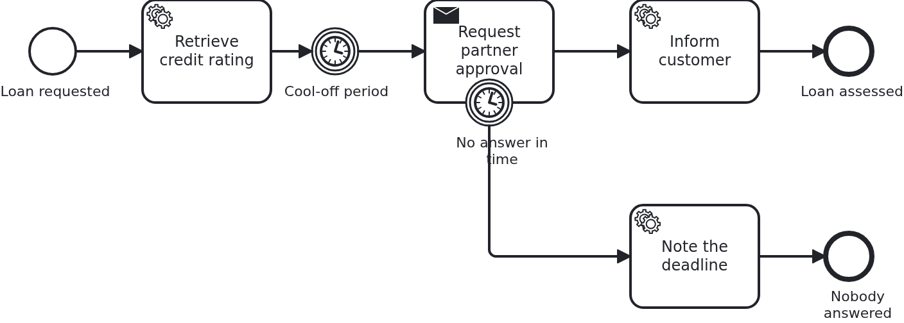

# Timers

[](./LICENSE)

Waiting is part of most business processes: a cool-off period before something is sent, a
deadline after which a request is chased or dropped. A BPMS (business process management
system) does that waiting for you. This blueprint shows two kinds of it: one delays the
process, the other takes work away.

## What this blueprint shows



The loan approval of the base blueprint, with a partner who has to approve the loan, and two
timers around that:

- **A timer in the sequence flow.** After the rating the workflow just waits. Only then is the
  partner asked. Nothing of the application runs in the meantime: no thread, no scheduler, no
  `sleep`. The BPMS holds the instance and wakes it up.
- **A deadline on the waiting task.** The task which asks the partner carries an interrupting
  timer boundary event. If no answer arrives in time, the workflow leaves the task and takes
  the path behind the timer. There the process decides what a missed deadline means.

With the second one the application notices something. An interrupting boundary event cancels
the open task. The handler is called once more with `@TaskEvent CANCELED`, so it can drop the
task id it kept. **Not every BPMS reports that**, so an application must not rely on it.
Answering a task that is gone does nothing either way.
[The adapter's wiki page](https://github.com/vanillabp/adapter-platform-integration/wiki/BPMS-adapters)
says which engines deliver cancellations. The test of this blueprint asserts the cleared id
only where it is delivered.

The durations are in the model (`PT1S` and `PT3S` here). That is a decision, not a detail. A
timer belongs to the process. So changing it means a new process version, with instances still
running on the old one. A deadline which belongs to a contract or a customer is better read
from the aggregate. Both Camunda engines support an expression instead of a literal.

Both durations are literals, so no part of the aggregate has to travel. The class carries
`@NoSyncWithBPMS`, and no attribute carries `@SyncWithBPMS`. So the engine holds the
aggregate's ID and nothing else. If you read a deadline from an expression instead, the
attribute that expression names has to be shared.

## Delta to the base blueprint

Compared to [`module-single`](https://github.com/vanillabp-blueprints/module-single-springboot):

|            File            |                                  What is different                                  |
|----------------------------|-------------------------------------------------------------------------------------|
| `loan_approval.bpmn`       | a timer catch event, a task waiting for a partner, and a timer boundary event on it |
| `WorkflowTaskHandler.java` | the `@WorkflowTask` method of the waiting task, taking `@TaskId` and `@TaskEvent`   |
| `Workflow.java`            | `completeTask` in addition to `startWorkflow`                                       |
| `Service.java`             | sends the request, keeps the task id, answers it, and notes a missed deadline       |
| `Aggregate.java`           | `partnerApprovalTaskId`, `partnerApproved` and `timedOut`                           |
| `LoanApprovalIT.java`      | one test per outcome: answered in time, and not answered at all                     |
| `pom.xml`                  | hands the BPMS of the build to the tests, for the assertion about cancellations     |

## Running it

Requires a JDK 21 or newer. Camunda 7 is embedded, so nothing else has to run:

```bash
mvn install verify
```

To run it on another BPMS, pick another Maven profile. Not one line of Java changes:

```bash
mvn install verify -Pcamunda8
```

Camunda 8 is a remote engine, so a cluster has to run. Start one. Its address and everything
else specific to that engine are in its profile file
`application/src/main/resources/application-camunda8.yaml`. The module's own test has a copy:

```yaml
vanillabp:
  adapters:
    camunda8:
      # Camunda 8 is a remote engine: point this at your cluster.
      rest-address: http://localhost:8080
      # Camunda 8.10 can lose a leased job for a whole job-timeout. Until Camunda fixes that,
      # the adapter advises against a lease. The key has no default:
      # https://github.com/camunda-community-hub/vanillabp-camunda8-adapter/wiki/Configuration#a-job-somebody-else-holds
      job-lease: do-not-use
```

The blueprint does not lease its jobs. On 8.10 the gateway of the cluster can lose a leased
job when a long poll ends, and the job then waits for a whole `job-timeout`. Until Camunda
fixes that, the adapter advises `do-not-use`, and moving to `use` later costs nothing. Why is
[decision 88 of the Camunda 8 adapter](https://github.com/camunda-community-hub/vanillabp-camunda8-adapter/blob/main/DECISIONS.md#88-until-camunda-fixes-its-gateway-the-adapter-advises-against-a-lease-and-its-own-tests-keep-one).

The file is loaded because the Maven profile `camunda8` sets the Spring profile of the same
name. So you choose the engine once, on the Maven command line. The build, the tests and
`spring-boot:run` all follow it.

[Operaton](https://operaton.org), the open source successor of Camunda 7, is embedded as well
and needs nothing else either. The BPMN files are the ones of Camunda 7, because Operaton reads
their `camunda:` attributes:

```bash
mvn install verify -Poperaton
```

[CIB seven](https://cibseven.org), a fork of Camunda 7 made by CIB software, is embedded as
well and needs nothing else either. The BPMN files are the ones of Camunda 7, because CIB seven
reads their `camunda:` attributes:

```bash
mvn install verify -Pcibseven
```

Start the application:

```bash
mvn -pl application spring-boot:run
```

You see nothing about identifiers at startup. The BPMS profiles of this blueprint set
`name-clash-avoidance: use-prefix`. So VanillaBP puts the workflow module ID in front of every
identifier before it reaches the engine, and takes it off again on the way back. The BPMN
files, the business code and the rest of the configuration keep the plain names. No tenant is
involved, which matters on a BPMS licensed per tenant.
[The wiki](https://github.com/vanillabp/adapter-platform-integration/wiki/Workflow-modules#how-name-clashes-are-avoided)
explains the modes and what each of them costs.

Start a loan approval. This is the only URL you need:

```
http://localhost:8080/api/loan-approval/start?amount=5000
```

The rating is done at once. The partner is asked a second later, and from then on the clock
runs:

```
Loan approval '0f7c…' started
Credit rating of loan approval '0f7c…' is 50
Partner was asked to approve loan approval '0f7c…' (5000 at a rating of 50)
Loan approval '0f7c…' waits for the partner, but not forever - the task carries a deadline of three seconds:
  Approved -> http://localhost:8080/api/loan-approval/0f7c…/partner-approved/1a2b…
```

Open that URL quickly, and the answer is accepted:

```
The partner approved loan approval '0f7c…'
The customer of loan approval '0f7c…' was informed
```

Wait instead, and the deadline ends the wait by itself:

```
The partner request of loan approval '4b21…' was canceled
Nobody answered for loan approval '4b21…' in time
```

The first of those two lines is the cancellation. It reaches the same handler that sent the
request, on a BPMS that reports cancellations. If you open the URL afterwards, the answer is
that this request is not open any more. The application decides that on its own.

Camunda 7 serves its own web applications, and the `camunda7` profile of this blueprint
configures a user for them. They are the quickest way to see a timer: the instance sits at the
catch event with the time it will fire. Where they are served and how to log in is in the
[adapter's wiki](https://github.com/camunda-community-hub/vanillabp-camunda7-adapter/wiki/Cockpit-Tasklist-and-Admin).

## How it works

|                                          File                                          |                                              Role                                               |
|----------------------------------------------------------------------------------------|-------------------------------------------------------------------------------------------------|
| `loan-approval/src/main/resources/loan-approval/processes/camunda7/loan_approval.bpmn` | the process: a timer catch event, a waiting task and an interrupting timer boundary event on it |
| `.../loanapproval/WorkflowTaskHandler.java`                                            | the method of the waiting task: `@TaskId` to keep, `@TaskEvent` to hear about the cancellation  |
| `.../loanapproval/Service.java`                                                        | asks the partner once, answers the task, and notes a missed deadline                            |
| `.../loanapproval/Workflow.java`                                                       | `completeTask`, the only place `ProcessService` is used                                         |
| `.../loanapproval/model/Aggregate.java`                                                | the task id, the answer and whether the deadline ran out                                        |
| `loan-approval/src/test/.../LoanApprovalIT.java`                                       | answered in time, and not answered at all                                                       |

Neither timer costs the application anything while it runs. The BPMS stores the due date, wakes
the instance up and delivers the next task. That is the reason to model waiting instead of
building it. A restart, a deployment or a night without traffic changes nothing about a due
date.

The tests wait for the aggregate, not for a clock. A timer fires when the BPMS gets to it. So a
test that sleeps for exactly three seconds fails on a slow machine.

## Documentation

- [Workflow tasks](https://github.com/vanillabp/adapter-platform-integration/wiki/Workflow-tasks#parameters): `@TaskId` and `@TaskEvent`, the two parameters this blueprint needs
- [Completing and canceling asynchronous tasks](https://github.com/vanillabp/adapter-platform-integration/wiki/Workflow-tasks#completing-and-canceling-asynchronous-tasks): the rules the answer follows, and what happens to a task that is gone
- [BPMS adapters](https://github.com/vanillabp/adapter-platform-integration/wiki/BPMS-adapters): which engine reports a cancellation to the application, and which does not
- the wiki of the BPMS adapter you use: how timers are executed, and what an expression instead of a literal duration may read

This blueprint is developed in the monorepo
[`blueprints`](https://github.com/vanillabp-blueprints/blueprints). This repository is a
read-only mirror, **issues and pull requests belong there.**

## Noteworthy & Contributors

[VanillaBP](https://www.github.com/vanillabp/spi-for-java) was developed by [Phactum](https://www.phactum.at) with the
intention of giving back to the community as it has benefited the community in the past.


## License

Copyright 2026 Phactum Softwareentwicklung GmbH

Licensed under the Apache License, Version 2.0
