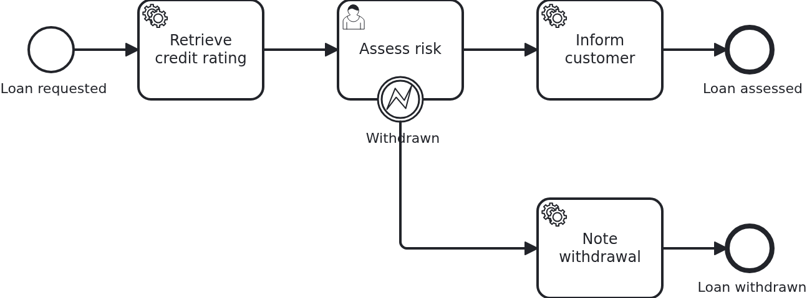

# User tasks

[](./LICENSE)

A user task is a process which waits for a person. The BPMS (business process management
system) opens the task and then does nothing at all until somebody answers. That may be minutes
or weeks later. This blueprint shows the two ends of that wait: what the application has to
keep while the task is open, and how it later completes or cancels it.

## What this blueprint shows



The loan approval of the base blueprint, with a risk assessment which somebody has to do before
the customer is informed. Three things happen around that task:

- The task is created, and VanillaBP calls `WorkflowTaskHandler#assessRisk` to say so. The
  method does not do the work. It receives the task's `@TaskId` and stores it on the workflow
  aggregate. Returning does not complete the task. That is the difference to a service task.
- Somebody answers through the API, which calls `ProcessService#completeUserTask` with the
  stored id. The workflow leaves the user task, and the service task behind it runs.
- Or the customer withdraws the request while the assessment is open. The application calls
  `cancelUserTask` with the error code `loan-withdrawn`. So the workflow leaves through the
  error boundary event instead.

When the task is canceled, the same handler method is called a second time, now with
`@TaskEvent CANCELED`. It drops the stored id. A method without a `@TaskEvent` parameter never
learns about cancellations. Know that before you keep a task id around. The workflow may take
the task away for reasons the application never asked for, like an interrupting boundary event
or the end of the workflow.

Two smaller things are in this blueprint:

- The URLs which continue the process are logged when the task is created. At that place a real
  application notifies whoever has to act, by mail or by putting the task into a task list.
- A task id is a link somebody keeps, so it can live longer than the task it points at.
  `Service#openRiskAssessment` compares the id in the URL with the one on the aggregate and
  refuses anything else. So a link opened twice ends as a message, not as a call to the BPMS.

Not every BPMS supports canceling a user task. The engine has to offer a command for it, and
Camunda 8 does not. VanillaBP answers such a call with an error which names the reason, instead
of pretending. That is why the test of the cancellation runs on Camunda 7 and on Operaton.
[Its adapter's wiki page](https://github.com/vanillabp/adapter-platform-integration/wiki/BPMS-adapters)
says which operations a BPMS supports. The Camunda 8 adapter names this one under
[deviations](https://github.com/camunda-community-hub/vanillabp-camunda8-adapter/wiki/Deviations#cancelusertask-is-not-supported).

## Delta to the base blueprint

Compared to [`module-single`](https://github.com/vanillabp-blueprints/module-single-quarkus):

|            File            |                                                             What is different                                                             |
|----------------------------|-------------------------------------------------------------------------------------------------------------------------------------------|
| `loan_approval.bpmn`       | a user task between the service task and the end, an error boundary event on it, and two service tasks which show where the workflow went |
| `WorkflowTaskHandler.java` | the `@WorkflowTask` method of the user task, taking `@TaskId` and `@TaskEvent`                                                            |
| `Workflow.java`            | `completeUserTask` and `cancelUserTask` in addition to `startWorkflow`                                                                    |
| `Service.java`             | the two halves of a user task: what happens when it opens, and what happens when the answer arrives through the API                       |
| `ApiController.java`       | the URLs answering and withdrawing, both carrying the task id                                                                             |
| `Aggregate.java`           | `riskAssessmentTaskId` and what the process wrote on the way out                                                                          |
| `LoanApprovalIT.java`      | one test per way a user task ends: answered, canceled, and still open                                                                     |
| `pom.xml`                  | hands the BPMS of the build to the tests, so the test of the cancellation knows where it can run                                          |

## Running it

Requires a JDK 21 or newer. Camunda 7 is embedded, so nothing else has to run:

```bash
mvn install verify
```

To run it on another BPMS, pick another Maven profile. Not one line of Java changes:

```bash
mvn install verify -Pcamunda8
```

Camunda 8 is a remote engine, so a cluster has to run. Start one. Its address and everything
else specific to that engine are in its profile file
`application/src/main/resources/application-camunda8.yaml`. The module's own test has a copy:

```yaml
vanillabp:
  adapters:
    camunda8:
      # Camunda 8 is a remote engine: point this at your cluster.
      rest-address: http://localhost:8080
      # This adapter leases the jobs it holds, so the cluster takes the answer of the current
      # activation only. The key has no default, because a lease cannot be taken back. This is
      # the value the adapter recommends:
      # https://github.com/camunda-community-hub/vanillabp-camunda8-adapter/wiki/Configuration#a-job-somebody-else-holds
      job-lease: use
```

The file is loaded because the Maven profile `camunda8` makes the config profile of the same
name the parent of the profile the application runs in. So you choose the engine once, on the
Maven command line. The build, the tests and `quarkus:dev` all follow it.

[Operaton](https://operaton.org), the open source successor of Camunda 7, is embedded as well
and needs nothing else either. The BPMN files are the ones of Camunda 7, because Operaton reads
their `camunda:` attributes:

```bash
mvn install verify -Poperaton
```

The test which cancels the user task does not run there. The build reports it as a skipped
test, not as a passing one.

Start the application:

```bash
mvn -pl application quarkus:dev
```

You see nothing about identifiers at startup. The BPMS profiles of this blueprint set
`name-clash-avoidance: use-prefix`. So VanillaBP puts the workflow module ID in front of every
identifier before it reaches the engine, and takes it off again on the way back. The BPMN
files, the business code and the rest of the configuration keep the plain names. No tenant is
involved, which matters on a BPMS licensed per tenant.
[The wiki](https://github.com/vanillabp/adapter-platform-integration/wiki/Workflow-modules#how-name-clashes-are-avoided)
explains the modes and what each of them costs.

Start a loan approval. This is the only URL you need:

```
http://localhost:8080/api/loan-approval/start?amount=5000
```

The process runs up to the risk assessment and stops there. It logs the URLs which continue it,
each one filled in and ready to click:

```
Loan approval '0f7c…' started
Credit rating of loan approval '0f7c…' is 50
Loan approval '0f7c…' waits for a risk assessment. Continue with one of:
  Acceptable    -> http://localhost:8080/api/loan-approval/0f7c…/assess-risk/1a2b…?riskIsAcceptable=true
  Too risky     -> http://localhost:8080/api/loan-approval/0f7c…/assess-risk/1a2b…?riskIsAcceptable=false
  Withdraw      -> http://localhost:8080/api/loan-approval/0f7c…/withdraw/1a2b…
```

Opening one of the first two completes the task, and the process goes on to its end:

```
Risk of loan approval '0f7c…' was assessed as acceptable
The customer of loan approval '0f7c…' was informed that the risk is acceptable
```

Opening the third one cancels it instead, and the workflow takes the error path:

```
The risk assessment of loan approval '0f7c…' was canceled
Loan approval '0f7c…' was withdrawn by the customer
Loan approval '0f7c…' ended as withdrawn
```

The first of those three lines is the cancellation notification. It arrives at the same handler
method which was called when the task was created. If you open the same URL twice, the answer
is that this assessment is not open any more. The application decides that on its own, without
asking the BPMS.

## How it works

|                                          File                                          |                                                         Role                                                         |
|----------------------------------------------------------------------------------------|----------------------------------------------------------------------------------------------------------------------|
| `loan-approval/src/main/resources/loan-approval/processes/camunda7/loan_approval.bpmn` | the process: a user task carrying the task definition, an error boundary event on it, and a service task per way out |
| `.../loanapproval/WorkflowTaskHandler.java`                                            | the `@WorkflowTask` method of the user task: `@TaskId`, `@TaskEvent`, and no work of its own                         |
| `.../loanapproval/Service.java`                                                        | both halves of the task: keeping the id when it opens, answering it when the API is called                           |
| `.../loanapproval/Workflow.java`                                                       | `completeUserTask` and `cancelUserTask`, the only place `ProcessService` is used                                     |
| `.../loanapproval/ApiController.java`                                                  | the GET endpoints answering and withdrawing                                                                          |
| `.../loanapproval/model/Aggregate.java`                                                | `riskAssessmentTaskId`, the handle to the open task, plus what the process wrote                                     |
| `loan-approval/src/test/.../LoanApprovalIT.java`                                       | one test per way the task ends. They wait for the aggregate instead of asking the engine                             |

The order of events: the service task fills in the credit rating. Then the BPMS creates the
user task and calls `WorkflowTaskHandler#assessRisk` with `TaskEvent.CREATED`. The handler
hands over to `Service#riskAssessmentOpened`, which stores the task id on the aggregate.
VanillaBP saves the aggregate after the call, as for any other task. The workflow now waits.

Whenever the answer arrives, `ApiController` calls `Service#assessRisk`. It writes the result
and tells `Workflow` that the risk was assessed. `Workflow#riskAssessed` calls
`ProcessService#completeUserTask` with the id, in a transaction. The aggregate is saved along
with the answer. On a remote BPMS the completion is sent only after that transaction committed.
So a rollback leaves the task open, instead of completing a task whose result was undone.

Withdrawing takes the same route through `cancelUserTask`, with an error code which the BPMN
catches. Afterwards the task is gone. So the handler is called once more with
`TaskEvent.CANCELED`, and drops the stored id. VanillaBP finds the BPMS which holds the task by
itself. That is why neither `Workflow` nor `Service` names one.

The tests wait instead of asserting at once. A BPMS runs tasks in transactions of its own. A
user task created by a remote engine arrives a moment after the workflow was started. Asserting
right away would pass on an embedded engine and fail on a remote one.

## Documentation

- [User tasks](https://github.com/vanillabp/adapter-platform-integration/wiki/Workflow-tasks#user-tasks): the notification handler, the task id and completing the task later
- [Parameters](https://github.com/vanillabp/adapter-platform-integration/wiki/Workflow-tasks#parameters): `@TaskId`, `@TaskEvent` and everything else a handler may ask for
- [Completing and canceling asynchronous tasks](https://github.com/vanillabp/adapter-platform-integration/wiki/Workflow-tasks#completing-and-canceling-asynchronous-tasks): the rules those calls follow, which are the ones a user task follows too
- [User tasks and asynchronous tasks](https://github.com/vanillabp/spi-for-java#user-tasks-and-asynchronous-tasks): the annotations used in `WorkflowTaskHandler.java`
- the wiki of the [BPMS adapter](https://github.com/vanillabp/adapter-platform-integration/wiki/BPMS-adapters) you use: which BPMN attribute carries the task definition of a user task, and whether cancellations are supported

This blueprint is developed in the monorepo
[`blueprints`](https://github.com/vanillabp-blueprints/blueprints). This repository is a
read-only mirror, **issues and pull requests belong there.**

## Noteworthy & Contributors

[VanillaBP](https://www.github.com/vanillabp/spi-for-java) was developed by [Phactum](https://www.phactum.at) with the
intention of giving back to the community as it has benefited the community in the past.


## License

Copyright 2026 Phactum Softwareentwicklung GmbH

Licensed under the Apache License, Version 2.0
