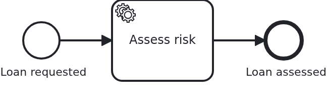

# Versions of a BPMN process

[](./LICENSE)

A process gets changed while workflows still run on the model it had yesterday. Those workflows
keep the version they were started on. They reach their next task and expect the behaviour of
that version. This blueprint shows how an application serves both, without a flag on the
aggregate and without an `if` in the business code.

## What this blueprint shows



One service task, `assessRisk`, and two methods serving it:

```java
@WorkflowTask(taskDefinition = "assessRisk", version = "1")
public void assessRiskManually(final Aggregate loanRequest) { ... }

@WorkflowTask(taskDefinition = "assessRisk", version = ">1")
public void assessRiskAutomatically(final Aggregate loanRequest) { ... }
```

In version 1 of the process a person assessed the risk. Every version after it computes a
score. The version of the process definition the workflow runs on decides which method is
called. That version comes from the BPMS (business process management system). Both Camunda
engines count integers upwards per BPMN process id. A boundary may also be a version tag from
the model (`camunda:versionTag`, `zeebe:versionTag`). Ranges are written `1-3`, `v1.0..v2.0`,
`>3` or `<v2.0`.

The engine of the module test is empty. So this model deploys as version 1, and
`assessRiskManually` runs. A second test shows the case the feature exists for: an application
which has moved on, and a workflow which has not. See
[the second deployment](#the-second-deployment) below.

What is worth knowing beyond the annotation:

- **Two methods may not serve overlapping versions.** VanillaBP reports that while the
  application starts, and names both methods. It does not let the first task of the wrong
  version find out.
- **The old method is not dead code.** If you delete it while workflows still run on that
  version, their next task becomes an incident. VanillaBP says so at startup. It asks the BPMS
  which versions still have running workflows. It reports every task definition of such a
  version which no method serves.
- **The old attributes stay on the aggregate.** No new workflow writes `assessedBy`. Removing
  it would take the data of the running ones with it. The aggregate is the state of the
  business case, not of the current release. Neither it nor `riskScore` reaches the BPMS. The
  class carries `@NoSyncWithBPMS`, and no attribute takes that back, because no expression in
  the model reads one. The version a workflow runs on comes from the BPMS itself. So choosing
  the method needs nothing shared either.
- **You can declare a version obsolete once nobody runs on it any more**, instead of serving it
  forever:

  ```yaml
  vanillabp:
    adapters:
      camunda7:
        outfaded-versions: 1
  ```

  This is a statement about workflows, not about deployments. The definition stays in the
  engine, and VanillaBP stops asking for methods which serve it.

## Delta to the base blueprint

Compared to [`module-single`](https://github.com/vanillabp-blueprints/module-single-springboot):

|                  File                   |                                 What is different                                  |
|-----------------------------------------|------------------------------------------------------------------------------------|
| `WorkflowTaskHandler.java`              | two methods for one task definition, each with the versions it serves              |
| `Service.java`                          | one business method per version of the assessment, neither knowing about the other |
| `model/Aggregate.java`                  | `assessedBy` from version 1 next to `riskScore` of the versions after it           |
| `loan_approval.bpmn`                    | the task is named `assessRisk`, which is the definition both methods refer to      |
| `LoanApprovalIT.java`                   | asserts which of the two methods ran, which is what proves the dispatch            |
| `SecondDeploymentIT.java`               | deploys an older model and then this one, and asserts what each workflow ran       |
| `version-1/camunda7/loan_approval.bpmn` | the older model that test deploys first                                            |

## Running it

Requires a JDK 21 or newer. Camunda 7 is embedded, so nothing else has to run:

```bash
mvn install verify
```

To run it on another BPMS, pick another Maven profile. Not one line of Java changes:

```bash
mvn install verify -Pcamunda8
```

The test asserts which of the two methods ran. So it needs an engine which does not know this
process yet. There the deployment is version 1, and the first method serves version 1. An
embedded Camunda 7 starts empty every time. A Camunda 8 cluster does not, so use a fresh one
when you run the test twice.

Camunda 8 is a remote engine, so a cluster has to run. Start one. Its address and everything
else specific to that engine are in its profile file
`application/src/main/resources/application-camunda8.yaml`. The module's own test has a copy:

```yaml
vanillabp:
  adapters:
    camunda8:
      # Camunda 8 is a remote engine: point this at your cluster.
      rest-address: http://localhost:8080
      # Camunda 8.10 can lose a leased job for a whole job-timeout. Until Camunda fixes that,
      # the adapter advises against a lease. The key has no default:
      # https://github.com/camunda-community-hub/vanillabp-camunda8-adapter/wiki/Configuration#a-job-somebody-else-holds
      job-lease: do-not-use
```

The blueprint does not lease its jobs. On 8.10 the gateway of the cluster can lose a leased
job when a long poll ends, and the job then waits for a whole `job-timeout`. Until Camunda
fixes that, the adapter advises `do-not-use`, and moving to `use` later costs nothing. Why is
[decision 88 of the Camunda 8 adapter](https://github.com/camunda-community-hub/vanillabp-camunda8-adapter/blob/main/DECISIONS.md#88-until-camunda-fixes-its-gateway-the-adapter-advises-against-a-lease-and-its-own-tests-keep-one).

The file is loaded because the Maven profile `camunda8` sets the Spring profile of the same
name. So you choose the engine once, on the Maven command line. The build, the tests and
`spring-boot:run` all follow it.

[Operaton](https://operaton.org), the open source successor of Camunda 7, is embedded as well
and needs nothing else either. The BPMN files are the ones of Camunda 7, because Operaton reads
their `camunda:` attributes:

```bash
mvn install verify -Poperaton
```

Take the address out and the application does not boot. This is the normal way to work with
VanillaBP: it checks the configuration while it boots, and the message names the property to
set.

Start the application:

```bash
mvn -pl application spring-boot:run
```

You see nothing about identifiers at startup. The BPMS profiles of this blueprint set
`name-clash-avoidance: use-prefix`. So VanillaBP puts the workflow module ID in front of every
identifier before it reaches the engine, and takes it off again on the way back. The BPMN
files, the business code and the rest of the configuration keep the plain names. No tenant is
involved, which matters on a BPMS licensed per tenant.
[The wiki](https://github.com/vanillabp/adapter-platform-integration/wiki/Workflow-modules#how-name-clashes-are-avoided)
explains the modes and what each of them costs.

Start a loan approval. This is the only URL you need:

```
http://localhost:8080/api/loan-approval/start?amount=5000
```

It answers with the ID of the loan request and logs the URL which shows the result:

```
Loan approval '0f7c…' started
Credit rating of loan approval '0f7c…' is 50
Show the result -> http://localhost:8080/api/loan-approval/0f7c…
```

Opening that URL shows the aggregate, including the credit rating the service task wrote.

Camunda 7 serves its own web applications, and the `camunda7` profile of this blueprint
configures a user for them. The
[adapter's wiki](https://github.com/camunda-community-hub/vanillabp-camunda7-adapter/wiki/Cockpit-Tasklist-and-Admin)
says where they are served and how to log in.

## How it works

|                                          File                                          |                                           Role                                           |
|----------------------------------------------------------------------------------------|------------------------------------------------------------------------------------------|
| `loan-approval/src/main/resources/loan-approval/processes/camunda7/loan_approval.bpmn` | the process: one service task, whose definition both methods refer to                    |
| `.../loanapproval/WorkflowTaskHandler.java`                                            | `@WorkflowTask(taskDefinition = "assessRisk", version = ...)` twice, once per range      |
| `.../loanapproval/Service.java`                                                        | `assessRiskManually` for version 1, `assessRiskAutomatically` for the versions after it  |
| `.../loanapproval/model/Aggregate.java`                                                | what both of them write, including the attribute only the older version fills            |
| `loan-approval/src/test/.../LoanApprovalIT.java`                                       | starts a workflow and asserts which method served it                                     |
| `application/src/test/.../SecondDeploymentIT.java`                                     | two boots, two versions: the start message and the old workflow ending on its own method |

The method is chosen per delivered task, not per workflow. VanillaBP asks the adapter which
version the workflow runs on, and picks the method whose range covers it. A BPMS which does not
report a version serves every method, whatever the annotation says. A range which names a
version tag needs a BPMS which can be asked about its tags.

What this means for a deployment: put the new model and the new method in one release. The
running workflows keep their version and their method. New workflows get the new one. Nothing
has to be migrated. It costs one old method per version still in use. That is the honest price
of not migrating running instances.

The reverse is worth saying too. If you change the behaviour of a task without a new version,
by editing the existing method, it changes for the running workflows as well. Sometimes that is
what you want, and for a bug fix it usually is. The version range is for the other case. Ask
yourself: should a workflow started yesterday end the way it started, or the way the
application works today?

### The second deployment

`SecondDeploymentIT` plays through an upgrade. It boots the application twice against one file
database:

1. The first boot deploys the model as it was before the change, from
   `application/src/test/resources/version-1/`. The engine counts it as version 1. A workflow
   starts and waits a few seconds before its risk is assessed. The application stops while it
   waits.
2. The second boot deploys the model this blueprint ships. It differs from the old one, so the
   engine counts it as version 2. The waiting workflow keeps version 1.

Then the test checks what a developer would see. The start of the second boot logs a notice
like this. It is a notice, not a warning, because every task of version 1 still has a method:

```
DEPLOYED VERSIONS (1)
  process 'loan_approval' of workflow module 'loan-approval', adapter 'camunda7'
      1 workflow(s) of this BPMN process still run on 1 version(s) older than the one
      the adapter deployed during this boot: 1. They keep being served - this is not a
      defect - ...
```

The old workflow then ends through `assessRiskManually`, the method kept for version 1. A
workflow started in the second boot ends through `assessRiskAutomatically`. Delete the first
method, and the start says so instead: a task definition of a version which workflows still run
on, and no method which serves it.

The test runs in the profiles of the embedded engines, `camunda7` and `operaton`, and skips
itself in the `camunda8` profile. It checks the choice of method by version number, and only an
engine which starts empty counts from one. A Camunda 8 cluster keeps every version deployed
before. So there the older model would not be version 1.

## Documentation

- [Workflow modules](https://github.com/vanillabp/adapter-platform-integration/wiki/Workflow-modules): what a workflow module is, its ID, and where its BPMN files are looked for
- [Defining a workflow module](https://github.com/vanillabp/adapter-platform-integration/wiki/Workflow-modules-in-Spring-Boot#defining-a-workflow-module): the marker file, resource conventions and the module's own configuration files
- [How name clashes are avoided](https://github.com/vanillabp/adapter-platform-integration/wiki/Workflow-modules#how-name-clashes-are-avoided): the modes keeping two workflow modules apart, and what each of them costs
- [Workflow aggregates](https://github.com/vanillabp/adapter-platform-integration/wiki/Workflow-aggregates): why there are no process variables
- [Wire up a process / Wire up a task](https://github.com/vanillabp/spi-for-java#usage): the annotations used in `WorkflowTaskHandler.java`, including the version ranges
- [BPMS adapters](https://github.com/vanillabp/adapter-platform-integration/wiki/BPMS-adapters): which engine reports a version, and which one can be asked about version tags
- the wiki of the [BPMS adapter](https://github.com/vanillabp/adapter-platform-integration/wiki/BPMS-adapters) you use: how a BPMN task has to be modelled for that engine

This blueprint is developed in the monorepo
[`blueprints`](https://github.com/vanillabp-blueprints/blueprints). This repository is a
read-only mirror, **issues and pull requests belong there.**

## Noteworthy & Contributors

[VanillaBP](https://www.github.com/vanillabp/spi-for-java) was developed by [Phactum](https://www.phactum.at) with the
intention of giving back to the community as it has benefited the community in the past.


## License

Copyright 2026 Phactum Softwareentwicklung GmbH

Licensed under the Apache License, Version 2.0
