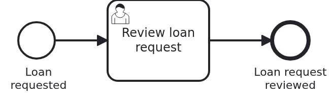

# A button in the header of the Business Cockpit, application

[](./LICENSE)

Your users work in the
[VanillaBP Business Cockpit](https://github.com/vanillabp/business-cockpit). A workflow module
can put a button into the header of the cockpit, for example to start a process. This blueprint
is the application which runs such a module: it takes the workflow module and the JAR of its user
interface, and it serves both. It has no code of its own apart from the class which starts it.

## What this blueprint shows



A loan approval with one user task, "Review loan request". The process, the endpoint of the start
form and who sees the module in the cockpit are in the backend. The button "Request a loan" and
the start form are in the frontend. This repository puts them together.

It is built like
[`cockpit-user-task-application`](https://github.com/vanillabp-blueprints/cockpit-user-task-application-springboot),
the application of the blueprint about the forms of user tasks. Only the names differ. Its README
explains why a workflow module with a user interface has three repositories, why npm does not
build inside Maven, why the user interface is a dependency and why the application is only a
container. All of that holds here as well.

### The parts of a workflow module with a user interface

|                       Part                        |                                      What it holds                                      | Built with |
|---------------------------------------------------|-----------------------------------------------------------------------------------------|------------|
| `cockpit-header-extension-backend-springboot`     | the API of the start form as an OpenAPI file, and the workflow module                   | Maven      |
| `cockpit-header-extension-frontend-react`         | the button in the header and the start form, as a JAR of the user interface             | npm        |
| `cockpit-header-extension-application-springboot` | this repository: the application which takes the workflow module and the user interface | Maven      |

Release them in this order: the backend, then the frontend, then this application. The two
versions this application takes are properties in `pom.xml`. A bot such as Renovate opens the
pull request which moves them from a snapshot to a release.

### The way the cockpit reaches the application

The cockpit forwards everything below `/wm/loan-approval/` to the address the module reports, its
`workflow-module-uri`, and puts the path of that address in place of `/wm/loan-approval`. The
module reports `http://localhost:8080/loan-approval`. So the API of the start form and the user
interface are both below `/loan-approval` here:

|      The browser asks the cockpit for      |        The application gets        |     It comes from      |
|--------------------------------------------|------------------------------------|------------------------|
| `/wm/loan-approval/bc-manifest.json`       | `/loan-approval/bc-manifest.json`  | the user interface JAR |
| `/wm/loan-approval/entries/...`            | `/loan-approval/entries/...`       | the user interface JAR |
| `POST /wm/loan-approval/api/loan-requests` | `/loan-approval/api/loan-requests` | the workflow module    |

Whether the browser asks at all is decided before. The cockpit lists the module only for the
members of `LOAN_OFFICERS`, the group the module names. A cockpit user interface loads the button
only from the modules in that list.

## Delta to the base blueprint

Compared to [`cockpit-workflow-details-application`](https://github.com/vanillabp-blueprints/cockpit-workflow-details-application-springboot):

|               File                |                                           What is different                                            |
|-----------------------------------|--------------------------------------------------------------------------------------------------------|
| `pom.xml`                         | the workflow module of `cockpit-header-extension-backend` and the UI JAR `cockpit-header-extension-ui` |
| `UserInterfaceSmokeTest.java`     | the manifest lists `Header` and `StartForm`, and the endpoint of the start form starts a loan approval |
| `docker-compose.yaml`             | other names of the containers                                                                          |
| `docker/dev-shell-simulator.yaml` | two users: Jane is a loan officer, John is not                                                         |

## Running it

Requires a JDK 21 or newer. The workflow module and the user interface JAR have to be in your
Maven repository. Until they are released, install them yourself: `mvn install` in the backend,
then `npm run build` in the frontend and `mvn install:install-file` of the JAR it built, as its
README says. Then:

```bash
mvn install
```

That runs the smoke tests on Camunda 7, which is embedded. To run on another BPMS, pick another
Maven profile. Not one line of Java changes:

```bash
mvn install -Pcamunda8
mvn install -Poperaton
mvn install -Pcibseven
```

Camunda 8 is a remote engine, so a cluster has to run. Its address and everything else specific
to that engine are in `application-camunda8.yaml`.

### With a cockpit

`docker-compose.yaml` starts a Business Cockpit and its MongoDB, as in `cockpit-user-task-application`:

```bash
mvn dependency:copy@business-cockpit
docker compose up -d
mvn spring-boot:run
```

On Docker Desktop, switch on host networking in the settings. This cockpit has no user interface
of its own, but its API for a user interface and its proxy work. Log in as `jane` with the
password `test`, and ask the cockpit which workflow modules Jane may see, and for the manifest of
the module:

```
http://localhost:9080/gui/api/v1/workflow-module
http://localhost:9080/wm/loan-approval/bc-manifest.json
```

The list holds `loan-approval`, because Jane is a loan officer. Log in as `john` instead, and the
list is empty: John sees no button. A cockpit with a user interface draws the button for Jane in
its header, and the start form starts a loan approval. Without one, start it here:

```
http://localhost:8080/loan-approval/api/loan-requests/start?applicant=Jane%20Doe&amount=5000
```

The cockpit now has the case and its user task "Review loan request". Stop the containers with
`docker compose down`.

## How it works

|                      File                      |                                                   Role                                                    |
|------------------------------------------------|-----------------------------------------------------------------------------------------------------------|
| `pom.xml`                                      | the workflow module, the user interface JAR, and per BPMS profile both adapters                           |
| `src/main/java/.../Application.java`           | starts the application. The module wires itself, so the package does not matter                           |
| `src/main/resources/application.yaml`          | the database, the active BPMS profile, and the cockpit the reports go to                                  |
| `src/main/resources/application-camunda7.yaml` | what Camunda 7 needs, and the same file per other BPMS                                                    |
| `src/test/.../ApplicationSmokeTest.java`       | the context starts, and every workflow module is wired                                                    |
| `src/test/.../UserInterfaceSmokeTest.java`     | the manifest comes from the user interface JAR, and the endpoint of the start form starts a loan approval |
| `docker-compose.yaml`                          | MongoDB, the user directory and the cockpit, on the network of your machine                               |
| `docker/dev-shell-simulator.yaml`              | the users of that cockpit, one inside the group of the module and one outside                             |

The application starts, and VanillaBP deploys the process of the module. The module registers
with the cockpit, with its `workflow-module-uri`, `ui-uri-type: ES_MODULES`,
`ui-uri-path: /bc-manifest.json` and the group `LOAN_OFFICERS` of its
`WorkflowModuleDetailsProvider`.

A loan officer opens the cockpit. Its user interface reads the list of modules, finds
`loan-approval`, and loads `/wm/loan-approval/bc-manifest.json`, which is the manifest of the user
interface JAR in this application. It asks the entry `Header` and draws the button. The start
form behind it posts to `/wm/loan-approval/api/loan-requests`, which is the controller of the
workflow module. The module starts the process, and the cockpit adapter reports the new case.

The smoke tests ask for the manifest and the endpoint without a cockpit. A missing dependency, or
a path which does not fit the module id, breaks one of them, and the application still starts.
That is why the test asks.

## Documentation

- [Connecting a workflow module](https://github.com/vanillabp/business-cockpit/wiki/Connecting-a-workflow-module): the cockpit adapter, where the reports go, and how a module registers itself
- [Who sees which workflow module](https://github.com/vanillabp/business-cockpit/wiki/Security#who-sees-which-workflow-module): the list of modules a user interface loads its parts from
- [What a workflow module tells the cockpit](https://github.com/vanillabp/business-cockpit/wiki/Configuration#what-a-workflow-module-tells-the-cockpit): `workflow-module-uri`, `ui-uri-type`, `ui-uri-path` and the other keys
- [Running the Business Cockpit](https://github.com/vanillabp/business-cockpit/wiki/Running-the-Business-Cockpit): the cockpit server and its MongoDB
- the wiki of the [BPMS adapter](https://github.com/vanillabp/adapter-platform-integration/wiki/BPMS-adapters) you use

This blueprint is developed in the monorepo
[`blueprints`](https://github.com/vanillabp-blueprints/blueprints). This repository is a
read-only mirror, **issues and pull requests belong there.**

## Noteworthy & Contributors

[VanillaBP](https://www.github.com/vanillabp/spi-for-java) was developed by [Phactum](https://www.phactum.at) with the
intention of giving back to the community as it has benefited the community in the past.


## License

Copyright 2026 Phactum Softwareentwicklung GmbH

Licensed under the Apache License, Version 2.0
