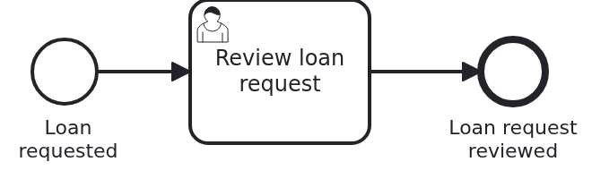

# A button in the header of the Business Cockpit, backend

[](./LICENSE)

Your users work in the
[VanillaBP Business Cockpit](https://github.com/vanillabp/business-cockpit). A workflow module
does not only show forms of user tasks and pages of cases there. It can also fill parts of the
cockpit itself. The most important case is starting a process. A loan request which does not
exist yet has no user task and no case page where a button could be. So the module puts a button
into the header of the cockpit. This blueprint is the backend of such a module: the API of the
start form behind the button, the workflow module which implements it, and who sees the button.

## What this blueprint shows



A loan approval with one user task, "Review loan request". It keeps the case open, so the new
case stays in the case list. In the cockpit, a loan officer clicks "Request a loan" in the header.
The start form opens in a dialog of the cockpit. Its OK calls the module's own API,
`POST /wm/loan-approval/api/loan-requests`, and the module starts the process. The button and the
form are not here. They are a user interface, built with npm, in a repository of its own. This
repository holds what the button needs from the backend.

This blueprint builds on
[`cockpit-workflow-details-backend`](https://github.com/vanillabp-blueprints/cockpit-workflow-details-backend-springboot),
which shows the page of a case. What is the same there is only linked here: why a module with a
user interface has three repositories, why the API is a file, and how a request of the browser
reaches the module.

### The parts of a workflow module with a user interface

|                       Part                        |                                     What it holds                                      | Built with |
|---------------------------------------------------|----------------------------------------------------------------------------------------|------------|
| `cockpit-header-extension-backend-springboot`     | this repository: the API of the start form as an OpenAPI file, and the workflow module | Maven      |
| `cockpit-header-extension-frontend-react`         | the button in the header and the start form, as a JAR of the user interface            | npm        |
| `cockpit-header-extension-application-springboot` | the application which takes the workflow module and the user interface and runs them   | Maven      |

Why there are three, and in which order they are released, is explained in
[`cockpit-user-task-backend`](https://github.com/vanillabp-blueprints/cockpit-user-task-backend-springboot#the-parts-of-a-workflow-module-with-a-user-interface).
It holds for every workflow module with a user interface.

### The module starts the case, not the cockpit

The cockpit does not start or end a case. It only shows what the workflow module reports. So the
start form does not ask the cockpit. It posts what the user typed to the module's own API, and the
cockpit forwards the request to the module. The module picks the id of the new loan request,
starts the process and answers 201 with the id. The cockpit adapter reports the new case, the way
it reports every other case, and the case is in the case list. From there on, the case goes on
like in `cockpit-user-task` and `cockpit-workflow-details`: with its user task and its page.

The form sends a body, so the endpoint is a POST. The GET endpoints of `ApiController` are for a
person with a browser.

The endpoint refuses an empty applicant and an amount which is not positive with 400, before a
process starts. The OpenAPI says the same, and the form checks it as well.

### Who sees the button

The cockpit asks every workflow module the user may see whether it has something for the header.
Which modules a user may see, the cockpit decides from the groups each module names when it
registers. The module names them with a bean which implements `WorkflowModuleDetailsProvider`.
Here it is `LoanApprovalModuleDetails`, and it names the group `LOAN_OFFICERS`.

A cockpit user interface reads the list of modules with `GET /gui/api/v1/workflow-module`. The
cockpit leaves out every module whose groups the user is not in. The user interface loads the
parts which belong to no case, like the button in the header, only from the modules in that list.
So John, who is not a loan officer, never sees the button, and his browser never loads the code
of the start form.

The bean decides nothing about the task list and the case list. Whether a user sees a task or a
case is decided for each of them, from what the cockpit adapter reported. A module without such a
bean is visible to everybody.

The bean does not protect the endpoint either. Somebody who knows the address can still post to
it. How a module protects its endpoints is the subject of a blueprint of its own about roles and
permissions.

### Other parts of the cockpit a module can fill

The header is one extension point of a generated cockpit. A cockpit generated with the skill may
have more. Two others are common, and this blueprint does not build them:

- an entry in the menu of the cockpit, which opens a page of the module,
- a page of the module which belongs to no case, for example a page to keep the master data a
  process needs.

The skill calls such pages `Pages` and does not propose them by default. A module which offers
them names a data entry `Pages` of its own, as this one names `Header`. The backend is the same
as here: an API in an OpenAPI file, a controller which implements it, and the bean which says who
sees the module.

### The module wires itself

`LoanApprovalAutoConfiguration` scans the package of the module for beans, entities and
repositories, as in
[`cockpit-user-task-backend`](https://github.com/vanillabp-blueprints/cockpit-user-task-backend-springboot#the-module-wires-itself).
The scan finds `LoanApprovalModuleDetails` as well. An application adds the module as a Maven
dependency, and that is all. Its user interface comes from the UI jar.

## Delta to the base blueprint

Compared to [`cockpit-workflow-details-backend`](https://github.com/vanillabp-blueprints/cockpit-workflow-details-backend-springboot):

|                 File                 |                                                   What is different                                                    |
|--------------------------------------|------------------------------------------------------------------------------------------------------------------------|
| `openapi/loan-approval.yaml`         | the one endpoint of the start form instead of the two of the case page                                                 |
| `loan_approval.bpmn`                 | the one user task, without the event subprocess                                                                        |
| `LoanApprovalModuleDetails.java`     | new: names the group `LOAN_OFFICERS`, the only users who see the module, and so the button                             |
| `StartFormController.java`           | new, instead of `CasePageController.java`: starts a loan approval with what the user typed, below `/loan-approval/api` |
| `WorkflowTaskHandler.java`           | the `@WorkflowTask` method of the user task only, and no `@WorkflowDetailsProvider` method                             |
| `Service.java`                       | picks the id of a new loan request and starts the process. No withdrawal                                               |
| `Workflow.java`                      | `startWorkflow` and `completeUserTask`, no `correlateMessage`                                                          |
| `Aggregate.java`                     | the applicant, the amount and the id of the open user task, no status                                                  |
| `ApiController.java`                 | the id of a loan request comes from the service                                                                        |
| `LoanApprovalIT.java`                | starts a loan approval through the start form, finds the case in the case list, and checks who sees the module         |
| `dev-shell-simulator.yaml` (test)    | two users: Jane is a loan officer, John is not                                                                         |
| `LoanApprovalAutoConfiguration.java` | its Javadoc names `LoanApprovalModuleDetails`                                                                          |

## Running it

Requires a JDK 21 or newer. Camunda 7 is embedded, so nothing else has to run:

```bash
mvn install
```

That runs the integration test, which starts the dev shell simulator of the cockpit itself. To
run it on another BPMS, pick another Maven profile. Not one line of Java changes:

```bash
mvn install -Pcamunda8
mvn install -Poperaton
mvn install -Pcibseven
```

Camunda 8 is a remote engine, so a cluster has to run. Its address and everything else specific
to that engine are in the test's profile file
`loan-approval/src/test/resources/application-camunda8.yaml`.

### Running the backend for the development of the user interface

It works as in
[`cockpit-user-task-backend`](https://github.com/vanillabp-blueprints/cockpit-user-task-backend-springboot#running-the-backend-for-the-development-of-the-user-interface):
build once, start the dev shell simulator on port 8079, then start the backend on port 8080, in
a second terminal.

```bash
mvn install -DskipTests
java -jar loan-approval/target/dev-shell-simulator.jar \
  --spring.config.additional-location=loan-approval/src/test/resources/dev-shell-simulator.yaml
mvn -pl loan-approval spring-boot:test-run -Dspring-boot.run.profiles=camunda7
```

Start a loan approval without the cockpit, look at it, and approve it:

```
http://localhost:8080/loan-approval/api/loan-requests/start?applicant=Jane%20Doe&amount=5000
http://localhost:8080/loan-approval/api/loan-requests/<loan request id>
http://localhost:8080/loan-approval/api/loan-requests/<loan request id>/approve
```

Approving stands in for the form of the user task, which this blueprint does not have. The start
form posts to `/loan-approval/api/loan-requests`, which a browser cannot do from its address bar.

## How it works

|                                          File                                          |                                                     Role                                                      |
|----------------------------------------------------------------------------------------|---------------------------------------------------------------------------------------------------------------|
| `loan-approval/src/main/resources/openapi/loan-approval.yaml`                          | the contract between the start form and the module: one operation, below the server `/wm/loan-approval`       |
| `loan-approval/src/main/resources/openapi/loan-requests.yaml`                          | the GET endpoints for a person with a browser                                                                 |
| `loan-approval/src/main/resources/loan-approval/processes/camunda7/loan_approval.bpmn` | the process: one user task                                                                                    |
| `loan-approval/src/main/resources/loan-approval/loan-approval.yaml`                    | what the cockpit has to know about the module: address, kind of user interface, manifest                      |
| `.../loanapproval/config/LoanApprovalModuleDetails.java`                               | names the group whose members see the module in the cockpit                                                   |
| `.../loanapproval/StartFormController.java`                                            | the endpoint of the start form: checks the values, starts the loan approval, answers 201 with its id          |
| `.../loanapproval/Service.java`                                                        | picks the id, starts the process through `Workflow`, keeps the id of the user task                            |
| `.../loanapproval/Workflow.java`                                                       | `startWorkflow` and `completeUserTask`, the only place `ProcessService` is used                               |
| `.../loanapproval/WorkflowTaskHandler.java`                                            | keeps the id of the user task when the process creates it                                                     |
| `.../loanapproval/model/Aggregate.java`                                                | the loan request and the id of the open user task                                                             |
| `loan-approval/src/test/.../LoanApprovalIT.java`                                       | starts a loan approval like the start form does, and checks what the cockpit was told and who sees the module |
| `loan-approval/src/test/.../CockpitSimulator.java`                                     | runs the dev shell simulator of the cockpit for the test, and reads cases and user tasks from it              |
| `.../loanapproval/config/LoanApprovalAutoConfiguration.java`                           | wires the module into any application which has it as a dependency                                            |

The order of events: the application starts, and the cockpit adapter registers the module with
the cockpit. It asks `LoanApprovalModuleDetails` for the groups, and the registration carries
`LOAN_OFFICERS`.

Jane opens the cockpit. Its user interface reads the list of modules, and `loan-approval` is in
it, because Jane is a loan officer. The cockpit asks the module for the parts of its header and
draws the button "Request a loan". Jane clicks it, and the start form opens in a dialog. She types
the applicant and the amount and clicks OK.

The form sends `POST .../api/loan-requests`. `StartFormController#requestLoan` checks the values
and calls `Service#request`, which picks the id and tells `Workflow` to start the process. The
answer 201 carries the id, and the form closes the dialog. The BPMS starts the workflow, and the
cockpit adapter reports the new case. The BPMS creates "Review loan request" and calls
`WorkflowTaskHandler#reviewLoanRequest`, which keeps the id of the task on the aggregate. The
cockpit adapter reports the task as well.

The integration test talks to the module the way the start form does, only without the proxy of
the cockpit in between. It starts the dev shell simulator of the cockpit and points
`vanillabp.cockpit.rest.base-url` at it. It finds the new case in the simulator by the id the
endpoint answered with, and the open user task of the case. The simulator stores the groups of
the module, but it does not show them and has no list of modules per user. So the test checks the
groups where the module names them, in the bean. Filtering the list is the cockpit's part.

The endpoint is generated from the OpenAPI file, as in `cockpit-workflow-details-backend`. The
integration test reads the file from the classpath and checks that its operation has its
endpoint.

## Documentation

- [Connecting a workflow module](https://github.com/vanillabp/business-cockpit/wiki/Connecting-a-workflow-module): the cockpit adapter, the smallest configuration, and how a module registers itself
- [Who sees which workflow module](https://github.com/vanillabp/business-cockpit/wiki/Security#who-sees-which-workflow-module): what `WorkflowModuleDetailsProvider` decides, and what it does not
- [What a workflow module tells the cockpit](https://github.com/vanillabp/business-cockpit/wiki/Configuration#what-a-workflow-module-tells-the-cockpit): `workflow-module-uri`, `ui-uri-type`, `ui-uri-path` and the other keys
- [The dev shell simulator](https://github.com/vanillabp/business-cockpit/wiki/Developing-UI-components-locally#the-dev-shell-simulator): running it and giving it users
- the wiki of the [BPMS adapter](https://github.com/vanillabp/adapter-platform-integration/wiki/BPMS-adapters) you use

This blueprint is developed in the monorepo
[`blueprints`](https://github.com/vanillabp-blueprints/blueprints). This repository is a
read-only mirror, **issues and pull requests belong there.**

## Noteworthy & Contributors

[VanillaBP](https://www.github.com/vanillabp/spi-for-java) was developed by [Phactum](https://www.phactum.at) with the
intention of giving back to the community as it has benefited the community in the past.


## License

Copyright 2026 Phactum Softwareentwicklung GmbH

Licensed under the Apache License, Version 2.0
