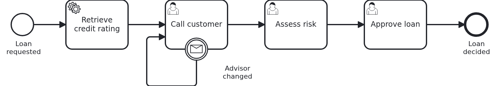

# Organizing user tasks

[](./LICENSE)

Your workflow module reports its user tasks to the
[VanillaBP Business Cockpit](https://github.com/vanillabp/business-cockpit). The details of a
user task decide who sees it, who gets it, who must not get it, who hears about it, by when it
is due and who may still read it later. The documentation describes each of these values on
its own. This blueprint shows how they work together in one running workflow module.

Each section below starts with the question it answers. Read the one you have.

## What this blueprint shows



An advisor requests a loan for a customer. The advisor calls the customer back, a member of the
risk team assesses the risk, and an approver decides. If the customer gets another advisor
while the call is still open, the call moves to the new advisor.

All three user tasks are described in `WorkflowTaskHandler`, one `@UserTaskDetailsProvider`
method per task definition. Everything they report is read from the workflow aggregate.

The demo users have the password `demo`:

|  User   |          What they may do          |
|---------|------------------------------------|
| `alice` | request loans, call customers      |
| `erin`  | request loans, call customers      |
| `lea`   | hand a customer to another advisor |
| `bob`   | assess risks                       |
| `carol` | assess risks and approve loans     |
| `dave`  | approve loans                      |

### Who caused this? The initiator

Every report names an initiator, and the cockpit does not notify that user about the report.
No BPMS records who pressed a button, and the security context of the request is gone when the
report is built. So `Service` writes the user into `Aggregate#lastActionBy` with every action:
requesting the loan, completing a task, the call which did not reach the customer, the change
of the advisor. The details providers read it back with `setInitiator(...)`.

`loan-approval.yaml` says `initiator-source: by-application`. A report without an initiator then
fails, together with the work which caused it. That is on purpose: a case which cannot say who
started it stays that way for good.

So `alice` gets no notification about "Call customer". She requested the loan a second ago and
knows that the call is next.

### Who may take the task? Candidate groups

"Assess risk" is reported with the candidate group `LOAN_APPROVAL_ASSESS_RISK`. That is the
constant `Permission.ASSESS_RISK`, and the same constant protects the endpoints of the form. So
the cockpit offers the task to exactly the people the form lets in. There is one constant per
kind of task, used on both sides. A second list for the cockpit would drift apart from the
first.

### Does the task belong to one person? The assignee

"Call customer" belongs to the advisor of the customer. The business knows who that is, so the
task gets `alice` as its assignee. The other two tasks have no assignee. Any member of the group
may take them, and the first one who takes it in the cockpit becomes the assignee.

Give a task an assignee when the aggregate can name the person, because the case belongs to
somebody: the advisor of a customer, the clerk who handles a claim. Leave it open when the work
belongs to a team. An assignee needs something in the aggregate which names the person, here
`Aggregate#advisor`.

"Call customer" also has a candidate group. A colleague can take the task over in the cockpit,
for example while `alice` is ill.

### Who must not take it? Four eyes

`carol` may assess risks and approve loans. If she assessed the risk, she must not approve the
same loan. "Approve loan" reports her in `excludedCandidateUsers`, read from
`Aggregate#riskAssessedBy`. The cockpit does not offer her the task, although her group says it
could.

The cockpit is not the only way to call an endpoint. So the module checks the same thing: her
form says `editable: false`, and `Service#decide` refuses her approval with 403.

### Who hears about it? `NotificationDelivery`

Each task sets how the cockpit notifies the people who may work on it:

|     Value     |      Task       |                                             Why                                              |
|---------------|-----------------|----------------------------------------------------------------------------------------------|
| `USER_CONFIG` | "Call customer" | routine work; each user decides in the cockpit whether they want a mail. This is the default |
| `SUPPRESS`    | "Assess risk"   | the risk team works from a shared mailbox, and the module writes there itself                |
| `FORCE`       | "Approve loan"  | the bank promised the customer an answer by a date, so nobody may miss the task              |

How to choose: `SUPPRESS` when your module sends its own message about the task, because two
messages about one thing teach people to ignore both. `FORCE` when a missed task costs money or
breaks a promise, and a user's setting must not hide it. `USER_CONFIG` for everything else.

### By when is it due? `dueDate`

Each due date is a rule of the bank, read from `loan-approval.yaml` and counted from
`Aggregate#requestedAt`: one day for the call, two days for the risk assessment. The approval is
due on `Aggregate#answerPromisedBy`, the date the bank promised the customer. That date is
written once, when the loan is requested, so it stays the same whatever happens on the way.

The task list of the cockpit is sorted by the due date first, then by the time a task was
created. A task without a due date is listed before every task which has one. So give every
task a due date, or none of them.

### When does it come back? `followUpDate`

`alice` calls and does not reach the customer. The form sends
`POST .../call-customer/{taskId}/not-reached`. The task stays open, but it gets a follow-up
date: 9 o'clock on the next morning, in the zone of `loan-approval.yaml`. The task list leaves
it out of the open tasks until then. Nobody has to see a task they cannot work on today.

The BPMS does not notice any of this. So `Service` calls `Workflow#taskDetailsChanged`, which
calls `BusinessCockpitService#aggregateChanged(loanRequest, taskId)`. The cockpit adapter asks
the details provider again, and the cockpit gets the follow-up date.

### What does the list show? `details`

The details are the business data the columns of the task list show: customer, amount, credit
rating and advisor. The cockpit stores them with the task, so a column can be sorted and
filtered without asking the module.

### How does a title explain the task? Titles and templates

The default title is the name of the user task in the BPMN file. "Assess risk" says what to do,
but not for whom and how much. A list of fifty tasks called "Assess risk" makes people open each
form to know which one is urgent. A title which carries the context saves that.

The module reports every title in English and German, because `loan-approval.yaml` names both
in `i18n-languages`. The blueprint shows three ways to fill the titles:

- **A template per task definition.** "Assess risk" sets no title. The cockpit adapter renders
  `loan-approval/loan_approval/assessRisk/task-title.ftl`, and `task-title_de.ftl` for German:
  "Assess the risk of 5000 EUR for Jane Roe". Without the German file, the English one would
  serve both languages.
- **A template name from the code.** After a failed call, "Call customer" sets the title
  `call-again.ftl` for both languages. That template is in the directory of the task, next to
  `task-title.ftl`, and says "Call Jane Roe again, attempt 2".
- **Text from the code.** "Approve loan" sets one text per language with
  `setTitle(Map.of("en", ..., "de", ...))`. That is enough for a title of one line. A title set
  in code needs a text for every language of `i18n-languages`.

Every template reads what the provider passed to `setTemplateContext`: here the record
`TitleContext`, not the aggregate. A template then sees only what it needs.

Five texts can come from a template: `task-title.ftl`, `task-definition-title.ftl`,
`workflow-title.ftl`, `task-fulltext-search.ftl` and `workflow-fulltext-search.ftl`. The
adapter looks in the directory of the task definition first, then in the one of the process,
then in the one of the module. A template directly in `loan-approval/` serves every task of
the module. This blueprint has the title and the search text of the case there, and the search
text of every task.

The templates are part of the module, so the module says where they are:
`vanillabp.cockpit.template-loader-path: "classpath:"` in `loan-approval.yaml`. The key is the
same for every module of an application. `classpath:` works for all of them, because the adapter
looks below a directory named after the module. That directory is the one in which every
resource of the module already is.

### How is a task found? `detailsFulltextSearch`

A customer calls the bank and gives their phone number. No column shows it. The search box of
the task list still finds the task, because `task-fulltext-search.ftl` writes the phone number
into the search text. The search looks only in that text. Data which is not in it cannot be
found.

### Where does the task open? `uiUriPath`

The forms of a module are usually loaded into the cockpit, from `ui-uri-path` in
`loan-approval.yaml`. That is the default of every task of the module. "Call customer" is
different: advisors call from the CRM. So its provider sets the address of the CRM page for this
loan request. A path which starts with `https://` is opened as it is.

### The task has to go to somebody else: end it and enter it again

The cockpit reads the assignee, the candidates and the excluded candidates once, when it stores
the task for the first time. A later report does not move a task to other people. Otherwise a
report could take a task away from somebody who is working on it.

`lea` hands the customer to `erin`. The module writes `erin` into `Aggregate#advisor` and
correlates the message `AdvisorChanged`. The boundary event on "Call customer" ends the task and
leads back into it. The BPMS creates a new task, and its first report names `erin` as assignee
and `lea` as initiator. The handler of the old task gets `CANCELED`.

### Who may still read it later? Admitted users

`bob` opens the risk assessment to work on it. The controller writes him into `Task#editors`,
and `Workflow#taskDetailsChanged` tells the cockpit. The details provider reports the editors
as `admittedUsers`. Half a year later `bob` works in another team and has lost the authority.
The cockpit still shows him the task, so he can read what he decided.

That is only worth something if the form lets him in as well. Otherwise the cockpit shows the
task and the form answers 403. So the endpoint which reads the form allows two ways in:

```java
@GetMapping("/assess-risk/{taskId}")
@PreAuthorize("hasAuthority('" + Permission.ASSESS_RISK + "')"
    + " or @userTaskAccess.mayRead(#loanRequestId, #taskId, authentication.name)")
```

`UserTaskAccess` is an ordinary bean. It reads the editors of the task and nothing else of the
case. The provider and the check read the same list. A second list would drift apart.

The controller knows which way let the user in. With the authority, `bob` gets the form to work
on it, `editable: true`, and is written into the editors. As an earlier editor, he gets it to
read, `editable: false`. Completing a task always needs the authority. The cockpit decides none
of this. It lists the task and opens the form.

An editor is written when the form is delivered for work, because that is where somebody really
sees the task. A user who only holds the authority and never opened the form has nothing to
read back.

### Who may open the case? `accessibleToGroups`

The workflow details provider reports the authorities of the module as the groups which may
open the case. It sets the initiator as well. With `initiator-source: by-application`, a
workflow report needs one like a task report does.

## Delta to the base blueprint

Compared to [`cockpit-usertasks-in-the-application`](https://github.com/vanillabp-blueprints/cockpit-usertasks-in-the-application-springboot):

|                File                |                                                                                    What is different                                                                                    |
|------------------------------------|-----------------------------------------------------------------------------------------------------------------------------------------------------------------------------------------|
| `loan_approval.bpmn`               | three user tasks in a row; a message boundary event on "Call customer" which leads back into it; no parallel branches                                                                   |
| `WorkflowTaskHandler.java`         | a `@UserTaskDetailsProvider` method per task definition, and a `@WorkflowDetailsProvider` method                                                                                        |
| `Aggregate.java`                   | who caused the last change, the advisor, the promised date, who assessed the risk; no multi-instance list                                                                               |
| `Task.java`                        | `editors`, who worked on the task                                                                                                                                                       |
| `CallCustomerTaskData.java`        | new: the attempts and the follow-up date of a call                                                                                                                                      |
| `ApproveLoanTaskData.java`         | new: the decision                                                                                                                                                                       |
| `CheckDocumentTaskData.java`       | gone, there is no document check                                                                                                                                                        |
| `AggregateRepository.java`         | reads the editors of one task                                                                                                                                                           |
| `UserTaskAccess.java`              | new: lets an earlier editor read a form                                                                                                                                                 |
| `UserTaskFormController.java`      | GET with `@PreAuthorize`, which lets in the authority or an earlier editor; `editable` says which; POST completes; no PUT                                                               |
| `Service.java`                     | writes the user with every action; the four-eyes check; the call which did not reach the customer; the change of the advisor                                                            |
| `Workflow.java`                    | correlates `AdvisorChanged`; `taskDetailsChanged` calls `BusinessCockpitService#aggregateChanged`                                                                                       |
| `ApiController.java`               | the start takes the advisor from the login; a GET hands a customer to another advisor                                                                                                   |
| `Permission.java`                  | one authority per kind of task, used as candidate group as well, and two for starting and for handing over                                                                              |
| `MethodSecurityConfiguration.java` | `@PreAuthorize` is checked as well                                                                                                                                                      |
| `loan-approval.yaml`               | the rules about time, the address of the CRM, the template directory, and what the cockpit has to know about the module                                                                 |
| `loan-approval/.../*.ftl`          | new: the templates of the titles and the search texts                                                                                                                                   |
| `SecurityConfiguration.java`       | six demo users                                                                                                                                                                          |
| `application.yaml`                 | where the reports go: the dev shell simulator                                                                                                                                           |
| `OrganizingUserTasksIT.java`       | replaces `LoanApprovalIT` and `UserTaskFormSecurityIT`: one test per pattern, which checks what the cockpit was told, and the proof that tasks and their data are loaded only when read |
| `CockpitSimulator.java`            | new: starts the dev shell simulator of the cockpit for the test                                                                                                                         |
| `ReportRecorder.java`              | new: keeps a copy of every report on its way to the simulator                                                                                                                           |
| `loan-approval/pom.xml`            | the `support` library of the cockpit and Freemarker; the cockpit adapter next to the BPMS adapter; the simulator for the test                                                           |
| `application/pom.xml`              | the cockpit adapter next to the BPMS adapter in every profile                                                                                                                           |

Drafts work as in the base blueprint and are left out here, so the forms have no PUT.

The rest is the same as in the base blueprint. The tasks and their data are loaded lazily,
`Service` carries `@Transactional` on the class, and the application sets
`open-in-view: false`. The package `support` of the module holds `UnknownTaskException` and
`TaskNotOpenException`, with their answers 404 and 409. It has nothing to do with the `support`
library of the cockpit. The details providers run inside the transaction of VanillaBP, so they
may read the tasks.

## Running it

Requires a JDK 21 or newer. Camunda 7 is embedded, so nothing else has to run:

```bash
mvn install verify
```

That runs the integration test, which starts the dev shell simulator of the cockpit itself. To
run it on another BPMS, pick another Maven profile. Not one line of Java changes:

```bash
mvn install verify -Poperaton
mvn install verify -Pcibseven
mvn install verify -Pcamunda8
```

Camunda 8 is a remote engine, so a cluster has to run. Its address and everything else
specific to that engine are in its profile file
`application/src/main/resources/application-camunda8.yaml`. The module's own test has a copy.

To run the application, start the dev shell simulator first. It stands in for the cockpit and
listens on port 8079. The build copies its runnable JAR to `loan-approval/target/`:

```bash
java -jar loan-approval/target/dev-shell-simulator.jar \
  --spring.config.additional-location=loan-approval/src/test/resources/dev-shell-simulator.yaml
```

Start the application in a second terminal:

```bash
mvn -pl application spring-boot:run
```

Start a loan approval. The browser asks you to log in. Take `alice` with the password `demo`:

```
http://localhost:8080/api/loan-approval/start?amount=5000&customer=Jane%20Roe
```

The log shows the address of each form when its task opens. Open it as a user who may work on
the task, and the form says `editable: true`. Completing a task is a POST, and that is the job
of a form. This blueprint has no forms, so `curl` stands in for one:

```bash
curl -u alice:demo -X POST http://localhost:8080/api/loan-approval/0f7c…/call-customer/1a2b…/not-reached
curl -u alice:demo -X POST -H 'Content-Type: application/json' -d '{"note":"wants it soon"}' \
  http://localhost:8080/api/loan-approval/0f7c…/call-customer/1a2b…
curl -u carol:demo -X POST -H 'Content-Type: application/json' -d '{"riskAcceptable":true}' \
  http://localhost:8080/api/loan-approval/0f7c…/assess-risk/3c4d…
curl -u carol:demo -X POST -H 'Content-Type: application/json' -d '{"approved":true}' \
  http://localhost:8080/api/loan-approval/0f7c…/approve-loan/5e6f…
```

The last one answers 403, because `carol` assessed the risk. `dave` may approve. To hand the
customer to `erin` while the call is open, log in as `lea`:

```
http://localhost:8080/api/loan-approval/0f7c…/change-advisor?advisor=erin
```

What the cockpit got is in the log of the simulator, and in its API at
`http://localhost:8079/official-api/v1/usertask/{taskId}`.

## How it works

|                                           File                                           |                                                 Role                                                  |
|------------------------------------------------------------------------------------------|-------------------------------------------------------------------------------------------------------|
| `loan-approval/src/main/resources/loan-approval/processes/camunda7/loan_approval.bpmn`   | the process: three user tasks, each with its task definition, and the boundary event which hands over |
| `.../loanapproval/WorkflowTaskHandler.java`                                              | the `@WorkflowTask` methods, and how each user task is organized in the cockpit                       |
| `.../loanapproval/Service.java`                                                          | writes who did what into the aggregate, and refuses an approval by the user who assessed the risk     |
| `.../loanapproval/Workflow.java`                                                         | `ProcessService` and `BusinessCockpitService`, the only place either is used                          |
| `.../loanapproval/UserTaskFormController.java`                                           | the endpoints of the forms; GET lets in the authority or an earlier editor, POST needs the authority  |
| `.../loanapproval/UserTaskAccess.java`                                                   | whether a user worked on a task before                                                                |
| `.../loanapproval/model/Aggregate.java`                                                  | everything the details providers read                                                                 |
| `.../loanapproval/model/usertask/Task.java`                                              | one user task, with its editors                                                                       |
| `.../loanapproval/config/Permission.java`                                                | the authorities, which are the candidate groups as well                                               |
| `loan-approval/src/main/resources/loan-approval/loan-approval.yaml`                      | the rules about time, the template directory, and the keys of the cockpit                             |
| `loan-approval/src/main/resources/loan-approval/loan_approval/assessRisk/task-title.ftl` | the title of "Assess risk", with `task-title_de.ftl` next to it                                       |
| `loan-approval/src/test/.../OrganizingUserTasksIT.java`                                  | one test per pattern                                                                                  |
| `loan-approval/src/test/.../ReportRecorder.java`                                         | keeps what the module reported, for the assertions                                                    |

The order of events: the advisor starts a loan approval. `Service#request` writes the advisor as
the advisor of the customer and as the last one who acted. The BPMS rates the loan and creates
"Call customer". The handler adds a `Task` to the aggregate. The cockpit adapter builds the
report of the task: it calls `callCustomerDetails`, which reads the aggregate. The report goes
through the outbox, so a cockpit which is down loses nothing.

Every later report asks the provider again. A report caused by the BPMS comes by itself: a task
created, completed or canceled. A report about something the BPMS does not notice comes from
`Workflow#taskDetailsChanged`: a follow-up date, a new editor.

A details provider only reads. VanillaBP does not save the aggregate after a provider ran, and
a provider which changed something would compete with the writes of the workflow.

The integration test runs the module with its real cockpit adapter. It starts the dev shell
simulator of the cockpit as a process of its own, with a small recorder in front of it, and
points `vanillabp.cockpit.rest.base-url` at the recorder. The simulator does not keep the
excluded candidates, the admitted users and the kind of notification. The recorder keeps a copy
of every report, and the test asserts on that copy. Maven copies the runnable JAR of the
simulator to `target/` before the integration tests run, and the test writes the simulator's
log to `target/dev-shell-simulator.log`.

## Documentation

- [Organizing user tasks](https://github.com/vanillabp/business-cockpit/wiki/Reporting-workflows-and-user-tasks#organizing-user-tasks): assignee, candidates, excluded candidates, admitted users, dates and notifications
- [Who caused it: the initiator](https://github.com/vanillabp/business-cockpit/wiki/Reporting-workflows-and-user-tasks#who-caused-it-the-initiator): the one value you have to answer
- [Reporting a change from your own code](https://github.com/vanillabp/business-cockpit/wiki/Reporting-workflows-and-user-tasks#reporting-a-change-from-your-own-code): `BusinessCockpitService#aggregateChanged`
- [Templates](https://github.com/vanillabp/business-cockpit/wiki/Templates): where a template is looked for, languages, the template context
- [Configuration](https://github.com/vanillabp/business-cockpit/wiki/Configuration#what-a-workflow-module-tells-the-cockpit): what a workflow module tells the cockpit
- [`cockpit-usertasks-in-the-application`](https://github.com/vanillabp-blueprints/cockpit-usertasks-in-the-application-springboot): the base, a row per user task and an authority per form
- [`cockpit-user-task-backend`](https://github.com/vanillabp-blueprints/cockpit-user-task-backend-springboot): how a form reaches the workflow module through the cockpit

This blueprint is developed in the monorepo
[`blueprints`](https://github.com/vanillabp-blueprints/blueprints). This repository is a
read-only mirror, **issues and pull requests belong there.**

## Noteworthy & Contributors

[VanillaBP](https://www.github.com/vanillabp/spi-for-java) was developed by [Phactum](https://www.phactum.at) with the
intention of giving back to the community as it has benefited the community in the past.


## License

Copyright 2026 Phactum Softwareentwicklung GmbH

Licensed under the Apache License, Version 2.0
