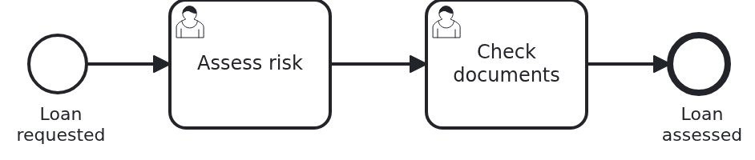

# User tasks in the Business Cockpit, application with the user interface behind a proxy

[](./LICENSE)

Your users work on their user tasks in the
[VanillaBP Business Cockpit](https://github.com/vanillabp/business-cockpit). The cockpit loads the
forms of a task from your workflow module at runtime. This application runs the workflow module,
but it does not carry the forms. They are in an nginx of their own, and the application forwards
the paths of the forms to it. So the backend and the user interface can be deployed apart.

## What this blueprint shows



A loan approval with two user tasks, "Assess risk" and then "Check documents". The workflow module
comes from `cockpit-user-task-backend-springboot`. The forms come from
`cockpit-user-task-frontend-react`, as the nginx image that project builds. This application puts
the two together at runtime, not at build time.

### Two ways to deliver the user interface

The frontend delivers its micro-frontends in two ways: as a UI jar and as an nginx image. A
micro-frontend is a small frontend of its own, which the cockpit loads. Both ways serve the same
files below the same path, `/loan-approval/`.

|                    Blueprint                     |                 The micro-frontends come from                 |
|--------------------------------------------------|---------------------------------------------------------------|
| `cockpit-user-task-application-springboot`       | the UI jar, on the class path of the application              |
| `cockpit-user-task-application-proxy-springboot` | this one: the nginx image, and the application forwards to it |
| `cockpit-user-task-bundle-springboot`            | the UI jar, bundled with the workflow module into one library |

### The way a file of the user interface travels

The cockpit loads `/wm/loan-approval/bc-manifest.json`. It forwards the request to the address the
module reported, `http://localhost:8080/loan-approval`, and puts the path of that address in
place of `/wm/loan-approval`. So the application gets `/loan-approval/bc-manifest.json`. It has no
such file, so the route of the workflow module passes the request on to the nginx, with the path
unchanged:

|          The browser asks the cockpit for           |       The application gets        |            Who answers             |
|-----------------------------------------------------|-----------------------------------|------------------------------------|
| `/wm/loan-approval/bc-manifest.json`                | `/loan-approval/bc-manifest.json` | the nginx, through the application |
| `/wm/loan-approval/entries/UserTaskForm-….js`       | `/loan-approval/entries/…`        | the nginx, through the application |
| `/wm/loan-approval/api/user-tasks/{id}/assess-risk` | `/loan-approval/api/user-tasks/…` | the application                    |

The browser sees one origin, the cockpit's. It never talks to the application or to the nginx
directly. And every file of the user interface passes through the application, so the security
of the application covers those files as well.

### The forwarding is a route of Spring Cloud Gateway, and the module brings it

An application is only a container for workflow modules. So the route is not in this
application. The workflow module brings it, as `UserInterfaceRouteAutoConfiguration`. It is one
route of
[Spring Cloud Gateway](https://docs.spring.io/spring-cloud-gateway/reference/spring-cloud-gateway-server-webmvc.html),
in the flavour for Spring MVC. It takes every GET below `/loan-approval/`, except the API below
`/loan-approval/api/`. Spring MVC asks a route before it asks the controllers. So without that
exception, the API of the module would go to the nginx as well.

The route is on when two things are true. This application has the starter of the gateway, and
it sets `loan-approval.user-interface.address`, the address of the nginx. Only its scheme, host
and port count. The key is below the id of the module, so each module of an application gets an
address of its own. An application which does not set it serves the user interface from the UI
jar, as `cockpit-user-task-application` does.

The route is the same for every workflow module with a user interface. Only the id differs. So
the `support` library of the Business Cockpit is the place for it. It does not have it yet. Once
it does, the module will lose the class.

The module also wires its beans, its entities and its repositories itself. So the package of
`Application` is `blueprint.application`, which is not above the module. This application has
no Java code but its `main` method.

### When this fits

The frontend team and the backend team deploy when they are ready, each on its own. A new form
goes live without a new build of the application, and a fix in the backend without a new build of
the frontend. In development and test, where both sides change every day, that saves time.

### What it costs

The backend and the user interface meet only when they are deployed. No build checks that the
forms of the nginx fit the API of the application. A form may call an endpoint the deployed
backend does not have yet, and nobody notices until a user opens the task. There is one more
container to run, and one more address to configure for each stage.

### Why production should take the application or the bundle

For production, VanillaBP recommends `cockpit-user-task-application` or
`cockpit-user-task-bundle`. Both take the UI jar, so the build decides which forms and which API
go together. What was tested is what runs. A release has one version, and a rollback takes the
forms back together with the API they were written for.

This blueprint shows the other way, because some teams need it while they develop and test. If
you take it to production, make sure your release process checks that the two versions fit.

## Delta to the base blueprint

Compared to `cockpit-user-task-application-springboot`:

|            File             |                                  What is different                                   |
|-----------------------------|--------------------------------------------------------------------------------------|
| `pom.xml`                   | no UI jar; the gateway, the Spring Cloud release train, Testcontainers for the test  |
| `application.yaml`          | new key `loan-approval.user-interface.address`, the address of the nginx             |
| `UserInterfaceProxyIT.java` | new: the application in front of the real nginx of the frontend                      |
| `docker-compose.yaml`       | new: the application, the nginx, the Business Cockpit with its MongoDB and its users |

## Running it

Requires a JDK 21 or newer and Docker. Build the backend and the frontend first. In their own
repositories, that means `mvn install` in the backend, and `npm run build` and
`npm run build:image` in the frontend. The frontend reads the OpenAPI file through a git submodule
of the backend, so it does not need the backend built. The frontend's README says how. That gives you the
workflow module in your local Maven repository and the image
`vanillabp-blueprints/cockpit-user-task-ui:1.0.0-SNAPSHOT` in your local Docker.

Then build this application and run its tests. Camunda 7 is embedded, so nothing else has to run.
The integration test starts the nginx image itself:

```bash
mvn install
```

To run it on another BPMS, pick another Maven profile. Not one line of Java changes:

```bash
mvn install -Pcamunda8
mvn install -Poperaton
mvn install -Pcibseven
```

Camunda 8 is a remote engine, so a cluster has to run. Its address is in
`src/main/resources/application-camunda8.yaml`.

### Everything together with Docker Compose

`docker-compose.yaml` runs the application, the nginx, the Business Cockpit and the MongoDB of the
cockpit. The cockpit reads its users from the dev shell simulator, so that runs as well. The
cockpit and the simulator are published as runnable jars, not as images. So Maven copies them to
`target/` first:

```bash
mvn package dependency:copy@business-cockpit
docker compose up
```

Start a loan approval. This is the only URL you need:

```
http://localhost:8080/loan-approval/api/loan-requests/start?amount=5000
```

The process stops at "Assess risk", and the application reports the task to the cockpit. The
cockpit of the compose file has no user interface of its own. Your organisation builds one with
the skill `business-cockpit-user-interface`. You can still follow the way a form takes. Open the
manifest through the cockpit, and log in as `test` with the password `test`:

```
http://localhost:8090/wm/loan-approval/bc-manifest.json
```

The cockpit forwards the request to the application, and the application to the nginx. The nginx
publishes no port, so this is the only way to reach it.

### Without Docker Compose

Start the nginx on port 8081, which is the address `application.yaml` names:

```bash
docker run --rm -p 8081:80 vanillabp-blueprints/cockpit-user-task-ui:1.0.0-SNAPSHOT
mvn spring-boot:run
```

Then `http://localhost:8080/loan-approval/bc-manifest.json` comes from the nginx, through the
application. Without a cockpit on port 8090, the reports stay in the outbox of the application
until one is there.

## How it works

|                      File                      |                                         Role                                         |
|------------------------------------------------|--------------------------------------------------------------------------------------|
| `src/main/java/.../Application.java`           | the application. It takes the workflow module through its Maven dependency           |
| `src/main/resources/application.yaml`          | the database, the address of the nginx and the address of the cockpit                |
| `src/main/resources/application-camunda7.yaml` | the settings of Camunda 7, and the same file per other BPMS                          |
| `src/test/java/.../UserInterfaceProxyIT.java`  | starts the nginx image and asks the application for every file of the user interface |
| `src/test/java/.../ApplicationSmokeTest.java`  | boots the application and checks that the workflow module is wired                   |
| `docker-compose.yaml`                          | the application, the nginx, the cockpit, its MongoDB and its users on one machine    |

`UserInterfaceProxyIT` runs against the image the frontend builds, not against a stand-in with test
files. A stand-in would only prove that the route forwards something. The application has no
route of its own, so the test also proves that the workflow module brings it. The real image proves that
the application and the frontend agree on the paths and on the manifest. The test asks for the
manifest, then for every file the manifest names, and it checks that the API of the module is
still answered by the application. The header `Cache-Control: no-cache` of the manifest comes from
the nginx, so the test knows where the answer came from.

The image is not pulled from a registry. The POM names it in the property `user-interface.image`,
with the version of the frontend. If the image is not on the machine, the test says how to build
it. Name another one with `-Duser-interface.image=...`.

### Three repositories, and the order of their releases

The workflow module is in the backend repository and the forms are in the frontend repository.
The backend builds with Maven, the frontend with npm. So they build on build agents with one tool
each. The frontend reads the OpenAPI file of the backend through a git submodule, at a commit it
pins, so it builds without the backend being built or released. Release the backend first, then
the frontend, then this application. A bot such as Renovate
opens the pull request which moves this application to the new release of the backend. The tag
of the nginx image is a deployment setting. It moves with each deployment, not with a build.

## Documentation

- [Spring Cloud Gateway Server MVC](https://docs.spring.io/spring-cloud-gateway/reference/spring-cloud-gateway-server-webmvc.html): routes, predicates and filters
- [Connecting a workflow module](https://github.com/vanillabp/business-cockpit/wiki/Connecting-a-workflow-module): the cockpit adapter, the smallest configuration, and how a module registers itself
- [What a workflow module tells the cockpit](https://github.com/vanillabp/business-cockpit/wiki/Configuration#what-a-workflow-module-tells-the-cockpit): `workflow-module-uri`, `ui-uri-type`, `ui-uri-path` and the other keys
- [Running the Business Cockpit](https://github.com/vanillabp/business-cockpit/wiki/Running-the-Business-Cockpit): the cockpit, its MongoDB and the account a workflow module reports with
- [Testcontainers](https://java.testcontainers.org/): the containers of the integration test

This blueprint is developed in the monorepo
[`blueprints`](https://github.com/vanillabp-blueprints/blueprints). This repository is a
read-only mirror, **issues and pull requests belong there.**

## Noteworthy & Contributors

[VanillaBP](https://www.github.com/vanillabp/spi-for-java) was developed by [Phactum](https://www.phactum.at) with the
intention of giving back to the community as it has benefited the community in the past.


## License

Copyright 2026 Phactum Softwareentwicklung GmbH

Licensed under the Apache License, Version 2.0
