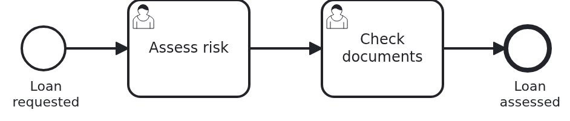

# User tasks in the Business Cockpit, application

[](./LICENSE)

Your users work on their user tasks in the
[VanillaBP Business Cockpit](https://github.com/vanillabp/business-cockpit). The cockpit lists the
tasks and opens a form for each of them. The form belongs to your workflow module. This blueprint
is the application which runs such a module: it takes the workflow module and the JAR of its user
interface, and it serves both. It has no code of its own apart from the class which starts it.

## What this blueprint shows



A loan approval with two user tasks, "Assess risk" and then "Check documents". The process, the
endpoints of the forms and what the cockpit has to know about the module are in the backend. The
forms are in the frontend. This repository puts them together.

### The parts of a workflow module with a user interface

Your build runners most likely have one image with Java and Maven and another one with Node. A
repository in which Maven and npm build together is hard to have there. So a workflow module with
a user interface has three parts, each in a repository of its own:

|                    Part                    |                                      What it holds                                      | Built with |
|--------------------------------------------|-----------------------------------------------------------------------------------------|------------|
| `cockpit-user-task-backend-springboot`     | the API of the forms as a JAR, and the workflow module                                  | Maven      |
| `cockpit-user-task-frontend-react`         | the forms and the columns of the task list, as a JAR of the user interface              | npm        |
| `cockpit-user-task-application-springboot` | this repository: the application which takes the workflow module and the user interface | Maven      |

The frontend needs only the API, and the API is in the backend. Only the application needs both.
So nothing depends on itself in a circle. Build and release the parts in this order:

1. the backend, which releases the API JAR and the workflow module,
2. the frontend, which reads the released API JAR and releases the JAR of the user interface,
3. this application, which takes the released workflow module and the released user interface.

Each part takes the parts before it as a released version from your Maven repository. The two
versions are properties in `pom.xml`. A bot such as Renovate opens the pull request which moves
them from a snapshot to a release. More repositories to release is the price for build runners
with one tool each.

### Why npm does not build inside Maven

A Maven plugin which downloads Node and runs npm puts a second tool chain into the Maven build.
Many companies see that as a security risk, and their runners do not have both tools anyway. So
the frontend builds the JAR of the user interface with npm alone. A JAR is a zip file, and this
one holds no class. Maven takes it like any other dependency.

### The user interface is a dependency

`io.vanillabp.blueprint:cockpit-user-task-ui` holds the micro-frontends below
`META-INF/resources/loan-approval/`. Spring Boot serves that directory of every JAR on the class
path at `/`. So the manifest is at `/loan-approval/bc-manifest.json`, and no line of code or
configuration serves it.

There is a frontend in React, one in Angular and one in Vue. All three publish their JAR under the
same coordinates. So this application does not know which one it gets. It gets the one your
Maven repository holds. If you switch from one frontend to another, nothing changes here.

### The way the cockpit reaches the application

The cockpit forwards everything below `/wm/loan-approval/` to the address the module reports, its
`workflow-module-uri`, and puts the path of that address in place of `/wm/loan-approval`. The
module reports `http://localhost:8080/loan-approval`. So the API of the forms and the user
interface are both below `/loan-approval` here:

|              The browser asks the cockpit for               |                   The application gets                   |     It comes from      |
|-------------------------------------------------------------|----------------------------------------------------------|------------------------|
| `/wm/loan-approval/bc-manifest.json`                        | `/loan-approval/bc-manifest.json`                        | the user interface JAR |
| `/wm/loan-approval/api/user-tasks/{userTaskId}/assess-risk` | `/loan-approval/api/user-tasks/{userTaskId}/assess-risk` | the workflow module    |

### Where the reports go is the application's choice

The workflow module says what the cockpit has to know about it. Which cockpit gets the reports is
up to the application. `application.yaml` names it below `vanillabp.cockpit.rest`, with the
account the cockpit accepts reports from. Each BPMS profile adds two adapters: the BPMS adapter,
and the cockpit adapter of the same BPMS, which reports the user tasks.

## Delta to the base blueprint

Compared to the application of
[`bpmn-user-task`](https://github.com/vanillabp-blueprints/bpmn-user-task-springboot):

|               File                |                                         What is different                                          |
|-----------------------------------|----------------------------------------------------------------------------------------------------|
| `pom.xml`                         | the workflow module and the user interface JAR come from other repositories, in their own versions |
| `pom.xml`                         | the cockpit adapter next to the BPMS adapter in every profile, and no web applications of the BPMS |
| `application.yaml`                | where the reports to the cockpit go                                                                |
| `UserInterfaceSmokeTest.java`     | new: the manifest and an endpoint of a form answer below `/loan-approval`                          |
| `docker-compose.yaml`             | new: a cockpit with its MongoDB, to see the reports arrive                                         |
| `docker/dev-shell-simulator.yaml` | new: the users of that cockpit                                                                     |

The workflow module itself is the subject of the backend, and the forms are the subject of the
frontend.

## Running it

Requires a JDK 21 or newer. The workflow module and the user interface JAR have to be in your
Maven repository. Until they are released, install them yourself: `mvn install` in the backend,
then `npm run build` in a frontend and `mvn install:install-file` of the JAR it built, as its
README says. Then:

```bash
mvn install
```

That runs the smoke tests on Camunda 7, which is embedded. To run on another BPMS, pick another
Maven profile. Not one line of Java changes:

```bash
mvn install -Pcamunda8
mvn install -Poperaton
mvn install -Pcibseven
```

Camunda 8 is a remote engine, so a cluster has to run. Its address and everything else specific
to that engine are in `application-camunda8.yaml`.

### With a cockpit

`docker-compose.yaml` starts a Business Cockpit and its MongoDB. The cockpit is a runnable JAR,
and it takes its users from the dev shell simulator of the cockpit, a second runnable JAR. Maven
copies both to `target/`:

```bash
mvn dependency:copy@business-cockpit
docker compose up -d
mvn spring-boot:run
```

The containers use the network of your machine, so the cockpit reaches the application at
`localhost:8080`. On Docker Desktop, switch on host networking in the settings. Start a loan
approval. This is the only URL you need:

```
http://localhost:8080/loan-approval/api/loan-requests/start?amount=5000
```

The cockpit on port 9080 now has the user task "Assess risk". This cockpit has no user interface
of its own, but its proxy works. Log in as `jane` with the password `test`, and open the manifest
of the module through the cockpit:

```
http://localhost:9080/wm/loan-approval/bc-manifest.json
```

A cockpit with a user interface shows the task in its list and opens the form from there. Stop
the containers with `docker compose down`.

### Developing the user interface

Somebody who works on the forms does not need this application. The dev shell of the frontend
forwards `/wm/loan-approval/` to a backend which runs on its own. The README of the backend
says how to start it.

## How it works

|                      File                      |                                         Role                                         |
|------------------------------------------------|--------------------------------------------------------------------------------------|
| `pom.xml`                                      | the workflow module, the user interface JAR, and per BPMS profile both adapters      |
| `src/main/java/.../Application.java`           | starts the application. Its package is above the module, so the module is found      |
| `src/main/resources/application.yaml`          | the database, the active BPMS profile, and the cockpit the reports go to             |
| `src/main/resources/application-camunda7.yaml` | what Camunda 7 needs, and the same file per other BPMS                               |
| `src/test/.../ApplicationSmokeTest.java`       | the context starts, and every workflow module is wired                               |
| `src/test/.../UserInterfaceSmokeTest.java`     | the manifest comes from the user interface JAR, and the form of an open task answers |
| `docker-compose.yaml`                          | MongoDB, the user directory and the cockpit, on the network of your machine          |

The application starts, and VanillaBP deploys the process of the module. The module reports
itself to the cockpit, with its `workflow-module-uri`, `ui-uri-type: ES_MODULES` and
`ui-uri-path: /bc-manifest.json`. Every report goes through the outbox first. So a cockpit which
is not running yet loses nothing, and the reports arrive once it is up.

A loan approval starts, and the BPMS creates "Assess risk". The cockpit adapter reports the task.
A user opens it in the cockpit. The cockpit loads `/wm/loan-approval/bc-manifest.json`, which is
the manifest of the user interface JAR in this application. Then it loads the form, and the form
calls `/wm/loan-approval/api/user-tasks/...`, which is the controller of the workflow module.

The smoke tests ask for both paths without a cockpit. A missing dependency, or a path which does
not fit the module id, breaks one of them, and the application still starts. That is why the
test asks.

## Documentation

- [Connecting a workflow module](https://github.com/vanillabp/business-cockpit/wiki/Connecting-a-workflow-module): the cockpit adapter, where the reports go, and how a module registers itself
- [What a workflow module tells the cockpit](https://github.com/vanillabp/business-cockpit/wiki/Configuration#what-a-workflow-module-tells-the-cockpit): `workflow-module-uri`, `ui-uri-type`, `ui-uri-path` and the other keys
- [Running the Business Cockpit](https://github.com/vanillabp/business-cockpit/wiki/Running-the-Business-Cockpit): the cockpit server and its MongoDB
- [Serving static content](https://docs.spring.io/spring-boot/reference/web/servlet.html#web.servlet.spring-mvc.static-content): why Spring Boot serves `META-INF/resources/` of every JAR
- the wiki of the [BPMS adapter](https://github.com/vanillabp/adapter-platform-integration/wiki/BPMS-adapters) you use

This blueprint is developed in the monorepo
[`blueprints`](https://github.com/vanillabp-blueprints/blueprints). This repository is a
read-only mirror, **issues and pull requests belong there.**

## Noteworthy & Contributors

[VanillaBP](https://www.github.com/vanillabp/spi-for-java) was developed by [Phactum](https://www.phactum.at) with the
intention of giving back to the community as it has benefited the community in the past.


## License

Copyright 2026 Phactum Softwareentwicklung GmbH

Licensed under the Apache License, Version 2.0
