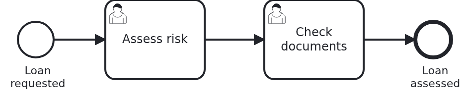

# User tasks in the Business Cockpit, backend

[](./LICENSE)

Your users work on their user tasks in the
[VanillaBP Business Cockpit](https://github.com/vanillabp/business-cockpit). The cockpit lists the
tasks, and it opens a form for each of them. The form belongs to your workflow module, and it
talks to your workflow module. This blueprint is the backend of such a module: the API the forms
call, and the workflow module which implements it.

## What this blueprint shows



A loan approval with two user tasks, "Assess risk" and then "Check documents". Each task has a
form with one input field. The forms are not here. They are a user interface, built with npm, in
a repository of their own. This repository holds what a form needs from the backend.

### The parts of a workflow module with a user interface

Your build runners most likely have
one image with Java and Maven and another one with Node. A repository in which Maven and npm
build together is hard to have there. So a workflow module with a user interface has three
parts, each in a repository of its own:

|                Part                 |                                    What it holds                                     | Built with |
|-------------------------------------|--------------------------------------------------------------------------------------|------------|
| `cockpit-user-task-backend-quarkus` | this repository: the API of the forms as an OpenAPI file, and the workflow module    | Maven      |
| `cockpit-user-task-frontend-react`  | the forms and the columns of the task list, as a JAR of the user interface           | npm        |
| `cockpit-user-task-application`     | the application which takes the workflow module and the user interface and runs them | Maven      |

The API and the workflow module are in one repository, because neither of them needs the user
interface. The user interface needs the API, and only the application needs both. So nothing
depends on itself in a circle. The frontend reads the OpenAPI file of this repository through a
git submodule, at a commit it pins. So it builds without this backend being built or released.
Release them in this order all the same: the backend first, then the frontend, then the
application. The frontend pins a commit of the backend, and the application takes the released
workflow module and the released user interface. A bot such as Renovate opens the pull request
which moves the application to a new release. So there are three repositories instead of one,
and this is the reason.

### The API is a file

The workflow module holds the OpenAPI of the four endpoints the forms call, at
`loan-approval/src/main/resources/loan-approval/openapi/loan-approval.yaml`. A frontend reads this
file through a git submodule of this repository, at a commit it pins, and generates its client from
it. It needs no Maven repository and no Java for that. The React, the Angular and the Vue frontend
read the same file. The build of the workflow module generates an interface from it, which
`UserTaskFormController` implements. Its test reads the file from the classpath and checks every
operation against the endpoints. The file sits next to the code which implements it, so one pull
request changes both.

### The way a form reaches the workflow module

A form runs in the browser, inside the cockpit.
It never calls your application directly. It calls the cockpit below `/wm/loan-approval/`, and
the cockpit forwards the request to the address the module reported, its `workflow-module-uri`.
On the way, the cockpit puts the path of that address in place of `/wm/loan-approval`. This
module reports `http://localhost:8080/loan-approval`, so:

|                            The browser asks for                            |                             The module gets                             |
|----------------------------------------------------------------------------|-------------------------------------------------------------------------|
| `/wm/loan-approval/api/loan-requests/{loanRequestId}/assess-risk/{taskId}` | `/loan-approval/api/loan-requests/{loanRequestId}/assess-risk/{taskId}` |
| `/wm/loan-approval/bc-manifest.json`                                       | `/loan-approval/bc-manifest.json`                                       |

That is why the OpenAPI names `/wm/loan-approval` as its server, and why every endpoint of the
module starts with `/loan-approval`. The second line is the user interface. The application
serves it from the JAR of the user interface, below `/loan-approval/`. An application which holds
several workflow modules keeps their paths apart this way.

### Completing a task is the module's job

A form sends what the user entered to the module. The
module writes it to the workflow aggregate and completes the user task with
`ProcessService#completeUserTask`. The cockpit adapter sees the task end in the BPMS (business
process management system) and tells the cockpit. The cockpit never sees the data of a form.

### A task somebody else took over answers 409

Two users can have the same task open. One of them takes it over in the cockpit and becomes its
assignee. The other one still sees the form. If that user completes it, the task is gone for the
user who has it now. So `POST` answers 409 Conflict for a task which is assigned to somebody else,
and the task stays open. The forms show their own message for it.

The cockpit keeps the assignee in its own store and tells nobody about it. So the module asks the
cockpit, in `Cockpit`, before it completes a task. It sends the cookie of the request along, which
holds the login of the user. The cockpit answers who that user is and whom the task is assigned
to, and the module compares the two. A task without an assignee, or one assigned to the user who
sends the form, is completed as before.

`Cockpit` asks through the official GUI API of the cockpit, with the clients of
`official-gui-api-quarkus-client`, which are generated from the OpenAPI file of that API. No
call is written by hand. `Cockpit` builds the two clients with `RestClients` of the support library
of the cockpit, from the keys below `loan-approval.cockpit`, while the application starts. The clients send the cookie of the request along on their own.
The application sets the address of the cockpit. It leaves out `/gui/api/v1`, the path of the
API, because the clients add it themselves, and an address which ends with it stops the start:

```properties
loan-approval.cockpit.base-url=http://localhost:9080
```

The module asks only if the application sets `base-url`. Without it there is no client, the
application starts, and a form completes its task as before. With it the support library checks
the address and every other key at the start, and a message names the key. The other keys
of the support library work there as well: timeouts, a proxy, retries, OAuth. They belong to the
module and not to `vanillabp`, so a second module in the same application asks the cockpit with
values of its own. A request without a cookie asks nothing, so the URLs of the log still work in
a browser alone. Any answer which is not clear counts as "nobody else took it", because a form
which is refused for no reason is worse than one which is not refused. Reading a form is never
refused.

### What the cockpit shows about a task

The cockpit adapter reports every user task of the
module without a line of code. `WorkflowTaskHandler#userTaskDetails` carries
`@UserTaskDetailsProvider` and adds business data to each report: the risk assessment, under the
key `riskAssessment`. A column of the task list, which the frontend defines, shows it. It is empty
while "Assess risk" is open. "Check documents" shows it.

### What the cockpit has to know about the module

`loan-approval.yaml` carries the keys below
`vanillabp.workflow-modules.loan-approval.cockpit`. `ui-uri-type: ES_MODULES` says that the user
interface is a set of ES modules. `ui-uri-path: /bc-manifest.json` says where the list of those
modules is. VanillaBP passes both on to the cockpit, and the cockpit user interface reads them.

### The module wires itself

Think of a workflow module as a complete application of its own which just cannot run alone. It
relies on nothing the hosting application provides, except resources the application shares on
purpose, such as the data source
([Workflow modules](https://github.com/vanillabp/adapter-platform-integration/wiki/Workflow-modules#what-is-a-workflow-module)).
An application is only a container for workflow modules. It adds this module as a Maven
dependency, and that is all.

The module needs no class for this. The `jandex-maven-plugin` writes an index of its classes into
the JAR, and Quarkus reads it while it builds the application. So Quarkus finds the beans, the
entity and the repository of the module. Every bean is known by its type, and the type includes
the package. So two workflow modules with a class `Service` each run in one application side by
side.

The files of the user interface come from the UI jar. Quarkus serves the files below
`META-INF/resources/` of every JAR, so they need nothing here. An application may take them
from an nginx instead. Then the support library of the cockpit forwards them, and the module
needs no class for it either: the application adds `io.vertx:vertx-http-proxy` and sets
`loan-approval.user-interface.address`
([Connecting a workflow module](https://github.com/vanillabp/business-cockpit/wiki/Connecting-a-workflow-module)).

The module reads the keys of its clients below `loan-approval.cockpit`, through `RestClients`.
The keys are below the id of the module, like every key a module reads itself. The keys below `vanillabp` belong to VanillaBP and the cockpit adapter, and they refuse
keys they do not read.

### Nothing is stored while the user types

The aggregate gets the input of a form once, when the
form completes the task. A form which keeps a draft while the user is still typing needs a store
of its own, because the aggregate holds results, not drafts.

## Delta to the base blueprint

Compared to [`bpmn-user-task`](https://github.com/vanillabp-blueprints/bpmn-user-task-quarkus):

|                    File                    |                                                                                                            What is different                                                                                                            |
|--------------------------------------------|-----------------------------------------------------------------------------------------------------------------------------------------------------------------------------------------------------------------------------------------|
| `loan-approval/openapi/loan-approval.yaml` | new: the four endpoints of the forms                                                                                                                                                                                                    |
| `loan-approval/loan-approval.yaml`         | the keys the cockpit needs, below `vanillabp.workflow-modules.loan-approval.cockpit`                                                                                                                                                    |
| `loan_approval.bpmn`                       | two user tasks in a row, and no service task and no boundary event                                                                                                                                                                      |
| `WorkflowTaskHandler.java`                 | a `@WorkflowTask` method per user task, and the `@UserTaskDetailsProvider` method                                                                                                                                                       |
| `UserTaskFormController.java`              | new: the endpoints of the forms, which implement the interface generated from the OpenAPI; 409 for a task somebody else took over                                                                                                       |
| `Cockpit.java`                             | new: asks the cockpit whether somebody else took over a user task, through the generated clients of its official GUI API                                                                                                                |
| `LoanApprovalProperties.java`              | deleted: the module reads no settings of its own, the keys of its clients are read by `RestClients`                                                                                                                                     |
| `ApiController.java`                       | only starts and shows a loan approval, below `/loan-approval/api/loan-requests`                                                                                                                                                         |
| `Workflow.java`                            | `documentsChecked` completes the second user task; no `loanRequestWithdrawn` and no BPMN error                                                                                                                                          |
| `loan-approval/openapi/loan-requests.yaml` | new: the API of `ApiController`, from which the build generates `LoanRequestsApi`                                                                                                                                                       |
| `Service.java`                             | per user task: keep the id, give a form its data, complete the task with what the user entered                                                                                                                                          |
| `Aggregate.java`                           | per user task the id of the open task and what the user entered                                                                                                                                                                         |
| `LoanApprovalIT.java`                      | reports to the dev shell simulator and completes both tasks through their endpoints                                                                                                                                                     |
| `WithoutTheCockpitAddressIT.java`          | new: without `loan-approval.cockpit.base-url` the module starts and a form completes its task without asking the cockpit                                                                                                                |
| `CockpitSimulator.java`                    | new: starts the dev shell simulator for the test                                                                                                                                                                                        |
| `CockpitGuiApi.java`                       | new: answers for the cockpit who is logged in and whom a task is assigned to, for the test                                                                                                                                              |
| `loan-approval/pom.xml`                    | the cockpit support, the REST client, the cockpit adapter next to the BPMS adapter in every profile, the JAR of the dev shell simulator and the client of the forms for the test, the profile `local` to run the module on your machine |
| `application.yaml` (test)                  | a free port, the outbox is polled every 0.2 seconds, and the reports go to the dev shell simulator                                                                                                                                      |
| `dev-shell-simulator.yaml` (test)          | new: the one demo user of the dev shell simulator                                                                                                                                                                                       |
| `pom.xml`                                  | no `application` module; the versions of the cockpit and of its adapter for Camunda 8, instead of `blueprint.bpms`                                                                                                                      |
| `application/`                             | deleted: the application is a repository of its own, see below                                                                                                                                                                          |

There is no application module. The application is a repository of its own, see above. So the
blueprint has no smoke test of an application either. The application repository brings it.

## Running it

Requires a JDK 21 or newer. Camunda 7 is embedded, so nothing else has to run:

```bash
mvn install
```

That runs the integration test, which starts the dev shell simulator of the cockpit itself. To
run it on another BPMS, pick another Maven profile. Not one line of Java changes:

```bash
mvn install -Pcamunda8
mvn install -Poperaton
mvn install -Pcibseven
```

Camunda 8 is a remote engine, so a cluster has to run. Its address and everything else specific
to that engine are in the test's profile file
`loan-approval/src/test/resources/application-camunda8.yaml`.

### Running the backend for the development of the user interface

Somebody who works on the forms runs the frontend's dev server. It shows the forms in a dev
shell, a small web page which stands in for the cockpit. The dev shell needs two servers behind
it. One is the dev shell simulator, which stands in for the server of the cockpit. The other is
a backend which runs this workflow module.

Quarkus builds an application, `quarkus:dev` included, out of the main sources and their
dependencies. The BPMS adapter, the cockpit adapter and the database of the module are in the
test scope. So the Maven profile `local` adds them for the run, with Camunda 7, which is
embedded. It also points Quarkus at the configuration of the test. The profile is in
`loan-approval/pom.xml`. Its dependencies are optional and never reach the JAR or somebody who
uses the module.

The simulator comes with this build. The build copies its runnable JAR to
`loan-approval/target/`:

```bash
mvn install -DskipTests
```

Start it with the users of `loan-approval/src/test/resources/dev-shell-simulator.yaml`. It
listens on port 8079:

```bash
java -jar loan-approval/target/dev-shell-simulator.jar \
  --spring.config.additional-location=loan-approval/src/test/resources/dev-shell-simulator.yaml
```

Then start the backend in a second terminal. It reports to the simulator on port 8079, and it
answers on port 8080:

```bash
mvn -Plocal quarkus:dev
```

`quarkus:dev` opens a debug port, 5005. If a second application runs in dev mode on the same
machine, both want that port. Start the second one with `-Ddebug=false`, or give it a port of
its own with `-Ddebug=5006`.

Start a loan approval in the backend. This is the only URL you need:

```
http://localhost:8080/loan-approval/api/loan-requests/start?amount=5000
```

The process stops at "Assess risk", and the simulator holds the task. The log names the endpoint
which gives the form its data:

```
Loan approval '0f7c…' started
Loan approval '0f7c…' waits for a risk assessment. Its form reads
  http://localhost:8080/loan-approval/api/loan-requests/0f7c…/assess-risk/1a2b…
```

Open it in a browser, and you see what the form shows. Completing the task is a POST with what
the user entered. That is the form's job, so the dev shell does it. The dev server of the frontend
forwards `/wm/loan-approval/` to `http://localhost:8080/loan-approval/`, the same way the cockpit
does. The frontend's README shows how.

## How it works

|                                          File                                          |                                                       Role                                                       |
|----------------------------------------------------------------------------------------|------------------------------------------------------------------------------------------------------------------|
| `loan-approval/src/main/resources/loan-approval/openapi/loan-approval.yaml`            | the contract between the forms and the module: four operations, below the server `/wm/loan-approval`             |
| `loan-approval/src/main/resources/loan-approval/processes/camunda7/loan_approval.bpmn` | the process: two user tasks, each carrying its task definition                                                   |
| `loan-approval/src/main/resources/loan-approval/loan-approval.yaml`                    | what the cockpit has to know about the module: address, kind of user interface, manifest                         |
| `.../loanapproval/WorkflowTaskHandler.java`                                            | keeps the id of each user task, and says what the cockpit shows about a task                                     |
| `.../loanapproval/UserTaskFormController.java`                                         | the endpoints of the forms: GET reads what a form shows, POST completes the task                                 |
| `.../loanapproval/Cockpit.java`                                                        | asks the cockpit whether somebody else took over a task, through the official GUI API                            |
| `.../loanapproval/Service.java`                                                        | finds the loan request, checks that the task is open on it, writes the input and completes the task              |
| `.../loanapproval/Workflow.java`                                                       | `startWorkflow` and `completeUserTask`, the only place `ProcessService` is used                                  |
| `.../loanapproval/model/Aggregate.java`                                                | the id of each open task, and what the user entered in each form                                                 |
| `loan-approval/src/test/.../LoanApprovalIT.java`                                       | plays both tasks through, and checks what the cockpit was told, through a client generated from the OpenAPI file |
| `loan-approval/src/test/.../WithoutTheCockpitAddressIT.java`                           | without the address of the cockpit the module starts and asks nothing                                            |
| `loan-approval/src/test/.../CockpitSimulator.java`                                     | runs the dev shell simulator of the cockpit for the test                                                         |
| `loan-approval/src/test/.../CockpitGuiApi.java`                                        | stands in for the official GUI API of the cockpit which `Cockpit` asks                                           |

The order of events: the BPMS creates "Assess risk" and calls `WorkflowTaskHandler#assessRisk`.
The handler hands the id over to `Service`, which keeps it on the aggregate. In the same moment
the cockpit adapter reports the task to the cockpit, with the details of
`WorkflowTaskHandler#userTaskDetails`. The report goes through the outbox, so a cockpit which is
down loses nothing.

A user opens the task in the cockpit. The cockpit loads the form of the module, and the form
calls `GET .../api/loan-requests/{loanRequestId}/assess-risk/{taskId}` with the business id of the
task and its id. The cockpit knows the task by the same id the handler got, and its business id is
the id of the loan request. `Service` finds the loan request by its id and accepts it only if that
task is open on it. A task which is not open on that loan request answers 404: the id is unknown,
the task belongs to another loan request, or it was completed already. So a form never completes
the task of another case by mistake.
If the cockpit says that somebody else took the task over, `POST` answers 409 and completes
nothing. The controller throws `BcTaskNotOpenException` and `BcTaskClaimedByAnotherUserException`,
and the mappers of the cockpit's support library, which register themselves, answers them.

The user enters the assessment, and the form sends it with `POST`. `Service` writes it to the
aggregate, and `Workflow#riskAssessed` completes the user task. The BPMS moves on to "Check
documents", and the same happens again. The report of the second task carries the risk
assessment for the column. Its form shows the assessment and takes a note. After that the
workflow ends, and the cockpit takes both tasks off the list.

Nobody writes the endpoints by hand. The build generates the interface `UserTasksApi` and the
classes of the forms from the OpenAPI, with the `openapi-generator-maven-plugin`, and
`UserTaskFormController` implements it. The paths of the file are relative to its server
`/wm/loan-approval`, so the interface carries `@Path("/api/loan-requests/{loanRequestId}")`. The
controller has to put `/loan-approval`, the path of the module, in front. Jakarta REST takes the
`@Path` of a class instead of the one of its interface, not in addition to it. So the controller
carries `@Path("/loan-approval/api/loan-requests/{loanRequestId}")`, and its methods keep the
paths of the interface. The integration test reads the OpenAPI from the classpath and checks that every
operation in it has its endpoint at that path. It asks with `OPTIONS`, and Quarkus answers with
the methods it has for the path.

The GET endpoints a person uses to start a loan approval and to look at it are an OpenAPI file
as well, `loan-approval/openapi/loan-requests.yaml`. `ApiController` implements the interface
`LoanRequestsApi` generated from it. The frontends do not read this file. Its server is
`http://localhost:8080/loan-approval`, so its paths start with `/api` and the interface carries
`@Path("/api/loan-requests")`. `ApiController` carries `@Path("/loan-approval/api/loan-requests")`,
the same way as the forms, and the URLs stay the server plus the path. A second test checks this
file the same way.

Completing a task is a POST, because a form calls it. The
[rules for blueprints](https://github.com/vanillabp-blueprints/blueprints/blob/main/CONTRIBUTING.md#endpoints-which-a-form-calls)
say so for every endpoint of a form. In this blueprint the form runs in the cockpit, or in the
dev shell in its place.

The integration test talks to the module the way a form does, only without the proxy of the
cockpit in between. It starts the dev shell simulator of the cockpit as a process of its own and
points `vanillabp.cockpit.rest.base-url` at it, in `LoanApprovalIT.ReportToTheSimulator`, before
Quarkus starts the module. The module runs with its real cockpit adapter.
The test asks the simulator what a cockpit user interface would ask: which user tasks there are,
and what their details say. Maven copies the runnable JAR of the simulator to `target/` before
the integration tests run, and the test writes the simulator's log to
`target/dev-shell-simulator.log`.

## Documentation

- [Connecting a workflow module](https://github.com/vanillabp/business-cockpit/wiki/Connecting-a-workflow-module): the cockpit adapter, the smallest configuration, and how a module registers itself
- [Reporting workflows and user tasks](https://github.com/vanillabp/business-cockpit/wiki/Reporting-workflows-and-user-tasks): `@UserTaskDetailsProvider` and the details of a task
- [What a workflow module tells the cockpit](https://github.com/vanillabp/business-cockpit/wiki/Configuration#what-a-workflow-module-tells-the-cockpit): `workflow-module-uri`, `ui-uri-type`, `ui-uri-path` and the other keys
- [The dev shell simulator](https://github.com/vanillabp/business-cockpit/wiki/Developing-UI-components-locally#the-dev-shell-simulator): running it and giving it users
- [User tasks](https://github.com/vanillabp/adapter-platform-integration/wiki/Workflow-tasks#user-tasks): the notification handler, the task id and completing the task later
- the wiki of the [BPMS adapter](https://github.com/vanillabp/adapter-platform-integration/wiki/BPMS-adapters) you use: which BPMN attribute carries the task definition of a user task

This blueprint is developed in the monorepo
[`blueprints`](https://github.com/vanillabp-blueprints/blueprints). This repository is a
read-only mirror, **issues and pull requests belong there.**

## Noteworthy & Contributors

[VanillaBP](https://www.github.com/vanillabp/spi-for-java) was developed by [Phactum](https://www.phactum.at) with the
intention of giving back to the community as it has benefited the community in the past.


## License

Copyright 2026 Phactum Softwareentwicklung GmbH

Licensed under the Apache License, Version 2.0
