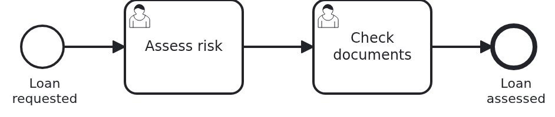

# User tasks in the Business Cockpit, backend

[](./LICENSE)

Your users work on their user tasks in the
[VanillaBP Business Cockpit](https://github.com/vanillabp/business-cockpit). The cockpit lists the
tasks, and it opens a form for each of them. The form belongs to your workflow module, and it
talks to your workflow module. This blueprint is the backend of such a module: the API the forms
call, and the workflow module which implements it.

## What this blueprint shows



A loan approval with two user tasks, "Assess risk" and then "Check documents". Each task has a
form with one input field. The forms are not here. They are a user interface, built with npm, in
a repository of their own. This repository holds what a form needs from the backend.

### The parts of a workflow module with a user interface

Your build runners most likely have
one image with Java and Maven and another one with Node. A repository in which Maven and npm
build together is hard to have there. So a workflow module with a user interface has three
parts, each in a repository of its own:

|                    Part                    |                                    What it holds                                     | Built with |
|--------------------------------------------|--------------------------------------------------------------------------------------|------------|
| `cockpit-user-task-backend-springboot`     | this repository: the API of the forms as an OpenAPI file, and the workflow module    | Maven      |
| `cockpit-user-task-frontend-react`         | the forms and the columns of the task list, as a JAR of the user interface           | npm        |
| `cockpit-user-task-application-springboot` | the application which takes the workflow module and the user interface and runs them | Maven      |

The API and the workflow module are in one repository, because neither of them needs the user
interface. The user interface needs the API, and only the application needs both. So nothing
depends on itself in a circle. The frontend reads the OpenAPI file of this repository through a
git submodule, at a commit it pins. So it builds without this backend being built or released.
Release them in this order all the same: the backend first, then the frontend, then the
application. The frontend pins a commit of the backend, and the application takes the released
workflow module and the released user interface. A bot such as Renovate opens the pull request
which moves the application to a new release. So there are three repositories instead of one,
and this is the reason.

### The API is a file

The workflow module holds the OpenAPI of the four endpoints the forms call, at
`loan-approval/src/main/resources/openapi/loan-approval.yaml`. A frontend reads this file through
a git submodule of this repository, at a commit it pins, and generates its client from it. It
needs no Maven repository and no Java for that. React and Angular frontends read the same file.
The workflow module implements it in `UserTaskFormController`, and its test reads the file from
the classpath and checks every operation against the endpoints. The file sits next to the code
which implements it, so one pull request changes both.

### The way a form reaches the workflow module

A form runs in the browser, inside the cockpit.
It never calls your application directly. It calls the cockpit below `/wm/loan-approval/`, and
the cockpit forwards the request to the address the module reported, its `workflow-module-uri`.
On the way, the cockpit puts the path of that address in place of `/wm/loan-approval`. This
module reports `http://localhost:8080/loan-approval`, so:

|                    The browser asks for                     |                     The module gets                      |
|-------------------------------------------------------------|----------------------------------------------------------|
| `/wm/loan-approval/api/user-tasks/{userTaskId}/assess-risk` | `/loan-approval/api/user-tasks/{userTaskId}/assess-risk` |
| `/wm/loan-approval/bc-manifest.json`                        | `/loan-approval/bc-manifest.json`                        |

That is why the OpenAPI names `/wm/loan-approval` as its server, and why every endpoint of the
module starts with `/loan-approval`. The second line is the user interface. The application
serves it from the JAR of the user interface, below `/loan-approval/`. An application which holds
several workflow modules keeps their paths apart this way.

### Completing a task is the module's job

A form sends what the user entered to the module. The
module writes it to the workflow aggregate and completes the user task with
`ProcessService#completeUserTask`. The cockpit adapter sees the task end in the BPMS (business
process management system) and tells the cockpit. The cockpit never sees the data of a form.

### What the cockpit shows about a task

The cockpit adapter reports every user task of the
module without a line of code. `WorkflowTaskHandler#userTaskDetails` carries
`@UserTaskDetailsProvider` and adds business data to each report: the risk assessment, under the
key `riskAssessment`. A column of the task list, which the frontend defines, shows it. It is empty
while "Assess risk" is open. "Check documents" shows it.

### What the cockpit has to know about the module

`loan-approval.yaml` carries the keys below
`vanillabp.workflow-modules.loan-approval.cockpit`. `ui-uri-type: ES_MODULES` says that the user
interface is a set of ES modules. `ui-uri-path: /bc-manifest.json` says where the list of those
modules is. VanillaBP passes both on to the cockpit, and the cockpit user interface reads them.

### The module wires itself

Think of a workflow module as a complete application of its own which just cannot run alone. It
relies on nothing the hosting application provides, except resources the application shares on
purpose, such as the data source
([Workflow modules](https://github.com/vanillabp/adapter-platform-integration/wiki/Workflow-modules#what-is-a-workflow-module)).
An application is only a container for workflow modules. It adds this module as a Maven
dependency, and that is all. So the module brings two auto-configurations, which Spring Boot
loads from every JAR on the class path.

`LoanApprovalAutoConfiguration` scans the package of the module for beans, entities and
repositories, and only that package. The beans get their fully qualified class name as name. Every workflow module has classes called `Service`,
`Workflow` and `ApiController`, and with the short names the second module in one application
ends the boot. The application's package does not have to be above the module's. An application
with entities of its own names their package with `@EntityScan` and `@EnableJpaRepositories` as
well, because Spring Boot then looks only where such annotations say.

`UserInterfaceRouteAutoConfiguration` is for an application which takes the user interface from
an nginx instead of from the UI jar. It forwards every GET below `/loan-approval/` to that nginx,
except the API below `/loan-approval/api/`. It is only active if two things are true: the
application has the starter of Spring Cloud Gateway for Spring MVC, and it sets
`loan-approval.user-interface.address`. The gateway is an optional dependency of the module, so
an application without it gets none of it. The key is below the id of the module, like every key
a module reads itself. The keys below `vanillabp` belong to VanillaBP and the cockpit adapter,
and they refuse keys they do not read.

This route is the same for every workflow module with a user interface. Only the id differs. So
the `support` library of the Business Cockpit is the place for it. It does not have it yet. Once
it does, the module will lose the class.

The module's own test boots it the same way. `ModuleTestApplication` scans nothing, so the
auto-configuration wires the module, as in every application which uses it.

### Nothing is stored while the user types

The aggregate gets the input of a form once, when the
form completes the task. A form which keeps a draft while the user is still typing needs a store
of its own, because the aggregate holds results, not drafts.

## Delta to the base blueprint

Compared to [`bpmn-user-task`](https://github.com/vanillabp-blueprints/bpmn-user-task-springboot):

|                    File                    |                                                                   What is different                                                                   |
|--------------------------------------------|-------------------------------------------------------------------------------------------------------------------------------------------------------|
| `openapi/loan-approval.yaml`               | new: the four endpoints of the forms                                                                                                                  |
| `loan-approval/loan-approval.yaml`         | the keys the cockpit needs, below `vanillabp.workflow-modules.loan-approval.cockpit`                                                                  |
| `loan_approval.bpmn`                       | two user tasks in a row, and no service task and no boundary event                                                                                    |
| `WorkflowTaskHandler.java`                 | a `@WorkflowTask` method per user task, and the `@UserTaskDetailsProvider` method                                                                     |
| `UserTaskFormController.java`              | new: the endpoints of the forms, which implement the OpenAPI                                                                                          |
| `ApiController.java`                       | only starts and shows a loan approval, below `/loan-approval/api/loan-requests`                                                                       |
| `Service.java`                             | per user task: keep the id, give a form its data, complete the task with what the user entered                                                        |
| `Aggregate.java`                           | per user task the id of the open task and what the user entered                                                                                       |
| `AggregateRepository.java`                 | finds the loan request by the id of an open user task                                                                                                 |
| `LoanApprovalIT.java`                      | reports to the dev shell simulator and completes both tasks through their endpoints                                                                   |
| `CockpitSimulator.java`                    | new: starts the dev shell simulator for the test                                                                                                      |
| `LocalBackend.java`                        | new: runs the workflow module for the development of the user interface                                                                               |
| `LoanApprovalAutoConfiguration.java`       | new: the module scans its own beans, entities and repositories                                                                                        |
| `UserInterfaceRouteAutoConfiguration.java` | new: forwards the user interface to an nginx, if the application names one                                                                            |
| `...AutoConfiguration.imports`             | new: tells Spring Boot about both auto-configurations                                                                                                 |
| `ModuleTestApplication.java`               | replaces `TestApplication`: scans nothing, the auto-configuration wires the module                                                                    |
| `loan-approval/pom.xml`                    | the cockpit adapter next to the BPMS adapter in every profile, the JAR of the dev shell simulator for the test, the gateway as an optional dependency |

There is no application module. The application is a repository of its own, see above. So the
blueprint has no smoke test of an application either. The application repository brings it.

## Running it

Requires a JDK 21 or newer. Camunda 7 is embedded, so nothing else has to run:

```bash
mvn install
```

That runs the integration test, which starts the dev shell simulator of the cockpit itself. To
run it on another BPMS, pick another Maven profile. Not one line of Java changes:

```bash
mvn install -Pcamunda8
mvn install -Poperaton
mvn install -Pcibseven
```

Camunda 8 is a remote engine, so a cluster has to run. Its address and everything else specific
to that engine are in the test's profile file
`loan-approval/src/test/resources/application-camunda8.yaml`.

### Running the backend for the development of the user interface

Somebody who works on the forms runs the frontend's dev server. It shows the forms in a dev
shell, a small web page which stands in for the cockpit. The dev shell needs two servers behind
it. One is the dev shell simulator, which stands in for the server of the cockpit. The other is
this backend.

Build once. The build copies the runnable JAR of the simulator to `loan-approval/target/`:

```bash
mvn install -DskipTests
```

Start the simulator, with the users of
`loan-approval/src/test/resources/dev-shell-simulator.yaml`. It listens on port 8079:

```bash
java -jar loan-approval/target/dev-shell-simulator.jar \
  --spring.config.additional-location=loan-approval/src/test/resources/dev-shell-simulator.yaml
```

Then start the backend in a second terminal. It runs the workflow module the way its test does,
with `LocalBackend`, an embedded BPMS and a database in memory. It reports to the simulator on
port 8079, and it answers on port 8080:

```bash
mvn -pl loan-approval spring-boot:test-run -Dspring-boot.run.profiles=camunda7
```

Start a loan approval. This is the only URL you need:

```
http://localhost:8080/loan-approval/api/loan-requests/start?amount=5000
```

The process stops at "Assess risk", and the simulator holds the task. The log names the endpoint
which gives the form its data:

```
Loan approval '0f7c…' started
Loan approval '0f7c…' waits for a risk assessment. Its form reads
  http://localhost:8080/loan-approval/api/user-tasks/1a2b…/assess-risk
```

Open it in a browser, and you see what the form shows. Completing the task is a POST with what
the user entered. That is the form's job, so the dev shell does it. The dev server of the frontend
forwards `/wm/loan-approval/` to `http://localhost:8080/loan-approval/`, the same way the cockpit
does. The frontend's README shows how.

## How it works

|                                          File                                          |                                                  Role                                                  |
|----------------------------------------------------------------------------------------|--------------------------------------------------------------------------------------------------------|
| `loan-approval/src/main/resources/openapi/loan-approval.yaml`                          | the contract between the forms and the module: four operations, below the server `/wm/loan-approval`   |
| `loan-approval/src/main/resources/loan-approval/processes/camunda7/loan_approval.bpmn` | the process: two user tasks, each carrying its task definition                                         |
| `loan-approval/src/main/resources/loan-approval/loan-approval.yaml`                    | what the cockpit has to know about the module: address, kind of user interface, manifest               |
| `.../loanapproval/WorkflowTaskHandler.java`                                            | keeps the id of each user task, and says what the cockpit shows about a task                           |
| `.../loanapproval/UserTaskFormController.java`                                         | the endpoints of the forms: GET reads what a form shows, POST completes the task                       |
| `.../loanapproval/Service.java`                                                        | finds the loan request by the id of its open task, writes the input and completes the task             |
| `.../loanapproval/Workflow.java`                                                       | `startWorkflow` and `completeUserTask`, the only place `ProcessService` is used                        |
| `.../loanapproval/model/Aggregate.java`                                                | the id of each open task, and what the user entered in each form                                       |
| `loan-approval/src/test/.../LoanApprovalIT.java`                                       | plays both tasks through, and checks what the cockpit was told                                         |
| `loan-approval/src/test/.../CockpitSimulator.java`                                     | runs the dev shell simulator of the cockpit for the test                                               |
| `.../loanapproval/config/LoanApprovalAutoConfiguration.java`                           | wires the module into any application which has it as a dependency                                     |
| `.../loanapproval/config/UserInterfaceRouteAutoConfiguration.java`                     | forwards the files of the user interface to an nginx, if `loan-approval.user-interface.address` is set |

The order of events: the BPMS creates "Assess risk" and calls `WorkflowTaskHandler#assessRisk`.
The handler hands the id over to `Service`, which keeps it on the aggregate. In the same moment
the cockpit adapter reports the task to the cockpit, with the details of
`WorkflowTaskHandler#userTaskDetails`. The report goes through the outbox, so a cockpit which is
down loses nothing.

A user opens the task in the cockpit. The cockpit loads the form of the module, and the form
calls `GET .../api/user-tasks/{userTaskId}/assess-risk` with the id of the task. The cockpit knows
the task by the same id the handler got, so `Service` finds the loan request by it. A task which
is not open answers 404: the id is unknown, or the task was completed already.

The user enters the assessment, and the form sends it with `POST`. `Service` writes it to the
aggregate, and `Workflow#riskAssessed` completes the user task. The BPMS moves on to "Check
documents", and the same happens again. The report of the second task carries the risk
assessment for the column. Its form shows the assessment and takes a note. After that the
workflow ends, and the cockpit takes both tasks off the list.

The endpoints are written by hand, rather than generated from the OpenAPI. Four endpoints read
better as code than as the settings of a generator. The integration test reads the OpenAPI from
the classpath and checks that every operation in it has its endpoint, so the file and the code
cannot drift apart unnoticed. An application with many forms may prefer to generate. Then the
interfaces come from the same file, and the controller implements them.

The API has POST requests, and the other blueprints have GET requests only, so that a browser is
the only tool needed. A form sends what the user entered. In this blueprint the browser is the
cockpit, or the dev shell in its place.

The integration test talks to the module the way a form does, only without the proxy of the
cockpit in between. It starts the dev shell simulator of the cockpit as a process of its own and
points `vanillabp.cockpit.rest.base-url` at it. The module runs with its real cockpit adapter.
The test asks the simulator what a cockpit user interface would ask: which user tasks there are,
and what their details say. Maven copies the runnable JAR of the simulator to `target/` before
the integration tests run, and the test writes the simulator's log to
`target/dev-shell-simulator.log`.

## Documentation

- [Connecting a workflow module](https://github.com/vanillabp/business-cockpit/wiki/Connecting-a-workflow-module): the cockpit adapter, the smallest configuration, and how a module registers itself
- [Reporting workflows and user tasks](https://github.com/vanillabp/business-cockpit/wiki/Reporting-workflows-and-user-tasks): `@UserTaskDetailsProvider` and the details of a task
- [What a workflow module tells the cockpit](https://github.com/vanillabp/business-cockpit/wiki/Configuration#what-a-workflow-module-tells-the-cockpit): `workflow-module-uri`, `ui-uri-type`, `ui-uri-path` and the other keys
- [The dev shell simulator](https://github.com/vanillabp/business-cockpit/wiki/Developing-UI-components-locally#the-dev-shell-simulator): running it and giving it users
- [User tasks](https://github.com/vanillabp/adapter-platform-integration/wiki/Workflow-tasks#user-tasks): the notification handler, the task id and completing the task later
- the wiki of the [BPMS adapter](https://github.com/vanillabp/adapter-platform-integration/wiki/BPMS-adapters) you use: which BPMN attribute carries the task definition of a user task

This blueprint is developed in the monorepo
[`blueprints`](https://github.com/vanillabp-blueprints/blueprints). This repository is a
read-only mirror, **issues and pull requests belong there.**

## Noteworthy & Contributors

[VanillaBP](https://www.github.com/vanillabp/spi-for-java) was developed by [Phactum](https://www.phactum.at) with the
intention of giving back to the community as it has benefited the community in the past.


## License

Copyright 2026 Phactum Softwareentwicklung GmbH

Licensed under the Apache License, Version 2.0
