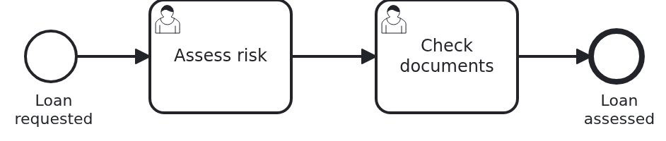

# User tasks in the Business Cockpit, bundle

[](./LICENSE)

A workflow module with a user interface comes in two JARs: the workflow module, built with Maven,
and the JAR of its user interface, built with npm. An application which runs several workflow
modules would need two dependencies per module, and it would have to know how each module is
wired. This blueprint packs both JARs and the wiring into one library, a bundle. The application
adds one dependency per module, and nothing else.

## What this blueprint shows



A loan approval with two user tasks, "Assess risk" and then "Check documents". The process and the
endpoints of the forms are in the backend, the forms are in the frontend. This repository makes
one library of them, `io.vanillabp.blueprint.cockpit-user-task-bundle-springboot:loan-approval-bundle`.

### Bundle or application

The backend and the frontend are the same either way. What comes after them depends on how you
run your workflow modules:

|                   You run                   |                                                                            Take                                                                             |
|---------------------------------------------|-------------------------------------------------------------------------------------------------------------------------------------------------------------|
| one workflow module per application         | [`cockpit-user-task-application`](https://github.com/vanillabp-blueprints/cockpit-user-task-application-springboot): the application takes both JARs itself |
| several workflow modules in one application | this bundle, one per module, and an application which takes the bundles                                                                                     |

The application which takes the bundles is the one
[`module-packaging`](https://github.com/vanillabp-blueprints/module-packaging-springboot) shows:
a project which assembles a runtime from workflow modules it has only as dependencies. The bundle
is what a team publishes, so that such a project can take its module with the user interface.

### The parts of a workflow module with a user interface

Your build runners most likely have one image with Java and Maven and another one with Node. A
repository in which Maven and npm build together is hard to have there. So a workflow module with
a user interface has three parts, each in a repository of its own:

|                  Part                  |                               What it holds                                | Built with |
|----------------------------------------|----------------------------------------------------------------------------|------------|
| `cockpit-user-task-backend-springboot` | the API of the forms as a JAR, and the workflow module                     | Maven      |
| `cockpit-user-task-frontend-react`     | the forms and the columns of the task list, as a JAR of the user interface | npm        |
| `cockpit-user-task-bundle-springboot`  | this repository: the workflow module, the user interface and their wiring  | Maven      |

The frontend needs only the API, and the API is in the backend. Only the bundle needs both. So
nothing depends on itself in a circle. Build and release the parts in this order: the backend,
then the frontend, then this bundle. Each part takes the parts before it as a released version
from your Maven repository. The two versions are properties in `pom.xml`, and a bot such as
Renovate opens the pull request which moves them from a snapshot to a release.

A Maven plugin which downloads Node and runs npm would save a repository. But it puts a second tool
chain into the Maven build, which many companies see as a security risk. So the frontend builds
its JAR with npm alone, and Maven takes it like any other dependency.

### The bundle wires the module

An application with several workflow modules has a package of its own. Its component scan does not
reach the package of a module. So the bundle brings an auto-configuration,
`LoanApprovalBundleAutoConfiguration`, which Spring Boot loads from every JAR on the class path.
It does two things:

- It scans the package of the module for beans. Every workflow module has classes called
  `Service`, `Workflow` and `ApiController`, so the beans get their fully qualified class name as
  name. With the short names, the second module in one application ends the boot.
- It adds the package of the module to the packages Spring Boot looks for entities and
  repositories in. The application's own package stays in that list.

The workflow module itself does not change. Its team may add an auto-configuration of its own
later, as `module-packaging` shows. Then the bundle needs none.

### The user interface needs nothing

The UI JAR holds its files below `META-INF/resources/loan-approval/`. Spring Boot serves that
directory of every JAR at `/`. So the application serves the manifest at
`/loan-approval/bc-manifest.json` as soon as the bundle is a dependency. The folder is named after
the workflow module, so the user interfaces of several modules do not mix.

The React, the Angular and the Vue frontend publish a JAR under the same coordinates. The bundle
carries the one your Maven repository holds.

## Delta to the base blueprint

Compared to [`cockpit-user-task-application`](https://github.com/vanillabp-blueprints/cockpit-user-task-application-springboot):

|                    File                    |                                       What is different                                        |
|--------------------------------------------|------------------------------------------------------------------------------------------------|
| `pom.xml`                                  | a library, not an application. The adapters are only in the test, the application chooses them |
| `LoanApprovalBundleAutoConfiguration.java` | new: wires the module into an application in another package                                   |
| `...AutoConfiguration.imports`             | new: tells Spring Boot about the auto-configuration                                            |
| `src/test/.../Application.java`            | the application of the test, in a package which does not reach the module                      |
| `src/test/resources/application.yaml`      | what the application writes: the database and where the reports go                             |
| `docker-compose.yaml`                      | gone: the application which takes the bundle runs the cockpit                                  |

## Running it

Requires a JDK 21 or newer. The workflow module and the UI JAR have to be in your Maven repository.
Until they are released, install them yourself: `mvn install` in the backend, then
`npm run build` in a frontend and `mvn install:install-file` of the JAR it built, as its README
says. Then:

```bash
mvn install
```

That runs the tests on Camunda 7, which is embedded, and installs the bundle. To test it on
another BPMS, pick another Maven profile. The bundle itself does not change:

```bash
mvn install -Pcamunda8
mvn install -Poperaton
mvn install -Pcibseven
```

Camunda 8 is a remote engine, so a cluster has to run. Its address and everything else specific
to that engine are in `src/test/resources/application-camunda8.yaml`.

An application takes the bundle with one dependency. It adds the BPMS adapter and the cockpit
adapter of its BPMS once, for all its modules:

```xml
<dependency>
  <groupId>io.vanillabp.blueprint.cockpit-user-task-bundle-springboot</groupId>
  <artifactId>loan-approval-bundle</artifactId>
  <version>1.0.0-SNAPSHOT</version>
</dependency>
```

## How it works

|                                File                                 |                                        Role                                         |
|---------------------------------------------------------------------|-------------------------------------------------------------------------------------|
| `pom.xml`                                                           | the workflow module and the UI JAR, and per BPMS profile both adapters for the test |
| `src/main/java/.../bundle/LoanApprovalBundleAutoConfiguration.java` | scans the module, and adds its package for entities and repositories                |
| `src/main/resources/META-INF/spring/...AutoConfiguration.imports`   | names the auto-configuration, so Spring Boot loads it                               |
| `src/test/java/blueprint/application/Application.java`              | an application in a package of its own, which says nothing about the module         |
| `src/test/java/.../ApplicationSmokeTest.java`                       | the context starts, and every workflow module is wired                              |
| `src/test/java/.../UserInterfaceSmokeTest.java`                     | the manifest comes from the UI JAR, and the form of an open task answers            |

The test application is in `blueprint.application`. The module is in
`blueprint.workflowmodule.loanapproval`, which the scan of the application does not reach. So if the
auto-configuration did not work, the module would have no beans. VanillaBP would find the process
and then miss the bean behind its tasks, and the boot would end. `ApplicationSmokeTest` also counts
the modules on the class path against the ones VanillaBP wired.

`UserInterfaceSmokeTest` asks for what the cockpit asks for: the manifest and the form of an open
task, both below `/loan-approval`. The workflow module tests the forms in detail. This test only
checks that the bundle brings everything an application needs.

## Documentation

- [Workflow modules in Spring Boot](https://github.com/vanillabp/adapter-platform-integration/wiki/Workflow-modules-in-Spring-Boot#publishing-a-workflow-module-it-brings-its-own-wiring): a module which brings its own wiring
- [Connecting a workflow module](https://github.com/vanillabp/business-cockpit/wiki/Connecting-a-workflow-module): the cockpit adapter and where the reports go
- [What a workflow module tells the cockpit](https://github.com/vanillabp/business-cockpit/wiki/Configuration#what-a-workflow-module-tells-the-cockpit): `workflow-module-uri`, `ui-uri-type`, `ui-uri-path`
- [Creating your own auto-configuration](https://docs.spring.io/spring-boot/reference/features/developing-auto-configuration.html): how Spring Boot finds and orders an auto-configuration
- the wiki of the [BPMS adapter](https://github.com/vanillabp/adapter-platform-integration/wiki/BPMS-adapters) you use

This blueprint is developed in the monorepo
[`blueprints`](https://github.com/vanillabp-blueprints/blueprints). This repository is a
read-only mirror, **issues and pull requests belong there.**

## Noteworthy & Contributors

[VanillaBP](https://www.github.com/vanillabp/spi-for-java) was developed by [Phactum](https://www.phactum.at) with the
intention of giving back to the community as it has benefited the community in the past.


## License

Copyright 2026 Phactum Softwareentwicklung GmbH

Licensed under the Apache License, Version 2.0
