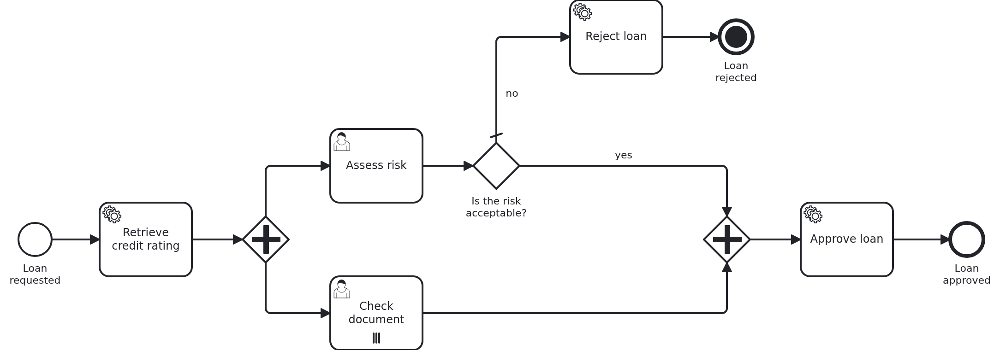

# User tasks in the application

[](./LICENSE)

Your application has forms for its user tasks, and users fill them in over hours or days. They
save in between, and the form may also save on its own while they type. This blueprint shows
where all of that is kept. Every user task is a row of its own next to the workflow aggregate,
and its draft stays in that row. The aggregate gets the result when the task is completed, and
not a moment before.

The patterns do not need a task list. They hold for an application with forms of its own, and
the same way for one whose tasks the VanillaBP Business Cockpit shows.

## What this blueprint shows



A loan approval assesses the risk and checks the documents of the customer at the same time.
"Check document" is a multi-instance user task. So it is open once per document, and all
instances are open side by side. If the risk is too high, the loan is rejected, and the
document checks which are still open are canceled.

**Only the result of a completed user task belongs in the workflow aggregate.** A draft does
not. If a draft went into the aggregate, everything which reads the aggregate would take it for
the answer. Here that is the other branch of the workflow: the form of a document check shows
the risk assessment. It must show the result or nothing. It must never show what the risk
officer typed ten minutes ago and may still change. The same holds for a gateway, a service
task and every report on the aggregate.

This is how the blueprint keeps a draft away from the aggregate:

- `Aggregate#tasks` is a map from the task id to a `Task`. A task is added when the BPMS opens
  it, and it stays when it is done. It is a map and not one attribute per task, because the
  same task definition can be open several times at once. `Aggregate#getTask(taskId)` returns
  an `Optional`, because a task id comes from a URL and may be wrong. The map is loaded
  lazily, when it is read.
- `Task` holds `createdAt`, `updatedAt`, `completedAt` and `completedBy`. Its `data` is a
  `TaskData`, the content of the form. `Task#getData()` returns it in the type the caller
  expects. The data is loaded lazily as well, so only the form which is read is loaded.
- `TaskData` is an interface with one record per kind of user task. It is stored as JSON in one
  column, and `@JsonSubTypes` lists the records. A new kind of user task needs no new table.
- Saving a form (PUT) changes the task and nothing else. Completing it (POST) writes the result
  into the aggregate, marks the task as completed and completes it in the BPMS, all in one
  transaction.
- When the workflow cancels a task, the handler is called with `CANCELED` and marks the task.
  `completedAt` is set and `completedBy` stays empty. The draft stays in the task and never
  reaches the aggregate.

The endpoints of each form are protected by an authority of the module. `@Secured` names
`Permission.ASSESS_RISK` or `Permission.CHECK_DOCUMENT`, and a user without it gets 403. The
module checks this itself, so it does not depend on how the application protects its URLs.
The application only decides how users log in. The user who completes a task is the user who
logged in, never a value of the request.

An authority alone is not enough, and the blueprint shows why. A clerk may complete document
checks. Without a second check, the clerk could send the id of a risk assessment to the
endpoint of a document check and complete it there. So `Service` also checks the kind of the
task, and answers 404 when the id belongs to a task of another kind.

Two exceptions say what is wrong with a task id: `BcUnknownTaskException` (404) and
`BcTaskNotOpenException` (409). Every module with forms needs them, so they come from
`io.vanillabp.businesscockpit:business-cockpit-spring-boot-support`, together with
`BcUserTaskExceptionHandler`, which turns them into the answer. The handler sends the message as
plain text, for the form to show. `UserTaskFormController` imports the handler with
`@Import(BcUserTaskExceptionHandler.class)`, because nothing registers it on its own.

When is the simple case enough?
[`bpmn-user-task`](https://github.com/vanillabp-blueprints/bpmn-user-task-springboot) keeps the
id of the one open task in an attribute of the aggregate and writes the answer there directly.
That is right as long as two things are true: a user task is never open twice at the same
time, and its form keeps no drafts. If one of them is not true, take this blueprint.

## Delta to the base blueprint

Compared to [`bpmn-user-task`](https://github.com/vanillabp-blueprints/bpmn-user-task-springboot):

|                File                |                                                                                What is different                                                                                |
|------------------------------------|---------------------------------------------------------------------------------------------------------------------------------------------------------------------------------|
| `loan_approval.bpmn`               | two branches at the same time: the risk assessment, and a multi-instance user task per document; a terminate end event                                                          |
| `Aggregate.java`                   | `tasks`, a lazily loaded map from the task id to a `Task`, instead of one task id; the results of the user tasks                                                                |
| `Task.java`                        | new: one user task with its dates, who completed it, and its `TaskData`, which is loaded lazily                                                                                 |
| `TaskData.java`                    | new: the content of a form, one record per kind of user task, stored as JSON                                                                                                    |
| `TaskDataConverter.java`           | new: writes `TaskData` as JSON into one column                                                                                                                                  |
| `WorkflowTaskHandler.java`         | the handler of the multi-instance user task, which gets its document as `@MultiInstanceElement`                                                                                 |
| `Service.java`                     | adds a task when it opens, saves drafts into the task, moves the result into the aggregate when the task is completed; `@Transactional` on the class                            |
| `UserTaskFormController.java`      | new: per form, GET reads, PUT saves a draft, POST completes; each endpoint protected by its authority; imports `BcUserTaskExceptionHandler`                                     |
| `Permission.java`                  | new: the authorities of the module, one per kind of user task                                                                                                                   |
| `MethodSecurityConfiguration.java` | new: switches on `@Secured` for the module                                                                                                                                      |
| `SecurityConfiguration.java`       | new, in the application: HTTP Basic and two demo users                                                                                                                          |
| `loan-approval.yaml`               | the documents to check, and the declaration of the list the model loops over                                                                                                    |
| `LoanApprovalIT.java`              | the tasks as rows, a draft which stays in its task, completion, cancellation, a task sent twice, tasks and data loaded only when read                                           |
| `StoredLoanApprovals.java`         | new, in the tests: reads a loan approval with all tasks and their data inside a transaction                                                                                     |
| `UserTaskFormSecurityIT.java`      | new: who may read, save and complete which form                                                                                                                                 |
| `loan-approval/pom.xml`            | Spring Security, and its test support; `business-cockpit-spring-boot-support` for the exceptions about a task id; `hibernate-maven-plugin`, which makes the data of a task lazy |
| `application.yaml`                 | `open-in-view: false`, so nothing reads the tasks after the transaction                                                                                                         |

The withdrawal of the base blueprint is not here. The terminate end event shows a canceled user
task instead, and it works on every BPMS.

## Running it

Requires a JDK 21 or newer. Camunda 7 is embedded, so nothing else has to run:

```bash
mvn install verify
```

To run it on another BPMS, pick another Maven profile. Not one line of Java changes:

```bash
mvn install verify -Pcamunda8
```

Camunda 8 is a remote engine, so a cluster has to run. Its address and everything else
specific to that engine are in its profile file
`application/src/main/resources/application-camunda8.yaml`. The module's own test has a copy.
[Operaton](https://operaton.org) and [CIB seven](https://cibseven.org) are embedded like
Camunda 7 and read the same BPMN files. Their profiles are `-Poperaton` and `-Pcibseven`.

Start the application:

```bash
mvn -pl application spring-boot:run
```

Start a loan approval. The browser asks you to log in. Take `risk-officer` with the password
`demo`:

```
http://localhost:8080/api/loan-approval/start?amount=5000
```

The process opens three user tasks and logs the address of each form:

```
Loan approval '0f7c…' started
Credit rating of loan approval '0f7c…' is 50
Loan approval '0f7c…' waits for a risk assessment. Its form reads
  http://localhost:8080/api/loan-approval/0f7c…/assess-risk/1a2b…
Loan approval '0f7c…' waits for a check of the document 'id-card'. Its form reads
  http://localhost:8080/api/loan-approval/0f7c…/check-document/3c4d…
Loan approval '0f7c…' waits for a check of the document 'income-statement'. Its form reads
  http://localhost:8080/api/loan-approval/0f7c…/check-document/5e6f…
```

Open the risk assessment in the browser, and you see what its form shows. Open a document
check, and you get 403, because `risk-officer` may not check documents. The other demo user is
`clerk`, with the same password, and may only check documents.

Saving and completing are the job of a form. It sends what the user entered as JSON, with PUT
to save and POST to complete, as the
[rules for blueprints](https://github.com/vanillabp-blueprints/blueprints/blob/main/CONTRIBUTING.md#endpoints-which-a-form-calls)
say for every endpoint of a form. This blueprint has no forms, so `curl` stands in for one:

```bash
curl -u risk-officer:demo -X PUT -H 'Content-Type: application/json' \
  -d '{"riskAcceptable":false,"comment":"first impression"}' \
  http://localhost:8080/api/loan-approval/0f7c…/assess-risk/1a2b…
```

Look at the loan approval now:

```
http://localhost:8080/api/loan-approval/0f7c…
```

The task holds the draft, and `riskAcceptable` of the aggregate is still empty. The forms of the
document checks show no risk assessment either. Complete the task:

```bash
curl -u risk-officer:demo -X POST -H 'Content-Type: application/json' \
  -d '{"riskAcceptable":true,"comment":"stable income"}' \
  http://localhost:8080/api/loan-approval/0f7c…/assess-risk/1a2b…
```

Now the result is in the aggregate, and the task says who completed it and when. Send the same
request again, and you get 409, because the task is not open any more. Complete both document
checks as `clerk` with `{"valid":true}`, and the loan is approved. If you complete the risk
assessment with `false` instead, the loan is rejected. The document checks which are still open
are then marked as canceled, and their drafts stay where they were.

## How it works

|                                          File                                          |                                                       Role                                                        |
|----------------------------------------------------------------------------------------|-------------------------------------------------------------------------------------------------------------------|
| `loan-approval/src/main/resources/loan-approval/processes/camunda7/loan_approval.bpmn` | the process: two branches, a multi-instance user task, a gateway on the result, a terminate end event             |
| `.../loanapproval/model/Aggregate.java`                                                | the tasks by their id, and the results of completed tasks                                                         |
| `.../loanapproval/model/usertask/Task.java`                                            | one user task: open, saved, completed or canceled                                                                 |
| `.../loanapproval/model/usertask/TaskData.java`                                        | the content of a form, with `AssessRiskTaskData` and `CheckDocumentTaskData` as the two kinds                     |
| `.../loanapproval/model/usertask/TaskDataConverter.java`                               | the JSON column                                                                                                   |
| `.../loanapproval/WorkflowTaskHandler.java`                                            | `CREATED` adds a task, `CANCELED` marks it                                                                        |
| `.../loanapproval/Service.java`                                                        | drafts into the task, results into the aggregate, and the check that a task is open and of the expected kind      |
| `.../loanapproval/UserTaskFormController.java`                                         | GET, PUT and POST per form, each with `@Secured`; imports `BcUserTaskExceptionHandler`, which answers 404 and 409 |
| `.../loanapproval/Workflow.java`                                                       | `startWorkflow` and `completeUserTask`, the only place `ProcessService` is used                                   |
| `.../loanapproval/config/Permission.java`                                              | the authorities of the module                                                                                     |
| `application/src/main/java/.../SecurityConfiguration.java`                             | how users log in: HTTP Basic, two demo users                                                                      |
| `loan-approval/src/test/.../LoanApprovalIT.java`                                       | plays the tasks through and waits for the aggregate                                                               |
| `loan-approval/src/test/.../UserTaskFormSecurityIT.java`                               | calls the form endpoints as users with and without the authority                                                  |

The order of events: the service task rates the loan request. Then the BPMS opens the risk
assessment and one document check per entry of `documentIds`. For each of them it calls
`WorkflowTaskHandler` with `CREATED`, and `Service` adds a `Task` with an empty form. A document
check gets its document as `@MultiInstanceElement` and keeps it in its `CheckDocumentTaskData`.
VanillaBP saves the aggregate after each call.

A user opens a form. `UserTaskFormController` asks `Service` for the loan request with that task.
`Service` refuses a task id which is unknown or of another kind. The form shows the data of the
task and what it needs from the aggregate.

The user saves. `Service#saveRiskAssessmentDraft` checks that the task is still open and
replaces its data. Nothing else changes. The row of the aggregate is not even written, because
the task is a row of its own table. So two users who work on two tasks of the same loan approval
at the same time do not overwrite each other.

The user completes. `Service#assessRisk` checks again that the task is open. Then it writes the
result into the aggregate, marks the task as completed by the user who logged in, and calls
`Workflow#riskAssessed`. That calls `ProcessService#completeUserTask` in the same transaction.
On a remote BPMS the completion is sent only after the transaction committed. So the result
reaches the aggregate exactly when the task is completed. If anything fails, neither of them
happens, and the user still finds the last draft.

The gateway reads `isRiskAccepted()`, and that reads the result of the completed task. If the
risk is too high, the workflow ends at a terminate end event, and the document checks which are
still open are canceled. VanillaBP calls their handler with `CANCELED`, and
`Service#taskCanceled` marks them. An embedded engine reports the cancellation at once. On a
remote BPMS VanillaBP works it out and reports it when the workflow has ended. A multi-instance
value such as the document is empty then, which is why the cancellation finds the task by its id
alone.

`TaskData` is stored as JSON by a converter of the JPA standard, so it works with every
database. The records are replaced as a whole and never changed in place. Jackson writes the
property `taskType` into the JSON and reads it back to know the record. Do not rename a name in
`@JsonSubTypes` once tasks are stored, or they can no longer be read.

The tasks and their data are loaded only when somebody reads them. VanillaBP loads the
aggregate before every task of the workflow. A service task or a gateway needs no user task, and
the tasks would grow with every one the workflow opens. So `Aggregate#tasks` is a lazy
`@OneToMany`. Reading a form loads the tasks, and the data of the one task the form is about.
The data of the others stays in the database. For a single attribute such as `Task#data`, JPA
can do that only if Hibernate rewrote the entity class when it was built. The
`hibernate-maven-plugin` in `loan-approval/pom.xml` does that. Without it, the annotation
`@Basic(fetch = LAZY)` is silently ignored, and the data comes with every task.
`LoanApprovalIT` proves both with `PersistenceUnitUtil#isLoaded`.

Something lazy can only be loaded while the transaction is still open. That is why
`@Transactional` is on the class `Service`. The methods a task handler calls run in the
transaction of VanillaBP anyway, and the annotation shows that they need one. `Service#withTask`
reads the data of its task before it returns, so the controller can build the form afterwards.
`Service#describe` writes the text of a loan approval inside the transaction. The application
sets `spring.jpa.open-in-view: false`. A read after the transaction then fails in a web request
too, and does not only work there by chance.

Both branches write to the aggregate when a task is completed. The aggregate carries
`@DynamicUpdate`, so the persistence layer writes only the columns which changed. The risk
assessment writes its own columns, and a document check writes a row of another table. So
neither of them puts back an old value of the other.

The tests wait instead of asserting at once. A user task created by a remote engine arrives a
moment after the workflow was started.

## Documentation

- [User tasks](https://github.com/vanillabp/adapter-platform-integration/wiki/Workflow-tasks#user-tasks): the notification handler, the task id and completing the task later
- [Completing and canceling asynchronous tasks](https://github.com/vanillabp/adapter-platform-integration/wiki/Workflow-tasks#completing-and-canceling-asynchronous-tasks): when `CANCELED` arrives, and why a multi-instance value may be empty then
- [Parameters](https://github.com/vanillabp/adapter-platform-integration/wiki/Workflow-tasks#parameters): `@TaskId`, `@TaskEvent`, `@MultiInstanceElement`
- [Workflow aggregates](https://github.com/vanillabp/adapter-platform-integration/wiki/Workflow-aggregates): what the BPMS sees of the aggregate, and two branches which write to it
- [`bpmn-user-task`](https://github.com/vanillabp-blueprints/bpmn-user-task-springboot): the simple case, one task open at a time
- [`bpmn-multi-instance-task`](https://github.com/vanillabp-blueprints/bpmn-multi-instance-task-springboot): multi-instance tasks in general

This blueprint is developed in the monorepo
[`blueprints`](https://github.com/vanillabp-blueprints/blueprints). This repository is a
read-only mirror, **issues and pull requests belong there.**

## Noteworthy & Contributors

[VanillaBP](https://www.github.com/vanillabp/spi-for-java) was developed by [Phactum](https://www.phactum.at) with the
intention of giving back to the community as it has benefited the community in the past.


## License

Copyright 2026 Phactum Softwareentwicklung GmbH

Licensed under the Apache License, Version 2.0
