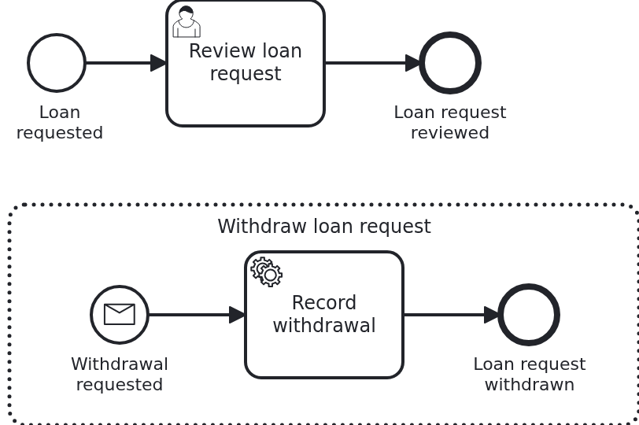

# The page of a case in the Business Cockpit, backend

[](./LICENSE)

Your users follow their cases in the
[VanillaBP Business Cockpit](https://github.com/vanillabp/business-cockpit). The cockpit lists
the cases, and it opens a page for each of them. The page belongs to your workflow module. It
shows details of the case, and it offers what a user may do with the case as a whole, outside of
its user tasks. This blueprint is the backend of such a module: the API the page calls, and the
workflow module which implements it.

## What this blueprint shows



A loan approval with one user task, "Review loan request". It keeps the case open, so there is
a case page to look at. An interrupting event subprocess "Withdraw loan request" starts with a
message, ends the open user task, writes the status "withdrawn" to the workflow aggregate and
ends the case. The page has a button "Withdraw loan request", and the button ends up in that
event subprocess. The page itself is not here. It is a user interface, built
with npm, in a repository of its own. This repository holds what the page needs from the
backend.

This blueprint builds on
[`cockpit-user-task-backend`](https://github.com/vanillabp-blueprints/cockpit-user-task-backend-springboot),
which shows the forms of user tasks. What is the same there is only linked here: why a module
with a user interface has three repositories, why the API is a file, and how a request of the
browser reaches the module.

### The parts of a workflow module with a user interface

|                       Part                        |                                     What it holds                                     | Built with |
|---------------------------------------------------|---------------------------------------------------------------------------------------|------------|
| `cockpit-workflow-details-backend-springboot`     | this repository: the API of the case page as an OpenAPI file, and the workflow module | Maven      |
| `cockpit-workflow-details-frontend-react`         | the case page and the columns of the case list, as a JAR of the user interface        | npm        |
| `cockpit-workflow-details-application-springboot` | the application which takes the workflow module and the user interface and runs them  | Maven      |

Why there are three, and in which order they are released, is explained in
[`cockpit-user-task-backend`](https://github.com/vanillabp-blueprints/cockpit-user-task-backend-springboot#the-parts-of-a-workflow-module-with-a-user-interface).
It holds for every workflow module with a user interface.

### Withdrawing goes through the process

The cockpit does not start or end a case. It only shows what the workflow module reports. So
"Withdraw loan request" does not ask the cockpit. The page calls the module's own API,
`POST /wm/loan-approval/api/cases/{loanRequestId}/withdraw`, and the cockpit forwards the request
to the module. The module correlates the message `WithdrawLoanRequest`. The event subprocess
starts and ends the user task. Its service task "Record withdrawal" sets the status of the
aggregate to `WITHDRAWN`, and the case reaches the end event "Loan request withdrawn". The
cockpit adapter reports both ends to the cockpit, the way it reports every other end.

A loan request which does not wait for its review any more cannot be withdrawn. The endpoint
then answers 409.

The page knows its case by the business id the cockpit shows. That is the id of the workflow
aggregate, here the id of the loan request. So the module finds the case without knowing an id
of the cockpit or of the BPMS.

### Withdrawn is not cancelled

Withdrawing is a business decision: this loan request is not needed any more. The outcome is
negative, but the process ends the normal way, and the status in the aggregate says what
happened. So the cockpit reports the end as `COMPLETED`, and the column "Status" of the case
list shows `WITHDRAWN`.

`CANCELLED` means something else. Somebody of operations cancelled the process in the BPMS, and
the run did not reach its end the way it should. That can be needed now and then. The status in
the aggregate does not change then. The cockpit will take the `deleteReason` of the engine as
the first text of the comment on such a case (cockpit story 1847).

### What the cockpit shows about a case

The cockpit adapter reports every workflow of the module without a line of code.
`WorkflowTaskHandler#workflowDetails` carries `@WorkflowDetailsProvider` and adds business data
to each report: the applicant under the key `applicant`, and the status of the loan request
under the key `status`. Two columns of the case list, which the frontend defines, show them.

### What the page gets from where

The page shows three things, and they come from two places:

|              What               |                                          From where                                          |
|---------------------------------|----------------------------------------------------------------------------------------------|
| the open user tasks of the case | the cockpit, through `workflow.getUserTasks(...)` of the module kit. The module is not asked |
| the data of the loan request    | the module, `GET /wm/loan-approval/api/cases/{loanRequestId}`                                |
| the button "Withdraw"           | the module, `POST /wm/loan-approval/api/cases/{loanRequestId}/withdraw`                      |

The cockpit knows the user tasks already. So the page asks the cockpit for them, and the module
needs no client for the API of the cockpit.

### Who may withdraw

This blueprint shows no rights. Everybody who sees the case sees the button, and the endpoint
checks no role. How a module protects its endpoints, and shows a button only to the users of a
role, is the subject of a blueprint of its own about roles and permissions.

### The module wires itself

`LoanApprovalAutoConfiguration` scans the package of the module for beans, entities and
repositories, as in
[`cockpit-user-task-backend`](https://github.com/vanillabp-blueprints/cockpit-user-task-backend-springboot#the-module-wires-itself).
An application adds the module as a Maven dependency, and that is all. This module has no route
to an nginx. Its user interface comes from the UI jar.

## Delta to the base blueprint

Compared to [`cockpit-user-task-backend`](https://github.com/vanillabp-blueprints/cockpit-user-task-backend-springboot):

|                File                |                                                     What is different                                                      |
|------------------------------------|----------------------------------------------------------------------------------------------------------------------------|
| `openapi/loan-approval.yaml`       | the two endpoints of the case page instead of the four of the forms                                                        |
| `loan_approval.bpmn`               | one user task, and the interrupting event subprocess "Withdraw loan request" with a message start event and a service task |
| `WorkflowTaskHandler.java`         | two `@WorkflowTask` methods, and a `@WorkflowDetailsProvider` method instead of the `@UserTaskDetailsProvider` method      |
| `CasePageController.java`          | new, instead of `UserTaskFormController.java`: reads a case and withdraws it, below `/loan-approval/api/cases`             |
| `ApiController.java`               | starts a loan approval with an applicant, approves it and shows it                                                         |
| `Service.java`                     | keeps the id of the user task, approves, withdraws by correlating the message, and records the withdrawal                  |
| `Workflow.java`                    | `correlateMessage` next to `startWorkflow` and `completeUserTask`                                                          |
| `Aggregate.java`                   | the applicant, the id of the open user task and the status                                                                 |
| `AggregateRepository.java`         | no finders: the page finds the case by its id                                                                              |
| `LoanApprovalIT.java`              | withdraws a loan request through the endpoint, and checks the user tasks of the case and the details for the case list     |
| `CockpitSimulator.java`            | reads a case by its business id, and the user tasks of a case                                                              |
| `pom.xml`, `loan-approval/pom.xml` | no Spring Cloud and no gateway                                                                                             |

There is no `UserInterfaceRouteAutoConfiguration`. The user interface comes from the UI jar, so
the module needs no route to an nginx, and no Spring Cloud.

## Running it

Requires a JDK 21 or newer. Camunda 7 is embedded, so nothing else has to run:

```bash
mvn install
```

That runs the integration test, which starts the dev shell simulator of the cockpit itself. To
run it on another BPMS, pick another Maven profile. Not one line of Java changes:

```bash
mvn install -Pcamunda8
mvn install -Poperaton
mvn install -Pcibseven
```

Camunda 8 is a remote engine, so a cluster has to run. Its address and everything else specific
to that engine are in the test's profile file
`loan-approval/src/test/resources/application-camunda8.yaml`.

### Running the backend for the development of the user interface

It works as in
[`cockpit-user-task-backend`](https://github.com/vanillabp-blueprints/cockpit-user-task-backend-springboot#running-the-backend-for-the-development-of-the-user-interface):
build once, start the dev shell simulator on port 8079, then start the backend on port 8080, in
a second terminal.

```bash
mvn install -DskipTests
java -jar loan-approval/target/dev-shell-simulator.jar \
  --spring.config.additional-location=loan-approval/src/test/resources/dev-shell-simulator.yaml
mvn -pl loan-approval spring-boot:test-run -Dspring-boot.run.profiles=camunda7
```

Start a loan approval. Then look at what the case page reads, or approve the loan request:

```
http://localhost:8080/loan-approval/api/loan-requests/start?applicant=Jane%20Doe&amount=5000
http://localhost:8080/loan-approval/api/cases/<loan request id>
http://localhost:8080/loan-approval/api/loan-requests/<loan request id>/approve
```

Approving stands in for the form of the user task, which this blueprint does not have. So you
can see an approved loan request next to a withdrawn one. Withdrawing is a POST, which the page
sends.

## How it works

|                                          File                                          |                                                        Role                                                         |
|----------------------------------------------------------------------------------------|---------------------------------------------------------------------------------------------------------------------|
| `loan-approval/src/main/resources/openapi/loan-approval.yaml`                          | the contract between the page and the module: two operations, below the server `/wm/loan-approval`                  |
| `loan-approval/src/main/resources/loan-approval/processes/camunda7/loan_approval.bpmn` | the process: one user task, and the event subprocess "Withdraw loan request" with the message `WithdrawLoanRequest` |
| `loan-approval/src/main/resources/loan-approval/processes/camunda8/loan_approval.bpmn` | the same for Camunda 8                                                                                              |
| `loan-approval/src/main/resources/loan-approval/loan-approval.yaml`                    | what the cockpit has to know about the module: address, kind of user interface, manifest                            |
| `.../loanapproval/WorkflowTaskHandler.java`                                            | keeps the id of the user task, records a withdrawal, and says what the cockpit shows about a case                   |
| `.../loanapproval/CasePageController.java`                                             | the endpoints of the case page: GET reads the case, POST withdraws the loan request                                 |
| `.../loanapproval/Service.java`                                                        | writes the status, and tells `Workflow` to complete the task or to correlate the message                            |
| `.../loanapproval/Workflow.java`                                                       | `startWorkflow`, `completeUserTask` and `correlateMessage`, the only place `ProcessService` is used                 |
| `.../loanapproval/model/Aggregate.java`                                                | the loan request, the id of the open user task and the status                                                       |
| `loan-approval/src/test/.../LoanApprovalIT.java`                                       | withdraws a loan request and approves another, and checks what the cockpit was told                                 |
| `loan-approval/src/test/.../CockpitSimulator.java`                                     | runs the dev shell simulator of the cockpit for the test, and reads cases and user tasks from it                    |
| `.../loanapproval/config/LoanApprovalAutoConfiguration.java`                           | wires the module into any application which has it as a dependency                                                  |

The order of events: the BPMS starts the workflow, and the cockpit adapter reports the case with
the details of `WorkflowTaskHandler#workflowDetails`. The BPMS creates "Review loan request" and
calls `WorkflowTaskHandler#reviewLoanRequest`, which keeps the id of the task on the aggregate.
The cockpit adapter reports the task as well.

A user opens the case in the cockpit. The cockpit loads the case page of the module. The page
asks the cockpit for the open user tasks of the case, and it calls
`GET .../api/cases/{loanRequestId}` with the business id of the case for the data of the loan
request.

The user clicks "Withdraw loan request", and the page sends
`POST .../api/cases/{loanRequestId}/withdraw`. `Workflow#withdrawalRequested` correlates the
message. The event subprocess interrupts the process: the user task ends, and the BPMS calls
`WorkflowTaskHandler#recordWithdrawal` for the service task, which sets the status `WITHDRAWN`.
The workflow ends at "Loan request withdrawn". The cockpit adapter reports the end of the task
and the end of the case. The report of the case reads the aggregate, so its details carry the
status `WITHDRAWN`.

The endpoints are written by hand, as in `cockpit-user-task-backend`. The integration test reads
the OpenAPI from the classpath and checks that every operation in it has its endpoint.

The integration test talks to the module the way the page does, only without the proxy of the
cockpit in between. It starts the dev shell simulator of the cockpit and points
`vanillabp.cockpit.rest.base-url` at it. It asks the simulator what a cockpit user interface
would ask: which case has this business id, which user tasks it has, and what its details say.

## Documentation

- [Connecting a workflow module](https://github.com/vanillabp/business-cockpit/wiki/Connecting-a-workflow-module): the cockpit adapter, the smallest configuration, and how a module registers itself
- [Reporting workflows and user tasks](https://github.com/vanillabp/business-cockpit/wiki/Reporting-workflows-and-user-tasks): `@WorkflowDetailsProvider` and the details of a case
- [What a workflow module tells the cockpit](https://github.com/vanillabp/business-cockpit/wiki/Configuration#what-a-workflow-module-tells-the-cockpit): `workflow-module-uri`, `ui-uri-type`, `ui-uri-path` and the other keys
- [The dev shell simulator](https://github.com/vanillabp/business-cockpit/wiki/Developing-UI-components-locally#the-dev-shell-simulator): running it and giving it users
- the wiki of the [BPMS adapter](https://github.com/vanillabp/adapter-platform-integration/wiki/BPMS-adapters) you use: how it correlates a message

This blueprint is developed in the monorepo
[`blueprints`](https://github.com/vanillabp-blueprints/blueprints). This repository is a
read-only mirror, **issues and pull requests belong there.**

## Noteworthy & Contributors

[VanillaBP](https://www.github.com/vanillabp/spi-for-java) was developed by [Phactum](https://www.phactum.at) with the
intention of giving back to the community as it has benefited the community in the past.


## License

Copyright 2026 Phactum Softwareentwicklung GmbH

Licensed under the Apache License, Version 2.0
