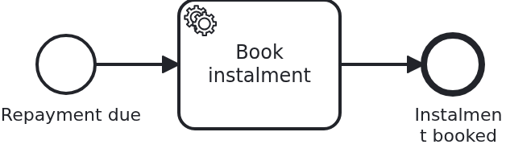

# Migrating running workflows to another BPMS

[](./LICENSE)

Moving to another BPMS (business process management system) does not happen in one big step.
Workflows are running, some of them for weeks. They were started in an engine which knows
nothing about the one you are moving to. This blueprint shows the answer VanillaBP gives:
configure both engines and start new workflows in the new one. Every operation on an existing
workflow then finds the engine which holds it.

## What this blueprint shows


A loan approval which waits twice: at a user task, and after it at a message. Two wait states
are the smallest model which shows the point. Answering either of them is an operation which
has to find the BPMS that holds the workflow.

The module has a second, much smaller workflow. It is here for its configuration, not for its
model:



The whole migration is configuration. Before it, one BPMS is configured as one adapter
instance:

```yaml
vanillabp:
  adapters:
    camunda7:
      # settings of that engine
```

During the migration both are configured. Their order decides where new workflows start:

```yaml
vanillabp:
  prioritized-adapters:
    - camunda8      # new workflows start here
    - camunda7      # workflows started earlier are still found here
  adapters:
    camunda8:
      rest-address: http://localhost:8080
    camunda7:
      # settings of that engine
  workflow-modules:
    loan-approval:
      workflows:
        loan_repayment:
          prioritized-adapters:
            - camunda7      # this one stays behind
```

From there, two rules route everything. Neither of them shows in the code:

**A new workflow starts in the first adapter of the list.** No adapter is asked, because nobody
can know a workflow which does not exist yet.

**An operation on an existing workflow goes to the BPMS holding it.** Completing the user task
and correlating the message both ask the adapters in the order of the list. The first one which
knows the workflow performs the operation. So a loan approval started in the old BPMS is
answered there, weeks after the new one became first priority.

The priority list exists on three levels: per adapter set, per workflow module, and per
workflow. The most specific list which is not empty wins. The repayment above uses the finest
level. This lets you migrate one workflow at a time instead of all at once.

Nothing in the Java code of this blueprint names an adapter, with one exception.
`/api/loan-approval/{id}/bpms` answers which BPMS runs a workflow, because this blueprint is
about showing the routing. It reads the id of the process definition the workflow runs on,
which is `<adapter-id>#<id of the BPMS>`, and returns the first part. An application normally
has no reason to ask.

## Delta to the base blueprint

Compared to [`module-single`](https://github.com/vanillabp-blueprints/module-single-springboot):

|            File             |                                                       What is different                                                        |
|-----------------------------|--------------------------------------------------------------------------------------------------------------------------------|
| `application/pom.xml`       | the profiles `camunda8`, `operaton` and `cibseven` bring BOTH adapters, because during a migration the old BPMS is still there |
| `application-camunda7.yaml` | the state before the migration: one adapter, nothing to prioritize                                                             |
| `application-camunda8.yaml` | the state during it: the priority list, both adapters, and the workflow which stays behind                                     |
| `application-operaton.yaml` | the same state for the migration to Operaton, with a database of its own for Operaton                                          |
| `application-cibseven.yaml` | the same state for the migration to CIB seven, with a database of its own for CIB seven                                        |
| `OperatonDatabase.java`     | the database of Operaton, under the `operaton` profile only                                                                    |
| `CibSevenDatabase.java`     | the database of CIB seven, under the `cibseven` profile only                                                                   |
| `application.yaml`          | a FILE database, because the scenario restarts the application                                                                 |
| `loan_approval.bpmn`        | a user task and a message catch event, the two wait states the election is shown with                                          |
| `loan_repayment.bpmn`       | the second workflow, whose priority list names the old BPMS alone                                                              |
| `loanrepayment/`            | its use case: the classes carry its name, because otherwise two use cases in one application would collide                     |
| `MigrationIT.java`          | starts, routes and finishes workflows in both BPMS                                                                             |
| `MigrationRestartIT.java`   | the migration itself: two boots, one database, the workflows of the first boot finished in the second                          |

The user task alone is [`bpmn-user-task`](https://github.com/vanillabp-blueprints/bpmn-user-task-springboot),
the message alone is [`bpmn-message-correlation`](https://github.com/vanillabp-blueprints/bpmn-message-correlation-springboot).
Here they are the two wait states a migration has to survive.

Two use cases in one application need different bean names. That is why the repayment classes
are called `RepaymentService` and so on, not `Service`. The general answer is one bean-name
generator per workflow module, and
[`module-multi`](https://github.com/vanillabp-blueprints/module-multi-springboot) shows it.

## Running it

Requires a JDK 21 or newer. The state before the migration needs nothing but the embedded engine:

```bash
mvn install verify
```

The migration state needs the remote engine, so a cluster has to run. The profile brings both
adapters:

```bash
mvn install verify -Pcamunda8
```

The address of the cluster and everything else specific to that engine are in
`application/src/main/resources/application-camunda8.yaml`.

The second migration goes from Camunda 7 to [Operaton](https://operaton.org), its open source
successor. Both engines are embedded, so nothing else has to run:

```bash
mvn install verify -Poperaton
```

Its profile file `application-operaton.yaml` describes the same state as the one of `camunda8`:
both adapters, Operaton first, and the repayment stays with Camunda 7. Two engines inside one
application need two things more. Operaton gets a database of its own, because two engines must
not share one set of tables. And Camunda 7 uses its older FEEL implementation, because both
engines bring the same FEEL library in two versions. FEEL is the expression language of decision
tables. `OperatonDatabase.java` builds the database, under this profile only. The POM removes
Camunda's copy of the FEEL library, and the key `dmn-feel-legacy-behavior` of the profile file
switches Camunda 7 over. The
[README of the Operaton adapter](https://github.com/vanillabp/operaton-adapter#side-by-side)
explains the FEEL library. The walk-through below works the same with `-Poperaton`. Only the
web applications of Camunda 7 come with this profile, because those of both engines in one
application have not been tested together.

The third migration goes from Camunda 7 to [CIB seven](https://cibseven.org), a fork of Camunda 7
made by CIB software. It is embedded as well:

```bash
mvn install verify -Pcibseven
```

Its profile file `application-cibseven.yaml` describes the same state again: both adapters, CIB
seven first, and the repayment stays with Camunda 7. CIB seven gets a database of its own, which
`CibSevenDatabase.java` builds under this profile only. Nothing else is needed. Both engines use
the same FEEL library in the same version, so the POM excludes nothing and Camunda 7 keeps its FEEL
implementation. The
[README of the CIB seven adapter](https://github.com/vanillabp/cibseven-adapter#side-by-side)
describes this setup. The walk-through below works the same with `-Pcibseven`. Only the web
applications of Camunda 7 come with this profile, because those of both engines in one
application are not supported.

The database is a file, `target/database/loan-approval`. In this one point the blueprint
differs from every other one in the catalogue. The scenario stops the application, changes
which BPMS are configured and starts it again. So the aggregates and the tables of the embedded
engine have to survive the first run. `mvn clean` throws the database away, and that is how you
start over.

### Walking through a migration

This is the sequence to show it to somebody. `MigrationRestartIT` does the same without a
browser.

Start with the old BPMS alone:

```bash
mvn -pl application spring-boot:run
```

Start a loan approval and take it past its user task:

```
http://localhost:8080/api/loan-approval/start
```

The log names the URL to answer the risk assessment, and after that the URL to report the
signed contract. Answer the assessment and leave the workflow waiting for the message. Start a
second loan approval and leave that one at its user task. Both are in the old BPMS:

```
http://localhost:8080/api/loan-approval/<id>/bpms
camunda7
```

Now stop the application and start it with both adapters:

```bash
mvn -pl application spring-boot:run -Pcamunda8
```

Start two more loan approvals and take one of them past its user task. They start in the
new BPMS, which the same URL shows:

```
http://localhost:8080/api/loan-approval/<id>/bpms
camunda8
```

Then answer the user task of the workflow left waiting in the old BPMS. Report the signed
contract for the one which was already waiting for it. Both finish in the old BPMS, and the two
new ones finish in the new one. The URLs are the same for all four, and so is the code behind
them.

A repayment shows the finest level of the priority list. It starts in the old BPMS, although
loan approvals already start in the new one:

```
http://localhost:8080/api/loan-repayment/start
http://localhost:8080/api/loan-repayment/<id>/bpms
camunda7
```

Camunda 7 serves its own web applications, and the `camunda7` profile of this blueprint
configures a user for them. They are a second way to see where a workflow lives. The
[adapter's wiki](https://github.com/camunda-community-hub/vanillabp-camunda7-adapter/wiki/Cockpit-Tasklist-and-Admin)
says where they are served and how to log in.

## How it works

|                                          File                                          |                                            Role                                             |
|----------------------------------------------------------------------------------------|---------------------------------------------------------------------------------------------|
| `application/src/main/resources/application-camunda8.yaml`                             | the priority list, both adapters, and the workflow-level list of the repayment              |
| `application/src/main/resources/application-operaton.yaml`                             | the same for the migration to Operaton, and where Operaton keeps its tables                 |
| `application/src/main/resources/application-cibseven.yaml`                             | the same for the migration to CIB seven, and where CIB seven keeps its tables               |
| `application/src/main/java/.../OperatonDatabase.java`                                  | the database Operaton runs on during the migration                                          |
| `application/src/main/java/.../CibSevenDatabase.java`                                  | the database CIB seven runs on during the migration                                         |
| `application/src/main/resources/application-camunda7.yaml`                             | the same application with one BPMS, which is where a migration starts                       |
| `loan-approval/src/test/resources/application-camunda7.yaml`                           | the same state for the module's own test, so it runs the scoping mode the application ships |
| `loan-approval/src/main/resources/loan-approval/processes/camunda7/loan_approval.bpmn` | the process with its two wait states                                                        |
| `.../loanapproval/Workflow.java`                                                       | `startWorkflow`, `completeUserTask` and `correlateMessage`, none of them naming an adapter  |
| `.../loanapproval/Service.java`                                                        | the business code, plus the one method reading which BPMS holds a workflow                  |
| `.../loanrepayment/RepaymentWorkflow.java`                                             | the same `startWorkflow`, for the workflow which stays behind                               |
| `loan-approval/src/test/.../MigrationIT.java`                                          | both BPMS in one boot: where a workflow starts, and that every operation reaches it         |
| `application/src/test/.../MigrationRestartIT.java`                                     | two boots against one database, which is the migration                                      |

What VanillaBP does with the priority list, in the order it happens:

1. **Deployment.** The BPMN models of a workflow module are deployed to every adapter its lists
   name. So both engines are ready to serve their workflows.
2. **Start.** The first adapter of the list applicable to that workflow gets it.
3. **Every later operation.** VanillaBP asks the adapters in order whether they know the
   workflow. The first one which says yes performs the operation. An adapter which does not
   know it passes. An adapter which cannot be reached stops the operation with an error, and
   the next one does not get to answer, because the unreachable one might be the one which
   holds the workflow. If the workflow is already completed, the operation does nothing and
   logs a warning. If nobody knows it, an exception says so and tells you what to do.
4. **Remembering.** VanillaBP caches successful elections. It also caches what it knows without
   asking: after a start, and whenever a BPMS delivers something of that workflow. The cache
   has a size limit and its entries expire. It needs no configuration. A lost record costs one
   more round of asking, never a wrong answer.

One setting of this blueprint is not a default, and it has a reason: `job-timeout: PT20S` on
the Camunda 8 adapter. The lock is how long a job stays reserved for a worker which does not
answer. So it is also how long anything behind such a job waits. Five minutes of that means
five minutes of watching nothing, and the handlers here finish in milliseconds. This blueprint
found the case which makes it visible: a workflow started right after a restart. The adapter
now keeps a restart from causing it. It waits for the cluster to release its workers before it
closes the client. The measurements are in
[what a restart costs the application which starts next](https://github.com/camunda-community-hub/vanillabp-camunda8-adapter/wiki/Configuration#what-a-restart-costs-the-application-which-starts-next).

Two things are worth knowing before you do this against a real cluster. First, a remote BPMS
may answer from a read model which is only eventually consistent, that is, it catches up after
a delay. So it may not know a workflow started moments ago for a few seconds. VanillaBP keeps
asking the adapter it recorded for as long as that adapter says it may need. Second, two
adapter ids of the same embedded engine are two engines, and they must not share one set of
engine tables. One of them needs a table prefix or a data source of its own. This blueprint
configures one instance per engine, so neither applies here.

### Keeping identifiers apart in the BPMS

The BPMS profiles of this blueprint set `name-clash-avoidance: use-prefix`. So VanillaBP puts
the workflow module ID in front of every identifier before it reaches the engine, and takes it
off again on the way back. The BPMN files, the business code and the rest of the configuration
keep the plain names, which is why nothing here mentions the prefix twice. The wiki page
[Workflow modules](https://github.com/vanillabp/adapter-platform-integration/wiki/Workflow-modules#how-name-clashes-are-avoided)
explains the modes and what each of them costs.

All three profiles say it for `camunda7`, and this repetition is the point of this section. The mode
decides what the engine calls a process, a message, a signal and an error. So a migration which
changes it renames everything the old BPMS already holds. The loan approval waiting for
`ContractSigned` would wait under `loan-approval__ContractSigned`, while the application asks
for `ContractSigned` in a tenant, and the message correlates with nothing. Leaving the setting
out of one profile is enough for that, because the default is the other mode. So the migration
profile repeats what the profile before it said. A change of mode is a migration of its own,
with a second adapter id for the same engine. The wiki page above describes it.

The module's own test reads profile files of its own, one per BPMS like the application, and
they name the same mode. Otherwise the test would run the default in one of its profiles. It
would then test a configuration this blueprint does not ship.

## Documentation

- [BPMS migration](https://github.com/vanillabp/adapter-platform-integration/wiki/BPMS-migration): the priority list, the election, the cache, and migrating between tenant setups
- [Configure the adapters](https://github.com/vanillabp/adapter-platform-integration/wiki/Spring-Boot-integration#configure-the-adapters): where adapter configuration lives and how it is bound
- [How name clashes are avoided](https://github.com/vanillabp/adapter-platform-integration/wiki/Workflow-modules#how-name-clashes-are-avoided): the same mechanism migrates a setup between two of these modes
- [Wire up a process](https://github.com/vanillabp/spi-for-java#wire-up-a-process): what the code in this blueprint does, without any of it knowing about a BPMS

This blueprint is developed in the monorepo
[`blueprints`](https://github.com/vanillabp-blueprints/blueprints). This repository is a
read-only mirror, **issues and pull requests belong there.**

## Noteworthy & Contributors

[VanillaBP](https://www.github.com/vanillabp/spi-for-java) was developed by [Phactum](https://www.phactum.at) with the
intention of giving back to the community as it has benefited the community in the past.


## License

Copyright 2026 Phactum Softwareentwicklung GmbH

Licensed under the Apache License, Version 2.0
