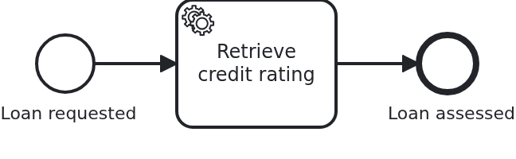
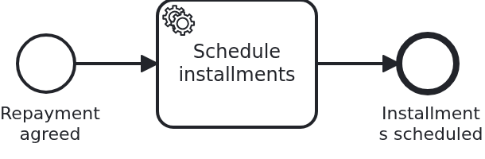

# A runtime assembled from published workflow modules

[](./LICENSE)

This is the setup larger organisations really run. Teams publish their workflow modules as
JARs. Somebody else assembles a runtime from them without having their sources. This blueprint
is the project of that somebody. Its application is a POM, a configuration file and two tests.
There is no Java code which wires anything, because it has nothing to wire with.

A delta on top of
[`module-multi`](https://github.com/vanillabp-blueprints/module-multi-quarkus), whose modules
these are. What changes is where they come from. They have their own group, their own version,
their own package, and no relation to this project except a dependency.

## What this blueprint shows





Two use cases, two JARs, published by their teams as `com.acme.lending:loan-approval:1.5.0` and
`com.acme.lending:loan-repayment:2.2.0`. This project has neither their sources nor a say in
their versions. It collects them, configures the environment they run in, and ships the result.

### Discovery: what it takes to pick up a foreign module

Nothing, and that is the point. The modules live in `com.acme.*`, packages this project never
heard of. Still, the dependency is all it takes. Each JAR carries an index of its classes, so
the build of the application finds the beans without being told where to look. The smoke test
proves it. It compares every workflow module which declares itself on the classpath with the
ones VanillaBP really wired.

**This comes from** `module-multi`. A module builds its index with the `jandex-maven-plugin`.
[The wiki](https://github.com/vanillabp/adapter-platform-integration/wiki/Workflow-modules-in-Quarkus#provide-index-for-workflow-modules)
says when it is needed and when the marker file alone is enough.

**And what to do with a module which has no index.** You will meet one in practice. The
application indexes it from outside with `quarkus.index-dependency.<name>.group-id` and
`.artifact-id`. It works. But then this project is responsible for a decision which belongs to
the module's build. Ask the team for the plugin instead. This is the fallback, not the way.

### Versioning: a module update is a dependency update

Every module carries its own version, and the application pins them in one place:

```xml
<dependencyManagement>
  <dependency>
    <groupId>com.acme.lending</groupId>
    <artifactId>loan-approval</artifactId>
    <version>1.5.0</version>
  </dependency>
  ...
```

To take a new version of a module, change one line there and nothing else. Its BPMN models come
along in the JAR. What happens to workflows which already run under the old models is not this
project's decision either. VanillaBP deploys what it finds at startup.
[`bpmn-versioning`](https://github.com/vanillabp-blueprints/bpmn-versioning-quarkus) shows how
a BPMS (business process management system) treats instances of an older version.

### Configuration: three places, and which one wins

The module, this application and the environment can all set the same value. The order is the
one an assembling project needs:

|                 Set in                 |                 Wins over                 |
|----------------------------------------|-------------------------------------------|
| environment, system property           | everything                                |
| `application.yaml` of this application | the file a module brings along            |
| the module's own file                  | nothing, it carries the module's defaults |

`application.yaml` of this blueprint sets both values a module ships, and
`ConfigurationLevelsIT` reads what arrived. `rating-scale` becomes the 42 set here, not the
module's 100. `rating-provider` takes the value which the build passes in from outside.

What that means when you assemble modules you do not own: **you decide their configuration**. A
module's file says what it needs to run at all. The project which collects it says what its
environment needs. The one exception is a module's profile-specific file. It beats the module's
plain file, because there the module still talks about itself.

Early snapshots of VanillaBP 2 had it the other way round. So a project written against one of
them may rely on a module winning. It does not win any more. The framework documents the order
and that correction in
[Workflow modules in Quarkus](https://github.com/vanillabp/adapter-platform-integration/wiki/Workflow-modules-in-Quarkus#configuration)
and in
[Migrating from Version 1](https://github.com/vanillabp/adapter-platform-integration/wiki/Migrating-from-version-1#a-workflow-modules-own-files-are-still-defaults).

### Shipping it

Three artifacts come out of this project, and none of them mentions a module:

```bash
mvn install                                        # the runnable application in application/target/quarkus-app
mvn install -Dquarkus.container-image.build=true   # the image: online-banking:1.0.0-SNAPSHOT
```

Jib assembles the image and needs no Docker daemon for it. The image carries the version of the
*application*. Which module versions went in is the business of the POM. Building it is not
part of `verify` or of CI. It takes minutes and downloads a base image, and a test which starts
a container tests Docker, not this blueprint.

**A native executable works with Camunda 8.** The command is

```bash
mvn install -Pcamunda8 -Dquarkus.native.enabled=true -Dquarkus.native.container-build=true
```

It compiles the application ahead of time in a builder container, so you need Docker or Podman
but no GraalVM on your machine. The result is one file,
`application/target/application-1.0.0-SNAPSHOT-runner`. Measured on 2026-11-15 on a machine
with 12 cores, with `-DskipTests -DskipITs`:

|            What            |                                   Measured                                   |
|----------------------------|------------------------------------------------------------------------------|
| whole build                | 1 min 41 s, of which the native image takes 1 min 21 s                       |
| memory of the image build  | 7 GB at its peak, limited with `-Dquarkus.native.native-image-xmx=8g`        |
| builder image, pulled once | `quay.io/quarkus/ubi9-quarkus-mandrel-builder-image:jdk-25`, 1.9 GB          |
| the executable             | 126 MB, starts in half a second, uses about 130 MB of memory after two cases |

Give the build at least 8 GB. Without the limit the image builder sizes its heap from the
memory of the machine. The tests of `-Pcamunda8` need a running cluster, as always.

Start the executable like the application. The cluster already uses port 8080, so the
application gets another one:

```bash
LOAN_APPROVAL_RATING_PROVIDER=schufa \
  application/target/application-1.0.0-SNAPSHOT-runner -Dquarkus.http.port=8081
```

Both start URLs from [Running it](#running-it), on port 8081, ran their workflow to the end:
the service tasks filled both aggregates, and the cluster reported both instances as
completed. The credit rating said `provided by 'schufa'`, so the environment still wins.

What it does not cover:

- **Camunda 7, Operaton and CIB seven.** With Camunda 7 the build succeeds, but the
  executable stops at startup when it builds the embedded engine. The engine creates objects by
  reflection, which a native image does not have unless somebody registers it. The adapters say
  it in their README: their Quarkus extension runs on the JVM only, because Camunda 7 never
  supported native images, and neither do the two forks. Use these engines on the JVM.
- **Choosing the engine at startup.** A native image takes its configuration files while it is
  built, so the executable is fixed to the profile it was built with. The build warns about
  every `application-*.yaml` of another profile which it leaves out. Build one executable per
  engine.
- **Tests against the executable.** No test of this blueprint starts it, and CI does not build
  it. The run above was done by hand.

Through all of it the engine stays a Maven profile. `-Pcamunda8` changes what is packaged, what
the tests run against and what the image contains. Not one line of Java changes.

### Watching it run

Once the runtime runs, somebody has to tell a quiet system from a stalled one. VanillaBP gives
the numbers and the log context for that, and neither needs a setting. And like everything
else here, it needs no line about a module.

**Every log line of a task names its workflow.** Around every task delivery and every dispatch
from the outbox, VanillaBP sets six MDC keys. MDC (mapped diagnostic context) is a set of values
which the logging library adds to every log line of the current thread. The ones to search by
are `vanillabp.workflow.module`, `vanillabp.bpmn.process` and `vanillabp.workflow.aggregate.id`.
So whatever a foreign module logs in its handler can be found by its workflow, although its team
never passed an id around. Put the keys into the log pattern of the application.
[The wiki](https://github.com/vanillabp/adapter-platform-integration/wiki/Observability#a-log-pattern-to-paste)
has a pattern to paste.

**Metrics and health appear as soon as the application brings the extensions for them.**
VanillaBP publishes its meters through Micrometer, but it does not bring Micrometer itself. This
blueprint adds none of it, so it reports no metrics and has no health endpoint. An application
which adds `quarkus-micrometer` with a registry, for example
`quarkus-micrometer-registry-prometheus`, gets the meters. One which adds
`quarkus-smallrye-health` gets the readiness check `vanillabp` in `/q/health/ready`.

Two numbers to start with:

- the rate of `vanillabp.task.deliveries` per `workflow.module`. If it is zero while workflows
  normally run, then either nothing is started or nothing finishes.
- `vanillabp.outbox.pending` together with `vanillabp.outbox.oldest.pending.age`: work which the
  application committed and its BPMS did not accept yet.

Where something happened is always a tag, never part of the name of a meter. That fits a project
which assembles modules. A third module adds a value of the `workflow.module` tag, not a new
meter. So a dashboard or an alert which groups by that tag covers it without a change.
[Observability](https://github.com/vanillabp/adapter-platform-integration/wiki/Observability)
lists every meter, its tags and the question it answers.

### What comes from `module-multi` unchanged

Having two workflow modules is the subject of that blueprint, so it is not repeated here. Each
module carries its index and keeps its resources below a directory of its own. The application
sets `name-clash-avoidance: use-prefix`, so the modules cannot collide inside the engine.

## Delta to the base blueprint

Compared to [`module-single`](https://github.com/vanillabp-blueprints/module-single-quarkus).
The modules are those of [`module-multi`](https://github.com/vanillabp-blueprints/module-multi-quarkus),
and the rows which say "as in `module-multi`" come from there:

|                                           File                                           |                                                           What is different                                                           |
|------------------------------------------------------------------------------------------|---------------------------------------------------------------------------------------------------------------------------------------|
| `loan-repayment/`, `banking-commons/`                                                    | new, as in `module-multi`: the second workflow module and the library both modules use                                                |
| `loan-approval/pom.xml`, `loan-repayment/pom.xml`, `banking-commons/pom.xml`             | no parent, own group, own version, own build including their index: JARs of another team                                              |
| `com/acme/...`                                                                           | the modules live in packages this application never heard of                                                                          |
| `loan-approval/src/main/java/blueprint/...`, `loan-approval/src/test/java/blueprint/...` | deleted: the classes of the base moved to `com/acme/...`                                                                              |
| `loan-approval/src/main/resources/loan-approval/*.yaml`                                  | as in `module-multi`: `rating-provider`, and a module file per environment                                                            |
| `openapi/loan-approval.yaml`                                                             | as in `module-multi`: the start URL takes a `customerId`                                                                              |
| `pom.xml`                                                                                | the modules `banking-commons` and `loan-repayment`, and no version of the OpenAPI generator, because each module brings its own build |
| `application/pom.xml`                                                                    | pins the module versions in `dependencyManagement` and adds the image extension                                                       |
| `application-camunda8.yaml`                                                              | as in `module-multi`: `name-clash-avoidance: use-prefix`                                                                              |
| `application/src/main/resources/application.yaml`                                        | tries to override two module values, and the test reads which attempt arrives                                                         |
| `application/src/test/.../ConfigurationLevelsIT.java`                                    | new: which of the three configuration levels wins                                                                                     |
| `application/src/test/.../ApplicationSmokeTest.java`                                     | unchanged, but here it tests the discovery and is more than a formality                                                               |
| `ModuleConfigurationPerProfileIT`, `BeanNamesPerModuleIT`                                | gone: profiles and bean names are `module-multi`'s subject                                                                            |

Everything inside the modules is `module-multi`, file for file. Only their coordinates, their
packages and their build belong to somebody else's release.

## Running it

Requires a JDK 21 or newer. Camunda 7 is embedded, so nothing else has to run:

```bash
mvn install verify
```

To run it on another BPMS, pick another Maven profile. Not one line of Java changes:

```bash
mvn install verify -Pcamunda8
```

Camunda 8 is a remote engine, so a cluster has to run. Its address is in
`application/src/main/resources/application-camunda8.yaml`, and the test of each module has a
copy.

[Operaton](https://operaton.org), the open source successor of Camunda 7, is embedded as well
and needs nothing else either. The BPMN files are the ones of Camunda 7, because Operaton reads
their `camunda:` attributes:

```bash
mvn install verify -Poperaton
```

[CIB seven](https://cibseven.org), a fork of Camunda 7 made by CIB software, is embedded as
well and needs nothing else either. The BPMN files are the ones of Camunda 7, because CIB seven
reads their `camunda:` attributes:

```bash
mvn install verify -Pcibseven
```

Start the application:

```bash
mvn -pl application quarkus:dev
```

Two URLs start something, one per workflow module:

```
http://localhost:8080/loan-approval/api/start?customerId=C-1001&amount=5000
http://localhost:8080/loan-repayment/api/start?customerId=C-1002&amount=6000
```

Each answers with the ID of the case it started and logs the URL which shows the result:

```
Loan approval '0f7c…' started: Ada Lovelace asks for 5,000 EUR
Credit rating of loan approval '0f7c…' is 50
Show the result -> http://localhost:8080/loan-approval/api/0f7c…
```

Both URLs belong to a module, which publishes them. This project neither knows nor declares
them.

Wherever the engine shows its deployments, it gives the shortest answer to "what is really in
this runtime": two processes, each with the prefix of the module which brought it.

To run the image instead of the application:

```bash
mvn install -Dquarkus.container-image.build=true
docker run --rm -p 8080:8080 -e LOAN_APPROVAL_RATING_PROVIDER=schufa online-banking:1.0.0-SNAPSHOT
```

The environment variable is the third configuration level from above. You see it in the log
line which names the rating provider.

## How it works

|                          File                           |                                             Role                                              |
|---------------------------------------------------------|-----------------------------------------------------------------------------------------------|
| `application/pom.xml`                                   | the whole project: two module dependencies, their pinned versions, the adapter and the image  |
| `application/src/main/resources/application.yaml`       | the database, the profile, and two override attempts whose fate the test reads                |
| `application/src/test/.../ApplicationSmokeTest.java`    | the discovery test: every declared workflow module has to be one VanillaBP wired              |
| `application/src/test/.../ConfigurationLevelsIT.java`   | which of the three configuration levels arrives                                               |
| `loan-approval/pom.xml`                                 | a foreign JAR's POM: own group, own version, own build, no parent                             |
| `loan-approval/src/main/java/com/acme/loanapproval/...` | the module's code, in the package its team chose                                              |
| `loan-approval/src/main/resources/loan-approval/...`    | the module's BPMN files and its own configuration, below its module id                        |
| `loan-approval/target/classes/META-INF/jandex.idx`      | the index the module's build writes; what makes it usable without this application knowing it |
| `loan-approval/src/test/java/com/acme/...`              | the module's own test, owned by the module's team and running without this application        |

What happens while the application is built: the build reads the index of every JAR. So the
beans of both modules become known without a line of configuration. At startup VanillaBP finds
the two `META-INF/workflow-module` markers, deploys the BPMN files each JAR brought, and
creates one `ProcessService` per aggregate. The application contributed the database, the
adapter and the environment. Nothing else, and nothing specific to a module.

Adding a third module takes one dependency and one version. Removing one means deleting both
lines. That is the whole promise of this blueprint, and the smoke test keeps it.

## Documentation

- [Workflow modules](https://github.com/vanillabp/adapter-platform-integration/wiki/Workflow-modules): what a workflow module is, its ID, and where its BPMN files are looked for
- [Defining a workflow module](https://github.com/vanillabp/adapter-platform-integration/wiki/Workflow-modules-in-Quarkus#defining-a-workflow-module): the marker file, the resource conventions and the module's own configuration files
- [Provide an index for workflow modules](https://github.com/vanillabp/adapter-platform-integration/wiki/Workflow-modules-in-Quarkus#provide-index-for-workflow-modules): why a JAR of its own needs one, and when the marker file alone is enough
- [Publishing a workflow module](https://github.com/vanillabp/adapter-platform-integration/wiki/Workflow-modules-in-Quarkus#publishing-a-workflow-module): what a module consumed by a foreign application needs
- [How name clashes are avoided](https://github.com/vanillabp/adapter-platform-integration/wiki/Workflow-modules#how-name-clashes-are-avoided): the three modes, and why changing the mode is a migration
- [Configuration of a workflow module](https://github.com/vanillabp/adapter-platform-integration/wiki/Workflow-modules#configuration): the file names, the profiles and the priority order
- [Workflow aggregates](https://github.com/vanillabp/adapter-platform-integration/wiki/Workflow-aggregates): why there are no process variables
- [Observability](https://github.com/vanillabp/adapter-platform-integration/wiki/Observability): every meter and its tags, the health endpoint, the MDC keys and a log pattern to paste
- the wiki of the [BPMS adapter](https://github.com/vanillabp/adapter-platform-integration/wiki/BPMS-adapters) you use: how a BPMN task has to be modelled for that engine

This blueprint is developed in the monorepo
[`blueprints`](https://github.com/vanillabp-blueprints/blueprints). This repository is a
read-only mirror, **issues and pull requests belong there.**

## Noteworthy & Contributors

[VanillaBP](https://www.github.com/vanillabp/spi-for-java) was developed by [Phactum](https://www.phactum.at) with the
intention of giving back to the community as it has benefited the community in the past.


## License

Copyright 2026 Phactum Softwareentwicklung GmbH

Licensed under the Apache License, Version 2.0

        https://www.apache.org/licenses/LICENSE-2.0

Unless required by applicable law or agreed to in writing, software distributed under the
License is distributed on an "AS IS" BASIS, WITHOUT WARRANTIES OR CONDITIONS OF ANY KIND,
either express or implied. See the License for the specific language governing permissions
and limitations under the License.
