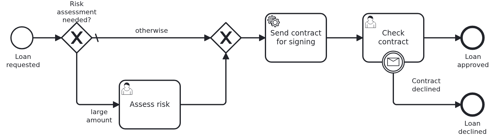

# Scenarios bring a case to every point of its process

[](./LICENSE)

You want to test a user task in the middle of a process, in every situation which matters for
the business. Each test would have to play the whole history of the case first, and the next
change of the model breaks all of them. This blueprint puts that history into one place, a
process driver. It brings a real loan approval to a named point of the process, with real code
and the real answers of the simulator, and the test starts there. A delta on top of
`module-simulator`.

## What this blueprint shows



A loan approval with two user tasks. From an amount of 10000 on, somebody has to assess the risk
first. Then the contract goes to the e-signature service, and somebody checks the signed
contract. The task "Check contract" opens while the signature may still be on its way. The
business code refuses to complete it before the customer signed. If the customer declines to
sign, the message "Contract declined" takes the task away, and the workflow ends with "Loan
declined".

So "Check contract" alone has four situations worth a test: a small amount, a large amount whose
risk somebody assessed, with the signature, and without it. A fifth one ends it: the customer
declines. Each of them has a history. The process driver knows these histories, and the tests do
not.

### The simulator plays the environment, the driver plays the users

A test of this blueprint runs the real application and replaces everything around it. Two
things take the places of what is around it:

- The **simulator** plays the environment: every system the application talks to. Here these
  are the credit rating, the e-signature service and the Business Cockpit. The application
  talks only to the simulator, and only the simulator calls the application back.
- The **process driver** plays the users. It acts like a person in the browser, through the
  API of the user interface of the workflow module, and it tells the simulator what the
  systems around should do.

With the actions of the users and the answers of the simulator, the driver plays the process
through, step by step, as it happens in production. Nothing in the application is mocked, and
nobody jumps into the engine.

```
  process driver: plays the users        simulator: plays the environment
        |                                  ^                  |
        | API of the user interface        | calls of the     | callbacks
        |                                  | adapters         |
        v                                  |                  v
  +------------------------------------------------------------------+
  | application: workflow module, adapters of its ports, BPMS adapter |
  +------------------------------------------------------------------+

  process driver --- test API ---> simulator: prepare data, make a system act
```

#### A simulated system acts like the real one

The simulator does not answer whatever a test wants. It behaves like the real system, and a test
chooses one of its typical behaviours. There are two ways to choose:

1. **By the data.** The simulator reacts to what it gets, as the real system reacts to its
   input. The e-signature service, for example, acts on the name of the signer of a contract.
   The customer of a loan request signs the contract, so a test chooses the behaviour with the
   name of the customer:

   |      Signer      |                 What the simulated e-signature service does                  |
   |------------------|------------------------------------------------------------------------------|
   | `John Signing`   | after 250 ms, it reports to the callback address that the contract is signed |
   | `Jack Nosign`    | after 250 ms, it reports that the signer declined                            |
   | `Jane Errornous` | `createEnvelope` fails with 500 and a problem detail, and nothing is kept    |
   | `Jim Avoidance`  | it takes the contract and never reports anything                             |
   | anybody else     | it takes the contract and waits until a test or a person signs it            |

   A real service answers an error with a status of 500, and that is what the adapter has to
   live with, so the simulator does the same.

2. **By the test API.** What data cannot say, a call of the test API says. A test makes the
   service sign a contract now, or makes it send a report about a contract the application
   never sent, as a real service may do. The test API also shows what a system got and what it
   did: the document of an envelope, the reports the service sent and how the application
   answered them, and how often the service refused a contract.

Both ways also show how the application copes with a system which misbehaves: a service which
fails, a customer who declines, or one who never answers. The tests in `ContractSigningIT` do
exactly that, one per row of the table. They show what the module does today, and nothing more:

- a failing service stops the contract from going out. The service task fails, and the BPMS
  handles it like every failing task: it may try again, and then it shows an incident,
- a declined contract ends the loan request. The application correlates the message "Contract
  declined", the workflow takes the task "Check contract" away and ends with "Loan declined",
- a customer who never answers leaves the task "Check contract" open, because the model has no
  deadline for the signature.

### A state names a point of the process and its history

`ProcessState` lists the points a scenario can bring a loan approval to:

|                    State                     |                             What is true there                             |
|----------------------------------------------|----------------------------------------------------------------------------|
| `ASSESS_RISK_USER_TASK`                      | the task "Assess risk" is open. Only a large amount gets there             |
| `CHECK_CONTRACT_USER_TASK_WITHOUT_SIGNATURE` | the task "Check contract" is open, and the signature has not come back yet |
| `CHECK_CONTRACT_USER_TASK`                   | the task "Check contract" is open, and the customer signed                 |
| `CONTRACT_DECLINED`                          | the customer declined to sign, and the workflow ended with "Loan declined" |

Two states name the same task of the model with another history. A state which ends in
`_USER_TASK` means that the task is open. The driver does not complete it. The test does that,
or a person in the dev shell. A state without this ending is one where the workflow ended, so no
task is open.

Each state names the step which finishes it, with `finishingSteps()`. A step is a small class
which does one thing: it acts like a user, prepares data in the simulator, or waits. Then it
waits until the application shows the result. Each step names only the steps right before it,
with `prerequisites()`:

|            Step            |                                What it does                                 |          Comes right after          |
|----------------------------|-----------------------------------------------------------------------------|-------------------------------------|
| `LoanRequestedStep`        | reserves a customer in the simulator, gives it a score, requests the loan   | nothing, it starts the loan request |
| `RiskAssessmentOpenedStep` | waits until "Assess risk" is open                                           | `LoanRequestedStep`                 |
| `RiskAssessedOnTheWayStep` | completes "Assess risk", if the amount needs it, and nothing otherwise      | `LoanRequestedStep`                 |
| `ContractCheckOpenedStep`  | waits until the contract went out and "Check contract" is open              | `RiskAssessedOnTheWayStep`          |
| `ContractSignedStep`       | chooses `John Signing` as the customer, and waits for his signature         | `ContractCheckOpenedStep`           |
| `ContractDeclinedStep`     | chooses `Jack Nosign` as the customer, and waits until the loan is declined | `RiskAssessedOnTheWayStep`          |

`TestData` holds what a scenario says about the case. Every value has a default which makes
sense for the business: a customer with a good score asks for a small amount, and signs when the
test says so. A test changes only what its scenario is about:

```java
var scenario = driver.advanceTo(
    ProcessState.CHECK_CONTRACT_USER_TASK,
    TestData.defaults().withAmount(TestData.LARGE_AMOUNT));
```

The test of a large amount does not know about "Assess risk". The test data chose the branch,
and `RiskAssessedOnTheWayStep` completed the task on the way.

A step may also change the test data before the first step runs, with `prepare()`.
`ContractSignedStep` needs a signed contract, so it chooses `John Signing` as the customer. The
simulator signs his contract by itself, and the step only waits for the signature.
`ContractDeclinedStep` chooses `Jack Nosign` in the same way. A test of another signer names the
customer, for example `TestData.defaults().withCustomerName(TestData.JIM_AVOIDANCE)`.

The driver follows the prerequisites back to `LoanRequestedStep` and runs the steps in that
order. A step which two others need runs only once. The driver does this for every state when it
starts, so a step without a bean, or two steps which need each other, stop the application at
once (the driver says `@Startup` for this), with a message which names the steps. The whole way to a state is written down nowhere in
one piece. When the model gets one more task before "Check contract", the new step names its
predecessor, `ContractCheckOpenedStep` names the new step, and nothing else changes: no state
and no test.

### No jump into the engine, no mock in the application

The driver never talks to a BPMS. It does not move a token to an activity, and it does not ask
the engine where a workflow is. Such a jump is specific to one BPMS, and it builds a state the
real process never had. The driver uses two things:

- the API of the user interface of the workflow module, as a person in the browser or the form of a
  user task does. It requests a loan, completes a task, and reads how far a loan request came. The
  client comes from the Maven module `loan-approval/gui-api/client`, which generates it from
  `loan-approval.yaml`, the API of the module,
- the test API of the simulator, to prepare data and to make a system act.

The driver does not know a single Java class of the module, not `Service`, not the repository,
and not `ProcessService`. It is a user, not a part of the module. So it can only build a case
which a user can build. And it works the same in a test and in a running application.

### Two rules for waiting

A BPMS moves a workflow on in its own time. VanillaBP gives the engine a command after the
transaction of the caller has committed. The Camunda 7 family then continues after a user task
in a job of its own, and Camunda 8 continues on its own nodes. So the driver waits twice.

**Wait for the wait point before you signal.** A step which completes a task first waits until
the task is open. Here this costs nothing extra. The module writes the id of an open task into
the aggregate, and completing a task needs that id. So waiting for the id is waiting for the
wait point. The same holds for a system around the application: a test signs through the test
API only after `ContractCheckOpenedStep` waited for the contract to go out, because the
simulator can sign only a contract it has.

A message is different, because it needs no id and is easy to send too early. Here is how
VanillaBP behaves:

- On the Camunda 7 family, a message for which no workflow waits is refused at your call,
  unless you configure a message time-to-live. Nothing is lost without a sound, but your step
  fails.
- With `message-time-to-live` set for the workflow module, the correlation waits in the outbox
  until the workflow arrives, as long as that time allows. Camunda 8 keeps the message in the
  cluster for the same time. Then you do not need this rule for messages.

The [wiki](https://github.com/vanillabp/adapter-platform-integration/wiki/Message-correlation#a-message-which-comes-before-the-workflow-waits-for-it)
has the details. This blueprint correlates one message, "Contract declined". The customer may
decline a moment after the contract went out, before the workflow waits in "Check contract". So
`loan-approval.yaml` sets `message-time-to-live: 1m`, and the message waits for the workflow. The
signature is no message. It is written into the aggregate, and "Check contract" waits for it.

The decline is also why `ContractDeclinedStep` does not come after `ContractCheckOpenedStep`.
That step waits until the API shows the open task, but the decline may take the task away before
the driver looks. So the driver would wait for a task which is already gone.

**Wait until your own state is stable before you return.** Completing a task returns before the
engine moved on. A caller which acts at once races the engine. So the last step of every state
waits for something the code of the workflow writes after the engine moved on: the id of the
next task, the contract sent, or `loanDeclined`, which the module writes when the workflow took
"Check contract" away. When `advanceTo` returns, nothing of the steps before is still on its way.

**A timeout says why.** Each step passes a diagnosis to the wait. When the time runs out, the
driver takes the loan request as the API showed it last and says what is missing, in words of
the business:

```
Loan approval '0f7c…' did not reach CHECK_CONTRACT_USER_TASK with TestData[amount=25000, creditScore=720, customerName=John Signing].
The step 'the contract goes out and the user task 'Check contract' opens' failed: the workflow
waits in the user task 'Assess risk'. Nobody completed it. (waited PT1M, last seen: LoanRequest[...])
```

A step also refuses test data which cannot lead to its state, before it waits. A small amount
never reaches "Assess risk", so `RiskAssessmentOpenedStep` says so at once.

### The driver is a Maven module of its own

The use case `loan-approval` has three Maven modules:

```
loan-approval/
  gui-api/           the API of the user interface, 'loan-approval.yaml', with 'client' and 'server'
  workflow-module/   the code, the BPMN models, the controller of the API, and all tests
  test-driver/       the process driver
simulator/
  api/               the test API of the simulator, with 'client' and 'server'
  application/       the simulator itself
```

The driver lives in `test-driver`, not in `src/main` of the workflow module. The module which
goes to production does not contain it, so nobody has to remember to switch it off there.

The tests of the workflow module are in the workflow module. They use the driver, so the
workflow module depends on `test-driver` in the test scope. The driver does not depend on the
workflow module. It uses only the client in `gui-api/client`, and the workflow module implements
the interface in `gui-api/server`. So there is no cycle, and Maven builds the driver first. The build starts the simulator for the tests,
and JaCoCo measures which code of the workflow module they run. Quarkus loads and changes the
classes of the application under test its own way, so the Quarkus extension `quarkus-jacoco`
measures, a test dependency of the module. `mvn verify` writes the report to
`loan-approval/workflow-module/target/site/jacoco-it/`, and fails when less than 85 percent of
the instructions of the module ran. The classes generated from the OpenAPI file are not counted,
because they are not code of the module.

The OpenAPI file is in a module of its own, because a Java program calls the API: the driver.
An API which only a browser or the module's own user interface calls keeps its file in the
workflow module, as in `module-simulator`.

The number is not the point. It shows that tests which use the software the way it is used in
production reach most of its code: the simulator answers like the real systems, and the driver
acts like the users through the same API the user interface calls. Today they run more than 90
percent of the module. What such a test checks is mostly what the acceptance criteria of a
story ask for, like "a clerk cannot approve the loan before the customer signed". So a test
which fails says which promise to the business is broken, not which method changed.

The dev shell of the cockpit and the tests of a user interface need the driver too, but in a
running application. For them the driver has a REST API:

|                                       URL                                        |                               What it does                               |
|----------------------------------------------------------------------------------|--------------------------------------------------------------------------|
| `/loan-approval/api/process-driver/states`                                       | lists the states                                                         |
| `/loan-approval/api/process-driver/advance-to?state=...&amount=...&creditScore=` | brings a new loan request there and names its open task, if there is one |

Two locks keep it out of production. The application takes `test-driver` only with the Maven
profile `test-driver`, which a production build never names. And the driver adds no bean and no
endpoint until `process-driver.enabled` is `true`. That property is a build property: Quarkus
reads it while it builds the application, and every bean of the driver says `@IfBuildProperty`
for it. So an application built without it does not even contain the beans. The tests of the
workflow module set it in their `application.yaml`. The API is an OpenAPI file in `test-driver`.
Only a browser, the dev shell and the tests of a user interface call it, so it has no client
module. Its integration test generates a client of its own.

The blueprint
[`cockpit-process-driver-frontend`](https://github.com/vanillabp-blueprints/cockpit-process-driver-frontend-react)
shows the dev shell side. It has the forms of both user tasks and a dev shell with a page
"Process driver". The page lists the states from `/loan-approval/api/process-driver/states`,
creates a case with one click and opens its user task. Somebody who works on a form gets a case
in the state they need in a few seconds.

What this blueprint leaves out: a library for drivers. Steps, states and waiting are project
code here, small enough to copy. Whether they belong into a framework is decided after a second
project has used them.

## Delta to the base blueprint

Compared to [`module-simulator`](https://github.com/vanillabp-blueprints/module-simulator-quarkus):

|                                        File                                         |                                                                                                                What is different                                                                                                                |
|-------------------------------------------------------------------------------------|-------------------------------------------------------------------------------------------------------------------------------------------------------------------------------------------------------------------------------------------------|
| `loan-approval/src/`                                                                | gone: the workflow module moved to `loan-approval/workflow-module/`                                                                                                                                                                             |
| `loan-approval/pom.xml`                                                             | an aggregator of the three modules `gui-api`, `workflow-module` and `test-driver`                                                                                                                                                               |
| `loan-approval/workflow-module/`                                                    | the workflow module, moved from `loan-approval/`, with all its tests, the start of the simulator, the BPMS profiles of the tests and the coverage                                                                                               |
| `loan-approval/workflow-module/src/main/resources/.../loan_approval.bpmn`           | a gateway and the task "Assess risk", the task "Check contract" instead of the message, the message "Contract declined" on that task and the end "Loan declined"                                                                                |
| `.../loanapproval/model/Aggregate.java`                                             | the answer for the gateway, the ids of both open tasks, the signature as a fact, the decline and the declined loan, the name of the customer, `@DynamicUpdate`                                                                                  |
| `.../loanapproval/Service.java`                                                     | assesses the risk, takes the signature and the decline, refuses to check a contract which is not signed, declines the loan when the task is taken away, the customer signs                                                                      |
| `.../loanapproval/ContractNotSignedException.java`                                  | new: the reason "Check contract" cannot be completed yet                                                                                                                                                                                        |
| `.../loanapproval/ApiController.java`                                               | completes both tasks with GET for a person and with POST for a form, 409 while not signed, shows the loan request as JSON, the decline included                                                                                                 |
| `loan-approval/gui-api/loan-approval.yaml`                                          | moved from `openapi/` of the module into a Maven module of its own, with `client` and `server`; the two tasks instead of "Prepare contract", each as GET and POST, the 409, the name of the customer, the loan request as JSON with the decline |
| `.../loanapproval/config/LoanApprovalProperties.java`                               | the limit of the risk assessment                                                                                                                                                                                                                |
| `.../loanapproval/Workflow.java`                                                    | completes "Assess risk" and "Check contract" instead of correlating the message "Contract signed", correlates the message "Contract declined"                                                                                                   |
| `.../loanapproval/WorkflowTaskHandler.java`                                         | opens "Assess risk" and "Check contract" instead of "Prepare contract", hears when "Check contract" is taken away                                                                                                                               |
| `loan-approval/workflow-module/src/main/resources/loan-approval/loan-approval.yaml` | the limit from which "Assess risk" comes first, the time-to-live of messages                                                                                                                                                                    |
| `loan-approval/test-driver/`                                                        | new: the process driver, its REST API and its unit tests                                                                                                                                                                                        |
| `loan-approval/gui-api/`                                                            | new: the API of the user interface, with `client` for the driver and the tests and `server` for the workflow module                                                                                                                             |
| `application/src/main/resources/application-local.yaml`                             | the address of the application for the client of the driver, `loan-approval-gui-api.client.base-url`                                                                                                                                            |
| `simulator-test-api/`                                                               | gone: moved to `simulator/api/`                                                                                                                                                                                                                 |
| `simulator/`                                                                        | an aggregator of `api`, the test API moved from `simulator-test-api/`, and `application`, the simulator moved from `simulator/`                                                                                                                 |
| `simulator/application/.../esignature/`                                             | the e-signature service acts on the name of the signer; it notes its refusals and its reports                                                                                                                                                   |
| `simulator/api/simulator-test-api.yaml`                                             | signing answers with the report; a report of any contract, the reports sent and the refusals                                                                                                                                                    |
| `simulator/application/src/main/resources/application.yaml`                         | errors as problem details                                                                                                                                                                                                                       |
| `e-signature.yaml`                                                                  | the error the service answers with                                                                                                                                                                                                              |
| `SignedContracts.java`                                                              | the port also takes a contract the signer declined                                                                                                                                                                                              |
| `CallbackController.java`                                                           | hands a report with `DECLINED` to the port, instead of refusing it                                                                                                                                                                              |
| `.../loanapproval/SignedContractsHandler.java`                                      | takes the decline                                                                                                                                                                                                                               |
| `e-signature-callback.yaml`                                                         | the status `DECLINED`, and 400 only for a report without a known status                                                                                                                                                                         |
| `pom.xml`                                                                           | its own coordinates and description, the modules `simulator` and `loan-approval` as aggregators, the version of JaCoCo                                                                                                                          |
| `application/pom.xml`                                                               | the workflow module under its new artifact id, and the Maven profile `test-driver`                                                                                                                                                              |

## Running it

Requires a JDK 21 or newer. The build starts the simulator for the tests and stops it when the
build ends. Camunda 7 is embedded, so nothing else has to run:

```bash
mvn verify
```

To run it on another BPMS, pick another Maven profile. Not one line of Java changes:

```bash
mvn verify -Pcamunda8
```

Camunda 8 is a remote engine, so a cluster has to run. Its address is in
`application/src/main/resources/application-camunda8.yaml`, and the tests of the module have a
copy. [Operaton](https://operaton.org) and [CIB seven](https://cibseven.org), two forks of
Camunda 7, are embedded as well and read the BPMN files of Camunda 7:

```bash
mvn verify -Poperaton
mvn verify -Pcibseven
```

The POM of the workflow module starts the simulator on a free port, writes its log to
`loan-approval/workflow-module/target/simulator.log`, and tells the tests where it is. A failing test prints the
lines the simulator logged while it ran.

To try the driver in a browser, build once, then start the simulator and the application with
the driver, each in a terminal of its own:

```bash
mvn install -DskipTests
java -jar simulator/application/target/simulator-application-1.0.0-SNAPSHOT-runnable.jar
mvn -Pcamunda7,test-driver -pl application quarkus:dev -Dprocess-driver.enabled=true
```

`process-driver.enabled` goes to the build, because Quarkus reads it while it builds the
application. `quarkus:dev` builds the application itself, so the system property reaches it.

The driver calls the API of the user interface at `loan-approval-gui-api.client.base-url`. The
profile `local` sets it to the address of the application. The application warns at startup that
the driver is on. Ask it for a loan approval whose
contract waits for its check:

```
http://localhost:8080/loan-approval/api/process-driver/advance-to?state=CHECK_CONTRACT_USER_TASK&amount=25000
```

The answer names the loan request and the open task. The driver assessed the risk on the way,
and the application logged each step, ending with:

```
Loan approval '0f7c…' waits for the check of its signed contract. Continue with:
  Check the contract -> http://localhost:8080/loan-approval/api/0f7c…/check-contract/4711
Loan approval '0f7c…' reached CHECK_CONTRACT_USER_TASK. Show it -> http://localhost:8080/loan-approval/api/0f7c…
```

The driver chose `John Signing` as the customer, so the simulator signed by itself. Open the URL
which checks the contract, and the workflow ends. Try the same with
`state=CHECK_CONTRACT_USER_TASK_WITHOUT_SIGNATURE`. Then the customer is `Jane Doe`, and the
check answers 409 until you sign through the simulator:

```
http://localhost:8079/simulator/test-api/e-signature/sign?contractId=0f7c…
```

With `state=CONTRACT_DECLINED` the customer is `Jack Nosign`, who declines by himself. The
answer names no task, because the workflow ended. The loan request shows `"loanDeclined": true`.

Without the profile `test-driver`, or without `process-driver.enabled`,
`/loan-approval/api/process-driver/states` answers 404.

Without the driver, you choose the customer yourself. A loan for `John Signing` is signed a
moment after the contract went out, and one for `Jack Nosign` is declined. One for `Jim Avoidance`
never gets an answer:

```
http://localhost:8080/loan-approval/api/request?customerId=C-1001&customerName=John%20Signing
```

The forms of the user tasks do not use these URLs. A form completes its task with POST on the
same path, as the
[rules for blueprints](https://github.com/vanillabp-blueprints/blueprints/blob/main/CONTRIBUTING.md#endpoints-which-a-form-calls)
ask: `completeAssessRisk` and `completeCheckContract` in `loan-approval.yaml`. They take no body,
because neither task has input, and they answer like the GET requests, 409 included. The GET
requests stay for a person in the browser and for the URLs the handler logs. The tests use
both, and each test says which one it means: `aClerkAssessesTheRiskInTheBrowser` and
`theFormOfTheTaskSubmitsTheAssessment`.

## How it works

|                                       File                                        |                                                                                                                    Role                                                                                                                     |
|-----------------------------------------------------------------------------------|---------------------------------------------------------------------------------------------------------------------------------------------------------------------------------------------------------------------------------------------|
| `ProcessState.java`                                                               | the states, and the steps which lead to each of them                                                                                                                                                                                        |
| `ProcessDriver.java`                                                              | prepares the test data, runs the steps of a state, and logs where the case is                                                                                                                                                               |
| `TestData.java`                                                                   | the amount, the credit score and the customer, with defaults which make sense                                                                                                                                                               |
| `steps/LoanRequestedStep.java`                                                    | prepares the customer in the simulator and requests the loan through the API                                                                                                                                                                |
| `steps/RiskAssessedOnTheWayStep.java`                                             | the branch of a large amount: waits for "Assess risk" and submits its form                                                                                                                                                                  |
| `steps/ContractSignedStep.java`                                                   | chooses `John Signing`, who signs by himself, and waits for the signature                                                                                                                                                                   |
| `steps/ContractDeclinedStep.java`                                                 | chooses `Jack Nosign`, who declines by himself, and waits until the loan is declined                                                                                                                                                        |
| `steps/StepSupport.java`                                                          | waits until the API shows the loan request in a state, turns a timeout into the reason                                                                                                                                                      |
| `GeneratedClients.java`                                                           | turns an interface generated from an OpenAPI file into a client at one address, for the test API of the simulator and in the tests                                                                                                          |
| `simulator/SimulatorTestApi.java`                                                 | the client of the test API of the simulator                                                                                                                                                                                                 |
| `ProcessDriverController.java`                                                    | the REST API, generated from `process-driver.yaml`                                                                                                                                                                                          |
| `config/ProcessDriverProducer.java`                                               | makes the two clients of the driver, the one of the API of the user interface with `RestClients` from the keys below `loan-approval-gui-api.client`; it and every other bean of the driver exist only if `process-driver.enabled` is `true` |
| `simulator/application/.../esignature/SignerBehaviour.java`                       | what the simulated e-signature service does, chosen by the name of the signer                                                                                                                                                               |
| `simulator/application/.../esignature/SignatureReports.java`                      | sends the reports of the service to the callback address, and notes the answers                                                                                                                                                             |
| `simulator/api/simulator-test-api.yaml`                                           | the test API: sign now, send a report of any contract, the reports sent, the refusals                                                                                                                                                       |
| `loan-approval/workflow-module/src/test/.../ScenarioTest.java`                    | base class of the tests: the application, the simulator, the driver, the client, and the cockpit the simulator plays, read through the client of its official GUI API                                                                       |
| `loan-approval/workflow-module/src/test/.../EverySystemIsTheSimulator.java`       | points every adapter and the driver at the simulator, and picks the port of the application, before it starts                                                                                                                               |
| `loan-approval/workflow-module/src/test/.../CheckContractIT.java`                 | "Check contract" for a small and for a large amount                                                                                                                                                                                         |
| `loan-approval/workflow-module/src/test/.../CheckContractWithoutSignatureIT.java` | "Check contract" before the signature: refused, and the task stays open, in the browser and in the form                                                                                                                                     |
| `loan-approval/workflow-module/src/test/.../AssessRiskIT.java`                    | "Assess risk": the cockpit shows it, no contract goes out before it, browser and form                                                                                                                                                       |
| `loan-approval/workflow-module/src/test/.../ContractSigningIT.java`               | one test per behaviour of the e-signature service: signs, declines, fails, never answers                                                                                                                                                    |
| `loan-approval/workflow-module/src/test/.../LoanRequestIT.java`                   | loans declined at once, and a report about a contract the application does not know                                                                                                                                                         |
| `loan-approval/workflow-module/src/test/.../ProcessDriverIT.java`                 | the REST API of the driver, and the reason it gives for an unreachable state                                                                                                                                                                |

The order of events in a test: `advanceTo` lets every step of the state prepare the test data,
builds a `Scenario` and runs the steps. `LoanRequestedStep` reserves a customer at the simulated
credit rating and requests the loan through the API of the module, which starts the workflow. For
a large amount the gateway opens "Assess risk", `WorkflowTaskHandler` writes the id of the task
into the aggregate, and `RiskAssessedOnTheWayStep` waits until the API shows that id and submits
the form of the task. The service task sends the contract, and "Check contract" opens.
`ContractCheckOpenedStep` waits for both. The customer is `John Signing`, so the simulator signs
a moment later and calls the application back, and `ContractSignedStep` waits until the API
shows the signature. Then `advanceTo` returns, and the test checks the task.

## Documentation

- [Workflow aggregates](https://github.com/vanillabp/adapter-platform-integration/wiki/Workflow-aggregates): why the driver waits for the aggregate, and why a gateway reads a plain boolean
- [A message which comes before the workflow waits for it](https://github.com/vanillabp/adapter-platform-integration/wiki/Message-correlation#a-message-which-comes-before-the-workflow-waits-for-it): when waiting before a message is needed, and the message time-to-live
- [spi-for-java](https://github.com/vanillabp/spi-for-java): starting workflows and completing user tasks
- [The dev shell simulator](https://github.com/vanillabp/business-cockpit/wiki/Developing-UI-components-locally#the-dev-shell-simulator): the part of the cockpit the simulator extends
- the wiki of the [BPMS adapter](https://github.com/vanillabp/adapter-platform-integration/wiki/BPMS-adapters) you use: everything specific to that engine

This blueprint is developed in the monorepo
[`blueprints`](https://github.com/vanillabp-blueprints/blueprints). This repository is a
read-only mirror, **issues and pull requests belong there.**

## Noteworthy & Contributors

[VanillaBP](https://www.github.com/vanillabp/spi-for-java) was developed by [Phactum](https://www.phactum.at) with the
intention of giving back to the community as it has benefited the community in the past.


## License

Copyright 2026 Phactum Softwareentwicklung GmbH

Licensed under the Apache License, Version 2.0

        https://www.apache.org/licenses/LICENSE-2.0

Unless required by applicable law or agreed to in writing, software distributed under the
License is distributed on an "AS IS" BASIS, WITHOUT WARRANTIES OR CONDITIONS OF ANY KIND,
either express or implied. See the License for the specific language governing permissions
and limitations under the License.
