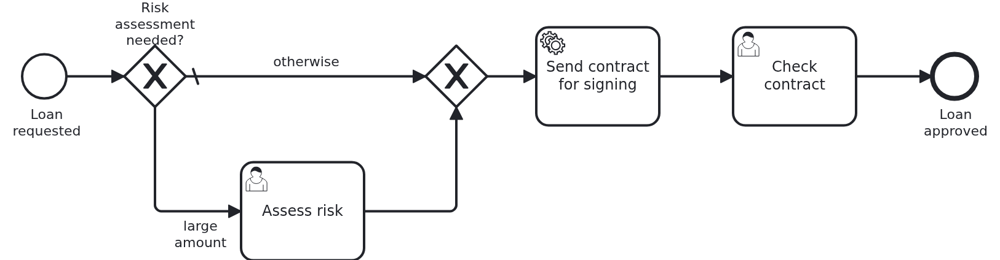

# Scenarios bring a case to every point of its process

[](./LICENSE)

You want to test a user task in the middle of a process, in every situation which matters for
the business. Each test would have to play the whole history of the case first, and the next
change of the model breaks all of them. This blueprint puts that history into one place, a
process driver. It brings a real loan approval to a named point of the process, with real code
and the real answers of the simulator, and the test starts there. A delta on top of
`module-simulator`.

## What this blueprint shows



A loan approval with two user tasks. From an amount of 10000 on, somebody has to assess the risk
first. Then the contract goes to the e-signature service, and somebody checks the signed
contract. The task "Check contract" opens while the signature may still be on its way. The
business code refuses to complete it before the customer signed.

So "Check contract" alone has four situations worth a test: a small amount, a large amount whose
risk somebody assessed, with the signature, and without it. Each of them has a history. The
process driver knows these histories, and the tests do not.

### A state names a point of the process and its history

`ProcessState` lists the points a scenario can bring a loan approval to:

|                    State                     |                             What is true there                             |
|----------------------------------------------|----------------------------------------------------------------------------|
| `ASSESS_RISK_USER_TASK`                      | the task "Assess risk" is open. Only a large amount gets there             |
| `CHECK_CONTRACT_USER_TASK_WITHOUT_SIGNATURE` | the task "Check contract" is open, and the signature has not come back yet |
| `CHECK_CONTRACT_USER_TASK`                   | the task "Check contract" is open, and the customer signed                 |

Two states name the same task of the model with another history. A state which ends in
`_USER_TASK` means that the task is open. The driver does not complete it. The test does that,
or a person in the dev shell.

Each state names the step which finishes it, with `finishingSteps()`. A step is a small class
which does one thing: it prepares data in the simulator, triggers something, or waits. Then it
waits until the application shows the result. Each step names only the steps right before it,
with `prerequisites()`:

|            Step            |                               What it does                                |          Comes right after          |
|----------------------------|---------------------------------------------------------------------------|-------------------------------------|
| `LoanRequestedStep`        | reserves a customer in the simulator, gives it a score, requests the loan | nothing, it starts the loan request |
| `RiskAssessmentOpenedStep` | waits until "Assess risk" is open                                         | `LoanRequestedStep`                 |
| `RiskAssessedOnTheWayStep` | completes "Assess risk", if the amount needs it, and nothing otherwise    | `LoanRequestedStep`                 |
| `ContractCheckOpenedStep`  | waits until the contract went out and "Check contract" is open            | `RiskAssessedOnTheWayStep`          |
| `ContractSignedStep`       | makes the simulated e-signature service sign and call back                | `ContractCheckOpenedStep`           |

`TestData` holds what a scenario says about the case. Every value has a default which makes
sense for the business: a customer with a good score asks for a small amount. A test changes
only what its scenario is about:

```java
var scenario = driver.advanceTo(
    ProcessState.CHECK_CONTRACT_USER_TASK,
    TestData.defaults().withAmount(TestData.LARGE_AMOUNT));
```

The test of a large amount does not know about "Assess risk". The test data chose the branch,
and `RiskAssessedOnTheWayStep` completed the task on the way.

The driver follows the prerequisites back to `LoanRequestedStep` and runs the steps in that
order. A step which two others need runs only once. The driver does this for every state when it
starts, so a step without a bean, or two steps which need each other, stop the application at
once, with a message which names the steps. The whole way to a state is written down nowhere in
one piece. When the model gets one more task before "Check contract", the new step names its
predecessor, `ContractCheckOpenedStep` names the new step, and nothing else changes: no state
and no test.

### No jump into the engine, no mock in the application

The driver never talks to a BPMS. It does not move a token to an activity, and it does not ask
the engine where a workflow is. Such a jump is specific to one BPMS, and it builds a state the
real process never had. The driver uses three things:

- the business code of the workflow module, `Service`, as the API of the module does when a
  person clicks,
- the repository of the aggregates, to see how far a loan approval came,
- the test API of the simulator, to prepare data and to make a system act.

It does not use `ProcessService` either. `Workflow` is the only class which talks to the
process, and completing a task goes through `Service` first, because `Service` writes what the
task means into the aggregate. A driver which completed the task through `ProcessService` would
skip that code, and the test would check a case no user can make.

### Two rules for waiting

A BPMS moves a workflow on in its own time. VanillaBP gives the engine a command after the
transaction of the caller has committed. The Camunda 7 family then continues after a user task
in a job of its own, and Camunda 8 continues on its own nodes. So the driver waits twice.

**Wait for the wait point before you signal.** A step which completes a task first waits until
the task is open. Here this costs nothing extra. The module writes the id of an open task into
the aggregate, and completing a task needs that id. So waiting for the id is waiting for the
wait point. The same holds for a system around the application: the simulator signs only a
contract it has, so `ContractSignedStep` runs after `ContractCheckOpenedStep`, which waited for
the contract to go out.

A message is different, because it needs no id and is easy to send too early. Here is how
VanillaBP behaves:

- On the Camunda 7 family, a message for which no workflow waits is refused at your call,
  unless you configure a message time-to-live. Nothing is lost without a sound, but your step
  fails.
- With `message-time-to-live` set for the workflow module, the correlation waits in the outbox
  until the workflow arrives, as long as that time allows. Camunda 8 keeps the message in the
  cluster for the same time. Then you do not need this rule for messages.

The [wiki](https://github.com/vanillabp/adapter-platform-integration/wiki/Message-correlation#a-message-which-comes-before-the-workflow-waits-for-it)
has the details. This blueprint correlates no message. The signature is written into the
aggregate, and "Check contract" waits for it. So the rule shows here only as "wait for the id
before you complete a task".

**Wait until your own state is stable before you return.** Completing a task returns before the
engine moved on. A caller which acts at once races the engine. So the last step of every state
waits for something the code of the workflow writes after the engine moved on: the id of the
next task, the contract sent. When `advanceTo` returns, nothing of the steps before is still on
its way.

**A timeout says why.** Each step passes a diagnosis to the wait. When the time runs out, the
driver reads the aggregate as it was last seen and says what is missing, in words of the
business:

```
Loan approval '0f7c…' did not reach CHECK_CONTRACT_USER_TASK with TestData[amount=25000, creditScore=720].
The step 'the contract goes out and the user task 'Check contract' opens' failed: the workflow
waits in the user task 'Assess risk'. Nobody completed it. (waited PT1M, last seen: Aggregate(...))
```

A step also refuses test data which cannot lead to its state, before it waits. A small amount
never reaches "Assess risk", so `RiskAssessmentOpenedStep` says so at once.

### The driver is a Maven module of its own

The driver lives in `test-driver`, not in `src/main` of the workflow module. The module which
goes to production does not contain it, so nobody has to remember to switch it off there.

The tests of the workflow module are in `test-driver` as well. They need the driver, and the
driver needs the module. Maven does not allow such a cycle between two modules, not even in the
test scope. So `loan-approval` has no tests of its own, and `test-driver` is where they run,
with the simulator the build starts.

The dev shell of the cockpit and the tests of a user interface need the driver too, but in a
running application. For them the driver has a REST API:

|                              URL                               |                      What it does                       |
|----------------------------------------------------------------|---------------------------------------------------------|
| `/process-driver/states`                                       | lists the states                                        |
| `/process-driver/advance-to?state=...&amount=...&creditScore=` | brings a new loan request there and names its open task |

Two locks keep it out of production. The application takes `test-driver` only with the Maven
profile `test-driver`, which a production build never names. And the driver adds no bean and no
endpoint until `process-driver.enabled` is `true`. The API is an OpenAPI file in `test-driver`.
Only a browser, the dev shell and the tests of a user interface call it, so it has no client
module.

What this blueprint leaves out: a library for drivers. Steps, states and waiting are project
code here, small enough to copy. Whether they belong into a framework is decided after a second
project has used them.

## Delta to the base blueprint

Compared to [`module-simulator`](https://github.com/vanillabp-blueprints/module-simulator-springboot):

|                                File                                 |                                         What is different                                         |
|---------------------------------------------------------------------|---------------------------------------------------------------------------------------------------|
| `loan-approval/src/main/resources/.../loan_approval.bpmn`           | a gateway and the task "Assess risk", the task "Check contract" instead of the message            |
| `.../loanapproval/model/Aggregate.java`                             | the answer for the gateway, the ids of both open tasks, the signature as a fact                   |
| `.../loanapproval/Service.java`                                     | assesses the risk, takes the signature, refuses to check a contract which is not signed           |
| `.../loanapproval/ContractNotSignedException.java`                  | new: the reason "Check contract" cannot be completed yet                                          |
| `.../loanapproval/ApiController.java`                               | completes both tasks, and answers 409 while the signature is missing                              |
| `.../openapi/loan-approval.yaml`                                    | the two tasks instead of "Prepare contract", and the 409                                          |
| `.../loanapproval/config/LoanApprovalProperties.java`               | the limit of the risk assessment                                                                  |
| `.../loanapproval/Workflow.java`                                    | completes "Assess risk" and "Check contract" instead of correlating the message "Contract signed" |
| `.../loanapproval/WorkflowTaskHandler.java`                         | opens "Assess risk" and "Check contract" instead of "Prepare contract"                            |
| `loan-approval/src/main/resources/loan-approval/loan-approval.yaml` | the limit from which "Assess risk" comes first                                                    |
| `loan-approval/src/test/`                                           | gone: the tests of the workflow module live in `test-driver`                                      |
| `pom.xml`                                                           | its own coordinates and description, and the module `test-driver`                                 |
| `loan-approval/pom.xml`                                             | no tests, no simulator start, no BPMS profiles: all of it moved to `test-driver`                  |
| `test-driver/`                                                      | new: the process driver, its REST API, and the tests of the workflow module                       |
| `test-driver/src/main/java/blueprint/testdriver/simulator/...`      | `SimulatorTestApi`, moved from the tests of `loan-approval`, because the driver needs it          |
| `application/pom.xml`                                               | the Maven profile `test-driver`                                                                   |

## Running it

Requires a JDK 21 or newer. The build starts the simulator for the tests and stops it when the
build ends. Camunda 7 is embedded, so nothing else has to run:

```bash
mvn verify
```

To run it on another BPMS, pick another Maven profile. Not one line of Java changes:

```bash
mvn verify -Pcamunda8
```

Camunda 8 is a remote engine, so a cluster has to run. Its address is in
`application/src/main/resources/application-camunda8.yaml`, and the tests of the module have a
copy. [Operaton](https://operaton.org) and [CIB seven](https://cibseven.org), two forks of
Camunda 7, are embedded as well and read the BPMN files of Camunda 7:

```bash
mvn verify -Poperaton
mvn verify -Pcibseven
```

The POM of `test-driver` starts the simulator on a free port, writes its log to
`test-driver/target/simulator.log`, and tells the tests where it is. A failing test prints the
lines the simulator logged while it ran.

To try the driver in a browser, build once, then start the simulator and the application with
the driver, each in a terminal of its own:

```bash
mvn install -DskipTests
mvn -pl simulator spring-boot:run
mvn -Pcamunda7,test-driver -pl application spring-boot:run \
  -Dspring-boot.run.jvmArguments=-Dprocess-driver.enabled=true
```

The application warns at startup that the driver is on. Ask it for a loan approval whose
contract waits for its check:

```
http://localhost:8080/process-driver/advance-to?state=CHECK_CONTRACT_USER_TASK&amount=25000
```

The answer names the loan request and the open task. The driver assessed the risk on the way,
and the application logged each step, ending with:

```
Loan approval '0f7c…' waits for the check of its signed contract. Continue with:
  Check the contract -> http://localhost:8080/api/loan-approval/0f7c…/check-contract/4711
Loan approval '0f7c…' reached CHECK_CONTRACT_USER_TASK. Show it -> http://localhost:8080/api/loan-approval/0f7c…
```

Open the URL which checks the contract, and the workflow ends. Try the same with
`state=CHECK_CONTRACT_USER_TASK_WITHOUT_SIGNATURE`. Then the check answers 409 until you sign
through the simulator:

```
http://localhost:8079/simulator/test-api/e-signature/sign?contractId=0f7c…
```

Without the profile `test-driver`, `/process-driver/states` answers 404.

## How it works

|                              File                               |                                       Role                                       |
|-----------------------------------------------------------------|----------------------------------------------------------------------------------|
| `ProcessState.java`                                             | the states, and the steps which lead to each of them                             |
| `ProcessDriver.java`                                            | runs the steps of a state, one after the other, and logs where the case is       |
| `TestData.java`                                                 | the amount and the credit score, with defaults which make sense for the business |
| `steps/LoanRequestedStep.java`                                  | prepares the customer in the simulator and requests the loan through `Service`   |
| `steps/RiskAssessedOnTheWayStep.java`                           | the branch of a large amount: waits for "Assess risk" and completes it           |
| `steps/StepSupport.java`                                        | waits for the aggregate, and turns a timeout into the reason                     |
| `ProcessDriverController.java`                                  | the REST API, generated from `process-driver.yaml`                               |
| `config/ProcessDriverAutoConfiguration.java`                    | wires the driver only if `process-driver.enabled` is `true`                      |
| `test-driver/src/test/.../ScenarioTest.java`                    | base class of the tests: the application, the simulator and the driver           |
| `test-driver/src/test/.../CheckContractIT.java`                 | "Check contract" for a small and for a large amount                              |
| `test-driver/src/test/.../CheckContractWithoutSignatureIT.java` | "Check contract" before the signature: 409, and the task stays open              |
| `test-driver/src/test/.../AssessRiskIT.java`                    | "Assess risk": the cockpit shows it, and no contract goes out before it          |
| `test-driver/src/test/.../ProcessDriverIT.java`                 | the REST API of the driver, and the reason it gives for an unreachable state     |

The order of events in a test: `advanceTo` builds a `Scenario` and runs the steps of the state.
`LoanRequestedStep` reserves a customer at the simulated credit rating and calls
`Service.request`, which starts the workflow. For a large amount the gateway opens "Assess risk",
`WorkflowTaskHandler` writes the id of the task into the aggregate, and
`RiskAssessedOnTheWayStep` waits for that id and calls `Service.assessRisk`. The service task
sends the contract, and "Check contract" opens. `ContractCheckOpenedStep` waits for both.
`ContractSignedStep` makes the simulator sign, which calls the application back. Then
`advanceTo` returns, and the test checks the task.

## Documentation

- [Workflow aggregates](https://github.com/vanillabp/adapter-platform-integration/wiki/Workflow-aggregates): why the driver waits for the aggregate, and why a gateway reads a plain boolean
- [A message which comes before the workflow waits for it](https://github.com/vanillabp/adapter-platform-integration/wiki/Message-correlation#a-message-which-comes-before-the-workflow-waits-for-it): when waiting before a message is needed, and the message time-to-live
- [spi-for-java](https://github.com/vanillabp/spi-for-java): starting workflows and completing user tasks
- [The dev shell simulator](https://github.com/vanillabp/business-cockpit/wiki/Developing-UI-components-locally#the-dev-shell-simulator): the part of the cockpit the simulator extends
- the wiki of the [BPMS adapter](https://github.com/vanillabp/adapter-platform-integration/wiki/BPMS-adapters) you use: everything specific to that engine

This blueprint is developed in the monorepo
[`blueprints`](https://github.com/vanillabp-blueprints/blueprints). This repository is a
read-only mirror, **issues and pull requests belong there.**

## Noteworthy & Contributors

[VanillaBP](https://www.github.com/vanillabp/spi-for-java) was developed by [Phactum](https://www.phactum.at) with the
intention of giving back to the community as it has benefited the community in the past.


## License

Copyright 2026 Phactum Softwareentwicklung GmbH

Licensed under the Apache License, Version 2.0

        https://www.apache.org/licenses/LICENSE-2.0

Unless required by applicable law or agreed to in writing, software distributed under the
License is distributed on an "AS IS" BASIS, WITHOUT WARRANTIES OR CONDITIONS OF ANY KIND,
either express or implied. See the License for the specific language governing permissions
and limitations under the License.
