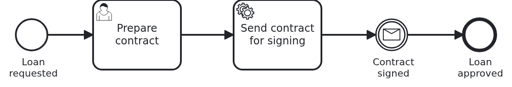

# A simulator plays the systems around a workflow module

[](./LICENSE)

A workflow module talks to other systems, and its tests need those systems to answer. This
blueprint gives them one small application of its own, the simulator. The application under
test mocks nothing: its real adapters talk to the simulator the way they later talk to the real
systems. A profile decides which of the two they talk to. A delta on top of `module-single`.

## What this blueprint shows



A loan approval which needs three systems around it. Each one is connected in another way:

1. A credit rating, over REST and synchronous. The application asks and gets the answer at
   once. It asks before the workflow starts, while the customer waits.
2. An e-signature service, over REST with a callback. The service task "Send contract for
   signing" hands the contract over. Later the service calls an endpoint of the application,
   and the application correlates the message the workflow waits for in "Contract signed".
3. The Business Cockpit. The cockpit adapter reports the user task "Prepare contract" there.

All three are played by the simulator in `simulator/`, a Spring Boot application of its own.
It plays the cockpit by extending the dev shell simulator of the Business Cockpit, so the
cockpit adapter reports to it as to a real cockpit. The two other systems it plays itself.

### Hexagonal architecture: the module knows ports, not systems

The workflow module does not know the credit rating or the e-signature service. It knows two
interfaces, and each is named after the role the system plays: `CreditRating` and
`ContractSigning`. These are the ports. They are plain Java in a Maven module of their own,
with the types the application wants to see. The product which plays the role is known only to
the adapter, which implements the port with a REST client:

```
external-systems/
├── credit-rating/
│   ├── port/            CreditRating, CreditScore
│   └── rest-adapter/    CreditRatingRestAdapter, talks HTTP and JSON
└── e-signature/
    ├── port/            ContractSigning, ContractToSign, SignedContracts
    └── rest-adapter/    ContractSigningRestAdapter, CallbackController
```

The workflow module depends on the two `port` modules. The application depends on the
workflow module and on the two `rest-adapter` modules, the same way it chooses the BPMS
adapter. The callback goes the other way, but the dependency does not. The module implements
`SignedContracts`, an interface of the port. The adapter calls it and the module still knows
nothing about the adapter.

Internal systems deserve ports as well, for two reasons. The code of the module speaks the language of the process. It says
`creditRating.scoreOf(customerId)`, not the path and the JSON of somebody's API. And a system
which looks fixed today may be gone in five years. Then one adapter is replaced, and the module
is not rewritten. And the split is what makes the simulator possible at all, because the same
adapter runs against both.

### Two kinds of simulator

The `bpmn-*` blueprints have a `Simulator` class in their tests as well. That one is a stand-in
bean on the level of the port. It replaces the adapter inside the test, and it shows the aspect
of the blueprint without anything around it. The simulator here is a different thing. It is a
process of its own, and the real adapters talk to it over HTTP. The stub shows an aspect. The
simulator proves the adapters.

### The test API knows nothing about the workflow

Every simulated system has two interfaces. The first is the API of the real system, the one the
adapters talk to. It follows a small OpenAPI file per system, `external-systems/*/openapi.yaml`.
The second is the test API below `/simulator/test-api/{system}/{action}`. Tests and people use it
to prepare data and to make a system act:

|                                    URL                                     |                   What it does                    |
|----------------------------------------------------------------------------|---------------------------------------------------|
| `/simulator/test-api/credit-rating/next-id`                                | reserves a customer id nobody used before         |
| `/simulator/test-api/credit-rating/create-rating?customerId=...&score=...` | makes the credit rating know a customer           |
| `/simulator/test-api/e-signature/envelope?contractId=...`                  | shows what the e-signature service was given      |
| `/simulator/test-api/e-signature/sign?contractId=...`                      | signs the contract and calls the application back |
| `/simulator/test-api/status`                                               | says that the simulator runs                      |

The test API creates data in a system and makes the system do what the real one does. It
knows nothing about loans or workflows. Which steps a loan approval needs, and in which order,
only the test knows. A test API which knows the process breaks with every change of the model.

The caller gives the ids, or it reserves one with `next-id`. Reserving matters: a `next-id`
which only reads the next free number gives two tests the same customer, and then the tests
cannot run at the same time.

All actions are GET requests, like the API of the application. So a person can sign a contract
in the browser, and a test uses the same URLs.

### No test waits for a clock

The simulated e-signature service does not sign after some seconds. It signs when somebody
calls `sign`. And the test does not wait a fixed time either. It waits until the workflow
aggregate shows the next state: the credit score is there, the contract was sent, the contract
is signed. So the test is as fast as the application, and it is not flaky on a slow machine.

### A missing system is a 503 which names its role

The credit rating is asked while the user waits. If it does not answer, the adapter throws
`CreditRatingUnavailableException`, and the API of the module answers with a 503:

```json
{"status": 503, "title": "Service Unavailable", "detail": "The credit rating does not answer. Try again later.", "externalSystem": "credit-rating"}
```

It names the role, not the product. The user learns that the application works and a system it
needs does not. Inside the service task "Send contract for signing" the case is different. Nobody
waits there, so the task fails and the BPMS decides what happens next, as for every service task.

### These tests are the end-to-end tests

The integration test of the workflow module goes through every interface the module has: its
API, the cockpit and the two systems around it. A system without a user interface needs no more
than that. These integration tests are its end-to-end tests. Where a module has a user
interface, the tests of that interface come on top.

What the simulator could also do, and this blueprint leaves out: switch a system to errors or
to slow answers on request, to try out how the application behaves then.

## Delta to the base blueprint

Compared to [`module-single`](https://github.com/vanillabp-blueprints/module-single-springboot):

|                             File                             |                                    What is different                                    |
|--------------------------------------------------------------|-----------------------------------------------------------------------------------------|
| `external-systems/*/port/`                                   | new: one Maven module per system, the interface named after its role and its types      |
| `external-systems/*/rest-adapter/`                           | new: one Maven module per system, the REST client and its auto-configuration            |
| `external-systems/*/openapi.yaml`                            | new: the API of each system, which the adapter talks to and the simulator plays         |
| `simulator/`                                                 | new: the simulator, a Spring Boot application which extends the dev shell simulator     |
| `loan-approval/pom.xml`                                      | the ports instead of adapters, the profile `start-stop-simulator`, the cockpit adapters |
| `.../loanapproval/Service.java`                              | asks the credit rating before the workflow starts, and hands the contract over          |
| `.../loanapproval/SignedContractsHandler.java`               | new: the way back from the e-signature service into the module                          |
| `.../loanapproval/ApiController.java`                        | answers 503 with the role of the system when the credit rating does not answer          |
| `.../loanapproval/config/LoanApprovalAutoConfiguration.java` | new: the module wires itself, because the application is not above it                   |
| `loan-approval/src/test/.../SimulatorTestApi.java`           | new: the client of the test API and of the cockpit API the simulator plays              |
| `loan-approval/src/test/.../SimulatorExtension.java`         | new: skips without a simulator, and prints its log when a test fails                    |
| `application/src/main/resources/application-local.yaml`      | new: every adapter talks to the simulator                                               |
| `application/src/main/resources/application-real.yaml`       | new: every adapter talks to the real system, addresses from the environment             |
| `application/src/test/.../ExternalSystemUnavailableIT.java`  | new: the 503 a user gets when the credit rating is missing                              |

## Running it

Requires a JDK 21 or newer. The build starts the simulator for the integration tests and stops
it when the build ends. Camunda 7 is embedded, so nothing else has to run:

```bash
mvn verify
```

To run it on another BPMS, pick another Maven profile. Not one line of Java changes:

```bash
mvn verify -Pcamunda8
```

Camunda 8 is a remote engine, so a cluster has to run. Its address is in
`application/src/main/resources/application-camunda8.yaml`, and the test of the module has a
copy.

[Operaton](https://operaton.org), the open source successor of Camunda 7, is embedded as well
and needs nothing else either. The BPMN files are the ones of Camunda 7, because Operaton reads
their `camunda:` attributes:

```bash
mvn verify -Poperaton
```

[CIB seven](https://cibseven.org), a fork of Camunda 7 made by CIB software, is embedded as
well and needs nothing else either. The BPMN files are the ones of Camunda 7, because CIB seven
reads their `camunda:` attributes:

```bash
mvn verify -Pcibseven
```

The Maven profile `start-stop-simulator` of the workflow module starts the simulator on a free
port, writes its log to `loan-approval/target/simulator.log`, and tells the tests where it is. A
failing test prints the lines the simulator logged while the test ran. To run the tests against
a simulator you started yourself, for example to debug it, name its address:

```bash
mvn verify -Dsimulator.base-url=http://localhost:8079
```

A test started in the IDE looks for a simulator at `http://localhost:8079`. When nobody answers
there, it is skipped, and the message says how to start one.

To try it in a browser, build once and start the simulator and the application, each in a
terminal of its own:

```bash
mvn install -DskipTests
mvn -pl simulator spring-boot:run
mvn -pl application spring-boot:run
```

The application runs in the profile `local`, so every adapter talks to the simulator. Request a
loan for a customer the simulated credit rating knows from the start:

```
http://localhost:8080/api/loan-approval/request?customerId=C-1001&amount=5000
```

The customer `C-1002` has a low score, so the same request for that customer is declined at
once. For `C-1001` the workflow starts, and the application logs where to go on:

```
Loan approval '0f7c…' started: customer 'C-1001' asks for 5000 with a credit score of 720
Loan approval '0f7c…' waits for its contract. Continue with:
  Prepare the contract -> http://localhost:8080/api/loan-approval/0f7c…/prepare-contract/4711?interestRate=3.5
```

The cockpit shows the same user task. The simulator answers the official API of the cockpit,
for example `http://localhost:8079/official-api/v1/usertask/4711`. Open the URL which prepares
the contract. The application hands it to the e-signature service, and now the simulator logs
where to go on:

```
Contract '0f7c…' waits for the signature of 'C-1001'. Sign it -> http://localhost:8079/simulator/test-api/e-signature/sign?contractId=0f7c…
```

Open that URL, and the simulator calls the application back. The workflow ends, and the
application logs the URL which shows the loan approval.

To run the application against the real systems, switch to the profile `real` and give it their
addresses:

```bash
EXTERNAL_SYSTEMS=real CREDIT_RATING_URL=... E_SIGNATURE_URL=... \
  E_SIGNATURE_CALLBACK_URL=... BUSINESS_COCKPIT_URL=... \
  mvn -pl application spring-boot:run
```

## How it works

|                                           File                                            |                                         Role                                         |
|-------------------------------------------------------------------------------------------|--------------------------------------------------------------------------------------|
| `.../loanapproval/ApiController.java`                                                     | the GET request which asks for a loan, and the 503 when the credit rating is missing |
| `.../loanapproval/Service.java`                                                           | asks `creditRating`, starts the workflow, hands the contract to `contractSigning`    |
| `external-systems/credit-rating/rest-adapter/.../CreditRatingRestAdapter.java`            | turns the port into a GET request, and the answer into a `CreditScore`               |
| `.../loanapproval/WorkflowTaskHandler.java`                                               | the user task, the service task, and the details the cockpit shows                   |
| `external-systems/e-signature/rest-adapter/.../ContractSigningRestAdapter.java`           | hands the contract over, with the address for the callback                           |
| `simulator/src/main/java/blueprint/simulator/esignature/ESignatureTestApiController.java` | signs on request and calls the application back                                      |
| `external-systems/e-signature/rest-adapter/.../CallbackController.java`                   | takes the callback and calls `SignedContracts`                                       |
| `.../loanapproval/SignedContractsHandler.java`                                            | implements `SignedContracts` and calls `Service`                                     |
| `.../loanapproval/Workflow.java`                                                          | starts the workflow, completes the user task, correlates "Contract signed"           |
| `simulator/src/main/java/blueprint/simulator/SimulatorApplication.java`                   | the simulator, which extends the dev shell simulator of the cockpit                  |
| `loan-approval/src/test/.../LoanApprovalIT.java`                                          | the whole loan approval against the simulator, and the cases where it is declined    |
| `application/src/test/.../ExternalSystemUnavailableIT.java`                               | the profile `real` with no system there, and the 503 a user gets                     |

The order of events: the API asks `Service` for a loan. `Service` asks the credit rating through
its port. Like every method of `Service`, this runs in a transaction, so a database connection
waits for the answer, but only as long as the adapter's short timeout allows. A good score
starts the workflow. The user task "Prepare contract" arrives in `WorkflowTaskHandler`, and the
cockpit adapter reports it to the cockpit. The API completes it. The service task hands the
contract to the e-signature service and notes it in the aggregate. The test waits for that note
and then signs through the test API. The simulator posts the callback, the adapter calls
`SignedContracts`, and `Workflow` correlates the message. The workflow ends.

## Documentation

- [Workflow modules](https://github.com/vanillabp/adapter-platform-integration/wiki/Workflow-modules): what a workflow module is, and where its BPMN files are looked for
- [Publishing a workflow module](https://github.com/vanillabp/adapter-platform-integration/wiki/Workflow-modules-in-Spring-Boot#publishing-a-workflow-module-it-brings-its-own-wiring): why the module brings an auto-configuration
- [Workflow aggregates](https://github.com/vanillabp/adapter-platform-integration/wiki/Workflow-aggregates): why there are no process variables, and why the test waits for the aggregate
- [spi-for-java](https://github.com/vanillabp/spi-for-java): starting workflows, completing user tasks and correlating messages
- [Connecting a workflow module](https://github.com/vanillabp/business-cockpit/wiki/Connecting-a-workflow-module): how a workflow module reports to the Business Cockpit
- [The dev shell simulator](https://github.com/vanillabp/business-cockpit/wiki/Developing-UI-components-locally#the-dev-shell-simulator): the part of the cockpit the simulator extends
- the wiki of the [BPMS adapter](https://github.com/vanillabp/adapter-platform-integration/wiki/BPMS-adapters) you use: everything specific to that engine

This blueprint is developed in the monorepo
[`blueprints`](https://github.com/vanillabp-blueprints/blueprints). This repository is a
read-only mirror, **issues and pull requests belong there.**

## Noteworthy & Contributors

[VanillaBP](https://www.github.com/vanillabp/spi-for-java) was developed by [Phactum](https://www.phactum.at) with the
intention of giving back to the community as it has benefited the community in the past.


## License

Copyright 2026 Phactum Softwareentwicklung GmbH

Licensed under the Apache License, Version 2.0

        https://www.apache.org/licenses/LICENSE-2.0

Unless required by applicable law or agreed to in writing, software distributed under the
License is distributed on an "AS IS" BASIS, WITHOUT WARRANTIES OR CONDITIONS OF ANY KIND,
either express or implied. See the License for the specific language governing permissions
and limitations under the License.
