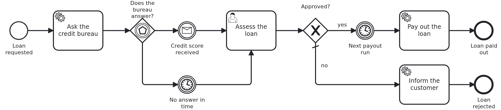

# A workflow module under load

[](./LICENSE)

Your workflow module works for one loan. What happens when hundreds run at once? A VanillaBP
application has more places which can run out than an ordinary one, and which of them runs out
first is written down nowhere. This blueprint finds out by measuring. A load driver plays
customers, clerks and a neighbour system, raises the load step by step, and names the pool which
ran out first, together with the setting to change. The driver runs in a simulator, a process
of its own, so it does not take CPU, heap or garbage collection time from the application it
measures.

## What this blueprint shows



A small process with the shapes which cost something:

- a service task which asks a neighbour system, the credit bureau,
- a message with the answer, and a timer for the case that no answer comes,
- a user task which a clerk holds while thinking,
- a gateway whose share is not in the model,
- a timer which wakes many workflows at once. Every loan approved before the next payout run
  gets the same due date, so they all wait in the same timer and wake up in the same moment.

A start is two phases and an outbox entry. An outbox entry is picked up and dispatched on
another thread. A delivery reads the aggregate in a transaction of its own. The BPMS brings its
own threads on top. All of them share the connections of one pool. Under load, one of them runs
out first, and it is a different one in every application.

### The load profile

The model says which tasks there are. It does not say how many workflows start per second, how
long a clerk thinks, how late the credit bureau answers or which way the gateway goes. That is
in `loan-approval/src/main/resources/loan-approval/load-profile.yaml`, next to the BPMN files:

```yaml
arrivals:
  pattern: random
  per-second: 4
gateways:
  Gateway_Approved:
    Flow_ToPayoutRun: 0.8
    Flow_ToInformRejection: 0.2
people:
  UserTask_AssessLoan:
    persons: 24
    think-time: PT2S
    think-time-spread: PT1S
neighbours:
  CatchEvent_CreditScoreReceived:
    name: credit bureau
    latency: PT0.3S
    latency-spread: PT0.2S
    no-answer-share: 0.05
```

Every key names a BPMN element by its id, so the profile stays next to the model it describes.
The file also holds the size of the aggregate and the hot path, the elements most workflows
pass. A key the driver does not know stops the simulator with a message which names it. So a
typo never falls back to nothing. The build copies the file into the simulator, so there is only
one file to change.

### The driver plays behaviour, not a loop

A loop which starts workflows as fast as it can measures the loop. The driver plays the people
and the systems around the module instead:

- **Customers** arrive at the rate of the profile, with random gaps like real arrivals. They do
  not wait for each other. Each one sends a loan request with its documents to the API of the
  application. When the application gets slow, they queue up in front of it.
- **Clerks** read the task list of the application, take an open assessment, hold it while they
  think, and decide through the same API. The share of approvals comes from the gateway in the
  profile.
- **The credit bureau** is asked by the application over HTTP. It answers through a callback
  after its latency, and sometimes not at all. Then the process stops waiting after ten
  seconds, and the clerk decides without the score.

### The driver is a process of its own

The driver measures the application, so it must not run inside it. In the same JVM, its
customers, clerks and the credit bureau would take CPU from the application, fill its heap and
make its garbage collector work. The report would count all of that as the application's.

So the driver runs in the simulator, a small application of its own next to the application.
It reaches the application only from outside, the way the real world does:

|           What           |                                         How                                         |
|--------------------------|-------------------------------------------------------------------------------------|
| customers and clerks     | the API of the workflow module, with the client generated from `loan-approval.yaml` |
| the credit bureau        | the application calls it with its REST adapter, the bureau calls back               |
| the queues               | the meters of the application in the Prometheus format, at `/q/metrics`             |
| the two full collections | JMX, the management interface every JVM has                                         |

The application holds nothing for load testing. What the driver uses, an operator has as well:
the API, the metrics endpoint, and a JMX port. The REST adapter of the credit bureau is the one the
application would use in production. Only its address points at the simulator.

The run walks through stages: a warm up, a steady stage at the rate of the profile, steps of a
quarter more load each, a peak, and a drain. In the drain nobody arrives any more, and the run
waits until every workflow has ended and the outbox is empty. A run whose work never ends has
not found a limit. It has hidden one.

### Which number to look at first

A limit is a knee. The offered load keeps rising, and at some stage the work done stops rising
with it, while a queue keeps rising. The report names the queue which started to rise first and
kept rising until the peak. Each queue names a setting:

|                Queue                |                            What it means                            |                          The setting                          |
|-------------------------------------|---------------------------------------------------------------------|---------------------------------------------------------------|
| threads waiting for a connection    | the pool is too small for the threads which draw from it            | `quarkus.datasource.jdbc.max-size`, or fewer of those threads |
| the age of the oldest outbox entry  | the outbox writes faster than it dispatches                         | `vanillabp.outbox.dispatch-threads`                           |
| execution slots in use, at the most | the handlers of a remote BPMS wait for a free slot                  | `vanillabp.adapters.<adapter-id>.worker-threads`              |
| time spent collecting garbage       | with a flat live set: the heap is too small for the work in flight  | the heap, `-Xmx`                                              |
| the live set after the drain        | with no work left, the heap still holds more than after the warm up | none: a defect                                                |

The numbers come from where the application publishes them anyway: the meters of VanillaBP, of
the connection pool and of the garbage collector, which Quarkus shows in the Prometheus format. So what the driver reads is what your monitoring reads in production. Only Camunda 8 has
execution slots. On an engine without them the column shows a dash.

The [wiki page about the pools](https://github.com/vanillabp/adapter-platform-integration/wiki/The-pools-of-an-application)
says what depends on what, and what each adapter adds.

Do not compare a run with a run of another machine. A CI runner shared with other jobs moves the
same work by about fifty percent between two runs, more than a real change would. So the CI of
this blueprint runs a tiny size only to prove that the driver still starts and finishes, and
measures nothing.

## Delta to the base blueprint

Compared to [`module-single`](https://github.com/vanillabp-blueprints/module-single-quarkus):

|                    File                    |                                         What is different                                          |
|--------------------------------------------|----------------------------------------------------------------------------------------------------|
| `loan_approval.bpmn`                       | the credit bureau, its answer or its timeout, the user task, the gateway and the payout run        |
| `load-profile.yaml`                        | new: what the model does not say about the load                                                    |
| `loan-approval.yaml`                       | how often the payout run comes, and the due date of the payout run declared for the timer          |
| `LoanApprovalProperties.java`              | `payoutRunEvery` instead of `ratingScale`                                                          |
| `CreditBureau.java`                        | new: the neighbour system, known to the module only by its role                                    |
| `WorkflowTaskHandler.java`                 | the four `@WorkflowTask` methods, one of them with `@TaskId` for the user task                     |
| `Service.java`                             | asks the bureau, takes its answer, opens and decides the assessment, pays out, rejects             |
| `Workflow.java`                            | correlates the answer of the bureau and completes the user task                                    |
| `Aggregate.java`                           | the documents, the score, the open task, the decision and the due date of the payout run           |
| `AggregateRepository.java`                 | the open assessments, as a task list shows them, and the number of unfinished workflows            |
| `ApiController.java`                       | the decision of a clerk, a request with documents, the task list and the number of open approvals  |
| `loan-approval-api/`                       | new Maven module: the API of the module moved here, because the simulator calls it from Java       |
| `loan-approval/openapi/loan-approval.yaml` | deleted from the workflow module: its API is in `loan-approval-api/` now                           |
| `external-systems/`                        | new: the API of the credit bureau and its callback, and the REST adapter of the application        |
| `load-run-api/`                            | new Maven module: the two URLs of a run, which the simulator offers and the test calls             |
| `simulator/`                               | new Maven module: an application of its own with the driver, the credit bureau and the report      |
| `pom.xml`                                  | the new modules, and the OpenAPI generator managed for all of them                                 |
| `loan-approval/pom.xml`                    | depends on `loan-approval-api-server` instead of generating the API itself                         |
| `application/pom.xml`                      | the REST adapter, Micrometer with Prometheus, JMX for `quarkus:dev`, starting the simulator        |
| `application.yaml`                         | a file database, the pool, the dispatch threads, a fresh gauge each second, the meters, the bureau |
| `LoanApprovalIT.java`                      | each path of the process, one loan at a time                                                       |
| `ScriptedCreditBureau.java`                | new: the credit bureau of the module test, which answers a moment later or stays silent            |
| `LoadRunIT.java`                           | new: a tiny run against the application, which has to start and finish                             |

## Running it

Requires a JDK 21 or newer. Camunda 7 is embedded, so nothing else has to run:

```bash
mvn install verify
```

To run it on another BPMS, pick another Maven profile. Not one line of Java changes:

```bash
mvn install verify -Pcamunda8
```

Camunda 8 is a remote engine, so a cluster has to run. Its address and everything else specific
to that engine are in its profile file
`application/src/main/resources/application-camunda8.yaml`. The module's own test has a copy:

```yaml
vanillabp:
  adapters:
    camunda8:
      # Camunda 8 is a remote engine: point this at your cluster.
      rest-address: http://localhost:8080
      # With a lease, the cluster takes the answer of the current activation only. The key
      # has no default. The 8.8 and 8.9 lines accept it and do nothing. On an 8.10 cluster
      # older than 8.10.10, a leased job can wait a whole job-timeout for nobody, and the
      # adapter warns at startup. Choose 'do-not-use' there. The cluster never takes a
      # lease off a job again. The wiki says why:
      # https://github.com/vanillabp/camunda8-adapter/wiki/Configuration#a-job-somebody-else-holds
      job-lease: use
```

The blueprint leases its jobs. With a lease, the cluster takes the answer of the current
activation only, so a run whose lock ran out cannot overwrite what a newer run wrote. On an 8.10
cluster older than 8.10.10, a leased job can wait a whole `job-timeout` for nobody. The adapter
then warns at startup, so choose `do-not-use` there. The cluster never takes a lease off a job
again. The
[wiki of the Camunda 8 adapter](https://github.com/vanillabp/camunda8-adapter/wiki/Configuration#a-job-somebody-else-holds) explains why.

The file applies because the Maven profile `camunda8` makes the profile of the same name the
parent of the profile the application runs in. So you choose the engine once, on the Maven
command line, and the build, the tests and the run all follow it.

The application keeps its data in a file, `target/loan-approval`. VanillaBP's delivery log is in
that file too, and the file outlives the cluster. A new cluster, for example after
`docker compose down`, hands out the job keys of the old one again. So at every start VanillaBP
compares the cluster with the one the delivery log was written with. If the cluster is new and
the log still holds records of the old one, the start ends, and the message says how to go on.
In this blueprint the simple way is `mvn clean`, which deletes the file. The
[wiki of the Camunda 8 adapter](https://github.com/vanillabp/camunda8-adapter/wiki/Configuration#the-identity-of-the-cluster) explains the check.

[Operaton](https://operaton.org), the open source successor of Camunda 7, is embedded as well
and needs nothing else either. The BPMN files are the ones of Camunda 7, because Operaton reads
their `camunda:` attributes:

```bash
mvn install verify -Poperaton
```

[CIB seven](https://cibseven.org), a fork of Camunda 7 made by CIB software, is embedded as
well and needs nothing else either. The BPMN files are the ones of Camunda 7, because CIB seven
reads their `camunda:` attributes:

```bash
mvn install verify -Pcibseven
```

A run needs two processes. Start the application. `quarkus:dev` opens a JMX port on localhost
as well, `9010`:

```bash
mvn -pl application quarkus:dev
```

`quarkus:dev` opens a debug port, 5005. If a second application runs in dev mode on the same
machine, both want that port. Start the second one with `-Ddebug=false`, or give it a port of
its own with `-Ddebug=5006`.

Start the simulator in a second terminal. It answers on port `8079`, and it starts from its
runnable JAR:

```bash
java -jar simulator/target/simulator-1.0.0-SNAPSHOT-runnable.jar
```

Start a run. This is the only URL you need:

```
http://localhost:8079/api/load-run/start?size=small
```

The run takes three to four minutes. Its report is here, and the log of the simulator prints it
at the end as well:

```
http://localhost:8079/api/load-run/report
```

While the run goes on, the same URL says which stage it is in. This report was measured on this
blueprint with Camunda 7, on a development machine, with the application in `quarkus:dev` and
the simulator as two processes:

```
Load run 'small' of process 'loan_approval', took 199s
Hot path: ServiceTask_RequestCreditScore -> CatchEvent_CreditScoreReceived -> UserTask_AssessLoan -> CatchEvent_PayoutRun -> ServiceTask_PayOut

stage     offered/s started/s delivered/s customers conn-wait    outbox  oldest-s     slots   gc-%  live-MB
warm-up         4.0       5.0        12.5       0.0       0.0       0.2       0.0         -    0.4      132
steady          4.0       4.1        13.6       0.0       0.0       0.0       0.0         -    0.5      144
step-1          5.0       4.8        12.4       0.0       0.0       0.2       0.0         -    0.4      134
step-2          6.0       6.6        20.4       0.0       0.0       0.2       0.0         -    0.5      137
step-3          7.0       6.5        17.6       0.0       0.0       0.1       0.0         -    0.5      141
peak            9.0       8.8        28.0       0.0       0.0       0.2       0.0         -    0.3      135
drain           0.0       0.0         4.2       0.0       0.0       0.0       0.0         -    0.1      138

Nothing ran out at this size. Run the next size to find the limit.
Compare runs of the same machine only. The numbers of another machine, and of a shared CI runner above all, move more than a real change would.
```

`small` is sized so that a laptop shows a result in a few minutes. The next step is
`?size=medium`, two minutes per stage and six steps, and then `?size=large`. All three are in
`simulator/src/main/resources/application.yaml`, and you can add your own. Raise `per-second`
in the load profile to start higher.

To walk one loan approval through by hand, set the log level of
`blueprint.workflowmodule.loanapproval` in `application.yaml` to `INFO`. Start the simulator as
well, because the application asks it for the credit score. Then start a loan:

```
http://localhost:8080/loan-approval/api/start?amount=5000
```

The log names the URLs to go on with as soon as the assessment is open:

```
Loan approval '0f7c…' waits for a clerk. Continue with one of:
  Approve -> http://localhost:8080/loan-approval/api/0f7c…/assess/42?approved=true
  Reject  -> http://localhost:8080/loan-approval/api/0f7c…/assess/42?approved=false
```

## How it works

|                                               File                                                |                                       Role                                       |
|---------------------------------------------------------------------------------------------------|----------------------------------------------------------------------------------|
| `loan-approval/src/main/resources/loan-approval/load-profile.yaml`                                | the load profile: arrivals, people, the neighbour system, shares, aggregate size |
| `simulator/src/main/java/.../loadrun/LoadRun.java`                                                | walks through the stages, reads the queues once a second, writes the report      |
| `simulator/src/main/java/.../loadrun/Customers.java`                                              | send loan requests at a rate, on threads like the front ends of many customers   |
| `simulator/src/main/java/.../loadrun/Clerks.java`                                                 | read the task list, think, decide, all through the API of the application        |
| `simulator/src/main/java/.../creditbureau/CreditBureauApiController.java`                         | plays the credit bureau: calls back after a latency, or not at all               |
| `simulator/src/main/java/.../loadrun/Queues.java`                                                 | reads the meters of the application in the Prometheus format                     |
| `simulator/src/main/java/.../loadrun/FullCollection.java`                                         | asks the JVM of the application for a full garbage collection, over JMX          |
| `simulator/src/main/java/.../loadrun/Report.java`                                                 | finds the knee and the queue which turned first, and names its setting           |
| `simulator/src/main/java/.../loadrun/LoadProfile.java`                                            | reads the profile and says exactly which key is wrong                            |
| `simulator/src/main/resources/application.yaml`                                                   | the run sizes, and where the application, its meters and its JMX port are        |
| `load-run-api/load-run.yaml`                                                                      | the two URLs of a run, as an OpenAPI file                                        |
| `loan-approval-api/loan-approval.yaml`                                                            | the API of the module, which people, the simulator and a task list call          |
| `external-systems/credit-bureau/credit-bureau-api/credit-bureau.yaml`                             | the API of the credit bureau, as its vendor would publish it                     |
| `external-systems/credit-bureau/credit-bureau-api/credit-bureau-callback.yaml`                    | the callback the application offers, where the bureau sends the score            |
| `external-systems/credit-bureau/rest-adapter/src/main/java/.../rest/CreditBureauRestAdapter.java` | implements `CreditBureau` with the generated client                              |
| `external-systems/credit-bureau/rest-adapter/src/main/java/.../rest/CallbackController.java`      | takes the score and hands it to `Service.creditScoreReceived`                    |
| `loan-approval/src/main/java/.../loanapproval/CreditBureau.java`                                  | the neighbour system, as the module knows it                                     |

The module knows nothing about load, and nothing in it was made for the driver. The driver calls
the API of the module, which a browser and a task list would call as well. So what is measured
is the module as it is, not a version of it made for measuring.

The API of the module is in a Maven module of its own, `loan-approval-api`, because the
simulator calls it from Java. Its `server` generates the interface `ApiController` implements,
its `client` generates what the simulator calls. The same holds for the credit bureau below
`external-systems`, and for the load run in `load-run-api`.

The REST adapter of the credit bureau needs two types of the workflow module: the port
`CreditBureau`, which it implements, and `Service`, which takes the score. So it depends on the
module, and the module does not know it. To use a real credit bureau, point
`credit-bureau.client.base-url` and `credit-bureau.callback-url` at it. Nothing else changes.

The driver brings no load testing tool. A blueprint is a template you copy, and the next
dependency update has to be able to move every library in it. A large tool would hold that
back, and a few hundred lines of Java are enough to play this behaviour.

The run asks the JVM of the application for a full garbage collection twice, after the warm up
and after the drain. Only then are the two live sets comparable. The application has no
endpoint for this. The simulator uses JMX, as an operator does with the button "Perform GC" of
JConsole. That is why the application needs a JMX port for a run. `quarkus:dev` opens one, and
for the built application you add the same options to the command line:

```bash
java -Dcom.sun.management.jmxremote.port=9010 -Dcom.sun.management.jmxremote.rmi.port=9010 \
  -Dcom.sun.management.jmxremote.host=localhost -Djava.rmi.server.hostname=localhost \
  -Dcom.sun.management.jmxremote.authenticate=false -Dcom.sun.management.jmxremote.ssl=false \
  -jar application/target/quarkus-app/quarkus-run.jar
```

The port listens on localhost only, and without a password. Never open it like this on a machine
other people can reach.

The database is a file, not one in memory. An in-memory database lives in the heap of the
application. Every finished workflow would stay there, and the report would read it as a live
set which never comes back.

`LoadRunIT` starts both processes, as a run does. The build starts the simulator with the
runnable JAR on a free port, with a tiny run size. The test starts the application on another
free port, with a JMX port, and starts the run through the API of the simulator.

The load profile is not only for this driver. Its keys are fixed here so that a tool which reads
your BPMN model can ask you for exactly these values and write the same file for your own
module.

## Documentation

- [The pools of an application](https://github.com/vanillabp/adapter-platform-integration/wiki/The-pools-of-an-application): which pools a VanillaBP application has, and what depends on what
- [Observability](https://github.com/vanillabp/adapter-platform-integration/wiki/Observability): every meter VanillaBP publishes, and the question it answers
- [What VanillaBP is sized for](https://github.com/vanillabp/adapter-platform-integration/wiki/What-VanillaBP-is-sized-for): the load VanillaBP is built for
- [Message correlation](https://github.com/vanillabp/adapter-platform-integration/wiki/Message-correlation): the answer of the credit bureau
- [Timers](https://github.com/vanillabp/adapter-platform-integration/wiki/Timers#a-deadline-out-of-the-workflow-aggregate): the due date of the payout run, read from the aggregate
- the wiki of the [BPMS adapter](https://github.com/vanillabp/adapter-platform-integration/wiki/BPMS-adapters) you use, for the threads and slots of that engine

This blueprint is developed in the monorepo
[`blueprints`](https://github.com/vanillabp-blueprints/blueprints). This repository is a
read-only mirror, **issues and pull requests belong there.**

## Noteworthy & Contributors

[VanillaBP](https://www.github.com/vanillabp/spi-for-java) was developed by [Phactum](https://www.phactum.at) with the
intention of giving back to the community as it has benefited the community in the past.


## License

Copyright 2026 Phactum Softwareentwicklung GmbH

Licensed under the Apache License, Version 2.0
