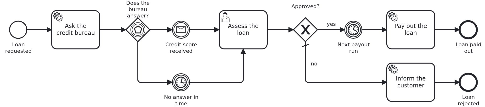

# A workflow module under load

[](./LICENSE)

Your workflow module works for one loan. What happens when hundreds run at once? A VanillaBP
application has more places which can run out than an ordinary one, and which of them runs out
first is written down nowhere. This blueprint finds out by measuring. A load driver plays
customers, clerks and a neighbour system, raises the load step by step, and names the pool which
ran out first, together with the setting to change.

## What this blueprint shows



A small process with the shapes which cost something:

- a service task which asks a neighbour system, the credit bureau,
- a message with the answer, and a timer for the case that no answer comes,
- a user task which a clerk holds while thinking,
- a gateway whose share is not in the model,
- a timer which wakes many workflows at once. Every loan approved before the next payout run
  gets the same due date, so they all wait in the same timer and wake up in the same moment.

A start is two phases and an outbox entry. An outbox entry is picked up and dispatched on
another thread. A delivery reads the aggregate in a transaction of its own. The BPMS brings its
own threads on top. All of them share the connections of one pool. Under load, one of them runs
out first, and it is a different one in every application.

### The load profile

The model says which tasks there are. It does not say how many workflows start per second, how
long a clerk thinks, how late the credit bureau answers or which way the gateway goes. That is
in `loan-approval/src/main/resources/loan-approval/load-profile.yaml`, next to the BPMN files:

```yaml
arrivals:
  pattern: random
  per-second: 4
gateways:
  Gateway_Approved:
    Flow_ToPayoutRun: 0.8
    Flow_ToInformRejection: 0.2
people:
  UserTask_AssessLoan:
    persons: 24
    think-time: PT2S
    think-time-spread: PT1S
neighbours:
  CatchEvent_CreditScoreReceived:
    name: credit bureau
    latency: PT0.3S
    latency-spread: PT0.2S
    no-answer-share: 0.05
```

Every key names a BPMN element by its id, so the profile stays next to the model it describes.
The file also holds the size of the aggregate and the hot path, the elements most workflows
pass. A key the driver does not know stops the application with a message which names it. So a
typo never falls back to nothing.

### The driver plays behaviour, not a loop

A loop which starts workflows as fast as it can measures the loop. The driver plays the people
and the systems around the module instead:

- **Customers** arrive at the rate of the profile, with random gaps like real arrivals. They do
  not wait for each other. When the application gets slow, they queue up in front of it.
- **Clerks** take an open assessment from the task list, hold it while they think, and decide.
  The share of approvals comes from the gateway in the profile.
- **The credit bureau** answers after its latency, and sometimes not at all. Then the process
  stops waiting after ten seconds, and the clerk decides without the score.

The run walks through stages: a warm up, a steady stage at the rate of the profile, steps of a
quarter more load each, a peak, and a drain. In the drain nobody arrives any more, and the run
waits until every workflow has ended and the outbox is empty. A run whose work never ends has
not found a limit. It has hidden one.

### Which number to look at first

A limit is a knee. The offered load keeps rising, and at some stage the work done stops rising
with it, while a queue keeps rising. The report names the queue which started to rise first and
kept rising until the peak. Each queue names a setting:

|                Queue                |                            What it means                            |                               The setting                               |
|-------------------------------------|---------------------------------------------------------------------|-------------------------------------------------------------------------|
| threads waiting for a connection    | the pool is too small for the threads which draw from it            | `spring.datasource.hikari.maximum-pool-size`, or fewer of those threads |
| the age of the oldest outbox entry  | the outbox writes faster than it dispatches                         | `vanillabp.outbox.dispatch-threads`                                     |
| execution slots in use, at the most | the handlers of a remote BPMS wait for a free slot                  | `vanillabp.adapters.<adapter-id>.worker-threads`                        |
| time spent collecting garbage       | with a flat live set: the heap is too small for the work in flight  | the heap, `-Xmx`                                                        |
| the live set after the drain        | with no work left, the heap still holds more than after the warm up | none: a defect                                                          |

The numbers come from where the application publishes them anyway: the meters of VanillaBP and
of the connection pool, and the garbage collector of the JVM. So what the driver reads is what
your monitoring reads in production. Only Camunda 8 has execution slots. On an engine without
them the column shows a dash.

The [wiki page about the pools](https://github.com/vanillabp/adapter-platform-integration/wiki/The-pools-of-an-application)
says what depends on what, and what each adapter adds.

Do not compare a run with a run of another machine. A CI runner shared with other jobs moves the
same work by about fifty percent between two runs, more than a real change would. So the CI of
this blueprint runs a tiny size only to prove that the driver still starts and finishes, and
measures nothing.

## Delta to the base blueprint

Compared to [`module-single`](https://github.com/vanillabp-blueprints/module-single-springboot):

|            File            |                                            What is different                                            |
|----------------------------|---------------------------------------------------------------------------------------------------------|
| `loan_approval.bpmn`       | the credit bureau, its answer or its timeout, the user task, the gateway and the payout run             |
| `load-profile.yaml`        | new: what the model does not say about the load                                                         |
| `loan-approval.yaml`       | how often the payout run comes, and the due date of the payout run declared for the timer               |
| `CreditBureau.java`        | new: the neighbour system, known to the module only by its role                                         |
| `WorkflowTaskHandler.java` | the four `@WorkflowTask` methods, one of them with `@TaskId` for the user task                          |
| `Service.java`             | asks the bureau, takes its answer, opens and decides the assessment, pays out, rejects                  |
| `Workflow.java`            | correlates the answer of the bureau and completes the user task                                         |
| `Aggregate.java`           | the documents, the score, the open task, the decision and the due date of the payout run                |
| `AggregateRepository.java` | the open assessments, as a task list shows them, and the number of unfinished workflows                 |
| `ApiController.java`       | an endpoint for the decision of a clerk, so one loan can be walked through in a browser                 |
| `load-driver/`             | new Maven module: the driver, the credit bureau it plays and the report                                 |
| `application/pom.xml`      | the load driver, and the actuator for Micrometer and the meters of the pool                             |
| `application.yaml`         | a file database, the pool, the dispatch threads, a fresh gauge each second, the run sizes, quieter logs |
| `LoanApprovalIT.java`      | each path of the process, one loan at a time                                                            |
| `LoadRunIT.java`           | new: a tiny run which has to start and finish                                                           |

## Running it

Requires a JDK 21 or newer. Camunda 7 is embedded, so nothing else has to run:

```bash
mvn install verify
```

To run it on another BPMS, pick another Maven profile. Not one line of Java changes:

```bash
mvn install verify -Pcamunda8
```

Camunda 8 is a remote engine, so a cluster has to run. Its address and everything else specific
to that engine are in its profile file
`application/src/main/resources/application-camunda8.yaml`. The module's own test has a copy:

```yaml
vanillabp:
  adapters:
    camunda8:
      # Camunda 8 is a remote engine: point this at your cluster.
      rest-address: http://localhost:8080
      # Camunda 8.10 can lose a leased job for a whole job-timeout. Until Camunda fixes that,
      # the adapter advises against a lease. The key has no default:
      # https://github.com/vanillabp/camunda8-adapter/wiki/Configuration#a-job-somebody-else-holds
      job-lease: do-not-use
```

The blueprint does not lease its jobs. On 8.10 the gateway of the cluster can lose a leased
job when a long poll ends, and the job then waits for a whole `job-timeout`. Until Camunda
fixes that, the adapter advises `do-not-use`, and moving to `use` later costs nothing. Why is
[decision 88 of the Camunda 8 adapter](https://github.com/vanillabp/camunda8-adapter/blob/main/DECISIONS.md#88-until-camunda-fixes-its-gateway-the-adapter-advises-against-a-lease-and-its-own-tests-keep-one).

The file is loaded because the Maven profile `camunda8` sets the profile of the same name. So
you choose the engine once, on the Maven command line, and the build, the tests and the run all
follow it.

[Operaton](https://operaton.org), the open source successor of Camunda 7, is embedded as well
and needs nothing else either. The BPMN files are the ones of Camunda 7, because Operaton reads
their `camunda:` attributes:

```bash
mvn install verify -Poperaton
```

[CIB seven](https://cibseven.org), a fork of Camunda 7 made by CIB software, is embedded as
well and needs nothing else either. The BPMN files are the ones of Camunda 7, because CIB seven
reads their `camunda:` attributes:

```bash
mvn install verify -Pcibseven
```

Start the application:

```bash
mvn -pl application spring-boot:run
```

Start a run. This is the only URL you need:

```
http://localhost:8080/api/load-run/start?size=small
```

The run takes three to four minutes. Its report is here, and the log prints it at the end as well:

```
http://localhost:8080/api/load-run/report
```

While the run goes on, the same URL says which stage it is in. This report was measured on this
blueprint with Camunda 7, on a development machine:

```
Load run 'small' of process 'loan_approval', took 213s
Hot path: ServiceTask_RequestCreditScore -> CatchEvent_CreditScoreReceived -> UserTask_AssessLoan -> CatchEvent_PayoutRun -> ServiceTask_PayOut

stage     offered/s started/s delivered/s customers conn-wait    outbox  oldest-s     slots   gc-%  live-MB
warm-up         4.0       4.2        11.3       0.0       0.4       0.0       0.0         -    0.3      105
steady          4.0       3.5         9.9       0.0       0.0       0.1       0.0         -    0.4      101
step-1          5.0       5.4        16.5       0.0       0.0       0.1       0.0         -    0.3      108
step-2          6.0       6.0        16.6       0.0       0.0       0.0       0.0         -    0.3      103
step-3          7.0       7.4        23.6       0.0       0.0       0.1       0.0         -    0.4      109
peak            9.0       8.5        23.1       0.0       0.0       0.0       0.0         -    0.3      109
drain           0.0       0.0         3.7       0.0       0.0       0.0       0.0         -    0.1      125

Nothing ran out at this size. Run the next size to find the limit.
Compare runs of the same machine only. The numbers of another machine, and of a shared CI runner above all, move more than a real change would.
```

`small` is sized so that a laptop shows a result in a few minutes. The next step is
`?size=medium`, two minutes per stage and six steps, and then `?size=large`. Both are in
`application.yaml`, and you can add your own. Raise `per-second` in the load profile to start
higher.

To walk one loan approval through by hand, set the log level of
`blueprint.workflowmodule.loanapproval` in `application.yaml` to `INFO`. Then start a loan:

```
http://localhost:8080/api/loan-approval/start?amount=5000
```

The log names the URLs to go on with as soon as the assessment is open:

```
Loan approval '0f7c…' waits for a clerk. Continue with one of:
  Approve -> http://localhost:8080/api/loan-approval/0f7c…/assess/42?approved=true
  Reject  -> http://localhost:8080/api/loan-approval/0f7c…/assess/42?approved=false
```

## How it works

|                                 File                                  |                                        Role                                         |
|-----------------------------------------------------------------------|-------------------------------------------------------------------------------------|
| `loan-approval/src/main/resources/loan-approval/load-profile.yaml`    | the load profile: arrivals, people, the neighbour system, shares, aggregate size    |
| `load-driver/src/main/java/.../loaddriver/LoadRun.java`               | walks through the stages, reads the queues once a second, writes the report         |
| `load-driver/src/main/java/.../loaddriver/Customers.java`             | start loan approvals at a rate, on threads like the request threads of a web server |
| `load-driver/src/main/java/.../loaddriver/Clerks.java`                | take an assessment from the task list, think, decide                                |
| `load-driver/src/main/java/.../loaddriver/CreditBureauSimulator.java` | answers after a latency, or not at all                                              |
| `load-driver/src/main/java/.../loaddriver/Queues.java`                | reads the meters of VanillaBP, of the pool and of the JVM                           |
| `load-driver/src/main/java/.../loaddriver/Report.java`                | finds the knee and the queue which turned first, and names its setting              |
| `load-driver/src/main/java/.../loaddriver/LoadProfile.java`           | reads the profile and says exactly which key is wrong                               |
| `load-driver/src/main/resources/openapi/load-run.yaml`                | the two URLs of a run, as an OpenAPI file                                           |
| `loan-approval/src/main/java/.../loanapproval/CreditBureau.java`      | the neighbour system, as the module knows it                                        |

The module knows nothing about load. The driver calls the same methods of `Service` which a
browser, a task list or a credit bureau would call. So what is measured is the module as it is,
not a version of it made for measuring.

The driver is a Maven module of its own and wires itself. Taking the `load-driver` dependency
out of the application takes all of it out: the driver, its two URLs and the credit bureau it
plays. Then the application brings a client of the real credit bureau, which implements
`CreditBureau`, and the workflow module does not change.

The driver brings no load testing tool. A blueprint is a template you copy, and the next
dependency update has to be able to move every library in it. A large tool would hold that
back, and a few hundred lines of Java are enough to play this behaviour.

The run asks the JVM for a full garbage collection twice, after the warm up and after the drain.
Only then are the two live sets comparable. An application never does that, the driver does it
as measuring equipment.

The database is a file, not one in memory. An in-memory database lives in the heap of the
application. Every finished workflow would stay there, and the report would read it as a live
set which never comes back.

The load profile is not only for this driver. Its keys are fixed here so that a tool which reads
your BPMN model can ask you for exactly these values and write the same file for your own
module.

## Documentation

- [The pools of an application](https://github.com/vanillabp/adapter-platform-integration/wiki/The-pools-of-an-application): which pools a VanillaBP application has, and what depends on what
- [Observability](https://github.com/vanillabp/adapter-platform-integration/wiki/Observability): every meter VanillaBP publishes, and the question it answers
- [What VanillaBP is sized for](https://github.com/vanillabp/adapter-platform-integration/wiki/What-VanillaBP-is-sized-for): the load VanillaBP is built for
- [Message correlation](https://github.com/vanillabp/adapter-platform-integration/wiki/Message-correlation): the answer of the credit bureau
- [Timers](https://github.com/vanillabp/adapter-platform-integration/wiki/Timers#a-deadline-out-of-the-workflow-aggregate): the due date of the payout run, read from the aggregate
- the wiki of the [BPMS adapter](https://github.com/vanillabp/adapter-platform-integration/wiki/BPMS-adapters) you use, for the threads and slots of that engine

This blueprint is developed in the monorepo
[`blueprints`](https://github.com/vanillabp-blueprints/blueprints). This repository is a
read-only mirror, **issues and pull requests belong there.**

## Noteworthy & Contributors

[VanillaBP](https://www.github.com/vanillabp/spi-for-java) was developed by [Phactum](https://www.phactum.at) with the
intention of giving back to the community as it has benefited the community in the past.


## License

Copyright 2026 Phactum Softwareentwicklung GmbH

Licensed under the Apache License, Version 2.0
