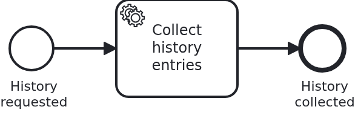

# Workflow aggregates without a repository

[](./LICENSE)

VanillaBP loads and saves the workflow aggregate for the application, so it has to know how
that is done. Usually a repository answers that question. This blueprint removes the repository
twice. It has two use cases. One aggregate is a JPA (Jakarta Persistence) entity which stores
itself, the other a MongoDB document which stores itself. Both live in the same workflow
module. A delta on top of `module-single`.

The interesting part of this blueprint is what is not in it. Nothing configures the
persistence. Nothing is injected to reach it. And nothing says which of the two databases an
aggregate belongs to.

## What this blueprint shows




Two use cases, each with the process of the base blueprint: one service task, started through a
GET request, and an aggregate the task fills. The processes are not the point here. The point
is how their aggregates are stored. The processes are the same on purpose, so that this
difference shows.

The loan approval extends `PanacheEntityBase` and lives in a relational database:

```java
@Entity
@Table(name = "LOAN_APPROVAL")
@NoSyncWithBPMS
public class Aggregate extends PanacheEntityBase {

  @Id
  private String loanRequestId;
  ...
}
```

The credit history extends `PanacheMongoEntityBase` and lives in MongoDB:

```java
@MongoEntity(collection = "CREDIT_HISTORY")
@NoSyncWithBPMS
public class Aggregate extends PanacheMongoEntityBase {

  @BsonId
  private String creditHistoryId;
  ...
}
```

No repository, no `AggregatePersistenceAware`, no property which names either of them. While
the application is built, VanillaBP asks each aggregate which idiom it is written in. It says
what it found, one line per aggregate:

```
Using VanillaBP's Hibernate ORM Panache active record persistence for workflow aggregate
'blueprint.workflowmodule.loanapproval.model.Aggregate'
Using VanillaBP's MongoDB Panache active record persistence for workflow aggregate
'blueprint.workflowmodule.credithistory.model.Aggregate'
```

The two lines differ, and that is what this blueprint claims. **The idiom is resolved per
aggregate, not per application.** So an application may mix them. The order of resolution
applies to each aggregate on its own. An `AggregatePersistenceAware` written by the application
wins over everything. A repository for that aggregate wins over the active record. Spring Data
repositories answer last. If you later add a repository for one of these aggregates, that one
moves onto it without a word of configuration, and the other stays where it is. The log line
shows which way it went. If it names a repository you thought you had deleted, that explains
why nothing changed.

**The price, and where you pay it.** A repository is a bean, so you can declare things on it,
most of all a transaction. Without it the application reads through the static finder of the
aggregate. That needs a transaction or an active request context of its own:

- The `get` methods of both `Service` classes carry `@Transactional`, as they do in the base
  blueprint. Here it is not a formality. It is the only place left to declare the transaction.
- the integration tests read in a transaction of their own per poll. The shared test harness
  does that anyway. Without it, the finder would have nothing to read from.

Nothing changes for the `@WorkflowTask` methods. VanillaBP owns the transaction of a task. It
loads the aggregate before the method and saves it afterwards. So a handler which declares a
transaction is as wrong here as everywhere else, and VanillaBP still fails the boot because of
it.

**Two databases, and what VanillaBP does with them.** Three things need storage: the workflow
aggregate, the phase-two outbox and the log of delivered tasks. The aggregate is where the
application put it. The other two belong in the transaction which stores that aggregate.
Otherwise a rollback leaves an outbox entry for a workflow whose aggregate never existed.

In an application with two databases both defaults are active, the relational one and the
MongoDB one. VanillaBP assigns them the same way it resolved the persistence. The entries of
the loan approval go into the relational store, those of the credit history into MongoDB. There
is nothing to configure. To overrule it, add a `PhaseTwoOutboxAware` or a
`TaskDeliveryLogAware` bean. This blueprint has no reason to have one.

**MongoDB writes in a transaction, and that needs a replica set.** MongoDB Panache enlists its
session in the transaction VanillaBP opens. So aggregate, outbox entry and delivery record
commit together. A MongoDB transaction is only available on a replica set or a sharded cluster.
The dev services start a replica set with one node, so a test needs nothing. A production
deployment has to be a replica set. VanillaBP checks for it while starting and warns if it is
not.

**With a MongoDB aggregate, an embedded engine behaves like a remote engine as far as
consistency goes.** The embedded Camunda 7 stores its own state in the relational database, and
no transaction spans both databases. The two are held together by the same mechanism a remote
engine needs. VanillaBP starts every workflow in two phases. The local transaction stores the
aggregate and the intent, and the engine is called afterwards. So do not read "embedded" as
"one commit" here. For the credit history, the engine's state and the aggregate are two
commits. The outbox makes that reliable instead of lucky.

**Where the data is stored says nothing about what leaves the application.** Both aggregates
carry `@NoSyncWithBPMS`. So the BPMS (business process management system) learns only what a
model reads, and both models read nothing. Each is a start event, one service task and an end
event, without a condition, a timer or a collection. So neither aggregate has an attribute
marked `@SyncWithBPMS`. The amount, the rating, the years and the entries found stay where they
are stored. The BPMS holds the ID of each aggregate. VanillaBP always shares it, because it
needs it to find the workflow again. Add a gateway to one of the models, and the attribute its
condition reads needs `@SyncWithBPMS`. Otherwise the condition has nothing to read. What is
shared is decided per aggregate by its annotations, the same as the persistence idiom. The two
databases play no part in it.

## Delta to the base blueprint

Compared to [`module-single`](https://github.com/vanillabp-blueprints/module-single-quarkus):

|                       File                        |                                                  What is different                                                  |
|---------------------------------------------------|---------------------------------------------------------------------------------------------------------------------|
| `.../loanapproval/model/AggregateRepository.java` | deleted. There is no repository, and nothing replaces it                                                            |
| `.../loanapproval/model/Aggregate.java`           | extends `PanacheEntityBase` and carries the one finder the application needs, `byId`                                |
| `.../loanapproval/Service.java`                   | injects no repository. The reading method calls `Aggregate.byId` inside its own transaction                         |
| `.../credithistory/`                              | the second use case, the same four classes, with an aggregate extending `PanacheMongoEntityBase`                    |
| `loan-approval/pom.xml`                           | both Panache flavours, because the module has an aggregate of each                                                  |
| `application/src/main/resources/application.yaml` | a MongoDB database next to the data source, and no connection string, so the dev services run one                   |
| `loan-approval/src/test/.../*IT.java`             | read through the aggregates' own finders, and assert that a workflow started on a remote engine keeps its aggregate |

Everything else is the base blueprint, file for file: the wiring classes, the API, the module's
own configuration, the test harness.

## Running it

Requires a JDK 21 or newer and a running Docker, because the dev services start a MongoDB for
the second use case. Camunda 7 is embedded, so nothing else has to run:

```bash
mvn install verify
```

For this blueprint that is not all, though. Both use cases assert that a workflow started on a
remote engine keeps its aggregate. That only means something on a remote engine:

```bash
mvn install verify -Pcamunda8
```

Camunda 8 is a remote engine, so a cluster has to run. Start one. Its address and everything
else specific to that engine are in its profile file
`application/src/main/resources/application-camunda8.yaml`. The module's own test has a copy:

```yaml
vanillabp:
  adapters:
    camunda8:
      # Camunda 8 is a remote engine: point this at your cluster.
      rest-address: http://localhost:8080
      # Camunda 8.10 can lose a leased job for a whole job-timeout. Until Camunda fixes that,
      # the adapter advises against a lease. The key has no default:
      # https://github.com/camunda-community-hub/vanillabp-camunda8-adapter/wiki/Configuration#a-job-somebody-else-holds
      job-lease: do-not-use
```

The blueprint does not lease its jobs. On 8.10 the gateway of the cluster can lose a leased
job when a long poll ends, and the job then waits for a whole `job-timeout`. Until Camunda
fixes that, the adapter advises `do-not-use`, and moving to `use` later costs nothing. Why is
[decision 88 of the Camunda 8 adapter](https://github.com/camunda-community-hub/vanillabp-camunda8-adapter/blob/main/DECISIONS.md#88-until-camunda-fixes-its-gateway-the-adapter-advises-against-a-lease-and-its-own-tests-keep-one).

The file is loaded because the Maven profile `camunda8` makes the config profile of the same
name the parent of the profile the application runs in. So you choose the engine once, on the
Maven command line. The build, the tests and `quarkus:dev` all follow it.

[Operaton](https://operaton.org), the open source successor of Camunda 7, is embedded as well
and needs nothing else either. The BPMN files are the ones of Camunda 7, because Operaton reads
their `camunda:` attributes:

```bash
mvn install verify -Poperaton
```

Start the application:

```bash
mvn -pl application quarkus:dev
```

You see nothing about identifiers at startup. The BPMS profiles of this blueprint set
`name-clash-avoidance: use-prefix`. So VanillaBP puts the workflow module ID in front of every
identifier before it reaches the engine, and takes it off again on the way back. The BPMN
files, the business code and the rest of the configuration keep the plain names. No tenant is
involved, which matters on a BPMS licensed per tenant.
[The wiki](https://github.com/vanillabp/adapter-platform-integration/wiki/Workflow-modules#how-name-clashes-are-avoided)
explains the modes and what each of them costs.

The two lines about the persistence appear while the application is built. So they show up in
that command as well as in `mvn install`.

Start a loan approval and a credit history. These are the only URLs you need:

```
http://localhost:8080/api/loan-approval/start?amount=5000
http://localhost:8080/api/credit-history/start?years=3
```

Each answers with the ID of the case it started and logs the URL which shows the result:

```
Loan approval '0f7c…' started
Credit rating of loan approval '0f7c…' is 50
Show the result -> http://localhost:8080/api/loan-approval/0f7c…
```

Opening that URL reads the aggregate through its own finder and shows what the service task
wrote. The two URLs behave the same. The databases behind them do not.

## How it works

|                                     File                                     |                                               Role                                               |
|------------------------------------------------------------------------------|--------------------------------------------------------------------------------------------------|
| `.../loanapproval/model/Aggregate.java`                                      | the JPA entity which is also its own persistence, the finder `byId`, and `@NoSyncWithBPMS`       |
| `.../credithistory/model/Aggregate.java`                                     | the MongoDB document which is also its own persistence, the finder `byId`, and `@NoSyncWithBPMS` |
| `.../loanapproval/Service.java`, `.../credithistory/Service.java`            | the business code; the reading methods own the transaction the finders need                      |
| `.../<usecase>/Workflow.java`                                                | what the application tells the process; the only class using `ProcessService`                    |
| `.../<usecase>/WorkflowTaskHandler.java`                                     | what the process tells the application: `@WorkflowService`, `@WorkflowTask`, calls `Service`     |
| `.../<usecase>/ApiController.java`                                           | the GET endpoints operating the process                                                          |
| `loan-approval/src/main/resources/loan-approval/processes/camunda7/*.bpmn`   | the two processes: start event, service task, end event                                          |
| `loan-approval/src/test/.../LoanApprovalIT.java`, `.../CreditHistoryIT.java` | start real workflows, read the aggregates statically, and cover the remote start                 |
| `loan-approval/src/test/.../WorkflowModuleTest.java`                         | their base class: a fresh transaction per poll. The same in every blueprint                      |
| `application/src/main/resources/application.yaml`                            | the two databases, and nothing about the workflows or their persistence                          |

When somebody requests a loan, the same happens as in the base blueprint. Only who touches the
database differs. `Service#request` builds the aggregate and tells `Workflow` that a loan was
requested. `ProcessService#startWorkflow` saves the aggregate through the operations of
Panache, not through a repository, and starts the workflow in the same transaction. When the
BPMS reaches the service task, VanillaBP loads the aggregate, calls
`WorkflowTaskHandler#retrieveCreditRating`, and saves it again. All of this happens inside the
transaction VanillaBP owns for that task. The credit history does the same. The only difference
is which database its transaction reaches.

No class of the application takes part in any of that. That is the point, and also the limit of
the idiom. Everything the application itself wants to read has to bring a transaction along.
Four places do, and they are the four places which read.

In every other respect an active record is an ordinary aggregate. That includes the way two
branches of one workflow can overwrite each other's writes.
[`persistence-parallel-branches`](https://github.com/vanillabp-blueprints/persistence-parallel-branches-quarkus)
and
[the wiki](https://github.com/vanillabp/adapter-platform-integration/wiki/Workflow-aggregates#two-writers-on-one-aggregate)
cover that, so it is not repeated here.
[`persistence-mongodb`](https://github.com/vanillabp-blueprints/persistence-mongodb-quarkus)
shows the MongoDB repository idiom, and an application which has no relational database at all.

## Documentation

- [Persisting workflow aggregates](https://github.com/vanillabp/adapter-platform-integration/wiki/Quarkus-integration#persisting-workflow-aggregates): the idioms recognised, the order they are resolved in, and what ends the build instead
- [Workflow aggregates](https://github.com/vanillabp/adapter-platform-integration/wiki/Workflow-aggregates): why there are no process variables, and what an aggregate is for
- [Sharing workflow-aggregate data](https://github.com/vanillabp/adapter-platform-integration/wiki/Workflow-aggregates#fine-grained-control-over-attributes-synchronized-to-the-bpms): `@NoSyncWithBPMS`, `@SyncWithBPMS`, and what a BPMS gets to see
- [Two writers on one aggregate](https://github.com/vanillabp/adapter-platform-integration/wiki/Workflow-aggregates#two-writers-on-one-aggregate): the collision an active record has as well, and the four ways to deal with it
- [Workflow modules](https://github.com/vanillabp/adapter-platform-integration/wiki/Workflow-modules): what a workflow module is, its ID, and where its BPMN files are looked for
- [Wire up a process / Wire up a task](https://github.com/vanillabp/spi-for-java#usage): the annotations used in `WorkflowTaskHandler.java`
- the wiki of the [BPMS adapter](https://github.com/vanillabp/adapter-platform-integration/wiki/BPMS-adapters) you use: how a BPMN task has to be modelled for that engine

This blueprint is developed in the monorepo
[`blueprints`](https://github.com/vanillabp-blueprints/blueprints). This repository is a
read-only mirror, **issues and pull requests belong there.**

## Noteworthy & Contributors

[VanillaBP](https://www.github.com/vanillabp/spi-for-java) was developed by [Phactum](https://www.phactum.at) with the
intention of giving back to the community as it has benefited the community in the past.


## License

Copyright 2026 Phactum Softwareentwicklung GmbH

Licensed under the Apache License, Version 2.0

        https://www.apache.org/licenses/LICENSE-2.0

Unless required by applicable law or agreed to in writing, software distributed under the
License is distributed on an "AS IS" BASIS, WITHOUT WARRANTIES OR CONDITIONS OF ANY KIND,
either express or implied. See the License for the specific language governing permissions
and limitations under the License.
