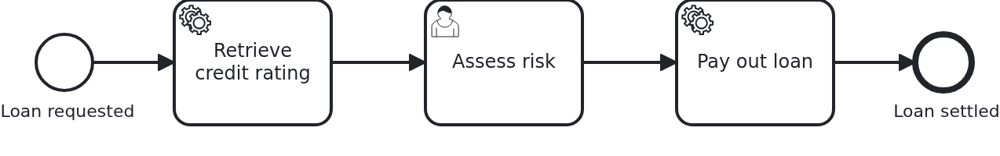

# A workflow aggregate which remembers every change

[](./LICENSE)

Banks and insurers have to be able to say later who changed a case, when, and what it looked
like before. The workflow aggregate is the right place for that, because it holds the case.

VanillaBP asks nothing of you here and gives you nothing. Auditing belongs to the application,
and it stays that way. What VanillaBP does have is the outbox. A report about an event is
written inside the transaction of that event and sent afterwards. So by the time it goes out,
the case has moved on. That is why the report carries the name of the state it is about. The
application knows how to name a state and how to read it back.

This blueprint does both with Hibernate Envers.

## What this blueprint shows



The loan approval of the base blueprint with three moments in it. They make the difference
visible. A service task writes the credit rating. A person decides whether the risk is
acceptable. After that a service task pays the loan out. Each of the three writes the workflow
aggregate, so each of them is one state of the case.

Two things happen on top of that. Hibernate Envers records every change, and the decision is
reported to a compliance archive. The report is written down when the decision is taken and
sent afterwards. The archive is away at the first attempt, so the payout is booked in between.
In the end the archive gets the loan approval as it was at the decision, not as it is by then.

### What the auditing writes

One word on the aggregate, `@Audited`, and Hibernate Envers keeps three tables instead of
one:

|          Table           |                                What is in it                                |
|--------------------------|-----------------------------------------------------------------------------|
| `LOAN_APPROVAL`          | the loan approval as it is now, the table every blueprint has               |
| `LOAN_APPROVAL_AUD`      | one row per change, with the number of the change and what kind it was      |
| `LOAN_APPROVAL_REVISION` | one row per change, with the moment it happened and the person it came from |

The last table is the revision entity of this application, `AuditedChange`. Without one, Envers
writes a table of its own called `REVINFO`. It knows the number and the moment and nothing
else. A class and a listener add the name of the person. That name is usually the reason to
have an auditing at all.

Reading it is a repository call. `AggregateRepository` extends `RevisionRepository` of Spring
Data Envers. So `findRevisions(loanRequestId)` returns the whole trail, and the API of this
blueprint shows it:

```
#1 by the customer: Aggregate(loanRequestId=0f7c…, amount=5000, creditRating=null, …)
#2 by the process: Aggregate(…, creditRating=50, assessRiskTaskId=null, …)
#3 by the process: Aggregate(…, creditRating=50, assessRiskTaskId=22, …)
#4 by paula: Aggregate(…, riskAcceptable=true, decidedBy=paula, paidOut=null)
#5 by the process: Aggregate(…, riskAcceptable=true, decidedBy=paula, paidOut=true)
```

Five changes for three business steps. The third one is the reason. The application keeps the
id of the open user task on the aggregate, and that is a write like any other. An auditing
records what the data does, not what the process means.

### This is Envers, not the auditing of Spring Data

The names are close enough to cause a wrong decision. The auditing of Spring Data,
`@CreatedDate` and `@LastModifiedDate` with `@EnableJpaAuditing`, writes who touched a record
last and when. It keeps no old state. So it can never answer what the case looked like at an
earlier moment. Hibernate Envers keeps the old states, and that is what this blueprint is
about.

### Naming a state before it exists

This is the part worth reading before copying anything.

A report about an event is written down while the event happens, and sent later. So it has to
name the state it means. Envers numbers a change when the transaction commits. That is after
the report was written, so the number is of no use there.

The way out is an id of the application's own. `ChangeBeingMade` makes one up as soon as
somebody asks. The revision of that transaction is written with that id in it. Reading a state
back then takes two steps: look up the revision which carries the id, then ask Envers for the
loan approval at that revision.

```java
// while the transaction is open, in AuditedAggregatePersistence
return ChangeBeingMade.id();

// later, when the report is sent
final var revisions = entityManager
    .createQuery("select change.id from AuditedChange change where change.changeId = :changeId", Integer.class)
    .setParameter("changeId", changeId)
    .getResultList();
```

The id belongs to the transaction, not to a single write, and that makes it usable. A
transaction which flushes twice still names one state. Nothing ever refers to the id of a
transaction which rolled back, because whatever wrote it down rolled back with it.

Two other ways fail at a second look. Both are worth knowing about:

- `AuditReader#getCurrentRevision(..., true)` creates the revision row early and hands out its
  number. It is deprecated since Envers 5.2. The replacement it points at, a
  `RevisionListener`, runs while the transaction commits, and that is exactly too late. A
  blueprint is copied, so it contains nothing which the next upgrade of a dependency can take
  away.
- The `@Version` attribute of an application which uses optimistic locking names a state as
  well, and it costs nothing extra. But it is assigned per write. A transaction which writes
  the aggregate twice ends with a version which its audit row does not carry, and the report
  then finds nothing. Use it only where a transaction writes once, and you have to be sure of
  that.

### Who made the change

Envers builds the revision entity itself, without asking the bean container. So the name of the
person cannot be injected into the listener. It travels on the thread. `ChangeBeingMade` holds
it, the API binds it around the call, and the listener reads it when Envers writes the
revision.

Where that binding happens matters. Envers writes the revision when the transaction commits,
which is after the business method returned. So if the business method removes the name again,
that is too late, and the change ends up without an author. The API is the right place. An
application with a security framework reads the authenticated user in a filter, which covers
the same stretch.

Changes nobody announced come from the process. A service task runs on a thread of the BPMS
(business process management system), where there is no person to name.

### What the report shows, and what it cannot

The report is written down in the transaction of the decision. So a decision which rolls back
takes its report with it. The report is sent once that transaction has committed. It names the
state of the decision. So its delivery reads the loan approval as it was then, however long the
delivery took.

The id travels with the report as one of its arguments, and VanillaBP reads nothing in it.
Loading the state is the application's own call, at the far end, with the two lines above. What
VanillaBP writes back into the BPMS is different. It always reads the current state, because
the case goes on in the BPMS, and a value which is a day old would be wrong there.

Limits belong to the picture as well:

- The state may be gone. An auditing is cleaned up at some point, and an entry may wait longer
  than that. The load then returns nothing. The report goes out with the state of today, and a
  line in the log says so. A report with newer values is better than no report.
- Only what is in the aggregate is audited. What an adapter reads out of the BPMS while it
  dispatches is the state of that moment: the assignee of a user task, its candidates, its due
  date. It is the data of the BPMS, and the BPMS keeps no history of it which anybody could
  ask.
- MongoDB has nothing of this built in. An application which stores its aggregates there writes
  the versions itself or does without them. The two questions stay the same either way: name
  the state, and read it back.

Auditing is not free. Every change costs a second write and a row which is never deleted. So
switch it on where somebody has to answer for the case later, and leave it off everywhere else.

## Delta to the base blueprint

Compared to [`module-single`](https://github.com/vanillabp-blueprints/module-single-springboot):

|                   File                   |                                            What is different                                             |
|------------------------------------------|----------------------------------------------------------------------------------------------------------|
| `loan_approval.bpmn`                     | a decision by a person between the credit rating and the payout, so the aggregate is written three times |
| `model/Aggregate.java`                   | carries `@Audited`, and the attributes the three steps write                                             |
| `model/AggregateRepository.java`         | also a `RevisionRepository`, which reads the trail                                                       |
| `config/AuditedRepositories.java`        | switches on the repository factory that reads revisions                                                  |
| `audit/AuditedChange.java`               | the revision entity, so a change knows who made it                                                       |
| `audit/ChangeBeingMade.java`             | the id naming the change, the person making it, and how long each of them has to be there                |
| `audit/AuditedAggregatePersistence.java` | how the aggregate is stored, and how a state it had before is read back                                  |
| `audit/ComplianceNotices.java`           | the report about the decision, which carries the change it is about                                      |
| `ComplianceArchive.java`                 | the port to the archive, so a test can put a simulator in its place                                      |
| `LoanApprovalIT.java`                    | decides, waits for the payout, and asserts on what the archive was told                                  |

## Running it

Requires a JDK 21 or newer. Camunda 7 is embedded, so nothing else has to run:

```bash
mvn install verify
```

To run it on another BPMS, pick another Maven profile. Not one line of Java changes:

```bash
mvn install verify -Pcamunda8
```

Camunda 8 is a remote engine, so a cluster has to run. Start one. Its address and everything
else specific to that engine are in its profile file
`application/src/main/resources/application-camunda8.yaml`. The module's own test has a copy:

```yaml
vanillabp:
  adapters:
    camunda8:
      # Camunda 8 is a remote engine: point this at your cluster.
      rest-address: http://localhost:8080
      # This adapter leases the jobs it holds, so the cluster takes the answer of the current
      # activation only. The key has no default, because a lease cannot be taken back. This is
      # the value the adapter recommends:
      # https://github.com/camunda-community-hub/vanillabp-camunda8-adapter/wiki/Configuration#a-job-somebody-else-holds
      job-lease: use
```

The file is loaded because the Maven profile `camunda8` sets the profile of the same name. So
you choose the engine once, on the Maven command line. The build, the tests and
`spring-boot:run` all follow it.

[Operaton](https://operaton.org), the open source successor of Camunda 7, is embedded as well
and needs nothing else either. The BPMN files are the ones of Camunda 7, because Operaton reads
their `camunda:` attributes:

```bash
mvn install verify -Poperaton
```

Start the application:

```bash
mvn -pl application spring-boot:run
```

Start a loan approval. This is the only URL you need:

```
http://localhost:8080/api/loan-approval/start?amount=5000&requestedBy=the%20customer
```

It answers with the id of the loan request. The log shows where the process stops:

```
Loan approval '0f7c…' was requested by the customer
Credit rating of loan approval '0f7c…' is 50
Loan approval '0f7c…' waits for a risk assessment. Continue with one of:
  Acceptable -> http://localhost:8080/api/loan-approval/0f7c…/assess-risk/1f2e…?riskIsAcceptable=true&decidedBy=paula
  Too risky  -> http://localhost:8080/api/loan-approval/0f7c…/assess-risk/1f2e…?riskIsAcceptable=false&decidedBy=paula
```

Open one of them, and the log shows the point of the whole blueprint:

```
Risk of loan approval '0f7c…' was assessed by paula as acceptable
The compliance archive does not answer about loan approval '0f7c…'. VanillaBP keeps the notice and tries again.
Loan approval '0f7c…' was paid out
The compliance archive recorded 'risk-assessed' of loan approval '0f7c…': Aggregate(…, riskAcceptable=true, decidedBy=paula, paidOut=null)
```

The archive gets the loan approval without the payout, although the payout was booked before
the notice went out. `LocalComplianceArchive` refuses the first attempt on purpose. So the wait
happens on the first run, not on the first bad day.

Two URLs show the two answers side by side: the case as it is, and the trail of everything it
was:

```
http://localhost:8080/api/loan-approval/0f7c…
http://localhost:8080/api/loan-approval/0f7c…/trail
```

Camunda 7 serves its own web applications, and the `camunda7` profile of this blueprint
configures a user for them. The
[adapter's wiki](https://github.com/camunda-community-hub/vanillabp-camunda7-adapter/wiki/Cockpit-Tasklist-and-Admin)
says where they are served and how to log in.

## How it works

|                                          File                                          |                                              Role                                              |
|----------------------------------------------------------------------------------------|------------------------------------------------------------------------------------------------|
| `loan-approval/src/main/resources/loan-approval/processes/camunda7/loan_approval.bpmn` | the process: rating, decision, payout, and therefore three states of the case                  |
| `.../loanapproval/model/Aggregate.java`                                                | the workflow aggregate, audited by one annotation and sharing nothing with the BPMS            |
| `.../loanapproval/model/AggregateRepository.java`                                      | the repository, and the revisions of Spring Data Envers                                        |
| `.../loanapproval/config/AuditedRepositories.java`                                     | the factory a revision repository needs, declared by the module itself                         |
| `.../loanapproval/audit/AuditedChange.java`                                            | the revision entity: number, moment, and who made the change                                   |
| `.../loanapproval/audit/ChangeBeingMade.java`                                          | the id of the change and the person making it, and the listener writing both into the revision |
| `.../loanapproval/audit/AuditedAggregatePersistence.java`                              | what VanillaBP asks, plus naming the change being made and reading the state at one            |
| `.../loanapproval/audit/ComplianceNotices.java`                                        | the report: written in the transaction of the decision, sent afterwards, about that state      |
| `.../loanapproval/ComplianceArchive.java`                                              | the port to the archive; `LocalComplianceArchive` is the stand-in to replace                   |
| `.../loanapproval/Service.java`                                                        | the business code, which knows nothing about revisions                                         |
| `.../loanapproval/ApiController.java`                                                  | the GET endpoints, and the one place saying who is acting                                      |
| `loan-approval/src/test/.../ComplianceArchiveSimulator.java`                           | the archive in the test, away at the first attempt                                             |
| `loan-approval/src/test/.../LoanApprovalIT.java`                                       | plays the case through and asserts what the archive was told                                   |

The test is the proof. It starts a loan approval, answers the risk assessment as `paula`, and
waits until the payout was booked. Only then does it look at what the archive received. The
notice holds the decision and no payout, while the aggregate in the database holds both. The
archive was asked twice, because it turned down the first attempt. The second test reads the
trail and checks that every change names its author. The third one checks the early revision on
its own. It asks for the revision inside a transaction, changes the loan approval afterwards,
and reads that revision back once the transaction has committed. What comes back is the changed
state. This shows that the number handed out before the flush is the number the change was
recorded under.

None of this affects an application which keeps no auditing at all. The two methods which name
a state and read it back belong to the application. So a blueprint without an auditing has
neither of them, and its reports carry the state of the moment they go out.

## Documentation

- [Workflow aggregates](https://github.com/vanillabp/adapter-platform-integration/wiki/Workflow-aggregates): what an aggregate is, and why there are no process variables
- [Aggregate persistence](https://github.com/vanillabp/adapter-platform-integration/wiki/Workflow-aggregates#aggregate-persistence): the interface this blueprint implements, and when an application needs to
- [What the outbox guarantees](https://github.com/vanillabp/adapter-platform-integration/wiki/Spring-Boot-integration#what-the-outbox-guarantees): why a report is written first and sent afterwards, and what that costs
- [Workflow modules](https://github.com/vanillabp/adapter-platform-integration/wiki/Workflow-modules): what a workflow module is, its ID, and where its BPMN files are looked for
- [Wire up a process / Wire up a task](https://github.com/vanillabp/spi-for-java#usage): the annotations used in `WorkflowTaskHandler.java`
- [Hibernate Envers](https://docs.jboss.org/hibernate/orm/current/userguide/html_single/Hibernate_User_Guide.html#envers): the auditing itself, its tables and its queries
- [Spring Data Envers](https://docs.spring.io/spring-data/envers/reference/): the repository reading the revisions
- the wiki of the [BPMS adapter](https://github.com/vanillabp/adapter-platform-integration/wiki/BPMS-adapters) you use: how a BPMN task has to be modelled for that engine

This blueprint is developed in the monorepo
[`blueprints`](https://github.com/vanillabp-blueprints/blueprints). This repository is a
read-only mirror, **issues and pull requests belong there.**

## Noteworthy & Contributors

[VanillaBP](https://www.github.com/vanillabp/spi-for-java) was developed by [Phactum](https://www.phactum.at) with the
intention of giving back to the community as it has benefited the community in the past.


## License

Copyright 2026 Phactum Softwareentwicklung GmbH

Licensed under the Apache License, Version 2.0
