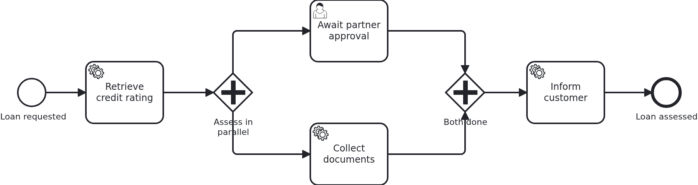

# Two branches writing one workflow aggregate

[](./LICENSE)

A workflow aggregate seems to have a single writer, because it belongs to one workflow. That
holds until the process puts a second token into it. A token marks where a process instance
currently is. From then on two branches change the same business case at the same time, in two
transactions nobody coordinates. A persistence layer which writes whole records lets the later
commit undo the earlier one. There is no exception and no log line, and the process runs
exactly as modelled.

This blueprint shows the data model which makes the collision impossible. It also shows a test
which causes the collision on purpose instead of hoping for it.

## What this blueprint shows



The loan approval of the base blueprint, with a parallel gateway after the credit rating. One
branch waits for a partner to answer through the API. The other collects documents from a
surrounding system. They run at the same time and join before the customer is informed.

The two branches are written by two different transactions:

- the document branch waits for the document service. Once the application says the documents
  are there, `recordDocuments` reads them. That handler runs in the transaction VanillaBP owns
  for its task.
- the partner branch waits at a user task, and the answer arrives through the API. That
  transaction belongs to the application.

The data model keeps them apart. The aggregate itself holds only what is written while a single
token exists: the request, the credit rating, and after the join the note that the customer was
informed. Everything a branch produces lives in an entity of that branch, `PartnerApproval` and
`DocumentCheck`.

That was not enough, and this part is worth reading before you copy this model. The two
`@OneToOne` attributes are two foreign-key columns ON the aggregate. So a branch which creates
its own entity still writes the aggregate's row to point at it. Without `@DynamicUpdate` that
write covers every column of the row. The transaction which commits second puts back the
foreign key it read at its start. Then the other branch's result is orphaned: its row is there,
and nothing refers to it any more. That is why the aggregate carries `@DynamicUpdate`. It is
the same mistake two branches make when they write the same attribute, one step further out.
The row of the aggregate is shared even where the data is not.

It only shows on a remote engine, because only there both branches are really delivered at the
same moment. An embedded engine runs the jobs of one instance one after the other and hides it.
That is the worst kind of difference between a development machine and production.

The cleaner model, for a project and not for a blueprint: let each branch's entity own the
foreign key (`@OneToOne(mappedBy = ...)` on the aggregate). Then a branch never writes the
aggregate's row at all. It costs a change in both entities and in the business code, and there
is no annotation to remember.

The id of the open task follows the same rule. It is on `PartnerApproval`, not on the
aggregate. The document branch reads the aggregate's row before that id exists, and writes it
back unchanged afterwards.

VanillaBP says at startup that this process can hold more than one token, while its aggregate
has no version attribute:

```
The BPMN process 'loan_approval' of workflow module 'loan-approval' can hold more than one
token at a time (e.g. 'Gateway_Split'), but its workflow aggregate has no version attribute
```

The warning is right, and it stays. This blueprint answers the question with the data model
instead of a version attribute.
[The wiki](https://github.com/vanillabp/adapter-platform-integration/wiki/Workflow-aggregates#two-writers-on-one-aggregate)
has the other three ways, and why they are real alternatives and not opinions.

## Delta to the base blueprint

Compared to [`module-single`](https://github.com/vanillabp-blueprints/module-single-quarkus):

|             File             |                                     What is different                                     |
|------------------------------|-------------------------------------------------------------------------------------------|
| `loan_approval.bpmn`         | a parallel gateway splitting into two branches and joining them again                     |
| `model/Aggregate.java`       | carries only what a single token writes, plus a relation per branch                       |
| `model/PartnerApproval.java` | what the branch of the application writes, including the id of its open task              |
| `model/DocumentCheck.java`   | what the branch of the BPMS writes                                                        |
| `Service.java`               | one method per branch. Each touches the entity of its own branch and nothing of the other |
| `WorkflowTaskHandler.java`   | the branch methods, two of them keeping the id of an open task (`@TaskId`)                |
| `DocumentsSimulator.java`    | the surrounding system, and the delay which keeps a branch inside its transaction         |
| `LoanApprovalIT.java`        | produces the overlap of the two transactions in every run                                 |

## Running it

Requires a JDK 21 or newer. Camunda 7 is embedded, so nothing else has to run:

```bash
mvn install verify
```

To run it on another BPMS, pick another Maven profile. Not one line of Java changes:

```bash
mvn install verify -Pcamunda8
```

Camunda 8 is a remote engine, so a cluster has to run. Start one. Its address and everything
else specific to that engine are in its profile file
`application/src/main/resources/application-camunda8.yaml`. The module's own test has a copy:

```yaml
vanillabp:
  adapters:
    camunda8:
      # Camunda 8 is a remote engine: point this at your cluster.
      rest-address: http://localhost:8080
      # Camunda 8.10 can lose a leased job for a whole job-timeout. Until Camunda fixes that,
      # the adapter advises against a lease. The key has no default:
      # https://github.com/camunda-community-hub/vanillabp-camunda8-adapter/wiki/Configuration#a-job-somebody-else-holds
      job-lease: do-not-use
```

The blueprint does not lease its jobs. On 8.10 the gateway of the cluster can lose a leased
job when a long poll ends, and the job then waits for a whole `job-timeout`. Until Camunda
fixes that, the adapter advises `do-not-use`, and moving to `use` later costs nothing. Why is
[decision 88 of the Camunda 8 adapter](https://github.com/camunda-community-hub/vanillabp-camunda8-adapter/blob/main/DECISIONS.md#88-until-camunda-fixes-its-gateway-the-adapter-advises-against-a-lease-and-its-own-tests-keep-one).

The file is loaded because the Maven profile `camunda8` makes the config profile of the same
name the parent of the profile the application runs in. So you choose the engine once, on the
Maven command line. The build, the tests and `quarkus:dev` all follow it.

Take the address out and the application does not boot. This is the normal way to work with
VanillaBP: it checks the configuration while it boots, and the message names the property to
set.

[Operaton](https://operaton.org), the open source successor of Camunda 7, is embedded as well
and needs nothing else either. The BPMN files are the ones of Camunda 7, because Operaton reads
their `camunda:` attributes:

```bash
mvn install verify -Poperaton
```

[CIB seven](https://cibseven.org), a fork of Camunda 7 made by CIB software, is embedded as
well and needs nothing else either. The BPMN files are the ones of Camunda 7, because CIB seven
reads their `camunda:` attributes:

```bash
mvn install verify -Pcibseven
```

Start the application:

```bash
mvn -pl application quarkus:dev
```

You see nothing about identifiers at startup. The BPMS profiles of this blueprint set
`name-clash-avoidance: use-prefix`. So VanillaBP puts the workflow module ID in front of every
identifier before it reaches the engine, and takes it off again on the way back. The BPMN
files, the business code and the rest of the configuration keep the plain names. No tenant is
involved, which matters on a BPMS licensed per tenant.
[The wiki](https://github.com/vanillabp/adapter-platform-integration/wiki/Workflow-modules#how-name-clashes-are-avoided)
explains the modes and what each of them costs.

Start a loan approval. This is the only URL you need:

```
http://localhost:8080/api/loan-approval/start?amount=5000
```

It answers with the ID of the loan request, and the log shows both branches running:

```
Loan approval '0f7c…' started
Credit rating of loan approval '0f7c…' is 50
Show the result -> http://localhost:8080/api/loan-approval/0f7c…
Collecting the documents of loan approval '0f7c…'
Loan approval '0f7c…' collected 3 document(s)
Loan approval '0f7c…' waits for the partner. Approve it with:
  http://localhost:8080/api/loan-approval/0f7c…/approve?approvedBy=partner
```

Opening the approval URL answers the waiting branch. The join lets the process go on, and the
last line names what both branches produced:

```
The partner approved loan approval '0f7c…'
The customer of loan approval '0f7c…' was informed: approved by partner, 3 document(s)
```

The result URL shows the aggregate with both records. Here the document branch usually finishes
first, because a browser is slower than a service task. In the test it is the other way round,
on purpose.

## How it works

|                                          File                                          |                                               Role                                               |
|----------------------------------------------------------------------------------------|--------------------------------------------------------------------------------------------------|
| `loan-approval/src/main/resources/loan-approval/processes/camunda7/loan_approval.bpmn` | the process: a parallel gateway, a branch per assessment, and the join in front of the last task |
| `.../loanapproval/model/Aggregate.java`                                                | what a single token writes, plus one relation per branch                                         |
| `.../loanapproval/model/PartnerApproval.java`                                          | the record of the branch the application finishes, including the id of the open task             |
| `.../loanapproval/model/DocumentCheck.java`                                            | the record of the branch the BPMS finishes                                                       |
| `.../loanapproval/Service.java`                                                        | `recordDocuments` and `approvePartnerRequest`, the two methods which run at the same time        |
| `.../loanapproval/WorkflowTaskHandler.java`                                            | one `@WorkflowTask` method per branch; the partner one keeps its task open with `@TaskId`        |
| `.../loanapproval/DocumentsClient.java`                                                | the port to the document service, so a test can put a simulator in its place                     |
| `loan-approval/src/test/.../DocumentsSimulator.java`                                   | that simulator, taking long enough for the other branch to be answered meanwhile                 |
| `loan-approval/src/test/.../LoanApprovalIT.java`                                       | starts a workflow, holds one branch, answers the other, and asserts that both results survived   |

The order of events in the test is the whole demonstration. Both branches wait for the
application first, so nothing runs before the test says so. The test then lets the document
branch start. The document service takes a few seconds, so that branch has read the aggregate
and has not written it yet. While it works, the API answers the partner branch. Its transaction
writes `PartnerApproval` and commits. The document branch commits afterwards. At that moment a
shared record would lose the partner's answer. The test asserts that both records are there,
that the answer was written before the documents, and that the credit rating from before the
split is untouched.

If such a test waits for the overlap to happen by itself, it passes nineteen times out of
twenty. If the application puts the two branches in order, the test fails whenever the model is
wrong, on every machine and in every run.

The test does not block a task handler until it is released, on purpose. A handler holds a
thread of the BPMS (business process management system). On a remote engine, everything one
adapter does shares only a few of these threads. A handler which waits for the test would keep the
BPMS from delivering the task the test waits for. So the delay has a limit, and the
application, not a latch, decides when a branch may run.

The branches must not write the same attribute of the same record. The blueprint follows the
rule everywhere. While more than one token is in the process, nothing writes the aggregate
itself.

## Documentation

- [Workflow modules](https://github.com/vanillabp/adapter-platform-integration/wiki/Workflow-modules): what a workflow module is, its ID, and where its BPMN files are looked for
- [Defining a workflow module](https://github.com/vanillabp/adapter-platform-integration/wiki/Workflow-modules-in-Quarkus#defining-a-workflow-module): the marker file, resource conventions and the module's own configuration files
- [How name clashes are avoided](https://github.com/vanillabp/adapter-platform-integration/wiki/Workflow-modules#how-name-clashes-are-avoided): the modes keeping two workflow modules apart, and what each of them costs
- [Two writers on one aggregate](https://github.com/vanillabp/adapter-platform-integration/wiki/Workflow-aggregates#two-writers-on-one-aggregate): where the second writer comes from, the four ways to deal with it, and what VanillaBP reports
- [Workflow aggregates](https://github.com/vanillabp/adapter-platform-integration/wiki/Workflow-aggregates): why there are no process variables
- [Wire up a process / Wire up a task](https://github.com/vanillabp/spi-for-java#usage): the annotations used in `WorkflowTaskHandler.java`
- the wiki of the [BPMS adapter](https://github.com/vanillabp/adapter-platform-integration/wiki/BPMS-adapters) you use: how a BPMN task has to be modelled for that engine
- [What becomes of a shared value on Camunda 7](https://github.com/camunda-community-hub/vanillabp-camunda7-adapter/wiki/What-becomes-of-a-shared-value):
  each of the two branch entities goes into one object variable, and what to configure so
  Cockpit shows them instead of a base64 blob

This blueprint is developed in the monorepo
[`blueprints`](https://github.com/vanillabp-blueprints/blueprints). This repository is a
read-only mirror, **issues and pull requests belong there.**

## Noteworthy & Contributors

[VanillaBP](https://www.github.com/vanillabp/spi-for-java) was developed by [Phactum](https://www.phactum.at) with the
intention of giving back to the community as it has benefited the community in the past.


## License

Copyright 2026 Phactum Softwareentwicklung GmbH

Licensed under the Apache License, Version 2.0
